# High-Scale Provisioning Architecture (10,000+ VMs)

> 🌐 **Language**: **English** | [한국어](ko/high-scale-provisioning-architecture.md)

This document presents the problem-driven engineering architecture that enables **CB-Tumblebug (TB)** and **CB-Spider (SP)** to provision, monitor, and control **10,000+ virtual machines (VMs) across 10 Cloud Service Providers (CSPs) and 146 global regions** within a single Infra.

Rather than a flat feature catalog, this guide is organized around the **10 fundamental bottlenecks (Challenges 1-10)** encountered when scaling multi-cloud infrastructure orchestration beyond 10,000 nodes, grouped into **four architectural parts**. For each bottleneck, the root causes and core resolution mechanisms are presented alongside focused Mermaid diagrams and measured before/after benchmark tables.

---

## 1. Executive Summary: The 10 Core Bottlenecks of 10,000+ VM Scale

When scaling a single multi-cloud Infra to 10,000+ VMs across 146 regions, naive orchestration collapses across four distinct planes: **External CSP Boundaries (Part I)**, **Internal Core Storage & Concurrency (Part II)**, **Cross-Layer Consistency & Driver Efficiency (Part III)**, and **Cluster Infrastructure & Observability (Part IV)**.

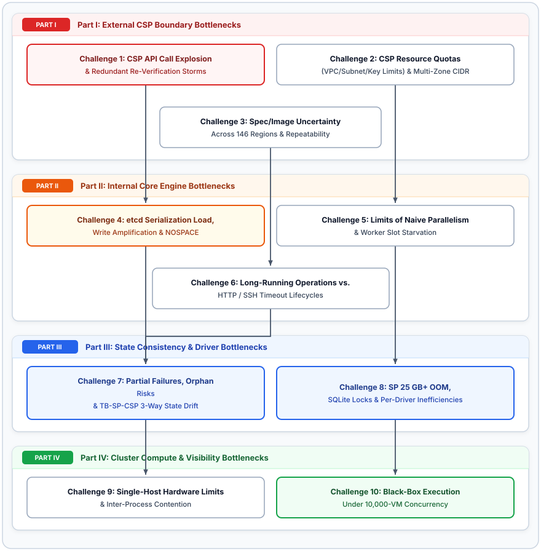

<details>
<summary>View Mermaid Source</summary>

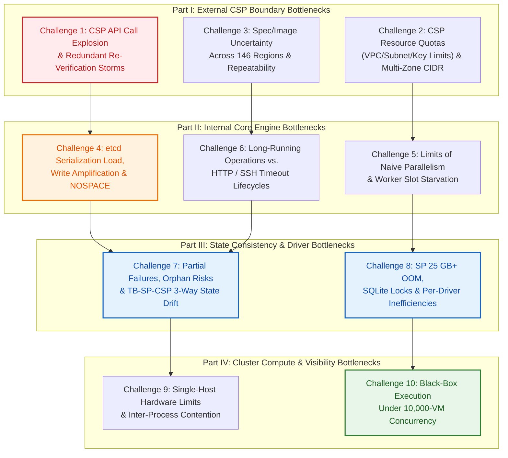

</details>

### Master Overview of Bottlenecks, Solutions & Measured Impact

| Part | Bottleneck (Challenge) | Core Architectural Solutions | Measured Impact (10,456-VM Benchmark) |
| :--- | :--- | :--- | :--- |
| **Part I** | **1. CSP API Call Explosion & Redundant Lookups** | Decoupling user reads from background status polling, 9-CSP Direct Batch/Bulk SDK integration, Singleflight & independent Public IP cache, Multi-tier client/metadata/verification cache, In-memory AccessInfo assembly & pruning auxiliary calls | **98.6% fewer CSP calls** (10,456 → ~146); AccessInfo query: **>120s timeout → 788.65 ms**; Resume Public IP lag: **+0.0 s** |
| **Part I** | **2. CSP Resource Quotas & Network Fragmentation** | Regional unified shared VNet, On-demand availability zone (AZ) subnets, Mutex-guarded non-overlapping CIDR allocation, Local RSA 2048 key generation + public key import | **438 / 438 (100%)** shared resources created in **192.41 s** across 146 regions with 0 VPC quota failures |
| **Part I** | **3. Spec/Image Uncertainty & Repeatability** | Declarative Infra templates, On-demand spec registration, Quota-aware risk analysis engine, Live PostgreSQL availability write-through | **99.60% (10,414/10,456)** provisioning success (100% across 9 CSPs); automatic dead-spec/zone exclusion |
| **Part II** | **4. etcd Load & Storage Bloat (NOSPACE)** | Hot dynamic status / Cold static etcd split, NodeGroup blueprint vs. compact per-node delta, OpenBao SSH private key offload, 6-tier query router, 50-worker parallel delete & 24h Compact+Defragment | **85-90% smaller node records** (8-12 KB → 0.8-1.2 KB); status query in **35.61 ms**; 10,418 keys deleted in **6.8 s** |
| **Part II** | **5. Naive Parallelism & 10-CSP Heterogeneity** | 10-CSP adaptive 3-level concurrency & timing, Early regional quota cancellation, Batched shared-resource associations, 10-CSP network/lifecycle quirk adaptations, GCP dedicated quota-wait slots (60) & dual SP semaphores (50 vs. 15), 5-tier adaptive polling | **15.70 VMs/s** sustained creation (663.26 s total); 10 CSPs across 146 regions orchestrated with 0 worker starvation |
| **Part II** | **6. Long-Running Ops vs. HTTP/SSH Timeouts** | Execution context detachment from HTTP request cancellation, Gateway timeout disabled (0s), 25m Infra operation lock, Active SSH readiness gate & real-time SSE streaming remote commands | **0 half-created orphan VMs** on client disconnect; non-blocking real-time SSH command streaming |
| **Part III** | **7. Partial Failures & 3-Way State Drift** | Partial failure policies (continue/refine/rollback), 3-tier fail-closed tombstone delete & dead-end IID auto-repair, Async SP IID purge & residual audit, Shared resource dependency recovery via existing resource registration, 2-Strike NotFound & immutability guards | 42 failed nodes refined in **1.83 s**; **438/438 shared resources deleted in 1 pass (149.85 s)**; **0 Undefined status regressions** |
| **Part III** | **8. SP OOM & Driver Inefficiencies** | Disabling synchronous SSH access checks & unused recent-history goroutines ([PR #1846](https://github.com/cloud-barista/cb-spider/pull/1846)), SQLite to PostgreSQL migration, 10-CSP 3-stage driver overhaul ([PR #1865](https://github.com/cloud-barista/cb-spider/pull/1865)), OS type hint ([PR #1909](https://github.com/cloud-barista/cb-spider/pull/1909)), Targeted Azure/IBM/KT fixes | **SP peak RAM: 25 GB+ (OOM) → 385-514 MiB (~98% cut)**; single-VM query latency **-12% to -78%**; NCP create **-59%** |
| **Part IV** | **9. Hardware Limits & Process Contention** | Kubernetes Helm umbrella chart, Data-locality co-location (podAffinity), Driver compute isolation (podAntiAffinity), OpenBao auto-init & auto-unseal sidecar | Complete CPU/GC/network isolation between TB (777 MiB) and SP (514 MiB) |
| **Part IV** | **10. Black-Box Execution at 10k Scale** | On-demand toggleable observability stack, Cardinality-safe 3-layer unified JSON log schema (single-line compaction), LogQL live in-flight request table, 2 custom Grafana dashboards | Real-time correlation of Inbound API, SP, Direct SDK, etcd WAL fsync, and pod CPU/RAM |

---

# Part I. Breaking External Cloud API & Resource Quota Barriers

## 2. Challenge 1: CSP API Call Explosion & Redundant Re-Verification Storms

### 2.1 Problem Diagnosis
In a traditional synchronous architecture, every user status check, lifecycle control action (Suspend, Resume, Terminate), Public IP lookup, or SSH access-info query translates into O(N) individual CSP API calls routed through SP. At N = 10,456 VMs, a single status poll or control operation triggers **10,000+ API requests**, immediately exhausting CSP rate limits (`RequestLimitExceeded` / `429 Too Many Requests`), dropping HTTP sessions, and triggering retry storms.

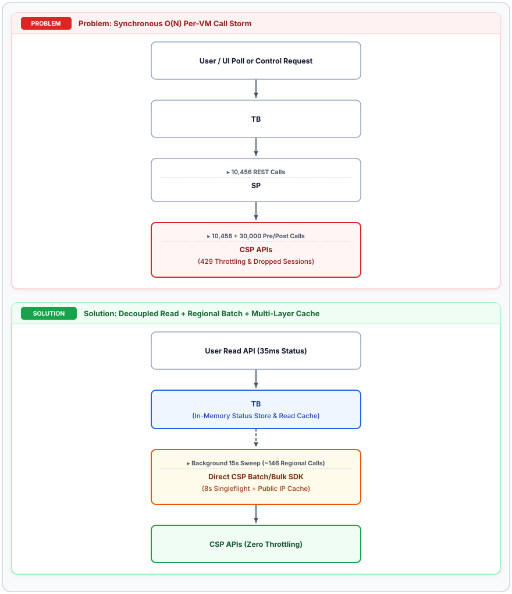

<details>
<summary>View Mermaid Source</summary>

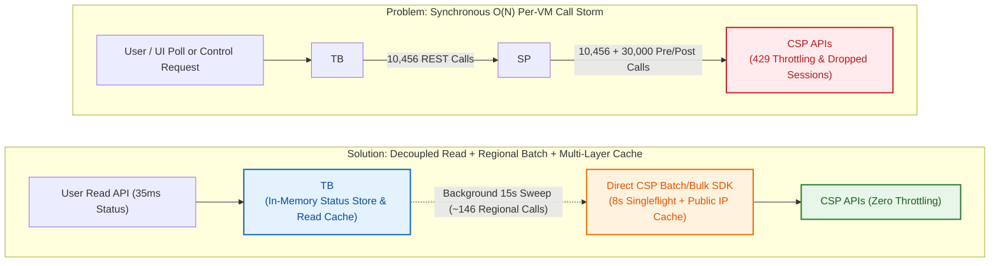

</details>

To resolve this bottleneck, TB combines five core mechanisms: (1) decoupling user read APIs from CSP polling paths, (2) replacing per-VM CSP calls with direct regional batch/bulk SDK operations, (3) adding lock-free singleflight status and Public IP caches over the batch path, (4) adding multi-tier client, metadata, and verification caches over internal SP calls, and (5) eliminating hidden per-VM calls in AccessInfo and provisioning.

---

### 2.2 Decoupling User Read APIs from CSP Polling
When user read requests directly trigger outbound CSP calls, any UI refresh or CLI status check during a 10,000-VM deployment causes an API storm.
- **Decoupling Mechanism**: User read APIs never call SP or CSPs. They read exclusively from the in-memory status store, while the background status synchronization daemon asynchronously refreshes statuses according to node priority.

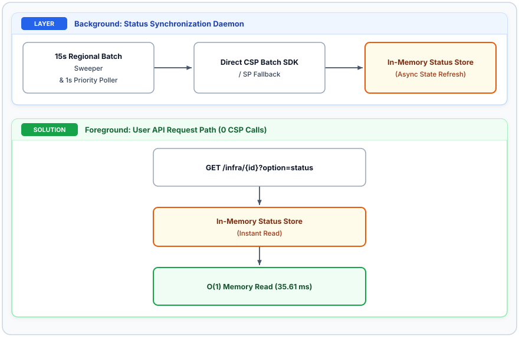

<details>
<summary>View Mermaid Source</summary>

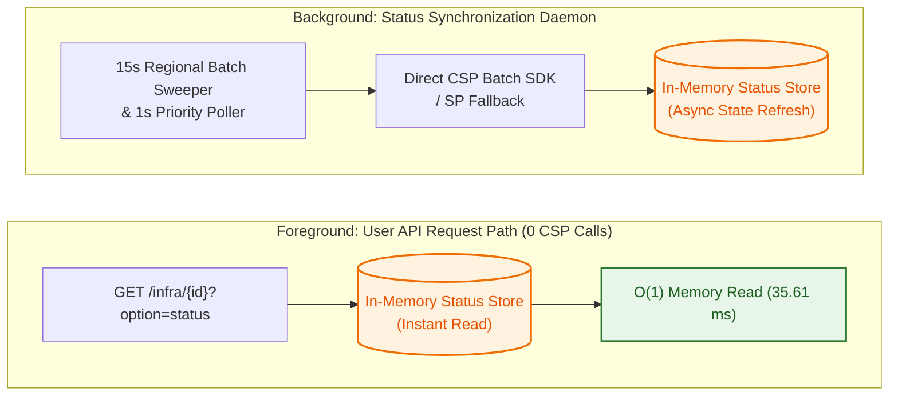

</details>

---

### 2.3 Direct CSP SDK Hybrid Control Plane to Overcome SP Abstraction Limits
Even after decoupling status polling into the background, relying solely on SP's **1:1 single-resource REST abstraction** hits **four structural abstraction barriers** at 10,456 VMs:
1. **No Batch/Bulk Abstraction**: Every REST call maps to 1 VM, forcing O(N) round-trips.
2. **Synchronous Blocking Waits Until Control Completion**: SP drivers (especially Azure) block synchronously until completion during Suspend/Resume/Reboot, serializing thousands of concurrent lifecycle transitions.
3. **SP IID Database Blindness**: If a VM creation call times out before SP persists its identifier (IID), or if VM deletion leaves behind detached residual resources (NIC, ENI, PublicIP, EIP, FloatingIP, Disk), SP's abstraction cannot see or clean them up.
4. **No Live Quota, Per-AZ Stock, or Dynamic Image-Family Abstraction**: SP's static catalog does not expose live account/family vCPU quota usage, runtime per-AZ stock exhaustion, date-stamped public image family rotation, or CSP-suggested alternative zones.

To overcome these limits without sacrificing multi-cloud uniformity, TB implements a **Hybrid Control Plane**: standard 1:1 provisioning flows through SP, while **9 high-scale functional domains** **directly execute native CSP SDKs (AWS, GCP, Azure, Alibaba, Tencent, IBM, NCP, NHN, KT, OpenStack)** backed by an OpenBao direct credential pipeline.

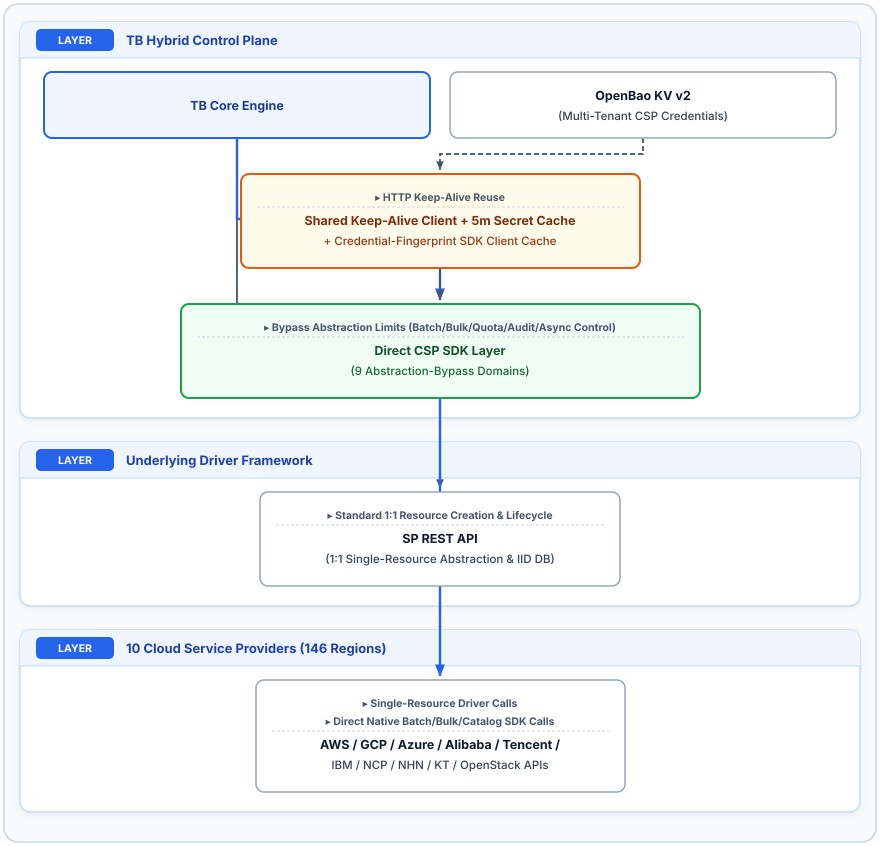

<details>
<summary>View Mermaid Source</summary>

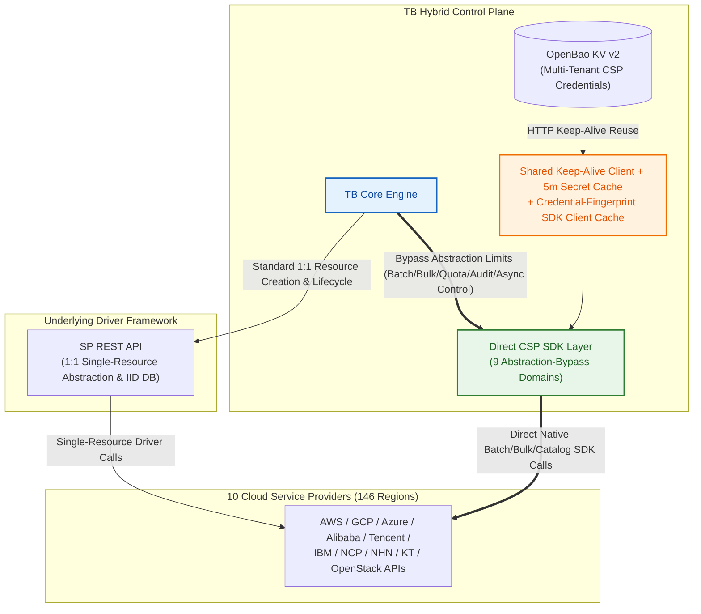

</details>

#### (1) OpenBao Direct Multi-Tenant Credential Pipeline & Rotation-Safe SDK Client Cache
- **OpenBao Keep-Alive & 5m Secret Cache**: Fetches credentials directly from OpenBao KV v2 via a process-wide HTTP keep-alive connection pool (so 10,000-VM sweeps never exhaust ephemeral ports) paired with a 5-minute TTL secret cache.
- **Rotation-Safe SDK Client Cache**: Caches authenticated CSP SDK clients (including IAM/OAuth tokens) under a composite key of the account identifier and a SHA-256 credential fingerprint. If a credential rotates in OpenBao, the fingerprint changes immediately, evicting the superseded client and creating a fresh one seamlessly.

#### (2) Complete 9-Domain Direct CSP SDK Capability Matrix

| Domain | Structural Limit of SP Abstraction | Direct CSP SDK Resolution Mechanism |
| :--- | :--- | :--- |
| **1. Regional/Subscription/Project Batch Status** | Single-VM status endpoint queries 1 VM at a time (10,456 calls per sweep) | AWS (up to 1,000 IDs/call), GCP (1 aggregated call/project across 41 regions), Azure (1 stream/subscription), 6 other CSPs (100 IDs/page) & OpenStack |
| **2. Native Bulk Control & Non-Blocking Async Control Initiation** | Single-VM control only; Azure driver blocks synchronously until completion | **AWS**: Bulk Start/Stop/Terminate APIs.<br/>**Azure**: Initiates async power-off/start/restart requests (concurrency 20) and **returns immediately without waiting for completion**, letting the background batch sweeper track convergence. Normal Terminate stays on SP to clean up NIC/PublicIP, while ghost VMs are terminated directly |
| **3. Targeted Orphan VM Lookup by UID** | If VM creation times out before IID persistence, SP has no record of the created VM | Queries 9 public CSPs + OpenStack using targeted Name/Tag filters (e.g., AWS batches of 200 UIDs) to locate timed-out VMs without scanning entire regions |
| **4. Direct CSP Truth Inventory & Residual Cleanup** | Cannot see untracked VMs or clean up detached orphaned NICs/PublicIPs/Disks | Inspects live CSP assets directly, matches TB ownership via naming conventions or management tags, and deletes orphaned NIC, ENI, PublicIP, EIP, FloatingIP, disk, and volume resources |
| **5. Live Account vCPU Quota & AZ Sold-Out Overlay** | Static catalog lacks live vCPU quota usage and per-AZ stock exhaustion | Queries SKU restrictions and **live account/family vCPU quotas** across 9 CSPs (Singleflight + asymmetric CPU/GPU TTLs), and overlays a per-AZ sold-out cache to block only the specific AZ that hit runtime capacity exhaustion |
| **6. Structured Failure Parser & Suggested Zone Extractor** | Raw SP error strings contain noisy HTTP header dumps, secrets, and unstructured messages | 8 CSP analyzers strip HTTP headers, redact secrets, classify errors (account quota, zone capacity, throttling, etc.), and extract **CSP-offered alternative zones** and retry hints |
| **7. Dynamic Latest Image Family Resolution & Direct Pricing** | Providers like Alibaba deprecate date-stamped public image IDs, breaking static catalogs | **Alibaba**: Resolves image families dynamically (10m TTL + Singleflight) at creation time.<br/>**Azure**: Resolves latest image URNs dynamically. Direct SDK pricing for AWS/Azure/GCP/Alibaba |
| **8. Single-Call Batch Tag Upsert** | SP tag APIs apply tags one by one, multiplying API calls | Directly calls AWS, Azure, and GCP native tag APIs to upsert all resource tags in a single SDK call |
| **9. GCP Security Group In-Use Check** | GCP allows deleting firewall rules even when running VMs still carry the network tag | Queries GCP project-wide instances directly before SG deletion and blocks deletion if any non-terminated VM still references the firewall tag |

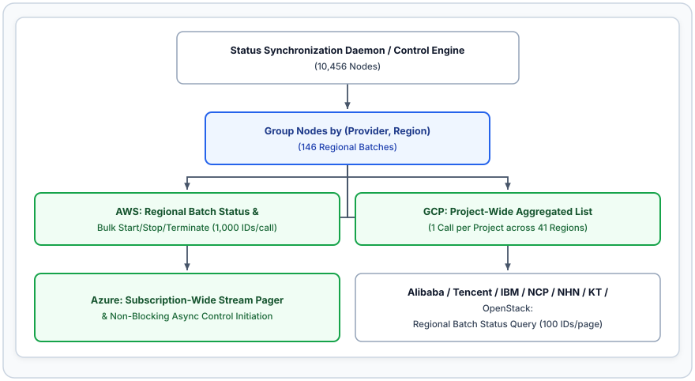

<details>
<summary>View Mermaid Source</summary>

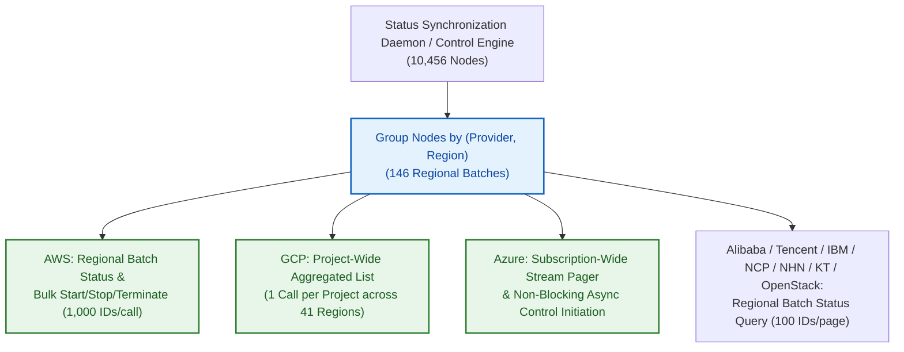

</details>

| CSP | Nodes in Benchmark | Legacy Per-VM Calls / Cycle | Direct Batch Calls / Cycle | Call Reduction |
| :--- | :---: | :---: | :---: | :---: |
| **AWS** (27 Regions) | 10,254 | 10,254 | **27** (1,000 IDs/page) | **-99.7%** |
| **GCP** (41 Regions) | 41 | 41 | **1** (aggregated call per project) | **-97.6%** |
| **Azure** (37 Regions) | 42 | 42 | **1** (stream pager per sub) | **-97.6%** |
| **Alibaba / Tencent / IBM / NCP / NHN / KT** | 115 | 115 | **38** (1 per region/zone) | **-67.0%** |
| **Total (10,456 VMs)** | **10,456** | **10,456** | **~67-146** | **-98.6% to -99.3%** |

---

### 2.4 Lock-Free Singleflight Batch Status Cache & Zero-Lag Public IP Extraction
Concurrent sweeps and lifecycle operations can query the same region at the same time; moreover, when 10,414 VMs Resume from Suspended, clouds assign **new dynamic Public IPs**. Fetching 10,212 new AWS Public IPs via individual SP VM calls would take **8-12 minutes**.
- **Lock-Free Singleflight Batch Status Cache**: Coalesces concurrent regional batch status requests within an 8s TTL window using per-region inflight channels outside the cache mutex. If a waiting caller's target instance ID is absent from the coalesced batch, it performs a targeted re-query.
- **Zero-Lag Independent Public IP Cache**: Because AWS batch instance responses already include each VM's Public IP, TB stores every instance's IP into an independent in-memory map during the batch status sweep. When the sweeper sees a node reach Running, it reads the new Public IP directly from memory, populating **10,212 AWS Public IPs with 0 SP calls and +0.0 s lag**.

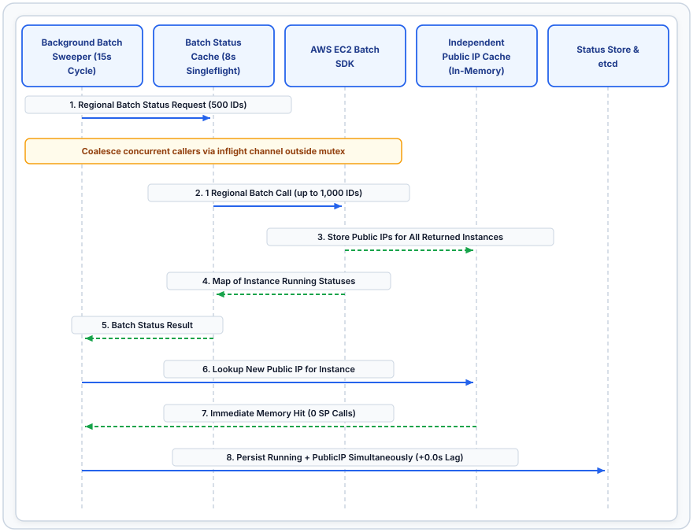

<details>
<summary>View Mermaid Source</summary>

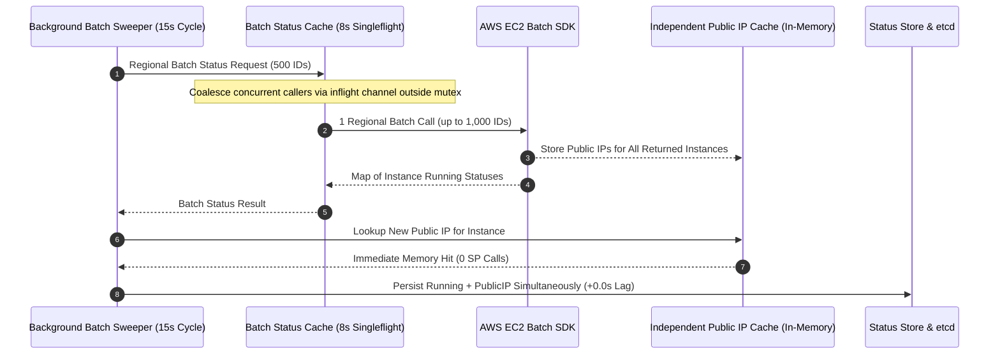

</details>

---

### 2.5 Multi-Layered Client, Metadata & Resource Verification Caching
During provisioning, 10,456 node worker goroutines repeatedly query connection configs, cloud regions, specs, images, and shared resource readiness (VNet, SG, SSHKey). TB applies a 3-layer caching hierarchy to eliminate redundant internal calls:
1. **Internal HTTP Client Cache, Queue-Wait Coalescing & Circuit Breaker**:
   - **Tiered TTLs**: Applies graduated TTLs (1s, 2s, 5s, 10s, 60s, 300s) based on data volatility.
   - **SHA-256 Body-Hashed Cache Keys**: Computes `GET_{url}_{sha256(body)}` so SP GET requests carrying JSON bodies preserve exact identity without leaking credentials in plaintext keys or logs.
   - **Queue-Wait Cache Coalescing**: Caps concurrent outbound requests per key at 20. Excess workers sleep 2s (up to 8 retries) and **re-check the client cache on every wakeup**, returning immediately once the leader populates the cache.
   - **Circuit Breaker & Transient Retry**: Opens for 30s after 5 consecutive failures; retries idempotent GET/HEAD calls (up to 3 times, 5s exponential backoff + jitter) on transient network or rate-limit errors.
2. **Metadata & Credential Cache**: Caches connection configs, region details, specs, images, and OpenBao-backed CSP SDK clients/tokens in memory.
3. **Shared Resource Verification TTL Cache**: Caches VNet/SG/SSHKey existence verification for 30s (standard check) and 5m (confirmed check).

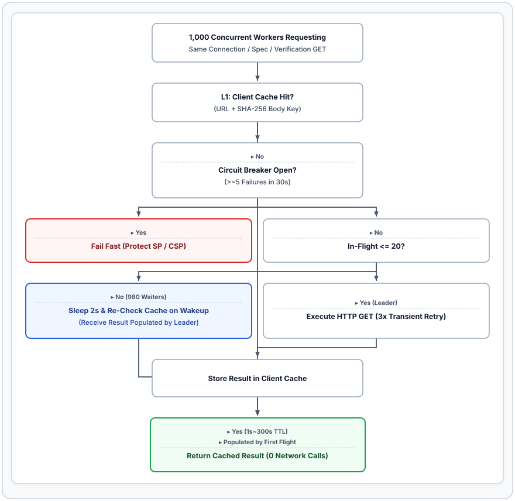

<details>
<summary>View Mermaid Source</summary>

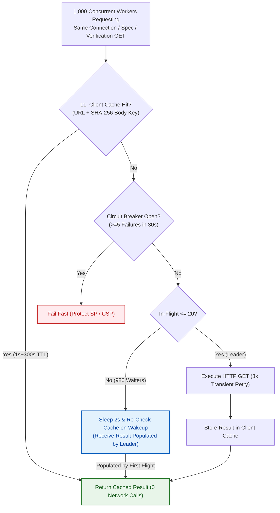

</details>

---

### 2.6 In-Memory AccessInfo Assembly & Pruning Per-VM Provisioning Calls
To eliminate the remaining O(N) per-VM calls in SSH access retrieval (`?option=accessinfo`) and post-creation metadata syncing:
- **In-Memory AccessInfo Assembly**: Replaced 10,456 runtime SP VM and SSHKey calls (>120s timeout) with an in-memory assembly from the read cache plus **1 local lookup per unique SSHKey ID (~146 regional keys)**, cutting response time to **788.65 ms** (over 152× faster).
- **Skipping Redundant Per-VM CSP Tag Sync**: Eliminated 1-2 post-create CSP tag API calls per VM (>10,000 calls saved), indexing labels locally in TB.
- **NodeGroup-Level OS Type Pre-Resolution & Hinting**: Pre-resolves image metadata and OS type (Windows vs. Linux) **once per NodeGroup** instead of per node, passing the OS hint directly to SP.

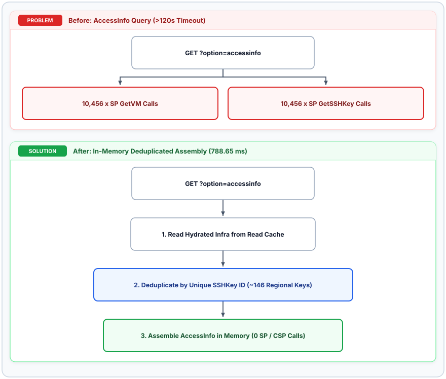

<details>
<summary>View Mermaid Source</summary>

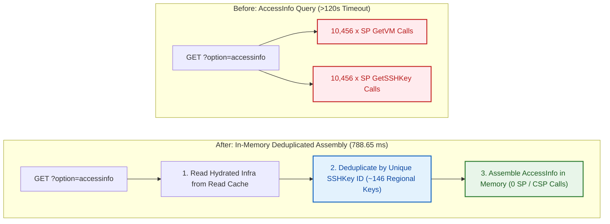

</details>

---

## 3. Challenge 2: CSP Physical Resource Quotas & Multi-Zone Network Fragmentation

### 3.1 Problem Diagnosis
Even when API rate limits are controlled, cloud providers enforce strict **per-region resource count quotas** (for instance, AWS allows only **5 VPCs per region** by default). Creating a separate VNet/SecurityGroup/SSHKey per NodeGroup immediately fails with `VpcLimitExceeded` when multiple node groups target the same region. Furthermore, pre-creating subnets across all availability zones wastes time and quota, concurrent multi-zone subnet creation causes CIDR collisions, and calling CSP key-generation APIs hits strict rate limits on providers like NCP.

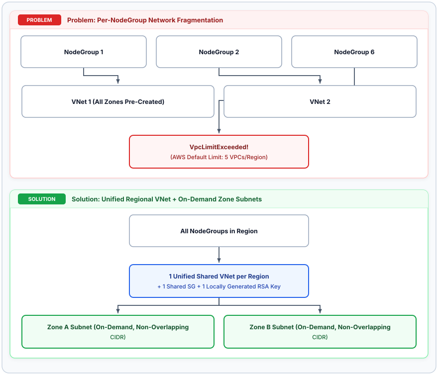

<details>
<summary>View Mermaid Source</summary>

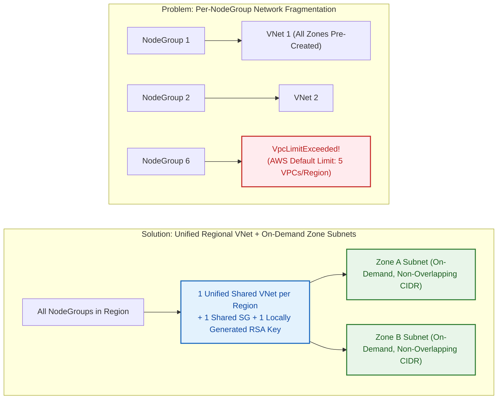

</details>

---

### 3.2 Unified Regional Shared VNet Architecture
Consolidates network topology so TB provisions **exactly 1 shared VNet, 1 shared Security Group, and 1 shared SSH Key per (Provider, Region)**, regardless of how many NodeGroups or thousands of VMs are deployed in that region.

### 3.3 On-Demand Zone Subnet Expansion & Mutex-Guarded CIDR Allocation
The regional shared VNet starts with a single base subnet. When a NodeGroup targets a specific availability zone that does not yet have a subnet in the shared VNet, TB serializes subnet expansion per VNet via a mutex, automatically calculates a non-overlapping private CIDR block, and attaches the zone subnet on demand.

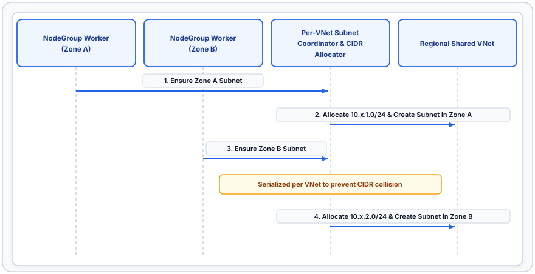

<details>
<summary>View Mermaid Source</summary>

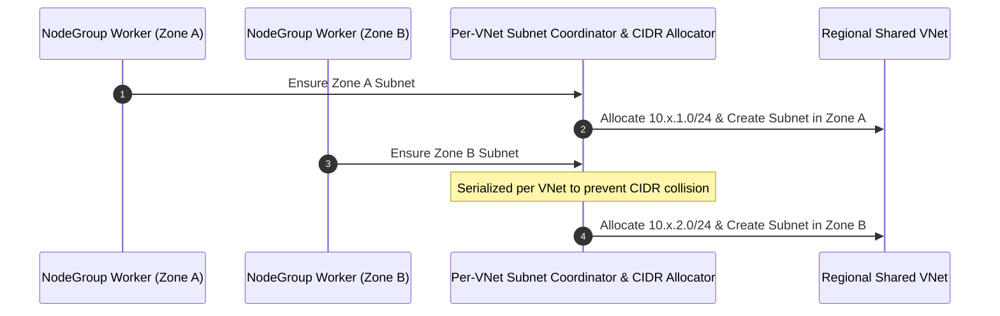

</details>

### 3.4 Local RSA 2048 Key Generation + Public Key Import
Instead of invoking CSP key-pair generation APIs (which frequently throttle or fail under multi-region bursts), TB generates RSA 2048 key pairs locally in ~5ms, stores the private key in **OpenBao**, and imports only the public key to the CSP (NCP, AWS, Azure, GCP).

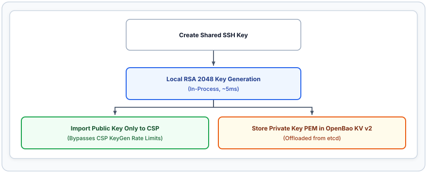

<details>
<summary>View Mermaid Source</summary>

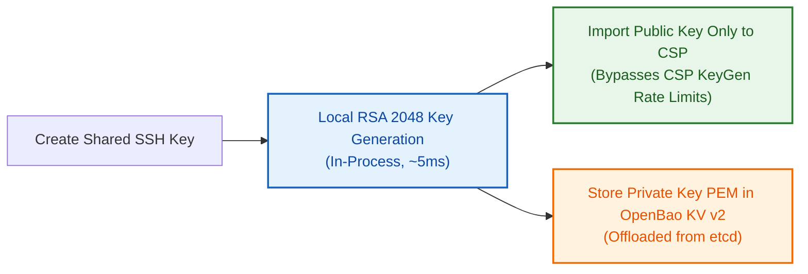

</details>

---

## 4. Challenge 3: Spec/Image Uncertainty Across 146 Regions & Test Repeatability

### 4.1 Problem Diagnosis
Across 10 CSPs and 146 regions, VM specs and OS images frequently suffer from regional capacity exhaustion (sold-out zones), architecture mismatches, or uncatalogued spec names. Sending hundreds of VM creation requests to a sold-out spec wastes minutes of API quota. Conversely, if a risk engine naively blacklists specs whenever *any* failure occurs, hitting a regional vCPU quota limit at 500 VMs will falsely blacklist a healthy spec.

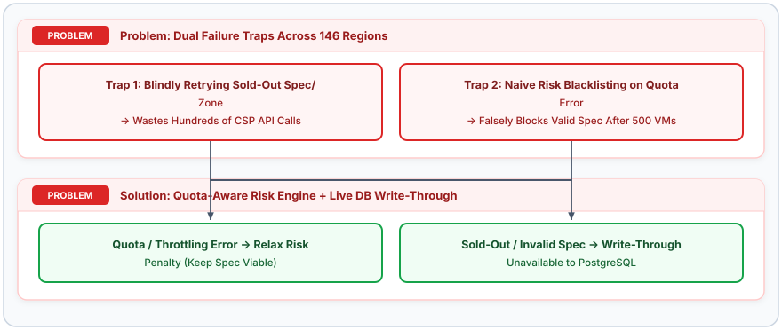

<details>
<summary>View Mermaid Source</summary>

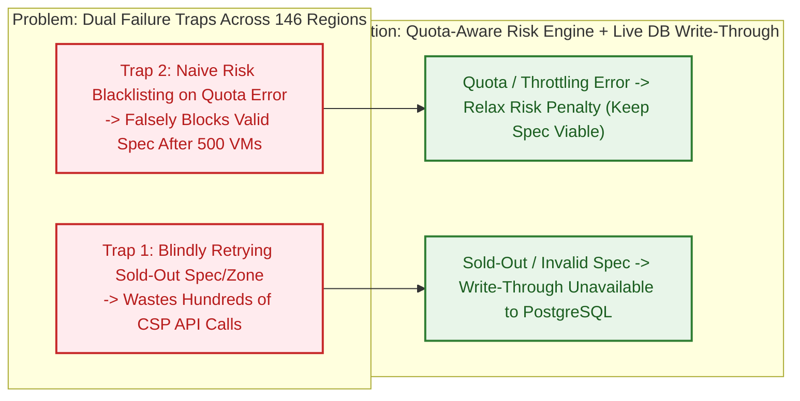

</details>

---

### 4.2 Declarative Infra Template System & On-Demand Spec Registration
- **Declarative Templates**: Codifies 10-CSP, 146-region, 10,456-VM topologies into versioned JSON templates (`infra-global-extream`) with pre-flight validation for repeatable single-command benchmarking.
- **On-Demand Spec Registration**: Dynamically fetches and registers valid CSP specs missing from the local catalog during provisioning instead of failing the deployment.

### 4.3 Direct SDK Live Quota/Availability Check, Dynamic Image Resolution & PostgreSQL Write-Through
- **Direct SDK Live Quota Check & AZ Sold-Out Overlay**:
  - Checks SKU restrictions and **live account/family vCPU quota usage** directly across 9 CSP SDKs (Singleflight), applying **asymmetric TTLs** tuned to hardware volatility (Standard CPU: Available 1h / QuotaExceeded 5m / SoldOut 1m; GPU/Accelerator: Available 5m / QuotaExceeded 2m / SoldOut 1m).
  - **Per-AZ Pinpoint Sold-Out Overlay**: Because AWS and GCP offering APIs only indicate whether a spec is *offered* in a zone (not real-time stock), runtime capacity errors (`InsufficientInstanceCapacity`) in a specific AZ (e.g., `eu-central-2a`) are recorded in an AZ sold-out cache, marking **only that specific AZ SoldOut while keeping sibling AZs (`eu-central-2b/c`) available**.
- **Dynamic Latest Image Family Resolution**: Prevents broken deployments when providers like Alibaba deprecate date-stamped public image IDs by resolving image families (10m TTL + Singleflight) and Azure latest image URNs directly via CSP SDK at provisioning time without modifying SP.
- **Structured CSP Failure Analysis & Quota-Aware Risk Evaluation**: 8 CSP-specific analyzers strip noisy HTTP header dumps, redact secrets, classify failures (account quota, zone capacity, throttling, image-spec mismatch), and extract **CSP-offered alternative zones**. Quota and throttling errors relax risk penalties so valid specs remain viable, while invalid specs/images write through immediately to PostgreSQL so subsequent runs automatically exclude them.

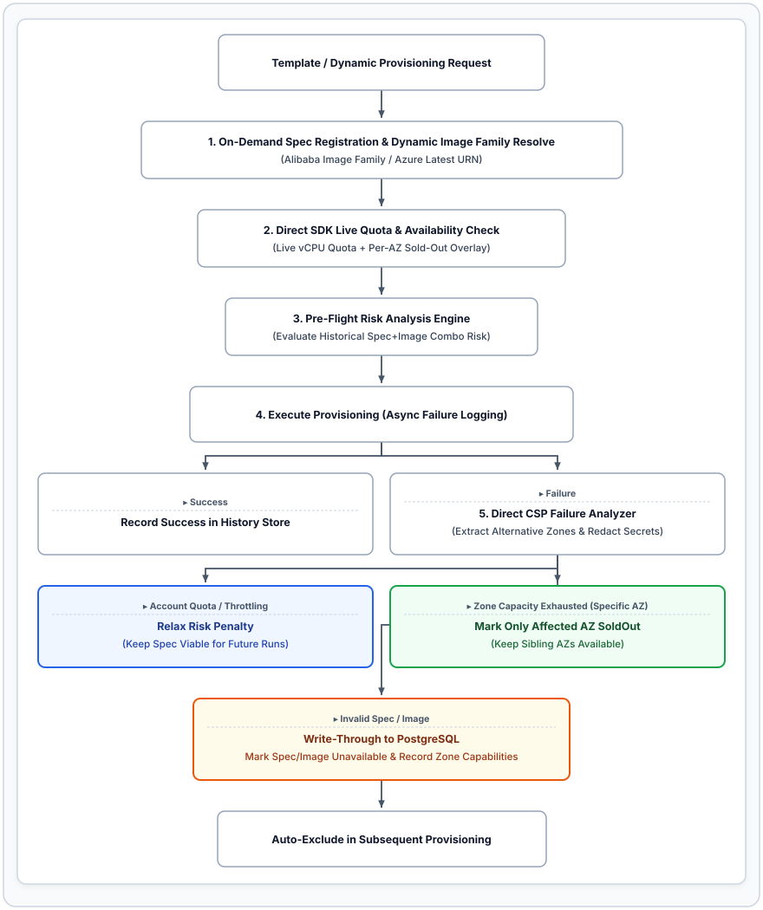

<details>
<summary>View Mermaid Source</summary>

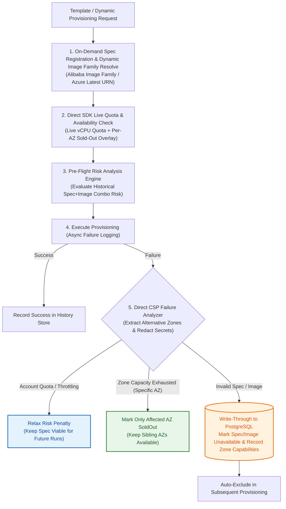

</details>

---

# Part II. Engineering the Internal Core: Storage, Concurrency & Lifecycles

## 5. Challenge 4: etcd Serialization Load, Write Amplification & Storage Bloat (NOSPACE)

### 5.1 Problem Diagnosis
In the legacy storage model, every VM was persisted in etcd as a full node JSON document (8-12 KB) duplicating ~45 shared fields (Spec, Image, VNet, SecurityGroups, SSHKey, Location, etc.). At 10,456 VMs:
1. A single `GET /infra/{id}` required reading and unmarshaling **~100 MB of JSON** from etcd.
2. Every 15-second status or Public IP update rewrote the entire 10 KB node JSON, causing severe MVCC revision write amplification that exhausted etcd's default 2 GiB quota (`mvcc: database space exceeded` / `NOSPACE`).

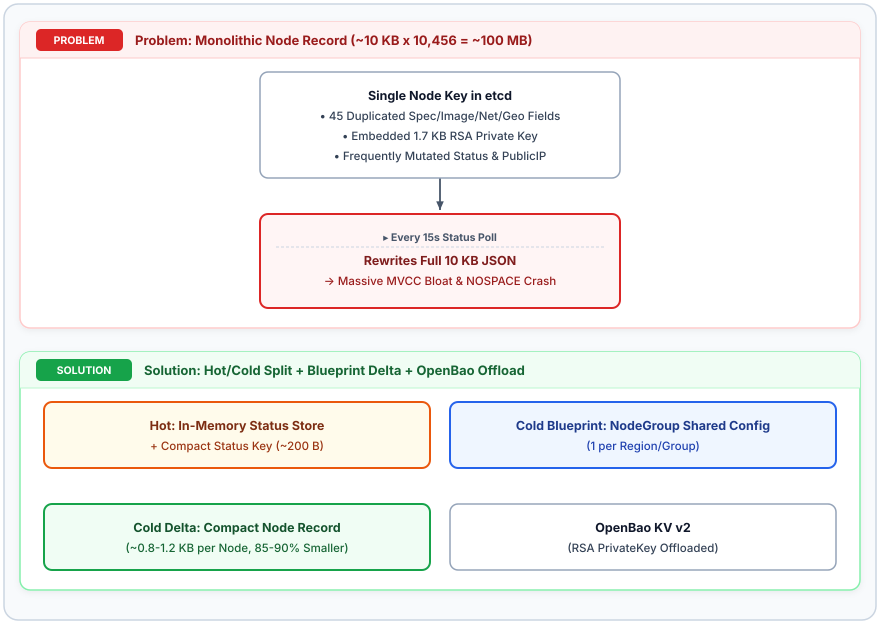

<details>
<summary>View Mermaid Source</summary>

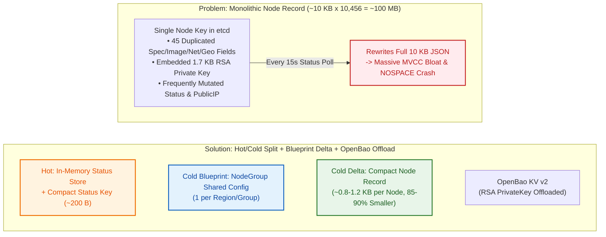

</details>

---

### 5.2 Hot (Status Store) vs. Cold (etcd) Storage Separation
High-frequency status mutations are isolated from static node configuration to eliminate MVCC write amplification.
- **Mechanism**: Dynamic fields (Status, NativeStatus, TargetStatus, PublicIP, SSHPort) live in the in-memory status store and write to lightweight status keys (~200 B) **only when the status or IP actually changes**, reducing etcd status write volume by **~95%**.

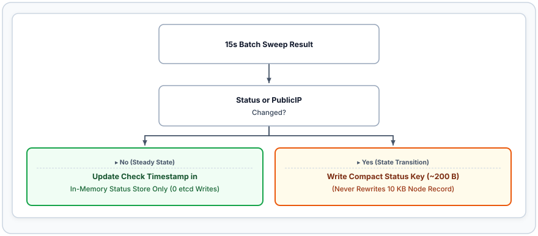

<details>
<summary>View Mermaid Source</summary>

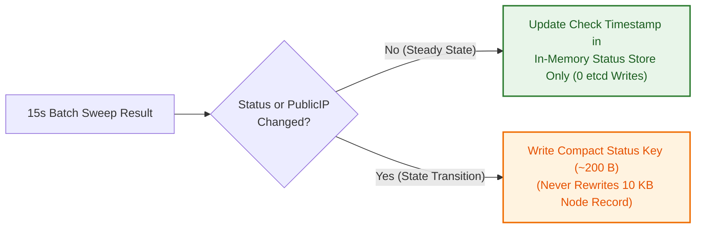

</details>

---

### 5.3 NodeGroup Blueprint vs. Compact Per-Node Delta
Cold node records are shrunk by an order of magnitude so 10,000-node reads and initial writes remain sub-second.
- **Mechanism**: Common configuration (~45 fields) is stored **once** in the NodeGroup blueprint. Shared fields are stripped before writing each compact node delta (0.8-1.2 KB). On read, 50 parallel workers merge the NodeGroup blueprint, compact node delta, and in-memory status in memory (Hydration).

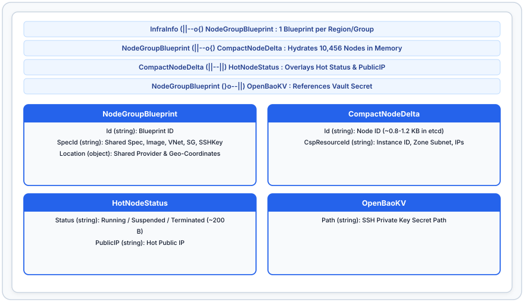

<details>
<summary>View Mermaid Source</summary>

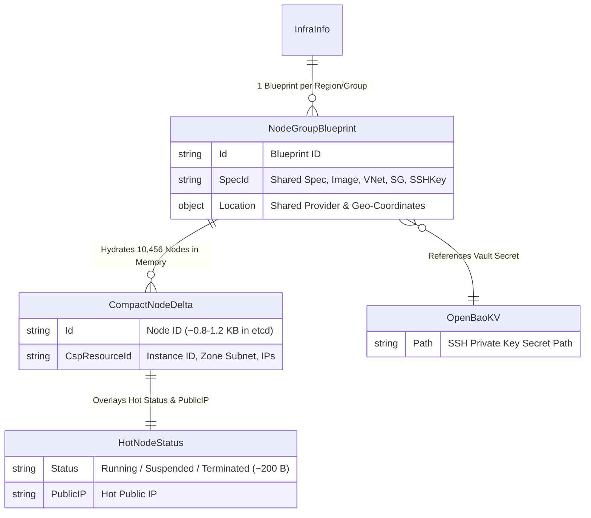

</details>

| Storage Metric (10,456-Node Infra) | Legacy Monolithic Node Record | Blueprint + Compact Delta + Status Split | Improvement |
| :--- | :---: | :---: | :---: |
| **Per-Node etcd Record Size** | 8-12 KB | **0.8-1.2 KB** | **85-90% smaller** |
| **Total etcd Payload per 10k Infra** | ~95-120 MB | **~10-12 MB** | **~90% reduction** |
| **Payload Written per Status Change** | ~10 KB | **~200 B** (compact status key) | **~98% smaller write** |

---

### 5.4 6-Tiered Query Router & 5s Read Cache (Singleflight)
Different API callers require different projections of an Infra. TB routes each query option to the lightest storage path:

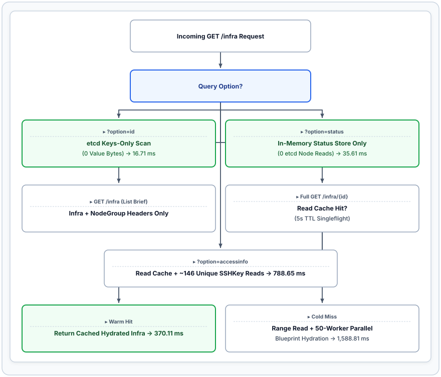

<details>
<summary>View Mermaid Source</summary>

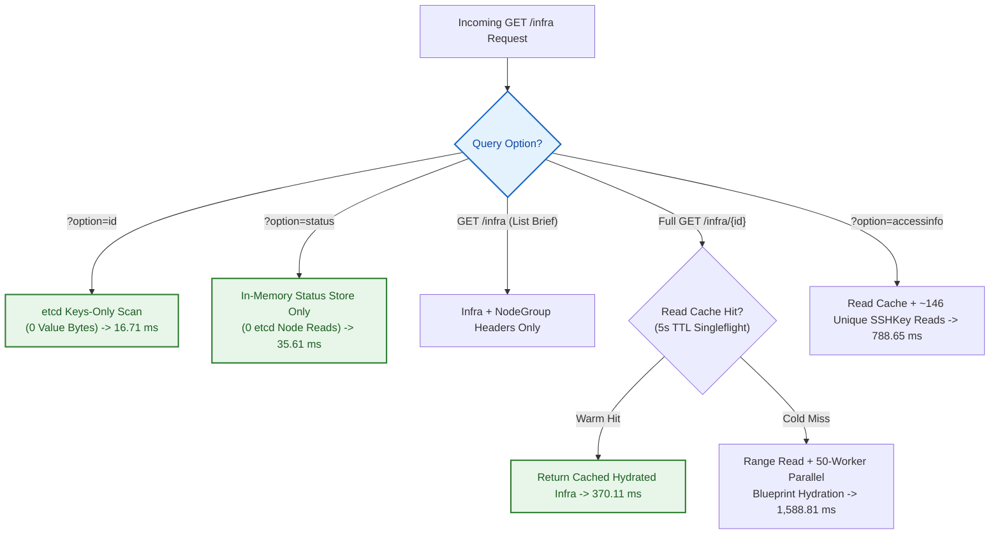

</details>

---

### 5.5 50-Worker Parallel etcd Deletion & 24h Compact+Defragment Loop
Deleting 10,418 node keys sequentially takes minutes, and repeated 10,000-VM test cycles fragment etcd's BoltDB file on disk.
- **4-Phase Parallel Delete**: Uses a 50-worker bounded semaphore to delete 10,418 node and status keys in **6.8 s (~1,550 keys/sec)**.
- **Automatic Compact + Defragment Loop**: Because etcd's auto-compaction only marks MVCC revisions as reusable internally without shrinking the BoltDB file on disk, TB runs **MVCC Compaction followed by Disk Defragmentation** on startup and every 24h, paired with an 8 GiB backend quota.

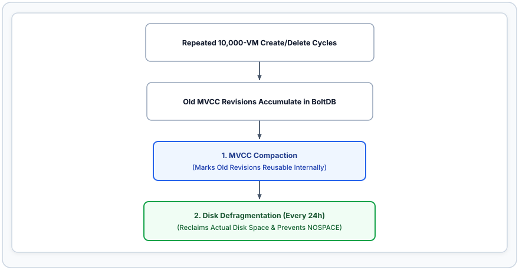

<details>
<summary>View Mermaid Source</summary>

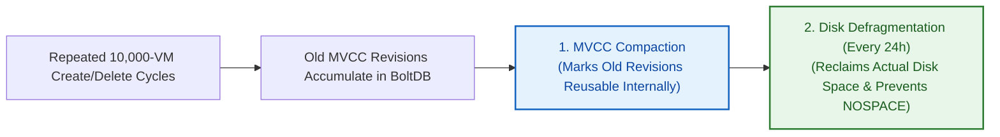

</details>

---

## 6. Challenge 5: Limits of Naive Parallelism: 10-CSP Adaptive Orchestration & Worker Starvation Prevention

### 6.1 Problem Diagnosis
The 10 supported Cloud Service Providers (AWS, GCP, Azure, Alibaba, Tencent, IBM, NCP, NHN, KT, OpenStack) differ drastically in API rate limits, network/VPC rules, and asynchronous operation handling. Driving 10,456 goroutines with uniform parallelism causes **three compounding failure modes**:
1. **Clashing Per-CSP API Rate Limits & Architectural Constraints**: While AWS, GCP, and Azure tolerate 20 concurrent VM creations per region, **Tencent Cloud enforces a strict 10 req/sec account-wide API limit**, causing 20 concurrent creations to fail immediately with `RequestLimitExceeded`. Furthermore, **NCP** requires all subnets in a VPC to reside in a single zone, **GCP** rejects VPC-level CIDR blocks, and **KT Cloud** operates a single account-wide VPC where leftover tiers trigger `409 duplicate network cidr` collisions.
2. **Head-of-Line Blocking / Worker Starvation in Flat Semaphore Pools**: Rate-limited workers (e.g., GCP `READ_REQUESTS` quota backoff) sleep for 15-60 seconds while holding active region/node semaphore slots, blocking healthy regions; similarly, after a 10,000-VM Resume, hundreds of fallback Public IP lookup goroutines flood the 50 global SP slots, starving status polling for minutes.
3. **Wasted Queue Execution in Quota-Exhausted Regions & Serial etcd Association Bottlenecks**: Once a region hits account vCPU quota or capacity exhaustion, hundreds of queued workers continue firing doomed API calls; upon completion, 10,000 nodes updating shared VNet/SG/SSHKey association lists cause 50,000+ serial Read-Modify-Write transactions in etcd.

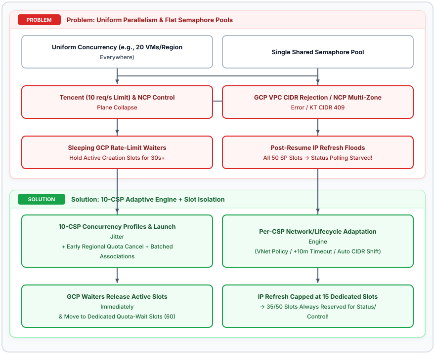

<details>
<summary>View Mermaid Source</summary>

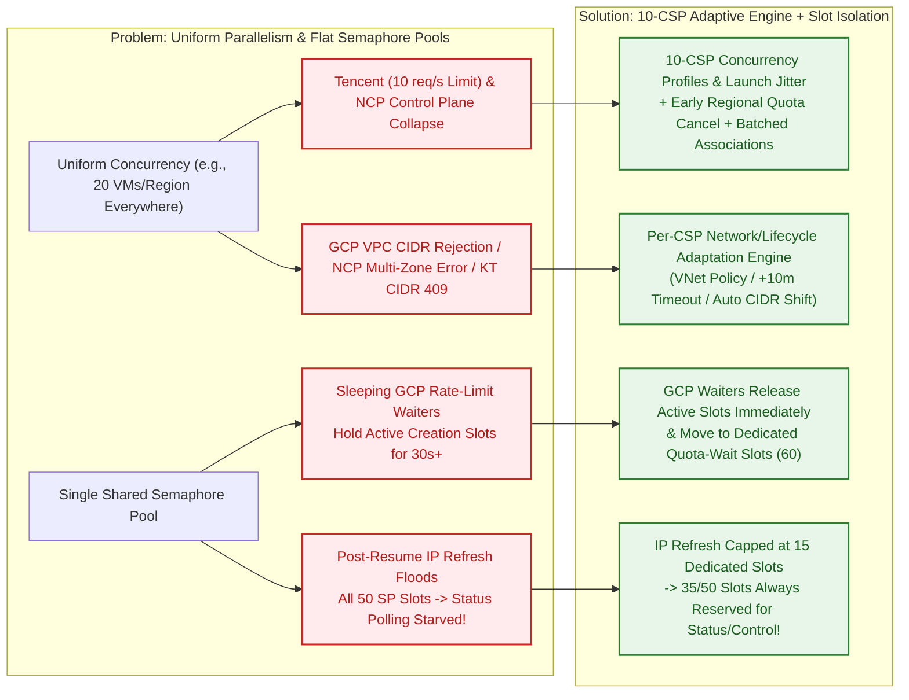

</details>

---

### 6.2 10-CSP 3-Level Concurrency & Timing Control and Early Regional Quota Cancellation
TB centralizes per-CSP API capacities and rate-limit policies into a unified concurrency registry, tuning creation, status polling, and resource registration concurrency and staggering per provider:
1. **3-Level Hierarchical Concurrency Control (CSP → Region → Node)**:
   - **Level 1 (10 Independent CSP Execution Trees)**: All 10 CSPs execute in parallel goroutine trees so slower providers (e.g., NCP, NHN) never delay high-throughput providers (e.g., AWS, Alibaba, GCP). Derived clouds like `openstack-new01` automatically map to the OpenStack profile.
   - **Level 2 (Per-CSP Concurrent Region Semaphores)**: Controls concurrent active regions per CSP for creation (30 for most, 5 for NCP), status polling (3-12), and resource registration (2-5).
   - **Level 3 (Per-Region Node Semaphores + 0-5s Launch Jitter + 6-Step Throttle Backoff)**: Tunes concurrent VM creations per region by provider (20 standard, 15 for NCP, **5 for Tencent to respect its 10 req/s account limit**), adding 0-5s random launch jitter per VM to smooth burst peaks and a 6-step exponential backoff (5s, 10s, 20s, 40s, 60s + 0-3s jitter) on rate-limit errors.
2. **Early Regional Quota/Capacity Cancellation**:
   - The moment any worker in a region encounters a quota or capacity exhaustion error, TB **immediately cancels all queued workers waiting on that region's semaphore before they make any API call**.
   - Workers that have already acquired the semaphore and started an SP call continue on the parent context so no half-created untracked VMs are left behind.
3. **Batched Shared-Resource Association Updates**:
   - Skips individual association list updates during VM creation and merges all created node IDs in **a single Read-Modify-Write per shared resource (VNet, Subnet, SG, SSHKey)** after the goroutines finish, eliminating **50,000+ serial etcd transactions**.

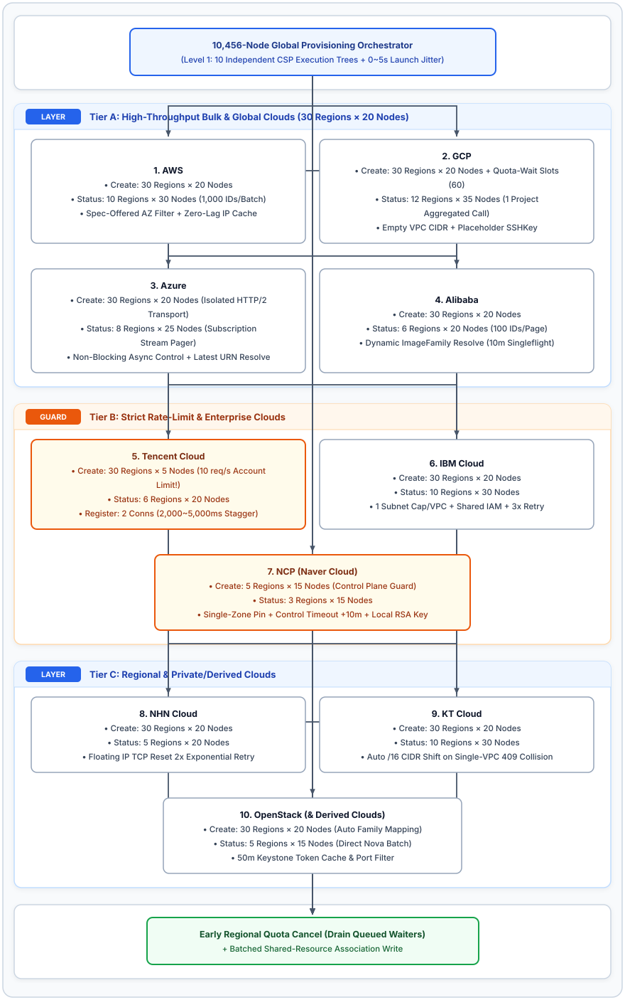

<details>
<summary>View Mermaid Source</summary>

```mermaid
flowchart TD
    START["10,456-Node Global Provisioning Orchestrator<br/>(Level 1: 10 Independent CSP Execution Trees + 0~5s Launch Jitter)"]

    subgraph "Tier A: High-Throughput Bulk & Global Clouds (30 Regions × 20 Nodes)"
        AWS["1. AWS<br/>• Create: 30 Regions × 20 Nodes<br/>• Status: 10 Regions × 30 Nodes (1,000 IDs/Batch)<br/>• Spec-Offered AZ Filter + Zero-Lag IP Cache"]
        GCP["2. GCP<br/>• Create: 30 Regions × 20 Nodes + Quota-Wait Slots (60)<br/>• Status: 12 Regions × 35 Nodes (1 Project Aggregated Call)<br/>• Empty VPC CIDR + Placeholder SSHKey"]
        AZ["3. Azure<br/>• Create: 30 Regions × 20 Nodes (Isolated HTTP/2 Transport)<br/>• Status: 8 Regions × 25 Nodes (Subscription Stream Pager)<br/>• Non-Blocking Async Control + Latest URN Resolve"]
        ALI["4. Alibaba<br/>• Create: 30 Regions × 20 Nodes<br/>• Status: 6 Regions × 20 Nodes (100 IDs/Page)<br/>• Dynamic ImageFamily Resolve (10m Singleflight)"]
    end

    subgraph "Tier B: Strict Rate-Limit & Enterprise Clouds"
        TEN["5. Tencent Cloud<br/>• Create: 30 Regions × 5 Nodes (10 req/s Account Limit!)<br/>• Status: 6 Regions × 20 Nodes<br/>• Register: 2 Conns (2,000~5,000ms Stagger)"]
        IBM["6. IBM Cloud<br/>• Create: 30 Regions × 20 Nodes<br/>• Status: 10 Regions × 30 Nodes<br/>• 1 Subnet Cap/VPC + Shared IAM + 3x Retry"]
        NCP["7. NCP (Naver Cloud)<br/>• Create: 5 Regions × 15 Nodes (Control Plane Guard)<br/>• Status: 3 Regions × 15 Nodes<br/>• Single-Zone Pin + Control Timeout +10m + Local RSA Key"]
    end

    subgraph "Tier C: Regional & Private/Derived Clouds"
        NHN["8. NHN Cloud<br/>• Create: 30 Regions × 20 Nodes<br/>• Status: 5 Regions × 20 Nodes<br/>• Floating IP TCP Reset 2x Exponential Retry"]
        KT["9. KT Cloud<br/>• Create: 30 Regions × 20 Nodes<br/>• Status: 10 Regions × 30 Nodes<br/>• Auto /16 CIDR Shift on Single-VPC 409 Collision"]
        OS["10. OpenStack (& Derived Clouds)<br/>• Create: 30 Regions × 20 Nodes (Auto Family Mapping)<br/>• Status: 5 Regions × 15 Nodes (Direct Nova Batch)<br/>• 50m Keystone Token Cache & Port Filter"]
    end

    START --> AWS
    START --> GCP
    START --> AZ
    START --> ALI
    START --> TEN
    START --> IBM
    START --> NCP
    START --> NHN
    START --> KT
    START --> OS

    AWS --> FINISH["Early Regional Quota Cancel (Drain Queued Waiters)<br/>+ Batched Shared-Resource Association Write"]
    GCP --> FINISH
    AZ --> FINISH
    ALI --> FINISH
    TEN --> FINISH
    IBM --> FINISH
    NCP --> FINISH
    NHN --> FINISH
    KT --> FINISH
    OS --> FINISH

    style START fill:#e3f2fd,stroke:#1565c0,stroke-width:2px,color:#0d47a1
    style TEN fill:#fff3e0,stroke:#ef6c00,stroke-width:2px,color:#e65100
    style NCP fill:#fff3e0,stroke:#ef6c00,stroke-width:2px,color:#e65100
    style FINISH fill:#e8f5e9,stroke:#2e7d32,stroke-width:2px,color:#1b5e20
```

</details>

---

### 6.3 10-CSP Network, Image & Lifecycle Quirk Adaptation Engine
Beyond concurrency numbers, TB embeds provider-specific adaptations across VNet/subnet creation, image resolution, SSH key handling, and lifecycle control to absorb each cloud's unique architectural rules.

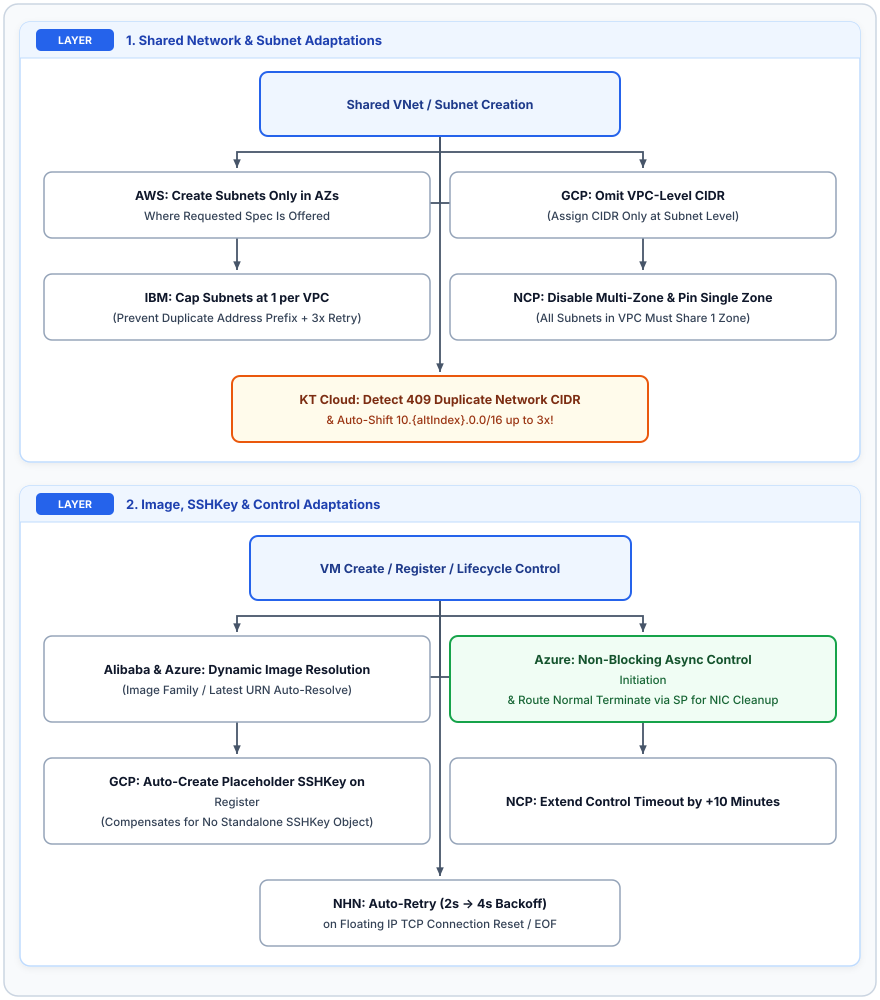

<details>
<summary>View Mermaid Source</summary>

```mermaid
flowchart TB
    subgraph NET["1. Shared Network & Subnet Adaptations"]
        direction LR
        NET_IN["Shared VNet / Subnet Creation"] --> NET_AWS["AWS: Create Subnets Only in AZs<br/>Where Requested Spec Is Offered"]
        NET_IN --> NET_GCP["GCP: Omit VPC-Level CIDR<br/>(Assign CIDR Only at Subnet Level)"]
        NET_IN --> NET_IBM["IBM: Cap Subnets at 1 per VPC<br/>(Prevent Duplicate Address Prefix + 3x Retry)"]
        NET_IN --> NET_NCP["NCP: Disable Multi-Zone & Pin Single Zone<br/>(All Subnets in VPC Must Share 1 Zone)"]
        NET_IN --> NET_KT["KT Cloud: Detect 409 Duplicate Network CIDR<br/>& Auto-Shift 10.{altIndex}.0.0/16 up to 3x!"]
    end

    subgraph CTL["2. Image, SSHKey & Control Adaptations"]
        direction LR
        CTL_IN["VM Create / Register / Lifecycle Control"] --> CTL_ALI["Alibaba & Azure: Dynamic Image Resolution<br/>(Image Family / Latest URN Auto-Resolve)"]
        CTL_IN --> CTL_AZ["Azure: Non-Blocking Async Control Initiation<br/>& Route Normal Terminate via SP for NIC Cleanup"]
        CTL_IN --> CTL_GCP["GCP: Auto-Create Placeholder SSHKey on Register<br/>(Compensates for No Standalone SSHKey Object)"]
        CTL_IN --> CTL_NCP["NCP: Extend Control Timeout by +10 Minutes"]
        CTL_IN --> CTL_NHN["NHN: Auto-Retry (2s -> 4s Backoff)<br/>on Floating IP TCP Connection Reset / EOF"]
    end

    NET ~~~ CTL

    style NET_IN fill:#e3f2fd,stroke:#1565c0,stroke-width:2px,color:#0d47a1
    style CTL_IN fill:#e3f2fd,stroke:#1565c0,stroke-width:2px,color:#0d47a1
    style NET_KT fill:#fff3e0,stroke:#ef6c00,stroke-width:2px,color:#e65100
    style CTL_AZ fill:#e8f5e9,stroke:#2e7d32,stroke-width:2px,color:#1b5e20
```

</details>

#### Comprehensive 10-CSP Concurrency Profile & Adaptive Engineering Matrix

| CSP | Create Concurrency<br/>(Regions × Nodes) | Status Concurrency<br/>(Regions × Nodes) | Register Concurrency<br/>(Conns / Stagger) | Network, Subnet & Shared-Resource Adaptations | Provisioning, Lifecycle Control & Recovery Adaptations |
| :--- | :---: | :---: | :---: | :--- | :--- |
| **1. AWS** | 30 × 20 | 10 × 30 | 5 (500-2000ms) | Creates on-demand subnets **only in AZs where the requested spec is actually offered** (e.g., skipping AZs without `t2.nano`) | Native bulk Start/Stop/Terminate (1,000 IDs/call); zero-SP-call Public IP extraction from batch status; per-AZ sold-out pinpoint overlay |
| **2. GCP** | 30 × 20<br/>(+ Quota-Wait 60) | 12 × 35 | 4 (1000-3000ms) | Clears VPC-level CIDR because GCP rejects VPC CIDRs and assigns CIDRs at the subnet level; regional subnets shared across zones | Releases active region/node slots to 60 dedicated quota-wait slots on `READ_REQUESTS` rate limits; 1-call project-wide aggregated status & firewall in-use check; auto-creates Placeholder SSHKey during VM registration |
| **3. Azure** | 30 × 20 | 8 × 25 | 4 (500-2000ms) | Multi-zone subnet support; SP [PR #1878](https://github.com/cloud-barista/cb-spider/pull/1878) extracts short resource names instead of full ARM IDs for accurate VPC/Key registration | Subscription-wide stream status pager; **non-blocking async control initiation (concurrency 20, no completion wait)**; normal Terminate routed via SP for NIC/PublicIP cleanup while ghost VMs use direct SDK termination; latest image URN resolution; isolated HTTP/2 transport per ARM client ([PR #1700](https://github.com/cloud-barista/cb-spider/pull/1700)) |
| **4. Alibaba** | 30 × 20 | 6 × 20 | 3 (1000-3000ms) | Multi-zone VSwitch dynamic expansion with mutex-guarded non-overlapping CIDR allocation | Resolves deprecated date-stamped public images dynamically at creation time via Direct SDK **image-family lookup (10m TTL + Singleflight)**; automatic compatible system disk category selection |
| **5. Tencent** | 30 × **5** | 6 × 20 | **2 (2000-5000ms)** | Multi-zone subnet support; skips subnet query when TargetZone is already specified ([PR #1865](https://github.com/cloud-barista/cb-spider/pull/1865)) | **Engineered for Tencent's strict 10 req/sec account-wide API limit**: caps per-region VM concurrency at **5** and registration concurrency at 2 (2-5s delay), eliminating `RequestLimitExceeded` cascades |
| **6. IBM** | 30 × 20 | 10 × 30 | 3 (500-2000ms) | **Caps subnets at 1 per VPC** to prevent SP driver's identical Address Prefix collision across multiple zones; wraps shared resource creation in a 3-attempt retry (10s, 20s, 30s) | Package-level shared IAM authenticator cache ([PR #1776](https://github.com/cloud-barista/cb-spider/pull/1776), cutting 5 → 1 network round-trip per call); OS type hint ([PR #1909](https://github.com/cloud-barista/cb-spider/pull/1909)) cutting VM creation time by -30% |
| **7. NCP** | **5 × 15** | **3 × 15** | 2 (1000-3000ms) | **Disables multi-zone subnet expansion and pins a single Zone** because all subnets in an NCP VPC must reside in the same zone; generates RSA 2048 keys locally and imports only the public key | Protects NCP's stricter control plane by capping concurrent regions at 5 (3 for status); **extends VM control timeout by +10 minutes**; removed 3-minute post-Running root disk wait in SP (**-59% create time, 237s → 97s**) |
| **8. NHN** | 30 × 20 | 5 × 20 | 2 (1000-3000ms) | OpenStack-based Neutron VPC/subnet handling; fixed AZ HTTP transport leak in SP ([PR #1865](https://github.com/cloud-barista/cb-spider/pull/1865)) | **Automatically retries up to 2 times (2s, 4s exponential backoff)** when NHN drops TCP connections (`connection reset by peer` / `EOF`) during Floating IP operations; fixed `kr2` Glance metadata unmarshal failure ([PR #1909](https://github.com/cloud-barista/cb-spider/pull/1909)) |
| **9. KT Cloud** | 30 × 20 | 10 × 30 | 2 (1000-3000ms) | **Single Account-Wide VPC Adaptation**: When leftover tiers trigger `409 duplicate network cidr`, automatically shifts to an alternative `/16` CIDR (`10.{altIndex}.0.0/16`) up to 3 times; disables on-demand zone subnet expansion | Parallelized port-forwarding/firewall rules without 2s sleeps in SP (**-54% create time, 56s → 26s**); tolerates shared firewall policy 404 on parallel delete ([PR #1705](https://github.com/cloud-barista/cb-spider/pull/1705)), preserves account SRCNAT IP ([PR #1877](https://github.com/cloud-barista/cb-spider/pull/1877)), and clones key-value slices to prevent data races ([PR #1889](https://github.com/cloud-barista/cb-spider/pull/1889)) |
| **10. OpenStack** | 30 × 20 | 5 × 15 | 3 (500-2000ms) | Maps arbitrary derived OpenStack instances (`openstack-new01`, etc.) to the canonical OpenStack rate-limit and network policy | Shared Direct Nova batch status & inventory handlers; 50m Keystone auth cache, Flavor cache, and port filtering ([PR #1865](https://github.com/cloud-barista/cb-spider/pull/1865)) |

---

### 6.4 GCP Dedicated Quota-Wait Slot Release & Dual-Semaphore IP Refresh Isolation
1. **GCP Quota-Wait Slot (60 Slots) Decoupling**: When GCP returns `Quota 'READ_REQUESTS' exceeded`, the worker **releases its region and node semaphore slots** and acquires a dedicated quota-wait slot (60) before sleeping (15s × attempt + jitter), letting other GCP regions proceed immediately (**41/41 GCP regions succeeded 100%**).
2. **Dual-Semaphore Isolation (15 IP-Refresh Slots → 50 Global SP Slots)**: Non-AWS fallback Public IP refresh workers (exponential backoff 5s, 10s, 20s, 40s, 60s = 135s window with 10m re-arming) must acquire a dedicated IP-refresh semaphore (15) before the global SP semaphore (50), reserving **35+ SP slots (70%)** for status polling and control at all times.

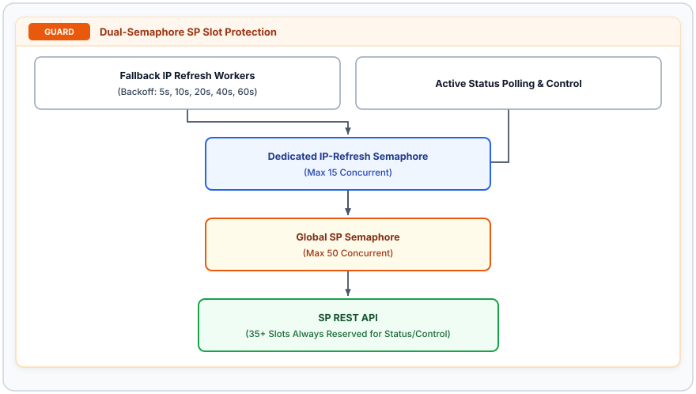

<details>
<summary>View Mermaid Source</summary>

```mermaid
flowchart LR
    subgraph "Dual-Semaphore SP Slot Protection"
        IP_GORO["Fallback IP Refresh Workers<br/>(Backoff: 5s, 10s, 20s, 40s, 60s)"] --> IP_SEM["Dedicated IP-Refresh Semaphore<br/>(Max 15 Concurrent)"]
        POLL_GORO["Active Status Polling & Control"] --> GLOB_SEM["Global SP Semaphore<br/>(Max 50 Concurrent)"]
        IP_SEM --> GLOB_SEM
        GLOB_SEM --> SP_API["SP REST API<br/>(35+ Slots Always Reserved for Status/Control)"]
    end

    style IP_SEM fill:#e3f2fd,stroke:#1565c0,stroke-width:2px,color:#0d47a1
    style GLOB_SEM fill:#fff3e0,stroke:#ef6c00,stroke-width:2px,color:#e65100
    style SP_API fill:#e8f5e9,stroke:#2e7d32,stroke-width:2px,color:#1b5e20
```

</details>

---

### 6.5 5-Tier Adaptive Polling Priorities
The background status synchronization daemon dynamically adjusts each node's polling frequency based on its lifecycle state and skips individual polling for Suspending/Resuming nodes on batch-capable CSPs:

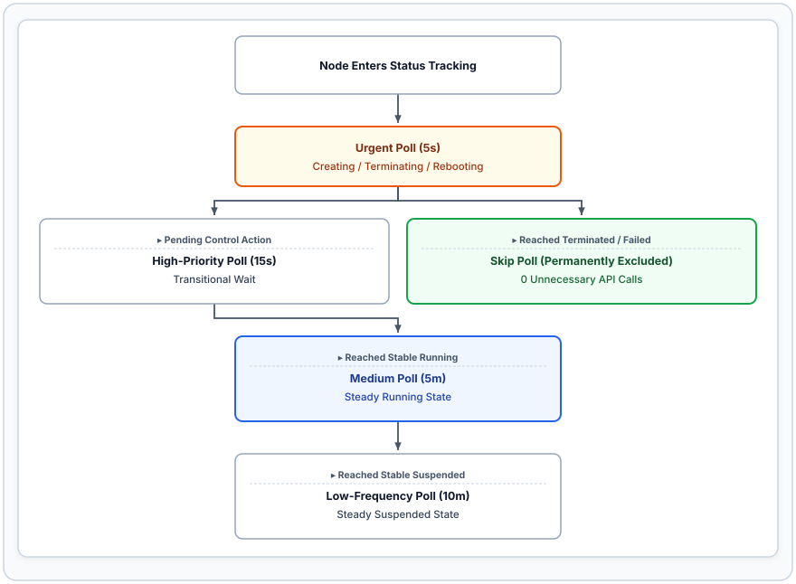

<details>
<summary>View Mermaid Source</summary>

```mermaid
flowchart LR
    START_P["Node Enters Status Tracking"] --> URG["Urgent Poll (5s)<br/>Creating / Terminating / Rebooting"]
    URG -->|"Pending Control Action"| HIGH["High-Priority Poll (15s)<br/>Transitional Wait"]
    HIGH -->|"Reached Stable Running"| MED["Medium Poll (5m)<br/>Steady Running State"]
    MED -->|"Reached Stable Suspended"| LOW["Low-Frequency Poll (10m)<br/>Steady Suspended State"]
    URG -->|"Reached Terminated / Failed"| SKIP["Skip Poll (Permanently Excluded)<br/>0 Unnecessary API Calls"]

    style URG fill:#fff3e0,stroke:#ef6c00,stroke-width:2px,color:#e65100
    style MED fill:#e3f2fd,stroke:#1565c0,stroke-width:2px,color:#0d47a1
    style SKIP fill:#e8f5e9,stroke:#2e7d32,stroke-width:2px,color:#1b5e20
```

</details>

---

## 7. Challenge 6: Long-Running Operations vs. HTTP / SSH Timeout Lifecycles

### 7.1 Problem Diagnosis
Provisioning or controlling 10,456 VMs takes several minutes, whereas reverse proxies (such as Envoy Gateway's default 15s timeout) or HTTP clients frequently disconnect early. When provisioning is bound to the HTTP request context, a client timeout cancels in-flight OpenBao secret reads and CSP VM creation calls mid-flight, leaving the Infra stuck in `Preparing` and leaking untracked orphan VMs.

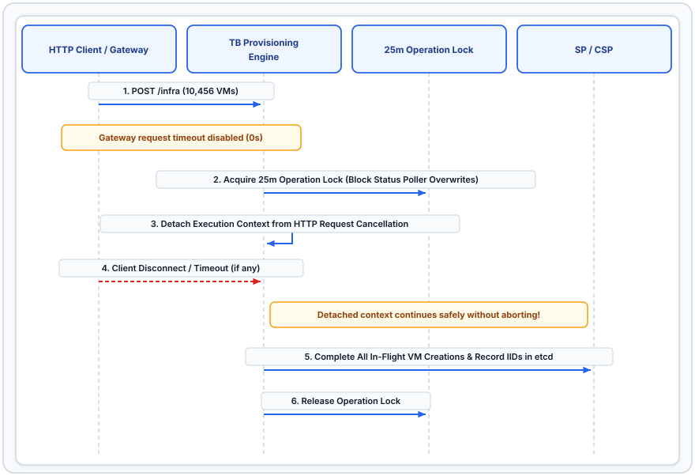

<details>
<summary>View Mermaid Source</summary>

```mermaid
sequenceDiagram
    autonumber
    participant Client as HTTP Client / Gateway
    participant TB as TB Provisioning Engine
    participant Lock as 25m Operation Lock
    participant CSP as SP / CSP

    Client->>TB: POST /infra (10,456 VMs)
    Note over Client,TB: Gateway request timeout disabled (0s)
    TB->>Lock: Acquire 25m Operation Lock (Block Status Poller Overwrites)
    TB->>TB: Detach Execution Context from HTTP Request Cancellation
    Client--xTB: Client Disconnect / Timeout (if any)
    Note over TB,CSP: Detached context continues safely without aborting!
    TB->>CSP: Complete All In-Flight VM Creations & Record IIDs in etcd
    TB->>Lock: Release Operation Lock
```

</details>

---

### 7.2 Execution Context Detachment, Gateway Timeout Removal & 25m Operation Lock
1. **Context Detachment**: Detaches background provisioning and control loops from HTTP client disconnects so every initiated CSP resource is properly tracked and persisted.
2. **Gateway Request Timeout Removal (0s)**: Disables gateway request timeouts on API and MCP routes to prevent `504 Gateway Timeout` terminations during multi-minute runs.
3. **25-Minute Infra Operation Lock**: Prevents background status sweeps from overwriting transitional states while an active provisioning or control operation is running.

### 7.3 Active SSH Readiness Gate & Async Streaming Remote Commands
Replaces fixed sleeps before post-deployment SSH commands with an active TCP/SSH handshake readiness gate, first-connect host-key auto-registration and verification, bastion/target concurrency semaphores, real-time SSE output streaming, and bounded command history in etcd.

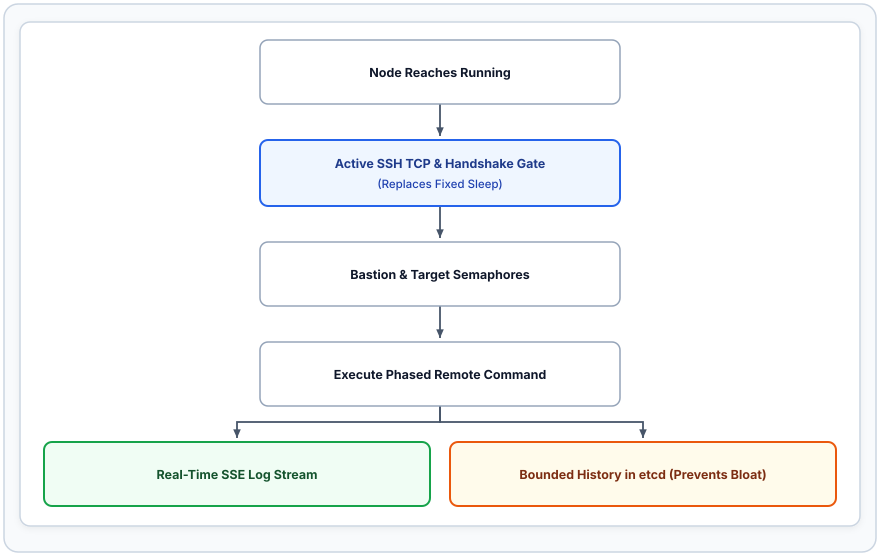

<details>
<summary>View Mermaid Source</summary>

```mermaid
flowchart LR
    VM_UP["Node Reaches Running"] --> GATE["Active SSH TCP & Handshake Gate<br/>(Replaces Fixed Sleep)"]
    GATE --> SEM["Bastion & Target Semaphores"]
    SEM --> EXEC["Execute Phased Remote Command"]
    EXEC --> SSE["Real-Time SSE Log Stream"]
    EXEC --> BOUND["Bounded History in etcd (Prevents Bloat)"]

    style GATE fill:#e3f2fd,stroke:#1565c0,stroke-width:2px,color:#0d47a1
    style SSE fill:#e8f5e9,stroke:#2e7d32,stroke-width:2px,color:#1b5e20
    style BOUND fill:#fff3e0,stroke:#ef6c00,stroke-width:2px,color:#e65100
```

</details>

---

# Part III. Self-Healing State Consistency & Deep SP Surgery

## 8. Challenge 7: Partial Failures, Experiment Time Loss & TB ↔ SP ↔ CSP 3-Way State Drift

### 8.1 Problem Diagnosis
At 10,000+ VM scale across 10 clouds, partial failures and cross-database state drift are inevitable:
1. **Partial Provisioning Failures**: If 42 nodes out of 10,456 fail due to regional capacity exhaustion (e.g., AWS `ap-northeast-3` or `eu-central-2a`), rolling back all 10,414 healthy VMs wastes 11+ minutes of work.
2. **3-Way Database Drift (TB etcd ↔ SP DB ↔ Live CSP)**: Because SP maintains its own IID database, a network error during deletion can erase the record in SP's DB while the **CSP resource survives and continues billing**, or Direct SDK bulk termination can delete VMs on the CSP while leaving stale IIDs in SP's DB.
3. **Transient Cloud API Dropouts**: During deletion or heavy load, GCP and Azure list APIs occasionally omit an instance for 1 sweep cycle, causing naive logic to regress the node to `Undefined`.

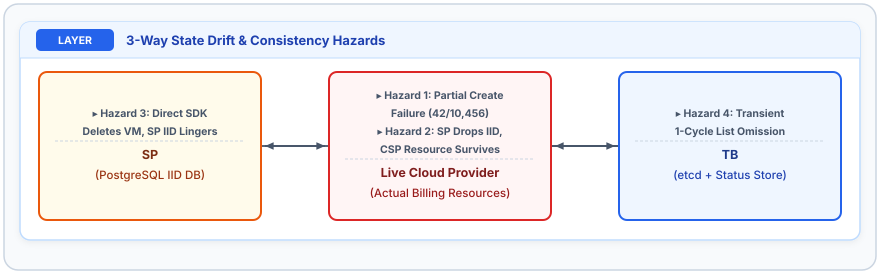

<details>
<summary>View Mermaid Source</summary>

```mermaid
flowchart TB
    subgraph "3-Way State Drift & Consistency Hazards"
        TB_DB[("TB<br/>(etcd + Status Store)")]
        SP_DB[("SP<br/>(PostgreSQL IID DB)")]
        CSP_LIVE[("Live Cloud Provider<br/>(Actual Billing Resources)")]

        TB_DB <-->|"Hazard 1: Partial Create Failure (42/10,456)"| CSP_LIVE
        SP_DB <-->|"Hazard 2: SP Drops IID, CSP Resource Survives"| CSP_LIVE
        TB_DB <-->|"Hazard 3: Direct SDK Deletes VM, SP IID Lingers"| SP_DB
        CSP_LIVE <-->|"Hazard 4: Transient 1-Cycle List Omission"| TB_DB
    end

    style TB_DB fill:#e3f2fd,stroke:#1565c0,stroke-width:2px,color:#0d47a1
    style SP_DB fill:#fff3e0,stroke:#ef6c00,stroke-width:2px,color:#e65100
    style CSP_LIVE fill:#ffebee,stroke:#c62828,stroke-width:2px,color:#b71c1c
```

</details>

---

### 8.2 Policy-Driven Failure Recovery (continue / refine / rollback) & Sub-2s Refinement (action=refine)
- **Targeted Failure Refinement (`action=refine`)**: Isolates and removes only Failed node records and any half-created CSP instances while keeping all healthy Running nodes intact. In our 10,456-VM run, `action=refine` cleaned up all 42 capacity-failed nodes in **1.83 s**, normalizing the Infra to **10,414 / 10,414 (100%) Running**.

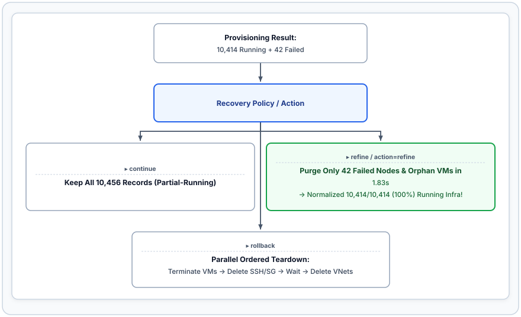

<details>
<summary>View Mermaid Source</summary>

```mermaid
flowchart TD
    PARTIAL["Provisioning Result:<br/>10,414 Running + 42 Failed"] --> POLICY{"Recovery Policy / Action"}
    POLICY -->|"continue"| KEEP["Keep All 10,456 Records (Partial-Running)"]
    POLICY -->|"refine / action=refine"| REFINE["Purge Only 42 Failed Nodes & Orphan VMs in 1.83s<br/>-> Normalized 10,414/10,414 (100%) Running Infra!"]
    POLICY -->|"rollback"| RB["Parallel Ordered Teardown:<br/>Terminate VMs -> Delete SSH/SG -> Wait -> Delete VNets"]

    style POLICY fill:#e3f2fd,stroke:#1565c0,stroke-width:2px,color:#0d47a1
    style REFINE fill:#e8f5e9,stroke:#2e7d32,stroke-width:2px,color:#1b5e20
```

</details>

---

### 8.3 3-Tier Fail-Closed Tombstone Deletion & Dead-End IID Auto-Repair
Enforces the invariant **"never purge a local record until CSP-side absence is confirmed"** ([Design Doc](../design/resource-deletion-tombstone.md)):
1. **Crash-Safe Tombstone (`Status = Deleting`)**: Persists `Deleting` status and the request timestamp *before* calling SP/CSP.
2. **3-Tier Verification Hierarchy**:

| Tier | Verification Primitive | Trust Level | Role in Deletion State Machine |
| :---: | :--- | :---: | :--- |
| **Tier 1** | SP Single GET Poll | Low (May answer from SP DB) | Used **only as a 5×3s wait loop**; never authorizes record purge |
| **Tier 2** | SP Full-List Comparison (`onCsp == false`) | High (Enumerates live CSP) | **Mandatory Purge Gate** (shared per connection via batched checks) |
| **Tier 3** | Direct CSP SDK Probe | Highest (Bypasses SP) | Direct cloud existence check when Tier 2 is inconclusive |

3. **Dead-End IID Auto-Repair**: If a delete retry receives "does not exist in connection" from SP while Tier 2 proves `onCsp == true` (SP lost its IID, stranding the live CSP resource), TB **automatically re-registers the resource into SP using its stored CSP `SystemId`** and retries DELETE.
4. **Auto-Pruning Dead Node Associations**: Shared resource cleanup prunes stale node references and deletes resources in parallel dependency order (SG → Wait → VNet → SSHKey), achieving **438 / 438 (100%) single-pass deletion in 149.85 s**.

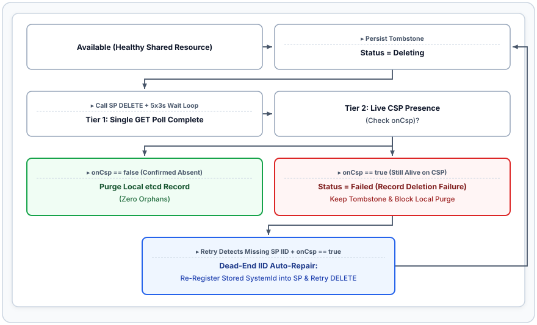

<details>
<summary>View Mermaid Source</summary>

```mermaid
flowchart TD
    AVAIL["Available (Healthy Shared Resource)"] -->|"Persist Tombstone"| DEL_ST["Status = Deleting"]
    DEL_ST -->|"Call SP DELETE + 5x3s Wait Loop"| T1["Tier 1: Single GET Poll Complete"]
    T1 --> T2{"Tier 2: Live CSP Presence<br/>(Check onCsp)?"}
    T2 -->|"onCsp == false (Confirmed Absent)"| PURGE["Purge Local etcd Record<br/>(Zero Orphans)"]
    T2 -->|"onCsp == true (Still Alive on CSP)"| FAIL_ST["Status = Failed (Record Deletion Failure)<br/>Keep Tombstone & Block Local Purge"]
    FAIL_ST -->|"Retry Detects Missing SP IID + onCsp == true"| REPAIR["Dead-End IID Auto-Repair:<br/>Re-Register Stored SystemId into SP & Retry DELETE"]
    REPAIR --> DEL_ST

    style FAIL_ST fill:#ffebee,stroke:#c62828,stroke-width:2px,color:#b71c1c
    style REPAIR fill:#e3f2fd,stroke:#1565c0,stroke-width:2px,color:#0d47a1
    style PURGE fill:#e8f5e9,stroke:#2e7d32,stroke-width:2px,color:#1b5e20
```

</details>

---

### 8.4 Async SP IID Purge, Direct CSP Orphan/Residual Audit & Firewall Protection
- **Asynchronous SP IID Purge**: When Direct CSP bulk termination deletes VMs directly on the cloud, TB reconciles SP's database asynchronously across 50 workers by calling SP's metadata-only unregister endpoint (0 CSP calls).
- **Targeted Timed-Out Orphan Lookup**: When a VM creation call times out before SP records an IID, the VM may still be created on the cloud. TB queries all 10 CSPs via Direct SDK Name/Tag filters (e.g., AWS batches of 200 UIDs) to locate and reclaim or terminate timed-out orphan VMs without scanning entire regions.
- **Direct CSP Truth Audit & Residual Resource Cleanup**:
  - Bypasses SP completely to inspect live cloud assets across all 9 public CSPs.
  - Using TB's naming convention or management tags, TB identifies and deletes **orphaned VM-adjacent residual resources (NIC, ENI, PublicIP, EIP, FloatingIP, disk, volume)** as well as untracked ghost VMs, while blocking premature Infra record deletion if live VMs remain.
- **Direct SDK GCP Firewall In-Use Check**: Because GCP allows deleting firewall rules even when running VMs still carry the network tag, TB verifies across all project instances that zero non-terminated VMs reference the firewall tag before SG deletion proceeds.

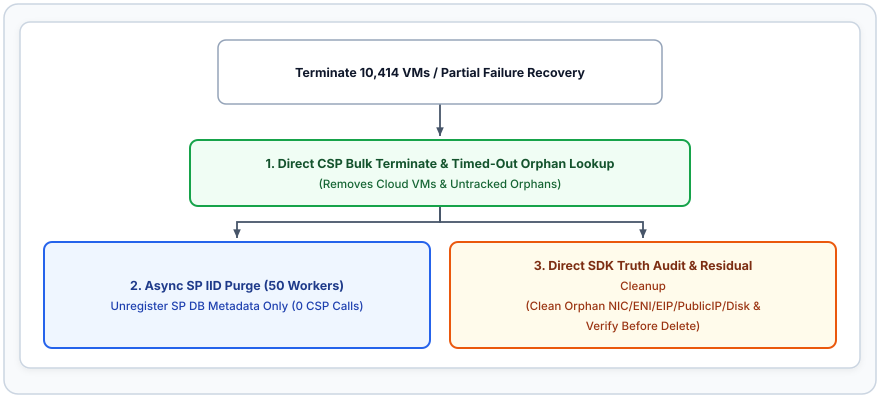

<details>
<summary>View Mermaid Source</summary>

```mermaid
flowchart LR
    TERM["Terminate 10,414 VMs / Partial Failure Recovery"] --> DIRECT_DEL["1. Direct CSP Bulk Terminate & Timed-Out Orphan Lookup<br/>(Removes Cloud VMs & Untracked Orphans)"]
    DIRECT_DEL --> ASYNC_REG["2. Async SP IID Purge (50 Workers)<br/>Unregister SP DB Metadata Only (0 CSP Calls)"]
    DIRECT_DEL --> AUDIT["3. Direct SDK Truth Audit & Residual Cleanup<br/>(Clean Orphan NIC/ENI/EIP/PublicIP/Disk & Verify Before Delete)"]

    style DIRECT_DEL fill:#e8f5e9,stroke:#2e7d32,stroke-width:2px,color:#1b5e20
    style ASYNC_REG fill:#e3f2fd,stroke:#1565c0,stroke-width:2px,color:#0d47a1
    style AUDIT fill:#fff3e0,stroke:#ef6c00,stroke-width:2px,color:#e65100
```

</details>

---

### 8.5 Overcoming Shared Resource DependencyViolation via Existing Resource Registration
When terminating and deleting VM nodes at scale and subsequently releasing shared resources (`DELETE /ns/{nsId}/sharedResources`), prior SP errors, network timeouts, or forced cleanups can leave **untracked orphan VMs or orphan SecurityGroups** alive on the CSP even though they were dropped from TB's etcd. Because these invisible orphans still hold live references to the regional shared VNet, Subnet, or SecurityGroup, the CSP rejects shared resource deletion with a **DependencyViolation** error (`resource has a dependent object`).

To resolve this safely and semi-automatically, TB combines **cascading failure-guarded shared resource release** with **targeted dependency recovery built on Existing Resource Registration** (`POST /ns/{nsId}/sharedResources/recoverDependencies`; see [Shared Resource Management Guide](shared-resource-management.md)):

1. **Dependency-Ordered Staging & SSHKey Retention Guard**:
   - **Auto-Pruning Dead References**: Prunes stale references from already-deleted nodes and selects only resources with 0 live associations.
   - **3-Stage Dependency Order & SSHKey Protection**: Releases shared resources strictly in **SecurityGroup → VNet → SSHKey** order. If a child SecurityGroup fails deletion due to a `DependencyViolation`, its connection and parent VNet are marked failed, **automatically retaining both the parent VNet and the connection's SSHKey** so operators never lose the SSH key needed to access or clean up surviving VMs. Failed VNet deletions also trigger asynchronous background reconciliation.
2. **Targeted Dependency Recovery Using Existing Resource Registration**:
   - Blindly importing every resource in a cloud account would pollute TB with unrelated customer workloads. Instead, TB first extracts the exact CSP Resource IDs of the namespace's shared VNets, Subnets, and SecurityGroups (the shared footprint).
   - **Phase 1 (Orphan SecurityGroup Adoption)**: Inspects untracked SecurityGroups (present on CSP only or in SP DB only) and checks their owner VPC. **Only SecurityGroups residing inside the shared VNet footprint** are adopted into TB via Existing Resource Registration.
   - **Phase 2 (Orphan VM Node Adoption)**: Captures both classes of untracked orphan VMs:
     - **CSP-Only Orphan VMs (Untracked by both SP and TB)**: Inspects the VM's live VPC and SecurityGroup attachments. **Only if the VM references the shared VNet or SG footprint** is it registered into TB via Existing Resource Registration under a dedicated **`dep-{shortCspId}`** recovery Infra.
     - **SP-Only Orphan VMs (Present in SP DB, Missing in TB)**: Inspects the SP VM record. If the CSP resource ID is empty (a ghost SP-only IID), purges it immediately; otherwise, if its VPC, Subnet, or SecurityGroups match the shared footprint, adopts it under **`dep-{shortCspId}`**.
   - **Clean Semi-Automated Teardown**: Once the hidden blockers are surfaced as standard `dep-{shortCspId}` Infras and SecurityGroups in TB, running `DELETE /ns/{nsId}/infra/dep-{shortCspId}?option=terminate` followed by `DELETE /ns/{nsId}/sharedResources` cleanly resolves the `DependencyViolation` and releases all shared resources.

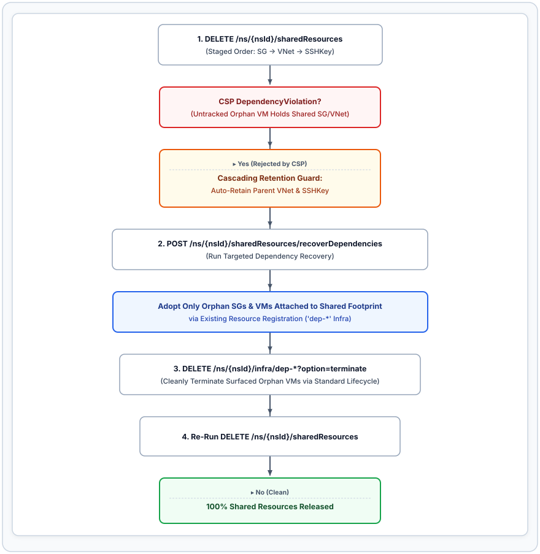

<details>
<summary>View Mermaid Source</summary>

```mermaid
flowchart TD
    DEL1["1. DELETE /ns/{nsId}/sharedResources<br/>(Staged Order: SG -> VNet -> SSHKey)"] --> VIOL{"CSP DependencyViolation?<br/>(Untracked Orphan VM Holds Shared SG/VNet)"}
    VIOL -->|"No (Clean)"| DONE["100% Shared Resources Released"]
    VIOL -->|"Yes (Rejected by CSP)"| GUARD["Cascading Retention Guard:<br/>Auto-Retain Parent VNet & SSHKey"]
    GUARD --> RECOV["2. POST /ns/{nsId}/sharedResources/recoverDependencies<br/>(Run Targeted Dependency Recovery)"]
    RECOV --> ADOPT["Adopt Only Orphan SGs & VMs Attached to Shared Footprint<br/>via Existing Resource Registration ('dep-*' Infra)"]
    ADOPT --> TERM_DEP["3. DELETE /ns/{nsId}/infra/dep-*?option=terminate<br/>(Cleanly Terminate Surfaced Orphan VMs via Standard Lifecycle)"]
    TERM_DEP --> DEL2["4. Re-Run DELETE /ns/{nsId}/sharedResources"]
    DEL2 --> DONE

    style VIOL fill:#ffebee,stroke:#c62828,stroke-width:2px,color:#b71c1c
    style GUARD fill:#fff3e0,stroke:#ef6c00,stroke-width:2px,color:#e65100
    style ADOPT fill:#e3f2fd,stroke:#1565c0,stroke-width:2px,color:#0d47a1
    style DONE fill:#e8f5e9,stroke:#2e7d32,stroke-width:2px,color:#1b5e20
```

</details>


<details>
<summary>View Mermaid Source</summary>

```mermaid
flowchart LR
    subgraph "Targeted Shared-Resource Footprint Scan & Adoption"
        FP["1. Extract Shared Footprint<br/>Collect CSP IDs of Shared<br/>VNets / Subnets / SGs"] --> INSP["2. Scan Untracked Resources<br/>(SecurityGroups & VM Nodes)"]
        INSP --> CASE_A["Case A: On CSP Only<br/>(Untracked by SP/TB)<br/>-> Check Attached VPC/SG"]
        INSP --> CASE_B["Case B: In SP DB Only<br/>(Missing in TB)<br/>-> Check SP VM VPC/Subnet/SG"]
        CASE_A --> MATCH{"Matches Shared<br/>Footprint?"}
        CASE_B --> MATCH
        MATCH -->|"No (Unrelated Customer Workload)"| SKIP["Strictly Skip (Protect External Resources)"]
        MATCH -->|"Yes (True Blocking Orphan)"| REG["Register Existing Resource<br/>(Adopt into 'dep-{shortCspId}' Infra)"]
    end

    style FP fill:#fff3e0,stroke:#ef6c00,stroke-width:2px,color:#e65100
    style MATCH fill:#e3f2fd,stroke:#1565c0,stroke-width:2px,color:#0d47a1
    style REG fill:#e8f5e9,stroke:#2e7d32,stroke-width:2px,color:#1b5e20
```

</details>

---

### 8.6 2-Strike NotFound Streak & Terminated State Immutability Guards
- **2-Strike NotFound Guard**: When a `Terminating` node is missing from a batch sweep, the 1st strike (15s) keeps it as `Terminating`; only on the **2nd consecutive strike (~30s)** is it marked `Terminated`. For non-terminating nodes, batch absence is ignored so transient GCP/Azure list dropouts never cause `Undefined` regressions.
- **Terminated Immutability & Suspended Empty-IP Overlay**: Prevents late sweeps from reviving `Terminated` nodes and clears `PublicIP` upon `Suspended` (0 ghost IPs).


<details>
<summary>View Mermaid Source</summary>

```mermaid
flowchart LR
    ABSENT["Instance Absent from Batch Status Response"] --> IS_TERM{"Target == Terminated<br/>or Current == Terminating?"}
    IS_TERM -->|"No (Running / Suspended)"| IGNORE["Ignore Transient Dropout<br/>(Prevent Undefined Regression)"]
    IS_TERM -->|"Yes (Terminating)"| STRIKE{"Consecutive Missing Sweep Count?"}
    STRIKE -->|"Strike 1 (15s)"| KEEP_TERM["Keep Status = Terminating<br/>(Wait for Next Sweep)"]
    STRIKE -->|"Strike 2 (30s Confirmed)"| FINAL_TERM["Mark Status = Terminated<br/>(Immutable Final State -> Skip Poll)"]

    style IGNORE fill:#e3f2fd,stroke:#1565c0,stroke-width:2px,color:#0d47a1
    style KEEP_TERM fill:#fff3e0,stroke:#ef6c00,stroke-width:2px,color:#e65100
    style FINAL_TERM fill:#e8f5e9,stroke:#2e7d32,stroke-width:2px,color:#1b5e20
```

</details>

---

## 9. Challenge 8: SP 25 GB+ OOM, SQLite Locks & Per-Driver Inefficiencies

### 9.1 Problem Diagnosis
Profiling 10,000-VM runs revealed that SP (the underlying multi-cloud driver framework) suffered from three severe bottlenecks:
1. **25 GB+ Memory OOM & Goroutine Accumulation**: VM creation spawned synchronous Public IP / SSH port-22 polling loops and background AdminWeb recent-history goroutines (fetching image, spec, and pricing metadata) for every VM.
2. **SQLite Database Lock Contention**: File-based SQLite threw `database is locked` errors under 1,000+ concurrent IID writes.
3. **3-5× Redundant CSP API Calls & Artificial Sleeps per VM**: Drivers ran pre-create fast-fail scans (listing all regional VMs for name collisions, querying images to check for Windows), uncached cloud authentication on every request, fixed 5-10s polling sleeps, and a 3-minute post-Running root disk wait on NCP.


<details>
<summary>View Mermaid Source</summary>

```mermaid
flowchart TB
    subgraph PROB["Problem: Legacy SP VM Creation Execution Path"]
        direction LR
        S_OLD["VM Create Request"] --> AUTH_OLD["Uncached Cloud Re-Auth<br/>(17 ARM Clients / 5 IBM Round-Trips)"]
        AUTH_OLD --> PRE_OLD["Pre-Create Fast-Fail:<br/>List All VMs + Windows Image Check"]
        PRE_OLD --> CREATE_OLD["CSP Create VM + Fixed 5-10s Sleeps<br/>(NCP: +180s Root Disk Wait)"]
        CREATE_OLD --> POST_OLD["Redundant GetVM x3 + SSH Poll<br/>+ AdminWeb Recent History Goroutine"]
        POST_OLD --> OOM["25 GB+ RAM (OOM) & 40+ Min Run"]
    end

    subgraph SOL["Solution: Streamlined SP Execution Path"]
        direction LR
        S_NEW["VM Create Request<br/>(+ OS Type Hint)"] --> AUTH_NEW["50m Cached Connection<br/>& Shared IAM Authenticator"]
        AUTH_NEW --> CREATE_NEW["Direct CSP Create VM<br/>(0 Pre-Checks, Adaptive 1-3s Poll)"]
        CREATE_NEW --> POST_NEW["Reuse Poller Response (1 Get)<br/>+ PostgreSQL IID Write"]
        POST_NEW --> LEAN["385-514 MiB Peak RAM (~98% Cut)"]
    end

    PROB ~~~ SOL

    style OOM fill:#ffebee,stroke:#c62828,stroke-width:2px,color:#b71c1c
    style AUTH_NEW fill:#e3f2fd,stroke:#1565c0,stroke-width:2px,color:#0d47a1
    style LEAN fill:#e8f5e9,stroke:#2e7d32,stroke-width:2px,color:#1b5e20
```

</details>

---

### 9.2 Eliminating Synchronous Access Checks & Unused AdminWeb History Goroutines (SP PR [#1846](https://github.com/cloud-barista/cb-spider/pull/1846))
- **Mechanism**:
  1. **Disabling Driver-Level Synchronous SSH Access Checks**: Bypassed driver-level synchronous Public IP polling and SSH port-22 connection loops during VM creation.
  2. **Disabling Unused AdminWeb History Goroutines**: Skipped background recent-history goroutines and their cascading image/spec lookups when AdminWeb is disabled.
- **Measured 10,000-VM Benchmark Impact (PR #1846)**:
  - **SP Peak Memory**: Dropped from **25 GB+ (OOM crash)** to **~488 MiB (~98% reduction)**.
  - **10,000-VM Batch Creation Time**: Dropped from **>40 minutes to 15 minutes** (and down to **11.05 minutes** with subsequent optimizations).


---

### 9.3 Migrating SP Metadata from SQLite to PostgreSQL
Replaced SP's local SQLite file database with a dedicated **PostgreSQL container** in both Docker Compose and Kubernetes Helm charts.


<details>
<summary>View Mermaid Source</summary>

```mermaid
flowchart TB
    subgraph BEFORE["Before: Local SQLite File DB"]
        direction LR
        SP1["1,000+ Concurrent SP Goroutines"] --> SQLITE["Single File Lock<br/>-> 'database is locked' Errors & Disk Bottleneck"]
    end

    subgraph AFTER["After: Dedicated PostgreSQL DB"]
        direction LR
        SP2["Stateless SP Pod"] --> PG["Dedicated PostgreSQL Connection Pool<br/>-> Row-Level MVCC Concurrency (0 Lock Errors)"]
    end

    BEFORE ~~~ AFTER

    style SQLITE fill:#ffebee,stroke:#c62828,stroke-width:2px,color:#b71c1c
    style PG fill:#e8f5e9,stroke:#2e7d32,stroke-width:2px,color:#1b5e20
```

</details>

---

### 9.4 3-Stage Driver Performance Overhaul Across All 10 CSPs (SP PR [#1865](https://github.com/cloud-barista/cb-spider/pull/1865))

#### Stage 1: Redundant Pre-Checks & Duplicate Lookups Removed per Driver

| CSP | Pre-Create Fast-Fail Calls Removed | Post-Create / Single-Query Redundancies Reduced |
| :--- | :--- | :--- |
| **NCP** | Full region server list scan (name collision), image public/Windows check | Block-storage list 2 → 1, ACG lookup N → 1 |
| **NHN** | Duplicate server list scan, VPC re-query, image/OS checks, empty-ID SG lookup | Image GET 2 → 1, SG list N → 1, fixed AZ HTTP transport leak, Flavor cache |
| **AWS** | Image query (Windows check), unused image & duplicate tag lookups in single-VM query | Device mappings queried only when data disks exist |
| **Azure** | Full resource-group VM list scan, custom image re-query, data-disk pre-check loop | Reused creation poller response instead of re-querying Public IP & NIC |
| **GCP** | Image GET (Windows check) | Disk GET 2 → 1; parallel image-family lookups (23.8s → 12.6s) |
| **Alibaba** | Available-resource pre-check, image query (Windows check) | VSwitch, system disk, and disk-attribute calls executed only when needed |
| **Tencent** | - | Subnets queried only when TargetZone is empty |
| **IBM** | Full instance list, per-VPC/spec/SG/disk Get, full FIP list, image/snapshot Get | Subnet full list → single Get, boot volume 3 → 1, removed tag instance re-query |
| **OpenStack** | Duplicate server list, data-disk check, VPC/subnet loops, per-SG Get, image OS Get | Added Flavor cache, port filter, mapping SG N → 1 |

#### Stage 2 & 3: 50-Minute Connection Cache, NCP Disk Wait Removal & KT SG Parallelization
- **50-Minute Connection Cache**: Cached authenticated cloud connections by credential hash for **50 minutes** (eliminating per-call creation of 17 ARM clients on Azure and Keystone re-auth on OpenStack/NHN).
- **NCP 3-Minute Root Disk Wait Removal**: Removed the post-Running wait for root disk status `optimizing` → `attached` (verified SSH and 82-89 MB/s disk writes work immediately upon Running), cutting NCP VM creation median from **237 s to 97 s (-59%)**.
- **KT Cloud SG Parallelization**: Parallelized port-forwarding/firewall rules without 2s sleeps and used a native outbound ALL rule, cutting post-ACTIVE driver time from **24 s/VM to 12 s/VM (-50%)** and SG rule updates from **35 s to 6 s (-83%)**.

#### Measured Performance Gains from PR #1865 (10-CSP Benchmark, Median)

| CSP | Node Creation Before → After | Creation Gain | Single-VM Query Before → After | Query Latency Gain |
| :--- | :---: | :---: | :---: | :---: |
| **NCP** | 237 s → **97 s** | **-59% (-140s)** | 0.78 s → **0.55 s** | **-29%** |
| **KT Cloud** | 56 s → **26 s** | **-54% (-30s)** | 2.15 s → **1.55 s** | **-28%** |
| **Azure** | 58 s → **41 s** | **-29% (-17s)** | 2.88 s → **0.62 s** | **-78%** |
| **IBM** | 23 s → **17 s** | **-26% (-6s)** | 4.53 s → **2.15 s** | **-53%** |
| **OpenStack** | 133 s → **122 s** | **-8% (-11s)** | 2.33 s → **1.60 s** | **-31%** |
| **NHN** | 73 s → **68 s** | **-7% (-5s)** | 4.75 s → **3.97 s** | **-16%** |
| **Alibaba** | 11 s → **9 s** | **-18% (-2s)** | 0.83 s → **0.47 s** | **-43%** |
| **GCP** | 27 s → **25 s** | **-7% (-2s)** | 2.64 s → **1.61 s** | **-39%** |
| **AWS** | 19 s → **18 s** | **-5% (-1s)** | 0.78 s → **0.39 s** | **-50%** |
| **Tencent** | 23 s → **23 s** | 0% | 0.59 s → **0.52 s** | **-12%** |

---

### 9.5 Conditional Windows Image Check Bypass via OS Type Hint (SP PR [#1909](https://github.com/cloud-barista/cb-spider/pull/1909))
When TB supplies the pre-resolved OS type hint (Windows vs. Linux) in the VM creation request, SP skips the pre-create Windows image lookup completely, saving 10,456 CSP image queries and fixing NHN `kr2` Glance image metadata unmarshal failures.

| CSP (Region / Spec) | Pure VM Create Before | Pure VM Create After | Time Saved | Improvement (%) |
| :--- | :---: | :---: | :---: | :---: |
| **KT** (kr1 / 1x1.itl) | 48.0 s | **32.0 s** | -16.0 s | **-33.3%** |
| **IBM** (jp-osa / nxf-2x1) | 20.0 s | **14.0 s** | -6.0 s | **-30.0%** |
| **NHN** (kr1 / t2.c1m1) | 115.0 s | **83.0 s** | -32.0 s | **-27.8%** (+ Fixed kr2 JSON failure) |
| **Azure** (australiaeast / standard_b1ls) | 66.0 s | **57.0 s** | -9.0 s | **-13.6%** |
| **GCP** (asia-northeast3 / n1-standard-1) | 22.0 s | **19.0 s** | -3.0 s | **-13.6%** |
| **Tencent** (ap-seoul / sa2.medium2) | 41.0 s | **36.0 s** | -5.0 s | **-12.2%** |
| **Alibaba** (ap-northeast-1 / ecs.e-c1m2.large) | 10.0 s | **9.0 s** | -1.0 s | **-10.0%** |
| **AWS** (ap-northeast-2 / t3.nano) | 22.0 s | **20.0 s** | -2.0 s | **-9.1%** |

---

### 9.6 Targeted Concurrency & Stability Fixes (SP PRs #1700, #1705, #1776, #1859, #1877, #1878, #1889)


<details>
<summary>View Mermaid Source</summary>

```mermaid
flowchart TB
    subgraph AZ_SG["Azure PR #1700: HTTP/2 GOAWAY Isolation"]
        direction LR
        AZ_OLD["Shared HTTP Transport across 5 Clients<br/>-> 60s CANCEL Kills All Parallel VM Creates"] --> AZ_NEW["Dedicated HTTP Transport per ARM Client<br/>-> Stable 25+ Parallel VMs/Region"]
    end

    subgraph IBM_SG["IBM PR #1776: Shared Package-Level IAM Authenticator"]
        direction LR
        IBM_OLD["7 Authenticators/Call + 2 Static Region Calls<br/>-> 5 Network Round-Trips per Request (26 Token Calls)"] --> IBM_NEW["1 Cached IAM Authenticator per API Key<br/>-> 1 Round-Trip per Request (2-3x Faster)"]
    end

    AZ_SG ~~~ IBM_SG

    style AZ_OLD fill:#ffebee,stroke:#c62828,stroke-width:2px,color:#b71c1c
    style IBM_OLD fill:#ffebee,stroke:#c62828,stroke-width:2px,color:#b71c1c
    style AZ_NEW fill:#e8f5e9,stroke:#2e7d32,stroke-width:2px,color:#1b5e20
    style IBM_NEW fill:#e8f5e9,stroke:#2e7d32,stroke-width:2px,color:#1b5e20
```

</details>

| SP PR | Target CSP | Root Cause Fixed | Impact |
| :---: | :---: | :--- | :--- |
| **[#1700](https://github.com/cloud-barista/cb-spider/pull/1700)** | Azure | Shared HTTP Transport caused a single 60s HTTP/2 GOAWAY (CANCEL) to abort all concurrent VM creations | Isolated HTTP Transport per ARM client → stable 25+ parallel creates |
| **[#1776](https://github.com/cloud-barista/cb-spider/pull/1776)** | IBM | 7 IAM authenticator instances created per call + 2 static region lookups = 5 round-trips per call | Shared package-level IAM authenticator → **5 → 1 round-trip (2-3× faster)** |
| **[#1705](https://github.com/cloud-barista/cb-spider/pull/1705)** | KT Cloud | Concurrent VM deletes tried to delete the same shared firewall PolicyID, failing with 404 on VMs 2..N | Tolerates already-removed PolicyID so parallel VM deletes complete cleanly |
| **[#1859](https://github.com/cloud-barista/cb-spider/pull/1859)** | KT / NHN | Snapshot creation blocked synchronously until image became Active | Switched to asynchronous snapshot initiation + status polling |
| **[#1877](https://github.com/cloud-barista/cb-spider/pull/1877)** | KT / NCP | KT VM termination deleted account SRCNAT IP; NCP ACG rule updates failed under concurrency | Preserved SRCNAT IP; added retry on NCP ACG busy state |
| **[#1878](https://github.com/cloud-barista/cb-spider/pull/1878)** | Azure | VPC/Key registration passed full ARM ID as resource name, failing lookup | Extracted short resource name → 100% registration accuracy |
| **[#1889](https://github.com/cloud-barista/cb-spider/pull/1889)** | KT Cloud | Concurrent VM creations mutated a shared key-value slice in place, causing data races | Cloned per-request key-value slices to eliminate race conditions |

---

# Part IV. Cluster Infrastructure Scaling & Real-Time Observability

## 10. Challenge 9: Single-Host Hardware Limits & Inter-Process Resource Contention

### 10.1 Problem Diagnosis
Running TB, SP, etcd, two PostgreSQL databases, and OpenBao on a single host causes severe CPU, Go GC, memory, and socket contention during 10,000-VM bursts. Conversely, naively scattering pods across a Kubernetes cluster introduces cross-node network latency between TB and etcd/PostgreSQL during 50-worker parallel reads.


<details>
<summary>View Mermaid Source</summary>

```mermaid
flowchart TB
    subgraph PA["Problem A: Single-Host Contention"]
        direction LR
        HOST["Single Host"] --> CONT["TB + SP + etcd + 2x Postgres<br/>Compete for CPU, GC & Ephemeral Ports"]
    end

    subgraph PB["Problem B: Naive K8s Scattering"]
        direction LR
        N1["Node 1: TB"] <-->|"Slow Cross-Node Network Hops<br/>During 50-Worker Hydration"| N2["Node 2: etcd & Postgres"]
    end

    PA ~~~ PB

    style CONT fill:#ffebee,stroke:#c62828,stroke-width:2px,color:#b71c1c
    style N2 fill:#fff3e0,stroke:#ef6c00,stroke-width:2px,color:#e65100
```

</details>

---

### 10.2 Topology-Aware Pod Placement (podAffinity + podAntiAffinity)
Kubernetes Helm deployment combines two scheduling rules:
1. **Data-Locality Co-Location (`podAffinity`)**: Schedules TB onto the **same worker node** as its dedicated etcd and PostgreSQL instances, keeping all 50-worker etcd reads/deletes on node-local loopback.
2. **Driver Compute Isolation (`podAntiAffinity`)**: Schedules SP onto a **separate worker node** from TB, isolating CPU spikes, Go GC pauses, and outbound CSP socket buffers.


<details>
<summary>View Mermaid Source</summary>

```mermaid
flowchart LR
    subgraph "Kubernetes Worker Node 1 (Data Locality via podAffinity)"
        TB["Pod: TB<br/>(Peak 777 MiB, 1.32 Cores)"]
        ETCD["StatefulSet: TB etcd<br/>(8 GiB Quota + 1h Auto-Compact)"]
        PGTB["StatefulSet: TB Postgres"]
        BAO["StatefulSet: OpenBao<br/>(+ Auto-Init Job & Unsealer Sidecar)"]
        TB <-->|"Node-Local Loopback (Zero Hop)"| ETCD
        TB <-->|"Node-Local Loopback"| PGTB
        TB <--> BAO
    end

    subgraph "Kubernetes Worker Node 2 (Compute Isolation via podAntiAffinity)"
        SP["Pod: SP<br/>(Peak 514 MiB, 0.27 Cores)"]
        PGSP["StatefulSet: SP Postgres"]
        SP <--> PGSP
    end

    TB -->|"Cross-Node Internal REST"| SP

    style TB fill:#e3f2fd,stroke:#1565c0,stroke-width:2px,color:#0d47a1
    style ETCD fill:#e8f5e9,stroke:#2e7d32,stroke-width:2px,color:#1b5e20
    style SP fill:#fff3e0,stroke:#ef6c00,stroke-width:2px,color:#e65100
```

</details>

---

### 10.3 Automated OpenBao Lifecycle, Gateway API & Unified Operations
- **Automated OpenBao Init & Auto-Unseal Sidecar**: Initializes OpenBao once, stores keys in a Kubernetes Secret, mounts the KV v2 secret engine, and runs an unsealer sidecar that automatically re-unseals OpenBao after any pod restart.
- **Unified Gateway API & MCP Gateway**: Routes web UI traffic, TB API traffic (with request timeout disabled), and MCP traffic (with strict RS256 JWT verification) through a unified gateway entry point.
- **Seamless Operational Experience**: Provides one-command cluster startup, initialization, self-healing port-forwarding, and container hot-rebuilds.


<details>
<summary>View Mermaid Source</summary>

```mermaid
flowchart LR
    DEV["Operator CLI: Cluster Up -> Init -> Port-Forward"] --> GW["K8s Gateway API (:8080 / :8443 TLS)"]
    GW -->|"/"| MAPUI["Web Dashboard (MapUI)"]
    GW -->|"/tumblebug (timeout=0s)"| TB_SVC["TB Service (/livez & Deep /readyz)"]
    GW -->|"/mcp (Strict RS256 JWT)"| AGW["MCP Gateway -> Stateless MCP Server"]

    style GW fill:#e3f2fd,stroke:#1565c0,stroke-width:2px,color:#0d47a1
    style TB_SVC fill:#e8f5e9,stroke:#2e7d32,stroke-width:2px,color:#1b5e20
```

</details>

---

## 11. Challenge 10: Black-Box Execution Under 10,000-VM Concurrency

### 11.1 Problem Diagnosis
When 10,456 VMs are created or controlled across 146 regions, thousands of operations execute simultaneously across three planes: **Inbound REST API**, **Outbound SP Calls**, and **Direct CSP SDK Calls**. Without observability, it is impossible to tell whether latency comes from etcd WAL fsync saturation, a hung long-running request, or throttling in a specific CSP's batch status call. Yet attaching per-VM IDs to Prometheus labels would immediately cause a **10,000+ time-series cardinality explosion**.

### 11.2 On-Demand Toggleable Zero-Overhead Observability Stack
Deploys a dedicated monitoring namespace with metrics collection (30s scrape, 24h ephemeral storage) and log aggregation (Loki + Promtail) on demand right before a large-scale benchmark, and tears it down afterward so normal clusters incur zero overhead.

---

### 11.3 Cardinality-Safe 3-Layer Unified JSON Log Schema & Loki Parser Protection
To correlate **request activity** with **system load** at zero metric-cardinality cost, TB emits symmetric start/completion JSON logs across all three interaction layers:


<details>
<summary>View Mermaid Source</summary>

```mermaid
flowchart TB
    subgraph "TB 3-Layer Structured JSON Log Emitters"
        L1_LOG["Layer 1: Inbound REST API<br/>Request Start / Complete / Error Logs<br/>Fields: Method, URI, status, latency"]
        L2_LOG["Layer 2: Outbound SP Calls<br/>Internal Call Start / OK / Failed Logs<br/>Fields: Method, URI (/spider/op), status, latency"]
        L3_LOG["Layer 3: Direct CSP SDK Calls<br/>Direct SDK Start / OK / Failed Logs<br/>Fields: provider, op, region, count, latency"]
    end

    subgraph "Log Sanitization & Parser Protection"
        COMPACT["Single-Line JSON Compactor<br/>Compacts Multi-Line CSP Error JSON into One Line"]
        FILTER["Noise Filter + 50 KB Body Truncation<br/>Suppresses Health Probes & High-Frequency Poll Noise"]
    end

    subgraph "Loki + Prometheus -> Dual Grafana Dashboards (:3000)"
        LOKI_DB[("Loki LogQL Engine<br/>Call Rate / p95 Latency / Error Rate<br/>+ Live In-Flight Request Delta<br/>+ Per-Subsystem Activity")]
        PROM_DB[("Prometheus Engine<br/>Pod CPU/RAM/Network<br/>+ OOM/Restarts<br/>+ etcd DB Size & WAL p99")]
        GRAF["Grafana Dashboards:<br/>1. Control Plane & etcd<br/>2. Interactions & Load"]
    end

    L1_LOG --> COMPACT
    L2_LOG --> COMPACT
    L3_LOG --> COMPACT
    COMPACT --> FILTER
    FILTER --> LOKI_DB
    LOKI_DB --> GRAF
    PROM_DB --> GRAF

    style COMPACT fill:#e3f2fd,stroke:#1565c0,stroke-width:2px,color:#0d47a1
    style LOKI_DB fill:#fff3e0,stroke:#ef6c00,stroke-width:2px,color:#e65100
    style PROM_DB fill:#fff3e0,stroke:#ef6c00,stroke-width:2px,color:#e65100
    style GRAF fill:#e8f5e9,stroke:#2e7d32,stroke-width:2px,color:#1b5e20
```

</details>

#### Three Log-Engineering Techniques for High-Scale Loki Stability
1. **Single-Line Compaction of Multi-Line Error JSON**: External CSPs and SP frequently return multi-line pretty-printed JSON error bodies. If logged raw, container runtimes split them across multiple log lines, breaking Loki's JSON parser. TB compacts all embedded JSON into a single line before emission.
2. **LogQL Live In-Flight Request Tracking Table**: By logging both request entry and request completion, Grafana computes `start_count - end_count > 0` in LogQL to display a **live table of currently executing long-running requests** without needing a distributed tracing backend.


<details>
<summary>View Mermaid Source</summary>

```mermaid
flowchart LR
    START_CNT["LogQL: Count Request Start Logs<br/>(Grouped by Method, Route)"] --> DIFF["Compute Delta: Starts - Completions > 0"]
    END_CNT["LogQL: Count Request Completion/Error Logs<br/>(Grouped by Method, Route)"] --> DIFF
    DIFF --> TABLE["Grafana Live Table:<br/>Currently Running Long API Requests!"]

    style DIFF fill:#e3f2fd,stroke:#1565c0,stroke-width:2px,color:#0d47a1
    style TABLE fill:#e8f5e9,stroke:#2e7d32,stroke-width:2px,color:#1b5e20
```

</details>

3. **Per-Subsystem Activity Tracking & Noise Filtering**: Suppresses health-probe logs, truncates response bodies above 50 KB, and aggregates log volume (lines/min) by subsystem to visualize real-time activity across provisioning, status synchronization, and lifecycle control.

---

### 11.4 Two Auto-Provisioned Custom Grafana Dashboards

| Dashboard | Panel Row | Key Metrics & LogQL / PromQL Signals | Diagnostic Purpose During 10,000-VM Runs |
| :--- | :--- | :--- | :--- |
| **1. Control Plane & etcd** | **Control Plane Load** | Pod CPU (cores), Working Set RAM (bytes), Network Transmit (B/s), CFS Throttle % | Verify TB (777 MiB) & SP (514 MiB) resource stability |
| | **Stability** | Container Restarts (1h), OOMKilled Counter (0 = healthy) | Immediate detection of memory spikes or crash loops |
| | **etcd Health** | Leader status, MVCC DB total size, WAL fsync p99 latency (s), Proposal commit/failure rate, active watches/leases | Monitor etcd DB growth against the 8 GiB quota and disk I/O bottlenecks |
| **2. Interactions & Load** | **Row 1: Inbound API** | Requests/min, p95 latency, HTTP >= 400 errors/min, **Live In-Flight Requests Table**, log lines/min by subsystem | Identify active user operations and the busiest core subsystems in real time |
| | **Row 2: Outbound SP** | Calls/min by SP operation, p95 latency (ms), SP errors/min | Spot slow SP endpoints or driver failures |
| | **Row 3: Direct CSP SDK** | Calls/min by provider + operation, p95 latency (ms), Direct-SDK errors/min | Track regional batch status and bulk Suspend/Resume/Terminate performance per CSP |
| | **Row 4: Correlated Load** | Time-aligned Pod CPU & Working Set Memory | Visually correlate API/SDK call spikes directly against CPU and memory curves |

---

## 12. End-to-End Verification Summary (10 CSPs, 146 Regions, 10,456 VMs)

All 10 architectural solutions were validated together in an end-to-end 8-stage lifecycle benchmark (for per-CSP deep dives, see the [Korean Test Report](../testing/ko/06-large-scale-multicloud-vm-lifecycle.md) / [English Test Report](../testing/en/06-large-scale-multicloud-vm-lifecycle.md)):

| Stage | Operation | Target Scale | Measured Result | Peak Pod RAM (TB / SP) |
| :--- | :--- | :--- | :--- | :---: |
| **Stage 0** | Shared Resource Creation (`POST /sharedResources`) | 146 Regions (438 VNet/SG/SSHKey) | **438 / 438 (100.0%)** created in **192.41 s** | 225 MiB / 153 MiB |
| **Stage 1** | Provisioning (`POST /infra`) | 10,456 VMs (10 CSPs, 146 Regions) | **10,414 / 10,456 Running (99.60%)** in **663.26 s** (15.70 VMs/s; 9 CSPs at 100%) | 743 MiB / 385 MiB |
| **Stage 2** | 9-Endpoint Query Benchmark | 10,456-Node Infra (5x Median) | IDs: **16.71 ms**, Status: **35.61 ms**, Cached GET: **370.11 ms**, AccessInfo: **788.65 ms** | 777 MiB / 385 MiB |
| **Stage 3** | Failure Refinement (`?action=refine`) | 42 Capacity-Failed Nodes | **Purged in 1.83 s** → Normalized to **10,414 / 10,414 (100.0%) Running** | 758 MiB / 385 MiB |
| **Stage 4** | Bulk Suspend (`?action=suspend`) | 10,414 Running VMs | API **78.53 s**, 99.95% Suspended in **184.3 s**, **0 lingering Public IPs** | 744 MiB / 487 MiB |
| **Stage 5** | Bulk Resume (`?action=resume`) | 10,414 Suspended VMs | API **65.82 s**, **100% Running & 100% PublicIP at 183.94 s (+0.0 s lag)** | 748 MiB / 514 MiB |
| **Stage 6** | Bulk Terminate (`?option=terminate`) | 10,414 Running VMs | **10,414 / 10,414 (100.0%) Terminated** in **270.83 s** (0 Undefined regressions) | 756 MiB / 514 MiB |
| **Stage 7** | Infra Deletion (`DELETE /infra/{id}`) | 10,414 Terminated Node Records | **117.18 s** (etcd 10,418 keys deleted in **6.8 s** + async SP IID cleanup) | 714 MiB / 460 MiB |
| **Stage 8** | Shared Resource Cleanup (`DELETE /sharedResources`) | 438 Shared Resources (146 Regions) | **438 / 438 (100.0%) deleted in 1 pass** in **149.85 s** | 520 MiB / 460 MiB |
