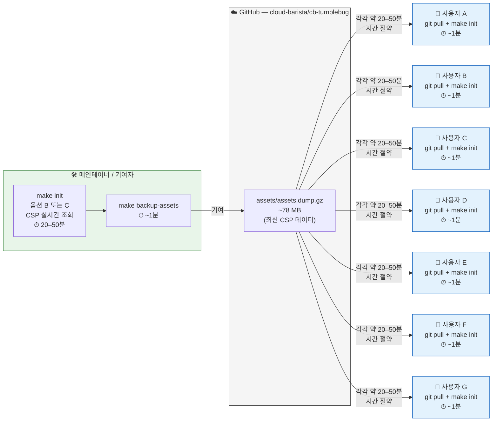
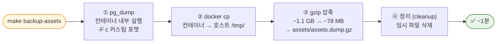
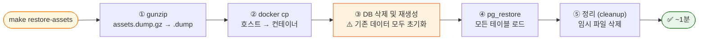

# Assets 백업 및 복원 (Assets Backup & Restore)

CB-Tumblebug는 컴퓨팅 스펙(Spec), OS 이미지(Image), 가격(Pricing) 데이터를 PostgreSQL에 저장합니다. 모든 클라우드 제공자(CSP)로부터 이 데이터를 실시간으로 가져오는 데는 20~50분이 소요됩니다. 사전 빌드된 백업을 사용하면 이 시간을 **약 1분**으로 단축할 수 있습니다.

## 소요 시간 비교

| 방식 (`make init` 옵션) | 소요 시간 | 비고 |
|--------|------|-------|
| **a. 백업에서 복원 (Restore from backup)** | **~1분** | 백업 데이터만 복원 (`cloudimage.csv`는 재적용되지 않음) |
| **a+. 백업에서 복원 + CSV 패치 (Restore from backup + patch CSV)** | **~2분** | 백업 데이터 복원 후 최신 `cloudimage.csv`를 추가로 적용 |
| b. CSP에서 가져오기 (Azure 제외) | ~20–30분 | 실시간 조회 후 마지막에 `cloudimage.csv` 병합 |
| c. 모든 CSP에서 가져오기 | ~40–50분 | Azure를 포함한 실시간 조회 후 마지막에 `cloudimage.csv` 병합 |

---

## 빠른 시작 (Quick Start)

```bash
# 현재 데이터베이스 백업
make backup-assets

# 백업에서 복원 (make init 사용 권장)
# 옵션 a 선택  : 복원만 수행       (~1분)
# 옵션 a+ 선택 : 복원 + CSV 패치 (~2분, cloudimage.csv가 업데이트된 경우 유용)
make init

# 백업 파일에서 직접 복원 (init 메뉴 건너뜀)
make restore-assets

# 특정 파일에서 복원
make restore-assets FILE=./backups/postgres/tumblebug_db_20240115.dump.gz
```

---

## 백업 생태계 동작 방식

백업 파일(`assets/assets.dump.gz`)은 GitHub 저장소에 커밋되어 관리됩니다. 메인테이너가 이를 최신 상태로 유지하며, 모든 사용자는 `git pull`을 통해 자동으로 최신 백업의 이점을 누릴 수 있습니다.



---

## 백업 흐름 (Backup Flow)



## 복원 흐름 (Restore Flow)



> 복원 작업은 PostgreSQL의 모든 데이터를 교체합니다. 단, etcd에 저장된 데이터(네임스페이스, Infra 상태, 자격 증명)에는 영향을 주지 **않습니다**.

---

## 백업 대상 항목

**포함됨 (PostgreSQL):** 컴퓨팅 스펙(Spec), OS 이미지(Image), 가격 정보(Pricing), 리전 정보(Region info)

**포함되지 않음 (etcd에 저장됨):** 실행 중인 Infra, 네임스페이스(Namespace), 자격 증명(Credential)

---

## `cloudimage.csv`와 백업의 관계

`assets/cloudimage.csv`는 CSP API를 통해 확보하기 어려운 이미지들을 수동으로 엄선하여 관리하는 목록입니다. 여기에는 너무 자주 변경되거나, 조회 시간이 지나치게 오래 걸리거나, 표준 API를 통해 노출되지 않는 이미지(예: Azure 마켓플레이스 이미지, AWS/GCP Kubernetes 노드 타입 식별자 등)가 포함됩니다.

`make init` 실행 시 옵션 **b** 또는 **c**를 선택하면, CSP 실시간 조회가 완료된 *후* `cloudimage.csv`가 데이터베이스에 자동으로 병합됩니다. 백업 파일(`assets.dump.gz`)에는 백업 시점에 적용되어 있던 CSV 데이터를 포함하여 *백업 당시*의 최신 상태가 그대로 담겨 있습니다.

만약 백업이 생성된 이후에 `cloudimage.csv`가 업데이트되었다면, 전체 CSP 조회를 다시 수행할 필요 없이 **옵션 a+를** 사용하여 백업을 복원한 직후 최신 CSV 데이터를 그 위에 즉시 재적용할 수 있습니다.

```
옵션 a   → pg_restore만 수행
           (백업 시점 기준의 cloudimage.csv 상태 유지)

옵션 a+  → pg_restore 수행
           + POST /tumblebug/updateImagesFromAsset 호출
           (현재 파일 기준으로 cloudimage.csv 재적용)

옵션 b/c → 실시간 CSP 조회 수행
           + 마지막에 cloudimage.csv 병합
```

---

## 업데이트된 백업 기여하기

```bash
make init                          # 옵션 B 또는 C — 실시간 조회
make backup-assets                 # assets/assets.dump.gz로 백업 캡처
git add assets/assets.dump.gz
git commit -m "chore: update assets database — $(date +%Y-%m-%d)"
# Pull Request 생성
```

---

## 파일 위치

```
cb-tumblebug/
├── assets/
│   └── assets.dump.gz     # Git에 커밋됨 — GitHub를 통해 공유
├── backups/postgres/
│   └── *.dump.gz          # 로컬 수동 백업 (git-ignored)
└── scripts/
    ├── backup-assets.sh
    └── restore-assets.sh
```

---

## 문제 해결 (Troubleshooting)

| 문제 | 해결 방법 |
|---------|-----|
| `container is not running` | `make up` 실행 |
| `backup file not found` | 파일 경로를 확인하거나 먼저 `make backup-assets` 실행 |
| 확인 프롬프트 건너뛰기 | `RESTORE_SKIP_CONFIRM=yes ./scripts/restore-assets.sh` 실행 |

---

## 관련 문서

- [`make init` 워크플로우](make-init-workflow.md)
- [리소스 템플릿 관리 (Resource Template Management)](resource-template-management.md)
