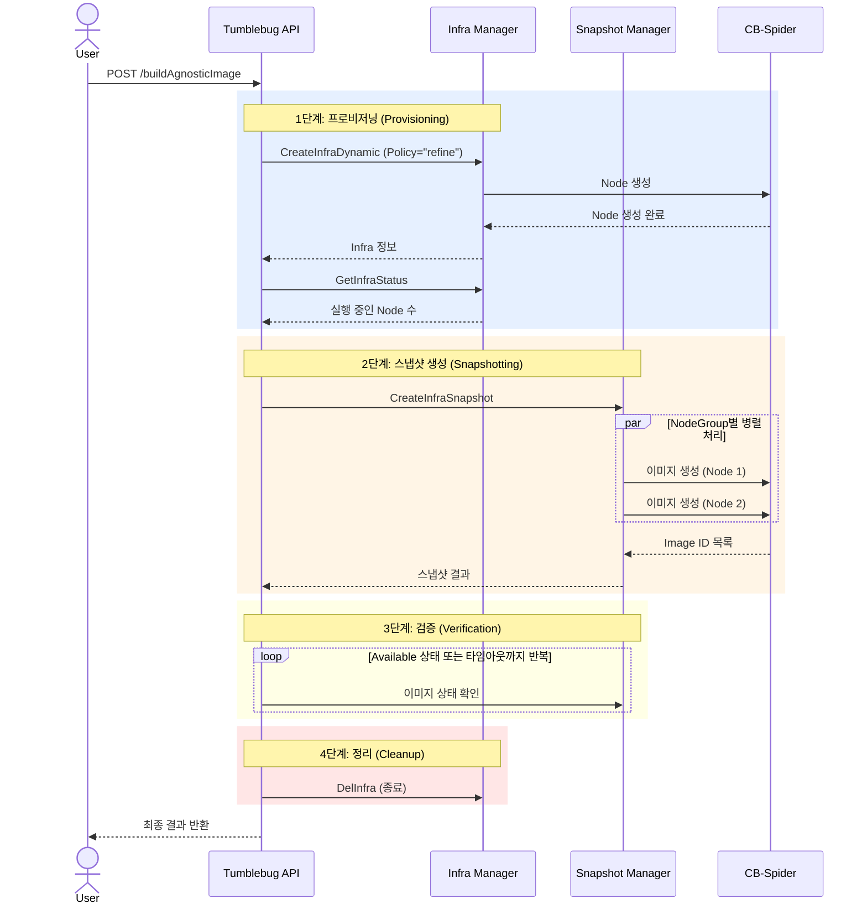
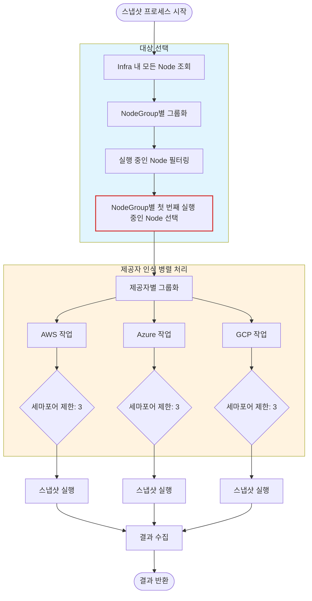
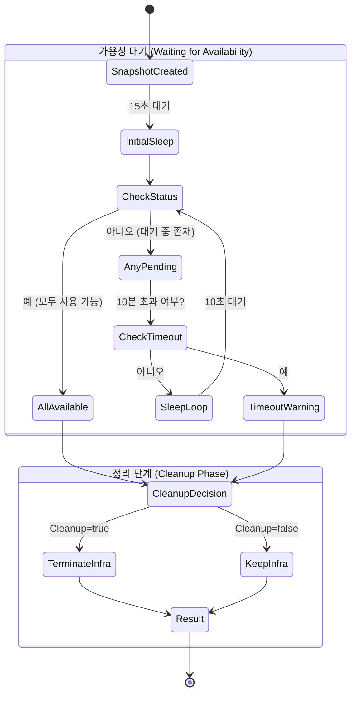
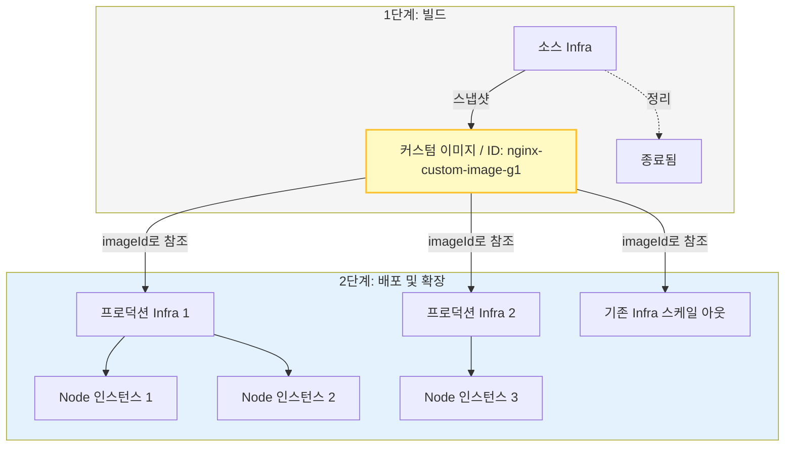

# 클라우드 종속성 없는 이미지 (Cloud-Agnostic Image)

CB-Tumblebug를 활용한 CSP 비종속적 자동화 커스텀 이미지 생성 종합 가이드

## 📑 목차

1. [개요](#개요)
2. [주요 기능](#주요-기능)
3. [워크플로우 아키텍처](#워크플로우-아키텍처)
4. [API 레퍼런스](#api-레퍼런스)
5. [사용 시나리오](#사용-시나리오)

---

## 개요

### Cloud-Agnostic Image란 무엇인가요?

**Cloud-Agnostic Image**는 다중 클라우드 제공자(CSP) 환경에서 커스텀 머신 이미지(스냅샷)를 생성하는 전체 수명 주기를 자동화하는 CB-Tumblebug의 고수준 워크플로우입니다. 단 한 번의 API 호출로 인프라 프로비저닝, 소프트웨어 설치(배포 후 명령어 실행), 스냅샷 생성, 리소스 정리까지 모두 처리합니다.

### 왜 Cloud-Agnostic Image를 사용해야 하나요?

**기존 문제점:**
- 수동으로 커스텀 이미지를 생성하려면 여러 단계를 거쳐야 합니다: Node 프로비저닝 → 소프트웨어 설치 → 검증 → Node 중지 → 이미지 생성 → Node 삭제.
- 이를 여러 클라우드(AWS, Azure, GCP 등)에 걸쳐 수행하려면 각기 다른 도구와 절차가 필요합니다.
- 타이밍 관리(Node가 준비될 때까지 대기, 이미지가 사용 가능 상태가 될 때까지 대기)가 복잡하고 오류가 발생하기 쉽습니다.

**해결책:**
- **원클릭 자동화(One-Click Automation)**: 인프라와 소프트웨어를 한 번만 정의하면 나머지는 Tumblebug가 알아서 처리합니다.
- **CSP 비종속성(CSP Agnostic)**: 지원되는 모든 클라우드 제공자에서 동일한 방식으로 작동합니다.
- **리소스 효율성(Resource Efficiency)**: 이미지가 안전하게 확보된 후 비용이 많이 드는 컴퓨팅 리소스를 자동으로 정리합니다.

### 핵심 요약

✅ **엔드투엔드 자동화(End-to-End Automation)**: 빈 상태에서 바로 사용할 수 있는 커스텀 이미지 생성까지 단일 요청으로 처리합니다.
✅ **병렬 처리(Parallel Processing)**: 여러 Node(NodeGroup별)에 대한 스냅샷을 동시에 생성합니다.
✅ **스마트 정리(Smart Cleanup)**: 이미지가 "Available(사용 가능)" 상태로 확인된 후에만 임시 Node를 자동으로 종료합니다.
✅ **오류 처리(Error Handling)**: "Refine" 정책을 사용하여 일부 프로비저닝 실패 상황을 유연하게 처리합니다.
✅ **상태 추적(Status Tracking)**: 이미지 생성 진행 상황을 모니터링하고 정리 전에 가용성을 보장합니다.

---

## 주요 기능

### 1. 자동화된 워크플로우

시스템은 엄격하게 순서가 지정된 일련의 작업을 실행합니다:

1. **프로비저닝(Provisioning)**: 사용자의 명세에 따라 임시 Infra(멀티클라우드 인프라)를 생성합니다.
2. **구성(Configuration)**: 배포 후 명령어(예: `apt install nginx`)를 실행하여 소프트웨어 환경을 설정합니다.
3. **스냅샷 생성(Snapshotting)**: 실행 중인 각 Node에 대해 CSP 네이티브 스냅샷 메커니즘을 트리거합니다.
4. **검증(Verification)**: 이미지 상태가 `Available`로 전환될 때까지 상태를 능동적으로 폴링합니다.
5. **정리(Cleanup)**: 불필요한 비용 발생을 방지하기 위해 임시 Infra를 종료합니다(선택 사항이지만 권장됨).

### 2. 병렬 스냅샷 생성

- 각 NodeGroup에서 실행 중인 첫 번째 Node를 식별합니다.
- 서로 다른 클라우드 제공자에 걸쳐 스냅샷 요청을 병렬로 실행합니다.
- API 속도 제한(Rate Limiting)을 방지하기 위해 제공자별 세마포어(Semaphore)를 사용합니다.

### 3. 안전 메커니즘

- **가용 상태 대기(Wait-for-Available)**: 생성된 이미지가 완전히 등록되어 사용 가능한 상태가 될 때까지 소스 Node를 삭제하지 않습니다.
- **부분 실패 처리(Partial Failure Handling)**: 일부 Node의 프로비저닝이 실패하더라도, 성공한 Node들에 대해서는 스냅샷 생성을 계속 진행합니다.
- **정리 보호(Cleanup Protection)**: 스냅샷 생성이 완전히 실패하더라도 좀비 리소스가 남지 않도록 정리 작업을 강제할 수 있습니다.

---

## 워크플로우 아키텍처

### 1. 전체 실행 시퀀스

다음 시퀀스 다이어그램은 사용자, Tumblebug 컴포넌트, 그리고 하부 CB-Spider 계층 간의 상호작용을 보여줍니다.



### 2. 스마트 스냅샷 전략

Tumblebug는 대표 Node를 선택하고 제공자별 API 동시성 제한을 관리하여 스냅샷 프로세스를 최적화합니다.



### 3. 검증 및 정리 로직

시스템은 소스 인프라를 삭제하기 전에 이미지가 실제로 사용 가능한 상태인지 확인합니다.



### 상태 전환 및 소요 시간

| 단계 | 설명 | 일반적인 소요 시간 |
|-------|-------------|------------------|
| **Provisioning (프로비저닝)** | Node 생성 및 소프트웨어 설치 | 2 - 10분 |
| **Snapshotting (스냅샷 생성)** | CSP 스냅샷 API 트리거 | 1 - 5분 |
| **Waiting (대기)** | 클라우드 제공자가 이미지를 최종 완료할 때까지 대기 | 5 - 20분 |
| **Cleanup (정리)** | 리소스 종료 및 정리 | 1 - 3분 |

### 4. 수명 주기: 한 번 빌드하여 여러 곳에 배포 (Build Once, Deploy Many)

커스텀 이미지가 생성되면 Tumblebug 내에서 재사용 가능한 자산(Asset)이 됩니다. 생성된 `imageId`를 사용하여 동일한 Node 인스턴스를 여러 개 생성할 수 있으므로 빠른 확장(Scale)과 일관된 배포가 가능합니다.



**재사용 방법:**
빌드 프로세스에서 반환된 `imageId`를 표준 Infra 생성 요청에 그대로 사용하기만 하면 됩니다:

```json
{
  "node": [
    {
      "imageId": "nginx-custom-image-g1",
      "specId": "aws-t3-small",
      "name": "prod-node-01"
    }
  ]
}
```

---

## API 레퍼런스

### Agnostic Image 생성

**엔드포인트:** `POST /ns/{nsId}/buildAgnosticImage`

**요청 본문 (Request Body):**
```json
{
  "sourceInfraReq": {
    "name": "build-image-infra",
    "nodeGroups": [
      {
        "nodeGroupSize": "1",
        "name": "base-group",
        "imageId": "ubuntu-22.04",
        "specId": "aws-t3-small"
      }
    ],
    "postCommands": [
      {
        "command": [
          "sudo apt-get update",
          "sudo apt-get install -y nginx"
        ]
      }
    ]
  },
  "snapshotReq": {
    "name": "nginx-custom-image",
    "description": "Ubuntu 22.04 with Nginx pre-installed"
  },
  "cleanupInfraAfterSnapshot": true,
  "policyOnPostCommandFailure": "abort"
}
```

**파라미터:**

| 파라미터 | 타입 | 필수 여부 | 기본값 | 설명 |
|-----------|------|----------|---------|-------------|
| `sourceInfraReq` | object | 예 | - | Node 스펙과 배포 후 명령어(post-commands)를 포함한 표준 Infra 생성 요청 |
| `snapshotReq` | object | 예 | - | 생성될 이미지에 대한 구성 정보 (이름, 설명) |
| `cleanupInfraAfterSnapshot` | boolean | 아니오 | `true` | 이미지 생성 성공 후 소스 Infra를 삭제할지 여부 |
| `policyOnPostCommandFailure` | string | 아니오 | `abort` | `abort`: 배포 후 명령어가 정상적으로 완료되지 않으면 빌드를 실패 처리함. `proceed`: 실패와 무관하게 스냅샷 생성 진행 |

### 이미지 빌드에서의 배포 후 명령어 (Post-deployment Commands)

`sourceInfraReq` 내의 명령어는 **이미지에 어떤 내용이 포함될지**를 정의하므로, 이 워크플로우는 이를 부수적인 작업이 아닌 핵심 빌드 단계로 취급합니다:

- **항상 동기식(Synchronous)으로 실행됩니다.** 부트스트랩 결과가 확인되기 전에는 스냅샷이 시작되어서는 안 되므로, `sourceInfraReq`에 `postCommandAsync: true`가 설정되어 있더라도 무시되며 로그에 기록됩니다.
- **부트스트랩 실패 시 기본적으로 빌드가 중단됩니다** (`policyOnPostCommandFailure: abort`):
  스냅샷을 생성하지 않으며, 실패 원인이 `message`에 반환되고 `postCommandStatus`가 결과에 그대로 포함됩니다. 이때도 리소스 정리를 위해 `cleanupInfraAfterSnapshot` 설정은 그대로 준수됩니다.
  명령어 실패 여부와 상관없이 의도적으로 이미지를 구우려는 경우에만 `proceed`로 설정하십시오.
- **순차적 단계(Ordered phases)를 지원합니다.** `postCommands[]`에 여러 항목을 추가하여 설치 → 구성 → 스냅샷 생성 전 정리(예: `cloud-init clean`, `waagent -deprovision`) 단계를 분리할 수 있으며, 여러 이미지를 한 번에 빌드할 때 서로 다른 NodeGroup을 대상으로 지정할 수도 있습니다.

전체 동작 방식(대상 지정, 타임아웃, 상태 값 등)에 대한 자세한 내용은 [Infra 프로비저닝 → 배포 후 명령어 (Post-deployment Commands)](infra-provisioning.md)를 참조하십시오.

**응답 (Response):** `200 OK`
```json
{
  "namespace": "default",
  "infraId": "build-image-infra",
  "infraStatus": "Terminated",
  "infraCleanedUp": true,
  "totalDuration": "12m45s",
  "message": "Successfully created 1 custom images from Infra build-image-infra and cleaned up infrastructure",
  "snapshotResult": {
    "infraId": "build-image-infra",
    "successCount": 1,
    "failCount": 0,
    "results": [
      {
        "nodeGroupId": "g1",
        "nodeId": "base-group-01",
        "status": "Success",
        "imageId": "nginx-custom-image-g1",
        "imageInfo": { ... }
      }
    ]
  }
}
```

---

## 사용 시나리오

### 1. 골든 이미지 파이프라인 (Golden Image Pipeline)
보안 패치와 컴플라이언스 도구가 사전 설치된 표준화된 "골든 이미지"를 생성합니다.
- **입력**: 기본 OS 이미지 (예: Ubuntu 22.04)
- **배포 후 명령어**: 보안 강화 스크립트, 모니터링 에이전트 설치
- **출력**: 프로덕션 배포 준비가 완료된 보안 강화 커스텀 이미지

### 2. 애플리케이션 사전 베이킹 (Application Pre-baking)
오토스케일링 그룹의 부팅 시간을 단축하기 위해 복잡한 애플리케이션 스택을 사전에 설치합니다.
- **입력**: 기본 OS
- **배포 후 명령어**: `docker install`, `git clone app`, `npm install`
- **출력**: 부팅 즉시 트래픽을 처리할 수 있는 애플리케이션 준비 완료 이미지

### 3. 크로스 클라우드 복제 (Cross-Cloud Replication)
(각 CSP별로 워크플로우 실행 필요)
- 하나의 `BuildAgnosticImage` 요청 구조를 정의합니다.
- 대상 클라우드(AWS, Azure, GCP)에 맞게 `specId`와 `imageId`만 변경합니다.
- 이를 실행하여 서로 다른 클라우드 전반에 걸쳐 기능적으로 동일한 이미지를 확보합니다.

---

## GUI 기반 테스트

### 요청 (request)


### 결과 (result)


