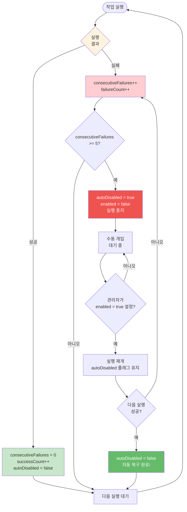
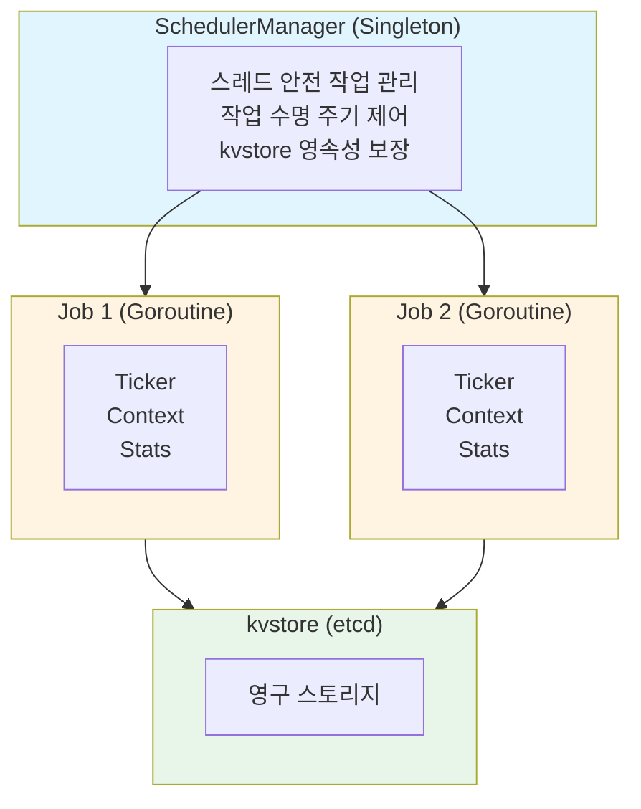
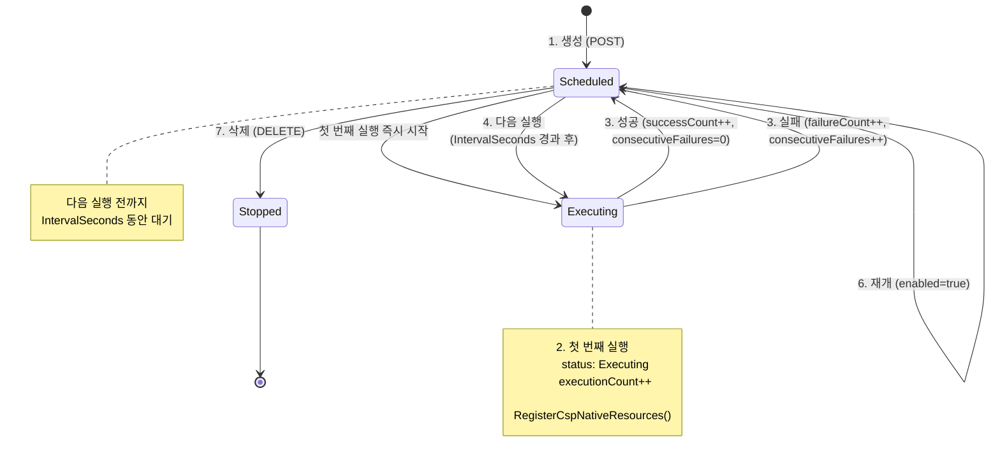
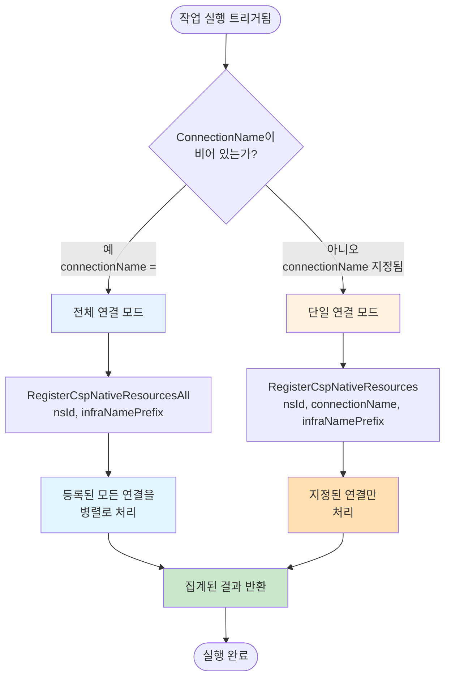
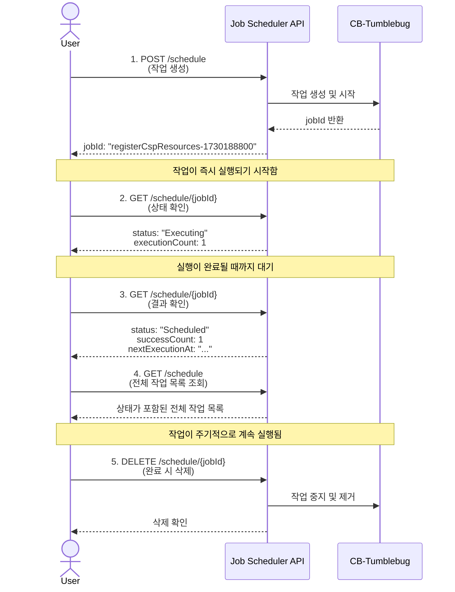
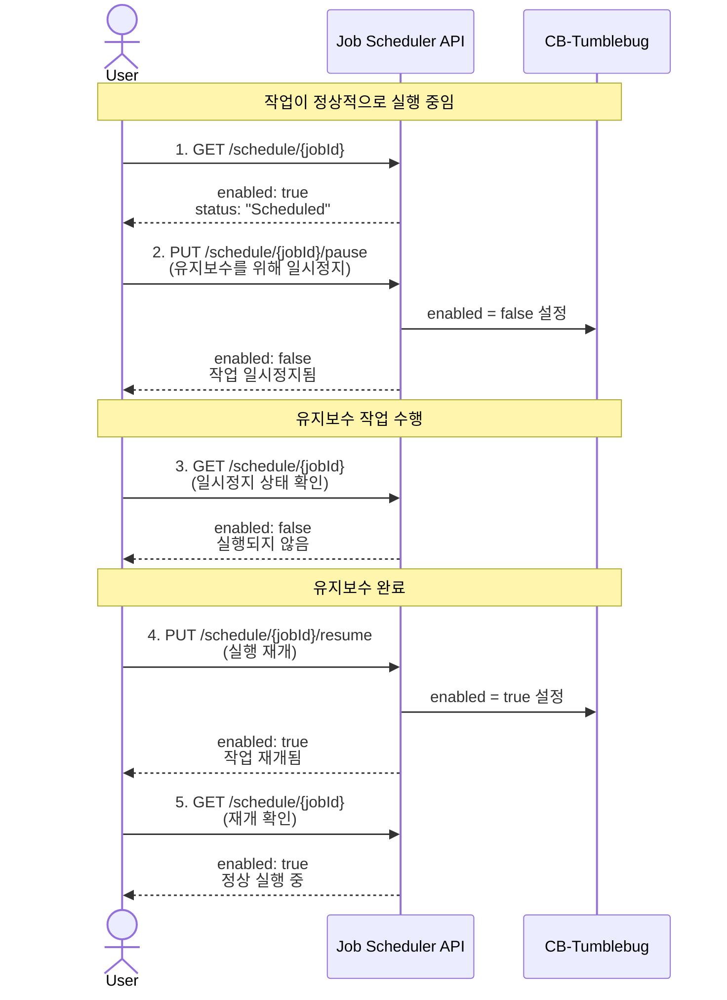
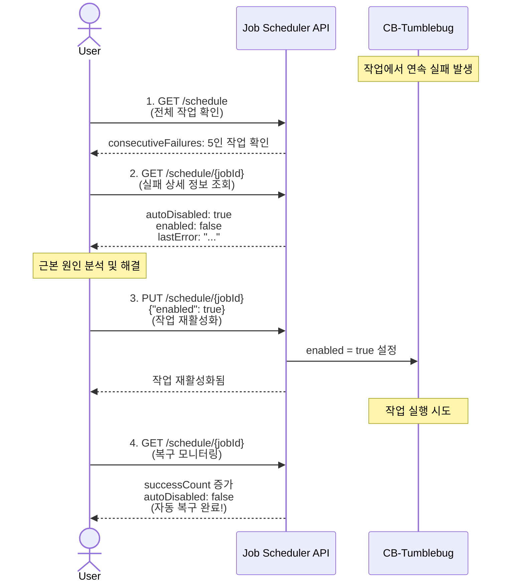
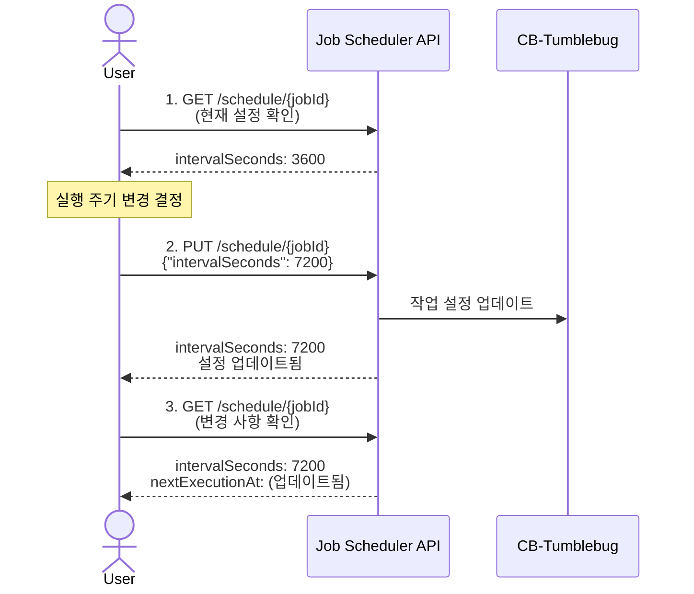
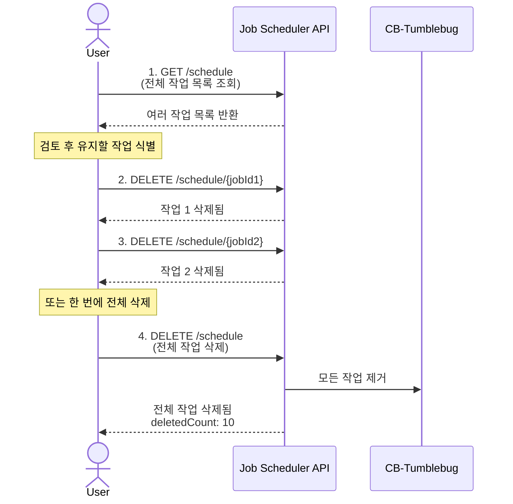

# 작업 스케줄러 사용자 가이드 (Job Scheduler User Guide)

CB-Tumblebug의 작업 스케줄러(Job Scheduler)를 활용한 CSP 리소스 자동 등록 종합 가이드

## 📑 목차

1. [개요](#개요)
2. [주요 기능](#주요-기능)
3. [아키텍처](#아키텍처)
4. [시작하기](#시작하기)
5. [API 레퍼런스](#api-레퍼런스)
6. [사용 시나리오](#사용-시나리오)
7. [고급 설정](#고급-설정)
8. [모니터링 및 관리](#모니터링-및-관리)
9. [문제 해결](#문제-해결)
10. [모범 사례](#모범-사례)

---

## 개요

### 작업 스케줄러(Job Scheduler)란?

작업 스케줄러(Job Scheduler)는 CB-Tumblebug에서 반복적인 작업을 자동으로 실행하는 시스템입니다. 현재 **CSP 리소스 등록 작업**의 자동화를 지원하며, 설정된 주기에 따라 CSP 네이티브 리소스(`VNet`, `SecurityGroup`, `SSHKey`, `Node`)를 자동으로 수집하여 등록합니다.

### 왜 작업 스케줄러를 사용해야 하나요?

**문제점:**
- CSP에서 생성된 리소스를 CB-Tumblebug에 수동으로 등록하는 작업이 반복적임
- 정기적인 동기화가 필요하지만 수동 실행은 번거롭고 오류가 발생하기 쉬움
- 여러 CSP와 리전에 걸친 리소스를 주기적으로 확인해야 함

**해결책:**
- 작업 스케줄러를 통한 주기적 자동 실행
- 한 번 설정하면 지속적으로 실행
- 실행 이력, 성공/실패 추적, 자동 복구(auto-recovery) 기능 제공

### 핵심 특징

✅ **즉시 실행**: 작업 생성 즉시 첫 번째 실행 시작  
✅ **주기적 반복**: 설정된 주기(최소 10초)마다 자동 실행  
✅ **유연한 대상 지정**: 특정 연결(Connection) 또는 전체 연결 선택 가능  
✅ **스마트 라우팅**: `connectionName`이 비어 있으면 → 등록된 모든 연결을 자동으로 처리  
✅ **자동 복구**: 연속 5회 실패 시 자동 비활성화, 이후 실행 성공 시 자동 복구  
✅ **네임스페이스 독립성**: 작업은 전역(Global)으로 관리되며, `nsId`는 등록 대상 지정 용도로 사용  
✅ **영속성(Persistence)**: 서버 재시작 후에도 작업이 자동으로 복구됨  
✅ **중복 방지**: 동일한 설정을 가진 작업의 중복 생성을 차단

---

## GUI 기반 테스트

### 동기화 스케줄링 요청


### 동기화 스케줄링 결과


---

## 주요 기능

### 1. 주기적 자동 실행

```
Task Complete → [Interval Wait] → Task Execute → [Interval Wait] → ...
```

- **주기(Interval) 기반**: 작업 완료 후 정확히 설정된 주기만큼 대기한 뒤 다음 실행을 시작합니다.
- **Cron과의 차이점**: 작업 소요 시간과 관계없이 일정한 대기 간격을 유지합니다.
- **최소 주기**: 10초 (테스트/개발 환경용)
- **권장 주기**: 운영(Production) 환경에서는 30분 이상 권장

### 2. 스마트 대상 선택

**단일 연결 모드 (Single Connection Mode):**
```json
{
  "connectionName": "aws-ap-northeast-2",
  "infraNamePrefix": "aws-kr"
}
```
→ 지정된 연결의 리소스만 등록합니다.

**전체 연결 모드 (All Connections Mode):**
```json
{
  "connectionName": "",
  "infraNamePrefix": "all-csps"
}
```
→ 등록된 모든 연결의 리소스를 자동으로 등록합니다.

### 3. 실행 상태 추적

| 상태 | 의미 | 전환 조건 |
|--------|---------|---------------------|
| `Scheduled` | 다음 실행 대기 중 | 작업 생성 후 또는 실행 완료 후 |
| `Executing` | 현재 작업 실행 중 | 실행 시간에 도달했을 때 |
| `Stopped` | 작업이 중지됨 | `DELETE`가 호출되었을 때 |

### 4. 실패 처리 및 자동 복구



**통계 추적:**
- `executionCount`: 총 실행 횟수
- `successCount`: 성공 횟수
- `failureCount`: 실패 횟수
- `consecutiveFailures`: 연속 실패 횟수

### 5. 타임아웃 보호

- **기본 타임아웃**: 30분
- **초과 시**: 자동으로 실패 처리되며 다음 실행을 대기합니다.
- **서버 재시작 시**: `Executing` 상태에서 `Scheduled` 상태로 자동 복구됩니다.

---

## 아키텍처

### 시스템 구성 요소



### 작업 수명 주기 (Job Lifecycle)



### 스마트 라우팅 로직



### 네임스페이스 독립성

**중요:** 작업(Job)은 특정 네임스페이스에 종속되지 않습니다!

```
kvstore 구조:
/scheduledJob/{jobId}  ← nsId가 없음!

작업의 nsId 필드:
→ 리소스가 등록될 "대상 네임스페이스"를 지정함
→ 작업 자체의 소유권을 의미하지 않음
```

**예시:**
```json
{
  "jobId": "job-123",
  "nsId": "production",     ← 리소스가 등록될 대상 네임스페이스
  "connectionName": "aws-us-east-1"
}
```
→ 이 작업은 AWS 리소스를 `production` 네임스페이스에 등록합니다.

---

## 시작하기

### 사전 요구 사항

- CB-Tumblebug 실행 중
- 최소 1개 이상의 CSP 연결(Connection) 등록 완료
- 적절한 권한 설정 완료 (API 인증)

### API 사용 흐름

일반적인 워크플로우를 이해하면 작업 스케줄러를 효과적으로 사용할 수 있습니다. 주요 사용 패턴은 다음과 같습니다.

#### 기본 워크플로우: 생성, 모니터링 및 관리



#### 일시정지 및 재개 워크플로우



#### 실패 복구 워크플로우



#### 설정 업데이트 워크플로우



#### 일괄 관리 워크플로우



### 빠른 시작 (Quick Start)

#### 1. 기본 작업 생성

```bash
curl -X POST http://localhost:1323/tumblebug/registerCspResources/schedule \
  -H "Content-Type: application/json" \
  -d '{
    "jobType": "registerCspResources",
    "nsId": "default",
    "intervalSeconds": 3600,
    "connectionName": "aws-ap-northeast-2",
    "infraNamePrefix": "aws-kr-resources"
  }'
```

**응답 예시:**
```json
{
  "jobId": "registerCspResources-1730188800",
  "jobType": "registerCspResources",
  "nsId": "default",
  "status": "Executing",
  "intervalSeconds": 3600,
  "enabled": true,
  "createdAt": "2025-10-29T10:00:00Z",
  "nextExecutionAt": "2025-10-29T11:00:00Z",
  "executionCount": 1,
  "successCount": 0,
  "failureCount": 0,
  "consecutiveFailures": 0,
  "connectionName": "aws-ap-northeast-2",
  "infraNamePrefix": "aws-kr-resources"
}
```

#### 2. 작업 상태 확인

```bash
curl http://localhost:1323/tumblebug/registerCspResources/schedule/{jobId}
```

#### 3. 작업 목록 조회

```bash
curl http://localhost:1323/tumblebug/registerCspResources/schedule
```

#### 4. 작업 일시정지

```bash
curl -X PUT http://localhost:1323/tumblebug/registerCspResources/schedule/{jobId}/pause
```

#### 5. 작업 재개

```bash
curl -X PUT http://localhost:1323/tumblebug/registerCspResources/schedule/{jobId}/resume
```

#### 6. 작업 삭제

```bash
curl -X DELETE http://localhost:1323/tumblebug/registerCspResources/schedule/{jobId}
```

---

## API 레퍼런스

### 1. 스케줄 작업 생성

**엔드포인트:** `POST /registerCspResources/schedule`

**요청 본문 (Request Body):**
```json
{
  "jobType": "registerCspResources",        // 필수: 작업 유형
  "nsId": "default",                        // 필수: 대상 네임스페이스
  "intervalSeconds": 3600,                  // 필수: 실행 주기 (초 단위, 최소 10)
  "connectionName": "aws-ap-northeast-2",   // 선택: 특정 연결 (비어 있으면 전체 연결)
  "infraNamePrefix": "infra-prefix",        // 선택: Infra 이름 접두사
  "option": "vNet,securityGroup",           // 선택: 리소스 유형 (비어 있으면 전체 리소스)
  "infraFlag": "y"                          // 선택: "y" (단일 Infra), "n" (Node별 개별 Infra)
}
```

**파라미터:**

| 파라미터 | 타입 | 필수 여부 | 기본값 | 설명 |
|-----------|------|----------|---------|-------------|
| `jobType` | string | 예 | - | 고정값: `"registerCspResources"` |
| `nsId` | string | 예 | - | 리소스를 등록할 대상 네임스페이스 |
| `intervalSeconds` | int | 예 | - | 실행 주기 (초 단위), 최소 10 |
| `connectionName` | string | 아니오 | `""` | 특정 연결 지정 (비어 있으면 모든 연결 대상) |
| `infraNamePrefix` | string | 아니오 | `"infra"` | Infra 이름 접두사 |
| `option` | string | 아니오 | `""` | 등록할 리소스 유형 (비어 있으면 모든 리소스) |
| `infraFlag` | string | 아니오 | `"y"` | `"y"`: 단일 Infra로 그룹화, `"n"`: Node별 개별 Infra 생성 |

**`option` 값 설명:**
등록할 리소스 유형을 쉼표(`,`)로 구분하여 지정합니다 (예: `"vNet, customImage"`).

* **지원되는 유형:** `vNet`, `securityGroup`, `sshKey`, `vm`, `dataDisk`, `customImage`
* **기본 동작 (`""`):** 비어 있는 경우 지원되는 **모든** 리소스 유형이 등록됩니다.
* **의존성 참고:** 논리적 의존성이 충족되어야 합니다 (예: `securityGroup`을 선택하려면 `vNet`도 함께 선택되어야 함).

**응답:** `200 OK`
```json
{
  "jobId": "registerCspResources-1730188800",
  "jobType": "registerCspResources",
  "nsId": "default",
  "status": "Executing",
  "intervalSeconds": 3600,
  "executionTimeout": 1800,
  "enabled": true,
  "connectionName": "aws-ap-northeast-2",
  "infraNamePrefix": "infra-prefix",
  "createdAt": "2025-10-29T10:00:00Z",
  "lastExecutedAt": "2025-10-29T10:00:00Z",
  "nextExecutionAt": "2025-10-29T11:00:00Z",
  "executionCount": 1,
  "successCount": 0,
  "failureCount": 0,
  "consecutiveFailures": 0,
  "autoDisabled": false
}
```

**오류 응답:**
- `400 Bad Request`: 잘못된 요청 형식이거나 필수 필드 누락
- `409 Conflict`: 동일한 설정의 작업이 이미 존재함
- `500 Internal Server Error`: 서버 내부 오류

### 2. 스케줄 작업 목록 조회

**엔드포인트:** `GET /registerCspResources/schedule`

**응답:** `200 OK`
```json
{
  "jobs": [
    {
      "jobId": "registerCspResources-1730188800",
      "jobType": "registerCspResources",
      "nsId": "default",
      "status": "Scheduled",
      "intervalSeconds": 3600,
      "enabled": true,
      "connectionName": "aws-ap-northeast-2",
      "infraNamePrefix": "aws-kr",
      "executionCount": 5,
      "successCount": 5,
      "failureCount": 0,
      "lastExecutedAt": "2025-10-29T14:00:00Z",
      "nextExecutionAt": "2025-10-29T15:00:00Z"
    }
  ]
}
```

### 3. 작업 상태 조회

**엔드포인트:** `GET /registerCspResources/schedule/{jobId}`

**경로 파라미터 (Path Parameters):**
- `jobId`: 작업 ID (예: `"registerCspResources-1730188800"`)

**응답:** `200 OK`
```json
{
  "jobId": "registerCspResources-1730188800",
  "jobType": "registerCspResources",
  "nsId": "default",
  "status": "Scheduled",
  "intervalSeconds": 3600,
  "executionTimeout": 1800,
  "enabled": true,
  "connectionName": "aws-ap-northeast-2",
  "infraNamePrefix": "aws-kr",
  "option": "",
  "infraFlag": "y",
  "createdAt": "2025-10-29T10:00:00Z",
  "lastExecutedAt": "2025-10-29T14:00:00Z",
  "nextExecutionAt": "2025-10-29T15:00:00Z",
  "executionCount": 5,
  "successCount": 5,
  "failureCount": 0,
  "consecutiveFailures": 0,
  "lastError": "",
  "lastResult": "Successfully registered 15 resources",
  "autoDisabled": false
}
```

### 4. 작업 설정 업데이트

**엔드포인트:** `PUT /registerCspResources/schedule/{jobId}`

**요청 본문 (Request Body):**
```json
{
  "intervalSeconds": 7200,     // 선택: 실행 주기 변경
  "enabled": true              // 선택: 활성화/비활성화
}
```

**응답:** `200 OK` (업데이트된 작업 상태 반환)

### 5. 작업 일시정지

**엔드포인트:** `PUT /registerCspResources/schedule/{jobId}/pause`

**요청 본문:** 없음

**응답:** `200 OK`
```json
{
  "jobId": "registerCspResources-1730188800",
  "status": "Scheduled",
  "enabled": false,
  "message": "Job paused successfully"
}
```

### 6. 작업 재개

**엔드포인트:** `PUT /registerCspResources/schedule/{jobId}/resume`

**요청 본문:** 없음

**응답:** `200 OK`
```json
{
  "jobId": "registerCspResources-1730188800",
  "status": "Scheduled",
  "enabled": true,
  "message": "Job resumed successfully"
}
```

### 7. 작업 삭제

**엔드포인트:** `DELETE /registerCspResources/schedule/{jobId}`

**응답:** `200 OK`
```json
{
  "message": "Scheduled job stopped and deleted successfully: registerCspResources-1730188800"
}
```

### 8. 전체 작업 삭제

**엔드포인트:** `DELETE /registerCspResources/schedule`

**응답:** `200 OK`
```json
{
  "message": "All scheduled jobs deleted successfully",
  "deletedCount": 3
}
```

---

## 사용 시나리오

### 시나리오 1: 단일 CSP 정기 동기화

**요구 사항:**
- 매시간 AWS `ap-northeast-2` 리전 리소스 동기화
- 모든 리소스 유형 포함

**설정:**
```bash
curl -X POST http://localhost:1323/tumblebug/registerCspResources/schedule \
  -H "Content-Type: application/json" \
  -d '{
    "jobType": "registerCspResources",
    "nsId": "production",
    "intervalSeconds": 3600,
    "connectionName": "aws-ap-northeast-2",
    "infraNamePrefix": "aws-kr-prod",
    "option": "",
    "infraFlag": "y"
  }'
```

### 시나리오 2: 멀티 CSP 통합 관리

**요구 사항:**
- 등록된 모든 CSP의 리소스를 6시간마다 수집
- CSP별로 분리된 네임스페이스에 등록

**설정 (네임스페이스별):**

```bash
# AWS 리소스를 'aws-ns'에 등록
curl -X POST http://localhost:1323/tumblebug/registerCspResources/schedule \
  -d '{
    "jobType": "registerCspResources",
    "nsId": "aws-ns",
    "intervalSeconds": 21600,
    "connectionName": "aws-ap-northeast-2",
    "infraNamePrefix": "aws-resources"
  }'

# Azure 리소스를 'azure-ns'에 등록
curl -X POST http://localhost:1323/tumblebug/registerCspResources/schedule \
  -d '{
    "jobType": "registerCspResources",
    "nsId": "azure-ns",
    "intervalSeconds": 21600,
    "connectionName": "azure-koreacentral",
    "infraNamePrefix": "azure-resources"
  }'

# GCP 리소스를 'gcp-ns'에 등록
curl -X POST http://localhost:1323/tumblebug/registerCspResources/schedule \
  -d '{
    "jobType": "registerCspResources",
    "nsId": "gcp-ns",
    "intervalSeconds": 21600,
    "connectionName": "gcp-asia-northeast3",
    "infraNamePrefix": "gcp-resources"
  }'
```

### 시나리오 3: 네트워크 리소스 전용 주기적 수집

**요구 사항:**
- 30분마다 Node를 제외한 네트워크 관련 리소스만 수집
- 빠른 인프라 변경 사항 감지

**설정:**
```bash
curl -X POST http://localhost:1323/tumblebug/registerCspResources/schedule \
  -d '{
    "jobType": "registerCspResources",
    "nsId": "network-monitoring",
    "intervalSeconds": 1800,
    "connectionName": "aws-us-east-1",
    "infraNamePrefix": "network-scan",
    "option": "vNet,securityGroup",
    "infraFlag": "n"
  }'
```

### 시나리오 4: 개발 환경 빠른 테스트

**요구 사항:**
- 개발 중 빠른 피드백을 위해 짧은 주기로 실행
- 특정 연결만 대상으로 지정

**설정:**
```bash
curl -X POST http://localhost:1323/tumblebug/registerCspResources/schedule \
  -d '{
    "jobType": "registerCspResources",
    "nsId": "dev",
    "intervalSeconds": 60,
    "connectionName": "aws-dev-region",
    "infraNamePrefix": "dev-test"
  }'
```

**테스트 후 삭제:**
```bash
curl -X DELETE http://localhost:1323/tumblebug/registerCspResources/schedule/{jobId}
```

### 시나리오 5: 일일 전체 CSP 리소스 스캔

**요구 사항:**
- 하루에 한 번 모든 연결의 리소스 스캔
- 비피크 시간대에 실행 (서버 부하 최소화)

**설정:**
```bash
curl -X POST http://localhost:1323/tumblebug/registerCspResources/schedule \
  -d '{
    "jobType": "registerCspResources",
    "nsId": "inventory",
    "intervalSeconds": 86400,
    "connectionName": "",
    "infraNamePrefix": "daily-scan"
  }'
```

### 시나리오 6: 일시적 중지 및 재개

**요구 사항:**
- 유지보수 작업 중 작업을 일시정지
- 유지보수 완료 후 작업 재개

**일시정지:**
```bash
curl -X PUT http://localhost:1323/tumblebug/registerCspResources/schedule/{jobId}/pause
```

**재개:**
```bash
curl -X PUT http://localhost:1323/tumblebug/registerCspResources/schedule/{jobId}/resume
```

---

## 고급 설정

### 실행 주기 최적화

| 사용 사례 | 주기 | 이유 |
|----------|----------|--------|
| 개발/테스트 | 10~60초 | 빠른 피드백, 즉각적인 검증 |
| 빈번한 변경 모니터링 | 5~30분 | 리소스 변경 사항의 빠른 감지 |
| 일반 운영(Production) 환경 | 1~6시간 | 안정성과 효율성의 균형 |
| 일일 동기화 | 12~24시간 | 서버 리소스 절약, 대규모 환경에 적합 |

### CSP API 호출 제한(Rate Limit) 고려 사항

**AWS 예시:**
- EC2 `DescribeInstances`: 분당 약 100회 요청
- VPC Describe API: 분당 약 100회 요청

**권장 사항:**
- 다중 연결: 최소 30분 이상 주기 설정
- 단일 연결: 최소 10분 이상 주기 설정
- Rate Limit 오류 발생 시: 실행 주기를 늘릴 것

### 연결 이름(`connectionName`) 전략

**1. 특정 연결 지정 (`connectionName` 명시):**
```json
{
  "connectionName": "aws-ap-northeast-2",
  "infraNamePrefix": "aws-kr"
}
```
- **장점**: 정확한 대상 지정, 빠른 실행 속도
- **단점**: 연결별로 작업을 각각 생성해야 함

**2. 전체 연결 대상 (`connectionName` 비움):**
```json
{
  "connectionName": "",
  "infraNamePrefix": "all-resources"
}
```
- **장점**: 모든 CSP를 한 번에 처리, 간편한 관리
- **단점**: 실행 시간이 길어짐, 실패 시 영향 범위가 큼

### 네임스페이스 전략

**1. CSP별 분리:**
```
nsId: "aws-production"   → AWS 리소스
nsId: "azure-production" → Azure 리소스
nsId: "gcp-production"   → GCP 리소스
```

**2. 목적별 분리:**
```
nsId: "production"  → 운영(Production) 리소스
nsId: "development" → 개발(Development) 리소스
nsId: "staging"     → 스테이징(Staging) 리소스
```

**3. 리전별 분리:**
```
nsId: "asia-pacific"  → 아시아 태평양(APAC) 리전
nsId: "north-america" → 북미(NA) 리전
nsId: "europe"        → 유럽(EU) 리전
```

### Infra 플래그(`infraFlag`) 전략

**`infraFlag: "y"` (권장)**
```json
{
  "infraFlag": "y",
  "infraNamePrefix": "aws-kr"
}
```
- 모든 Node를 하나의 Infra로 그룹화
- 관리 편의성 향상
- 리소스 구조 단순화

**`infraFlag: "n"`**
```json
{
  "infraFlag": "n",
  "infraNamePrefix": "vm"
}
```
- Node별로 개별 Infra 생성
- Node 단위의 세밀한 관리가 필요할 때 사용
- 대규모 환경에서는 권장하지 않음

### 실행 타임아웃 설정

**기본값:** 30분 (1800초)

**사용자 정의 설정 (향후 지원 예정):**
```json
{
  "intervalSeconds": 3600,
  "executionTimeout": 1200
}
```
- 빠른 실행 환경: 10~15분
- 대규모 환경: 30~60분

---

## 모니터링 및 관리

### 실행 상태 모니터링

#### 1. 개별 작업 상태 확인
```bash
curl http://localhost:1323/tumblebug/registerCspResources/schedule/{jobId}
```

**확인해야 할 주요 지표:**
- `status`: 현재 상태 (`Scheduled`/`Executing`)
- `executionCount`: 총 실행 횟수
- `successCount`: 성공 횟수
- `failureCount`: 실패 횟수
- `consecutiveFailures`: 연속 실패 횟수 (5 이상이면 알림 필요)
- `lastExecutedAt`: 마지막 실행 시각
- `nextExecutionAt`: 다음 예정 실행 시각
- `autoDisabled`: 자동 비활성화 여부
- `lastError`: 마지막 오류 메시지
- `lastResult`: 마지막 실행 결과

#### 2. 전체 작업 확인
```bash
curl http://localhost:1323/tumblebug/registerCspResources/schedule
```

### 성공률 계산

```python
success_rate = (successCount / executionCount) * 100
```

**예시:**
```json
{
  "executionCount": 100,
  "successCount": 95,
  "failureCount": 5
}
```
→ 성공률: 95%

### 알림 조건

**심각 (Critical - 즉각적인 조치 필요):**
- `consecutiveFailures >= 5`: 연속 5회 실패
- `autoDisabled = true`: 자동 비활성화됨
- `status = "Executing"` 상태가 30분 이상 지속됨

**경고 (Warning - 모니터링 필요):**
- `consecutiveFailures >= 3`: 연속 3회 실패
- `failureCount / executionCount > 0.1`: 실패율이 10%를 초과함
- `nextExecutionAt < now`: 예정된 실행 시각을 초과함

### 로그 확인

**CB-Tumblebug 로그:**
```bash
# Docker 환경
docker logs -f cb-tumblebug

# 직접 실행 환경
tail -f /var/log/cb-tumblebug/tumblebug.log
```

**주요 로그 패턴:**
```
# 작업 생성
INFO Scheduler: Created scheduled job: registerCspResources-1730188800

# 실행 시작
INFO Scheduler: Starting job execution: registerCspResources-1730188800

# 실행 완료
INFO Scheduler: Job completed successfully: registerCspResources-1730188800

# 실행 실패
ERROR Scheduler: Job execution failed: registerCspResources-1730188800, error: ...

# 자동 비활성화됨
WARN Scheduler: Job auto-disabled after 5 consecutive failures: registerCspResources-1730188800
```

### 작업 설정 변경

#### 주기 변경 (실행 빈도 조정)
```bash
curl -X PUT http://localhost:1323/tumblebug/registerCspResources/schedule/{jobId} \
  -H "Content-Type: application/json" \
  -d '{
    "intervalSeconds": 7200
  }'
```

#### 활성화/비활성화
```bash
# 비활성화
curl -X PUT http://localhost:1323/tumblebug/registerCspResources/schedule/{jobId} \
  -d '{"enabled": false}'

# 활성화
curl -X PUT http://localhost:1323/tumblebug/registerCspResources/schedule/{jobId} \
  -d '{"enabled": true}'
```

### 일괄 관리

#### 전체 작업 조회 및 필터링
```bash
# 전체 작업 목록 조회
curl http://localhost:1323/tumblebug/registerCspResources/schedule | jq '.jobs'

# 네임스페이스별 작업 필터링
curl http://localhost:1323/tumblebug/registerCspResources/schedule | \
  jq '.jobs[] | select(.nsId == "production")'

# 실패 중인 작업 필터링
curl http://localhost:1323/tumblebug/registerCspResources/schedule | \
  jq '.jobs[] | select(.consecutiveFailures > 0)'
```

#### 전체 작업 삭제
```bash
curl -X DELETE http://localhost:1323/tumblebug/registerCspResources/schedule
```

---

## 문제 해결

### 문제 1: 작업이 실행되지 않음

**증상:**
- `nextExecutionAt`이 계속 미래 시각으로 표시됨
- `executionCount`가 증가하지 않음

**원인 및 해결 방법:**

1. **`enabled = false` 상태인 경우**
   ```bash
   # 확인
   curl .../schedule/{jobId} | jq '.enabled'
   
   # 해결: 활성화(재개)
   curl -X PUT .../schedule/{jobId}/resume
   ```

2. **`autoDisabled = true` (자동 비활성화됨) 상태인 경우**
   ```bash
   # 확인
   curl .../schedule/{jobId} | jq '.autoDisabled, .consecutiveFailures'
   
   # 해결: 원인을 파악하여 해결한 후 수동으로 활성화
   curl -X PUT .../schedule/{jobId} -d '{"enabled": true}'
   ```

3. **서버 시간 문제**
   ```bash
   # 서버 시간 확인
   date
   
   # 작업의 nextExecutionAt 확인
   curl .../schedule/{jobId} | jq '.nextExecutionAt'
   ```

### 문제 2: 작업이 "Executing" 상태에서 멈춰 있음

**증상:**
- `status = "Executing"` 상태가 계속 유지됨
- 30분 이상 실행 중임

**원인:**
- 실행 타임아웃(기본 30분) 초과
- 네트워크 문제로 인해 작업이 중단됨
- CSP API로부터 응답이 없음

**해결 방법:**
```bash
# 1. 작업 재시작 (삭제 후 재생성)
curl -X DELETE .../schedule/{jobId}

curl -X POST .../schedule -d '{
  "jobType": "registerCspResources",
  "nsId": "...",
  "intervalSeconds": 3600,
  "connectionName": "...",
  ...
}'

# 2. 서버 재시작 시 자동 복구됨
# 작업이 자동으로 "Scheduled" 상태로 복구됩니다.
```

### 문제 3: 작업이 실행되지만 계속 실패함

**증상:**
- `consecutiveFailures`가 계속 증가함
- `lastError`에 오류 메시지가 기록됨

**일반적인 오류 및 해결 방법:**

#### 1. 연결(Connection) 오류
```json
{
  "lastError": "failed to connect to CSP: connection 'aws-invalid' not found"
}
```
**해결 방법:** 연결 이름을 확인하고 수정합니다.
```bash
# 연결 목록 확인
curl http://localhost:1323/tumblebug/config

# 작업을 삭제하고 올바른 연결 이름으로 재생성
```

#### 2. 권한 오류
```json
{
  "lastError": "CSP API error: UnauthorizedOperation"
}
```
**해결 방법:** CSP 자격 증명(Credentials)을 확인하고 재설정합니다.

#### 3. 호출 제한(Rate Limit) 오류
```json
{
  "lastError": "CSP API error: RequestLimitExceeded"
}
```
**해결 방법:** 실행 주기를 늘립니다.
```bash
curl -X PUT .../schedule/{jobId} -d '{"intervalSeconds": 3600}'
```

#### 4. 타임아웃 오류
```json
{
  "lastError": "execution timeout exceeded (30 minutes)"
}
```
**해결 방법:** 
- 대상 연결 수를 줄입니다 (특정 연결만 대상으로 지정).
- 실행 주기를 늘려 서버 부하를 줄입니다.

### 문제 4: 중복 작업을 생성할 수 없음

**증상:**
```json
{
  "message": "A job with the same configuration already exists",
  "existingJobId": "registerCspResources-1730188800"
}
```

**원인:**
동일한 설정(`jobType` + `nsId` + `connectionName` + `infraNamePrefix` + `option` + `infraFlag`)을 가진 작업이 이미 존재합니다.

**해결 방법:**
```bash
# 1. 기존 작업 확인
curl .../schedule/{existingJobId}

# 2. 기존 작업 삭제 후 재생성
curl -X DELETE .../schedule/{existingJobId}
curl -X POST .../schedule -d '{ ... }'

# 또는 3. 기존 작업 설정 수정
curl -X PUT .../schedule/{existingJobId} -d '{"intervalSeconds": 7200}'
```

### 문제 5: 작업을 삭제할 수 없음

**증상:**
- `DELETE` 요청 후에도 작업이 남아 있음
- 작업이 계속 실행됨

**해결 방법:**
```bash
# 1. 작업 상태 확인
curl .../schedule/{jobId}

# 2. 강제 삭제 (현재 실행 중이더라도 중지됨)
curl -X DELETE .../schedule/{jobId}

# 3. 문제가 지속되는 경우: 서버 재시작
docker-compose restart cb-tumblebug
```

### 문제 6: 서버 재시작 후 작업이 사라짐

**증상:**
- 서버 재시작 전에는 작업이 존재했으나 재시작 후 사라짐

**원인:**
- `kvstore` 연결 문제
- 작업 저장 실패

**확인 및 해결 방법:**
```bash
# kvstore (etcd) 상태 확인
docker-compose ps etcd

# kvstore 데이터 확인
curl http://localhost:2379/v2/keys/scheduledJob

# CB-Tumblebug 로그 확인
docker logs cb-tumblebug | grep "Failed to persist"
```

### 문제 7: 메모리 사용량이 증가함

**증상:**
- 작업 수가 늘어남에 따라 메모리 사용량이 계속 증가함

**원인:**
- 각 작업이 고루틴(Goroutine) + 티커(Ticker)를 사용함
- 과도한 작업 생성

**권장 사항:**
- 작업 수 제한: 네임스페이스당 100개 미만으로 유지
- 불필요한 작업 정리
- 유사한 작업 통합 (`connectionName`을 비워 전체 연결 모드로 실행)

**모니터링:**
```bash
# 작업 수 확인
curl .../schedule | jq '.jobs | length'

# 메모리 사용량 확인
docker stats cb-tumblebug
```

---

## 모범 사례

### 1. 적절한 실행 주기 설정

**나쁜 예시:**
```json
{
  "intervalSeconds": 10,
  "connectionName": ""
}
```
→ 너무 짧은 주기로 모든 연결을 스캔함 → 서버 과부하 발생

**좋은 예시:**
```json
{
  "intervalSeconds": 3600,
  "connectionName": "aws-ap-northeast-2"
}
```
→ 적절한 주기 설정 및 특정 연결만 스캔

### 2. 네임스페이스 설계

**나쁜 예시:**
```
모든 리소스를 "default" 네임스페이스에 등록
```

**좋은 예시:**
```
aws-production    → AWS 운영 환경
azure-production  → Azure 운영 환경
aws-development   → AWS 개발 환경
monitoring        → 모니터링 리소스
```

### 3. 작업 명명 전략

**Infra 이름 접두사(`infraNamePrefix`) 규칙:**
```
{csp}-{region}-{purpose}

예시:
- aws-kr-prod
- azure-us-dev
- gcp-asia-test
```

### 4. 오류 처리

**모니터링 스크립트 예시:**
```bash
#!/bin/bash
# check-jobs.sh

JOBS=$(curl -s http://localhost:1323/tumblebug/registerCspResources/schedule)

# 실패 중인 작업 확인
FAILED=$(echo $JOBS | jq '[.jobs[] | select(.consecutiveFailures >= 3)] | length')

if [ $FAILED -gt 0 ]; then
  echo "WARNING: $FAILED jobs with failures detected"
  echo $JOBS | jq '.jobs[] | select(.consecutiveFailures >= 3) | {jobId, consecutiveFailures, lastError}'
  
  # 알림 전송 (Slack, 이메일 등)
  # send-alert.sh "Job failures detected"
fi
```

### 5. 중앙 집중식 관리

**대시보드 구성 예시:**
```
┌─────────────────────────────────────┐
│     Job Scheduler Dashboard          │
├─────────────────────────────────────┤
│ Total Jobs: 12                       │
│ Running: 10                          │
│ Paused: 1                            │
│ Failed: 1                            │
├─────────────────────────────────────┤
│ Job Details:                         │
│  - aws-kr-prod: ✓ (Success: 99%)   │
│  - azure-us-dev: ✓ (Success: 100%) │
│  - gcp-asia-test: ✗ (Failed: 3)    │
└─────────────────────────────────────┘
```

### 6. 정기적인 작업 정리

```bash
#!/bin/bash
# cleanup-old-jobs.sh

# 30일 이상 실행되지 않은 작업 찾기
OLD_JOBS=$(curl -s .../schedule | \
  jq -r '.jobs[] | select(.lastExecutedAt < (now - 2592000) | todate) | .jobId')

for jobId in $OLD_JOBS; do
  echo "Deleting old job: $jobId"
  curl -X DELETE .../schedule/$jobId
done
```

### 7. 문서화

**각 작업에 대한 문서화 예시:**
```
Job ID: registerCspResources-1730188800
Purpose: AWS 한국 리전 운영 리소스 동기화
Owner: DevOps Team
Created: 2025-10-29
Interval: 1시간 (3600초)
Target: aws-ap-northeast-2 → production 네임스페이스
Alert: Slack #infra-alerts
```

---

### Swagger UI
다음 주소에서 대화형 API 문서를 확인할 수 있습니다:
```
http://localhost:1323/tumblebug/api
```

### 샘플 코드

**Python 예시:**
```python
import requests
import json

BASE_URL = "http://localhost:1323/tumblebug"

# 작업 생성
def create_job(ns_id, connection, interval):
    response = requests.post(
        f"{BASE_URL}/registerCspResources/schedule",
        json={
            "jobType": "registerCspResources",
            "nsId": ns_id,
            "intervalSeconds": interval,
            "connectionName": connection,
            "infraNamePrefix": f"{connection}-resources"
        }
    )
    return response.json()

# 작업 상태 확인
def check_job(job_id):
    response = requests.get(
        f"{BASE_URL}/registerCspResources/schedule/{job_id}"
    )
    return response.json()

# 사용 예시
job = create_job("production", "aws-ap-northeast-2", 3600)
print(f"Created job: {job['jobId']}")

status = check_job(job['jobId'])
print(f"Job status: {status['status']}")
print(f"Executions: {status['executionCount']}")
```

---

## 자주 묻는 질문 (FAQ)

### Q1: 작업을 생성한 후 첫 번째 실행은 언제 시작되나요?
**A:** 작업 생성 즉시 첫 번째 실행이 시작됩니다. `intervalSeconds`는 첫 번째 실행이 완료된 이후부터 적용됩니다.

### Q2: 작업이 실행 중일 때 삭제하면 어떻게 되나요?
**A:** 현재 실행 중인 작업이 안전하게 중지되고 작업이 삭제됩니다. 진행 중이던 작업은 완료되지 않습니다.

### Q3: 서버가 재시작된 후에도 작업이 유지되나요?
**A:** 네, 작업은 `kvstore`에 저장되며 서버 재시작 후 자동으로 복구됩니다. 단, 재시작 시점에 실행 중이던 작업은 중지되고 `Scheduled` 상태로 복구됩니다.

### Q4: 동일한 연결에 대해 여러 개의 작업을 생성할 수 있나요?
**A:** 아니요, 완전히 동일한 설정(`jobType` + `nsId` + `connectionName` + `infraNamePrefix` + `option` + `infraFlag`)을 가진 중복 작업은 생성할 수 없습니다. `409 Conflict` 오류가 반환됩니다.

### Q5: `connectionName`이 비어 있으면 어떻게 되나요?
**A:** 등록된 모든 연결의 리소스가 자동으로 수집됩니다. 내부적으로 `RegisterCspNativeResourcesAll()` 함수가 호출됩니다.

### Q6: 연속으로 5회 실패하면 어떻게 되나요?
**A:** 해당 작업은 자동으로 `autoDisabled = true`, `enabled = false`로 설정됩니다. 문제를 해결한 후 `enabled = true`로 설정하여 수동으로 다시 활성화할 수 있습니다.

### Q7: 실행 시간이 `intervalSeconds`보다 길면 어떻게 되나요?
**A:** 다음 실행은 이전 실행이 완료될 때까지 대기합니다. 이전 실행이 완료된 후 `intervalSeconds`만큼 대기한 다음 후속 실행을 시작합니다.

### Q8: 최대 작업 수 제한이 있나요?
**A:** 기술적인 제한은 없지만, 네임스페이스당 100개 미만으로 유지하는 것을 권장합니다. 작업을 과도하게 생성하면 서버 리소스 사용량이 증가할 수 있습니다.

### Q9: 작업 실행 이력을 확인할 수 있나요?
**A:** 현재는 가장 최근의 실행 결과(`lastResult`, `lastError`)만 저장됩니다. 전체 실행 이력 관리 기능은 향후 지원될 예정입니다.

### Q10: Cron 표현식을 사용할 수 있나요?
**A:** 현재는 주기(Interval) 기반 스케줄링만 지원됩니다. Cron 표현식 지원은 향후 추가될 예정입니다.
