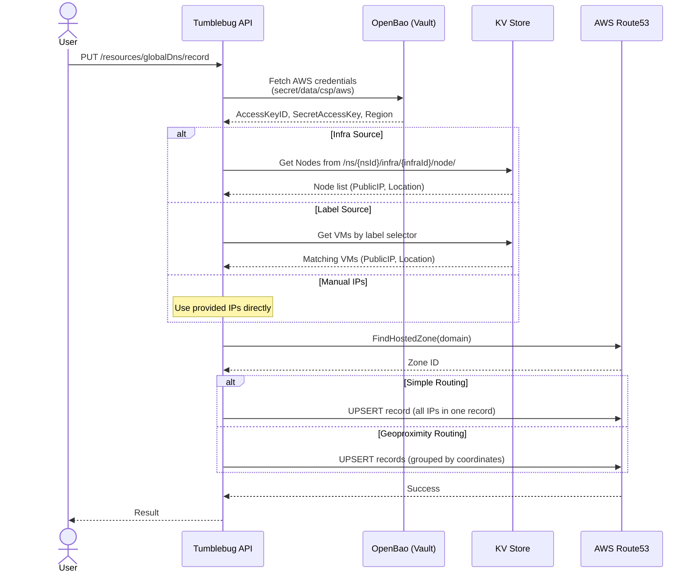
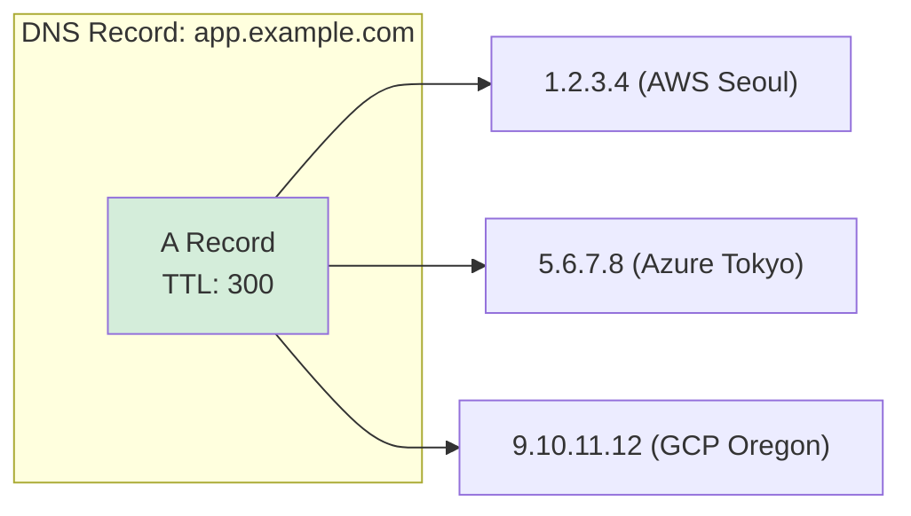
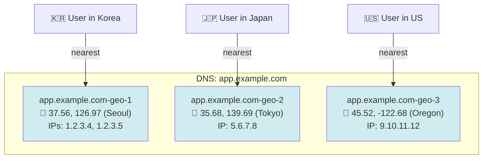

# 글로벌 DNS 관리 (Global DNS Management)

AWS Route53을 사용하여 멀티클라우드 인프라 전반의 DNS 레코드를 관리하기 위한 가이드입니다. Infra Node로부터의 자동 IP 확인(Resolution), 레이블 기반 Node 선택, 그리고 위치 기반 트래픽 분산을 위한 지리적 근접성(Geoproximity) 라우팅을 지원합니다.

## 📑 목차

1. [개요](#개요)
2. [핵심 개념](#핵심-개념)
3. [아키텍처](#아키텍처)
4. [라우팅 정책](#라우팅-정책)
5. [사전 준비 사항](#사전-준비-사항)
6. [API 레퍼런스](#api-레퍼런스)
7. [사용 예제](#사용-예제)

---

## 개요

### 글로벌 DNS 관리란 무엇인가?

**글로벌 DNS 관리**(Global DNS Management)를 사용하면 통합된 CB-Tumblebug API를 통해 AWS Route53의 DNS 레코드를 생성, 업데이트, 조회 및 삭제할 수 있습니다. DNS 항목을 수동으로 관리하는 대신 DNS 레코드가 특정 Infra를 가리키도록 지정하면, Tumblebug가 자동으로 Node의 공인 IP(Public IP)를 확인하여 적절한 Route53 레코드를 생성합니다.

### 왜 이 기능을 사용하는가?

**문제점:**
- 멀티클라우드 VM은 재프로비저닝 시 변경되는 동적 공인 IP를 가집니다.
- 여러 클라우드에 걸친 수십 개의 VM에 대해 수동으로 DNS 레코드를 업데이트하는 작업은 번거롭습니다.
- 표준 DNS(단순 라우팅)는 사용자의 지리적 근접성을 무시하고 모든 트래픽을 단일 리전으로 보냅니다.

**해결책:**
- **Infra 인식 DNS (Infra-Aware DNS)**: Infra Node에서 공인 IP를 자동으로 확인하여 DNS 레코드를 생성합니다.
- **레이블 기반 선택 (Label-Based Selection)**: 레이블 셀렉터(예: `role=web`)를 사용하여 특정 VM을 타겟팅합니다.
- **지리적 근접성 라우팅 (Geoproximity Routing)**: 지리적 좌표를 기반으로 사용자를 가장 가까운 Node로 라우팅합니다.
- **일괄 작업 (Bulk Operations)**: 단일 API 호출로 여러 레코드를 삭제합니다.

---

## 핵심 개념

### IP 소스 선택 (IP Source Selection)

DNS 레코드를 생성하거나 업데이트할 때, 사용자는 IP 주소를 지정하기 위해 **정확히 하나의** 방법을 선택해야 합니다:

| 방법 | 필드 | 설명 | 지리적 근접성(Geoproximity) 지원 |
|--------|-------|-------------|---------------------|
| **Infra** | `setBy.infra` | 지정된 Infra 내 모든 Node의 공인 IP | ✅ (Node 위치 정보 사용) |
| **Label** | `setBy.label` | 레이블 셀렉터와 일치하는 Node의 공인 IP | ✅ (Node 위치 정보 사용) |
| **Manual IPs** | `setBy.ips` | 사용자가 직접 입력한 IP 주소 | ❌ (위치 데이터 없음) |

### 레코드 이름 확인 (Record Name Resolution)

레코드 이름은 자동으로 FQDN(정규화된 도메인 이름)으로 변환됩니다:

| 입력 | 도메인 | 변환된 FQDN |
|-------|--------|----------------|
| `app` | `example.com` | `app.example.com` |
| `app.example.com` | `example.com` | `app.example.com` (변경 없음) |
| *(비어 있음)* | `example.com` | `example.com` (루트/Apex 도메인) |

### 레이블을 사용한 네임스페이스 범위 지정 (Namespace Scoping with Labels)

`nsId`와 함께 Label 소스를 사용할 때, 시스템은 레이블 셀렉터 앞에 `sys.namespace=<nsId>`를 자동으로 추가하여 레이블 쿼리의 범위를 제한합니다. 이를 통해 대상 네임스페이스 내의 VM만 선택되도록 보장합니다.

MapUI에서 Infra + Label 필터 모드를 사용할 때는, 선택된 Infra 내의 VM으로 범위를 제한하기 위해 `sys.infraId=<infraId>`도 함께 앞에 추가됩니다.

---

## 아키텍처

### 전체 흐름



### 자격 증명 흐름 (Credential Flow)

Route53을 위한 AWS 자격 증명은 **OpenBao**(HashiCorp Vault 호환)에 저장되며 런타임에 조회됩니다:

```
OpenBao (secret/data/csp/aws)
├── AWS_ACCESS_KEY_ID
├── AWS_SECRET_ACCESS_KEY
└── AWS_DEFAULT_REGION (default: us-east-1)
```

Tumblebug가 OpenBao에 인증하려면 `VAULT_TOKEN` 환경 변수가 설정되어 있어야 합니다.

---

## 라우팅 정책

### 단순 라우팅 (Simple Routing)

확인된 모든 IP가 **단일 DNS 레코드**에 배치됩니다. DNS 리졸버는 모든 IP를 반환하며, 클라이언트는 일반적으로 첫 번째 IP에 연결합니다(리졸버 수준에서의 라운드 로빈).



### 지리적 근접성 라우팅 (Geoproximity Routing)

VM들은 (`VmInfo.Location`의 위도/경도를 기준으로) **지리적 좌표별로 그룹화**됩니다. 각 좌표 그룹은 `GeoProximityLocation`을 가진 별도의 Route53 레코드가 되며, 이를 통해 Route53은 사용자를 가장 가까운 엔드포인트로 라우팅합니다.



**주요 동작 방식:**
- **동일한 좌표**(동일한 CSP 리전)에 있는 VM들은 여러 IP를 가진 하나의 레코드로 그룹화됩니다.
- 좌표는 **소수점 둘째 자리**까지 반올림됩니다(Route53 정밀도 제한).
- 각 그룹은 `app.example.com-geo-1`, `app.example.com-geo-2` 등과 같은 `SetIdentifier`를 부여받습니다.
- 지리적 근접성 라우팅을 사용하려면 **Infra 또는 Label** 소스가 필요합니다(수동 IP에는 위치 데이터가 없음).

---

## 사전 준비 사항

1. **AWS Route53 호스팅 영역(Hosted Zone)**: 도메인이 등록되어 있어야 하며 Route53에 호스팅 영역이 생성되어 있어야 합니다.
2. **OpenBao (Vault)**: `secret/data/csp/aws` 경로에 AWS 자격 증명이 저장되어 있어야 합니다.
3. **VAULT_TOKEN**: 유효한 OpenBao 토큰으로 설정된 환경 변수입니다.
4. **VAULT_ADDR**: OpenBao 서버 주소입니다(Tumblebug에 구성됨).

### OpenBao 시크릿 설정

```bash
# Store AWS credentials in OpenBao
export VAULT_ADDR="http://localhost:8200"
export VAULT_TOKEN="your-token"

bao kv put secret/csp/aws \
  AWS_ACCESS_KEY_ID="AKIA..." \
  AWS_SECRET_ACCESS_KEY="wJalr..." \
  AWS_DEFAULT_REGION="us-east-1"
```

---

## API 레퍼런스

### 호스팅 영역 목록 조회 (List Hosted Zones)

Route53에서 사용 가능한 모든 호스팅 영역의 목록을 조회합니다.

```
GET /tumblebug/resources/globalDns/hostedZone
```

**응답:**
```json
{
  "hostedZones": [
    {
      "zoneId": "/hostedzone/Z1234567890",
      "name": "example.com.",
      "recordCount": 5
    }
  ]
}
```

### DNS 레코드 업데이트/생성 (Update / Upsert DNS Record)

DNS 레코드를 생성하거나 업데이트합니다.

```
PUT /tumblebug/resources/globalDns/record
```

**요청 본문 (Request Body):**
```json
{
  "domainName": "example.com",
  "recordName": "app",
  "recordType": "A",
  "ttl": 300,
  "routingPolicy": "simple",
  "setBy": {
    "infra": {
      "nsId": "default",
      "infraId": "infra-01"
    }
  }
}
```

| 필드 | 타입 | 필수 여부 | 설명 |
|-------|------|----------|-------------|
| `domainName` | string | ✅ | Route53 호스팅 영역 도메인 |
| `recordName` | string | | 레코드 이름 (단독 이름인 경우 도메인이 자동으로 뒤에 추가됨) |
| `recordType` | string | | `A`, `AAAA`, `CNAME`, `TXT` (기본값: `A`) |
| `ttl` | int | | 초 단위 TTL (기본값: `300`) |
| `routingPolicy` | string | | `simple` 또는 `geoproximity` (기본값: `simple`) |
| `setBy.infra` | object | ①  | `{ nsId, infraId }` |
| `setBy.label` | object | ①  | `{ nsId, labelSelector }` |
| `setBy.ips` | string[] | ①  | 수동 IP 목록 |

> ① `infra`, `label`, 또는 `ips` 중 정확히 하나만 제공해야 합니다.

**응답:**
```json
{
  "message": "Successfully updated record app.example.com"
}
```

### DNS 레코드 조회 (Query DNS Records)

도메인에 대한 DNS 레코드를 조회합니다.

```
GET /tumblebug/resources/globalDns/record?domainName={domain}&recordName={name}&recordType={type}
```

| 파라미터 | 타입 | 필수 여부 | 설명 |
|-----------|------|----------|-------------|
| `domainName` | string | ✅ | 조회할 도메인 |
| `recordName` | string | | 레코드 이름으로 필터링 (접두사 일치) |
| `recordType` | string | | 레코드 타입으로 필터링 |

**응답:**
```json
{
  "record": [
    {
      "name": "app.example.com.",
      "type": "A",
      "ttl": 300,
      "values": ["1.2.3.4", "5.6.7.8"],
      "setIdentifier": "",
      "routingPolicy": "simple"
    },
    {
      "name": "geo.example.com.",
      "type": "A",
      "ttl": 300,
      "values": ["9.10.11.12"],
      "setIdentifier": "geo.example.com-geo-1",
      "routingPolicy": "geoproximity",
      "geoLatitude": "37.56",
      "geoLongitude": "126.97"
    }
  ]
}
```

### DNS 레코드 삭제 (Delete DNS Record)

단일 DNS 레코드 또는 이름과 타입이 일치하는 모든 레코드를 삭제합니다.

```
DELETE /tumblebug/resources/globalDns/record
```

**요청 본문 (Request Body):**
```json
{
  "domainName": "example.com",
  "recordName": "app.example.com",
  "recordType": "A",
  "setIdentifier": ""
}
```

| 필드 | 타입 | 필수 여부 | 설명 |
|-------|------|----------|-------------|
| `domainName` | string | ✅ | 도메인 이름 |
| `recordName` | string | ✅ | 삭제할 레코드 FQDN |
| `recordType` | string | | 레코드 타입 (기본값: `A`) |
| `setIdentifier` | string | | 특정 레코드 ID (비어 있으면 일치하는 모든 레코드 삭제) |

### DNS 레코드 일괄 삭제 (Bulk Delete DNS Records)

단일 요청으로 여러 레코드를 삭제합니다. 레코드는 도메인별로 그룹화되어 도메인당 하나의 ChangeBatch로 제출됩니다.

```
DELETE /tumblebug/resources/globalDns/records
```

**요청 본문 (Request Body):**
```json
{
  "records": [
    { "domainName": "example.com", "recordName": "app.example.com", "recordType": "A" },
    { "domainName": "example.com", "recordName": "geo.example.com", "recordType": "A", "setIdentifier": "geo.example.com-geo-1" }
  ]
}
```

**응답:**
```json
{
  "totalRequested": 2,
  "succeeded": 2,
  "failed": 0,
  "results": [
    { "recordName": "app.example.com", "recordType": "A", "success": true, "message": "deleted successfully" },
    { "recordName": "geo.example.com", "recordType": "A", "setIdentifier": "geo.example.com-geo-1", "success": true, "message": "deleted successfully" }
  ]
}
```

---

## 사용 예제

### 예제 1: Infra 기반 단순 레코드 생성

단순 라운드 로빈 라우팅을 사용하여 `app.example.com`이 Infra 내의 모든 VM을 가리키도록 설정합니다:

```bash
curl -X PUT "http://localhost:1323/tumblebug/resources/globalDns/record" \
  -H "Content-Type: application/json" \
  -u default:default \
  -d '{
    "domainName": "example.com",
    "recordName": "app",
    "recordType": "A",
    "ttl": 300,
    "routingPolicy": "simple",
    "setBy": {
      "infra": { "nsId": "default", "infraId": "infra-01" }
    }
  }'
```

### 예제 2: Infra 기반 지리적 근접성(Geoproximity) 레코드 생성

지리적 근접성을 기반으로 사용자를 가장 가까운 Node로 라우팅합니다:

```bash
curl -X PUT "http://localhost:1323/tumblebug/resources/globalDns/record" \
  -H "Content-Type: application/json" \
  -u default:default \
  -d '{
    "domainName": "example.com",
    "recordName": "geo",
    "recordType": "A",
    "ttl": 60,
    "routingPolicy": "geoproximity",
    "setBy": {
      "infra": { "nsId": "default", "infraId": "infra-01" }
    }
  }'
```

### 예제 3: 레이블 셀렉터 기반 레코드 생성

`role=web` 레이블이 지정된 VM들에 대한 DNS 레코드를 생성합니다:

```bash
curl -X PUT "http://localhost:1323/tumblebug/resources/globalDns/record" \
  -H "Content-Type: application/json" \
  -u default:default \
  -d '{
    "domainName": "example.com",
    "recordName": "web",
    "recordType": "A",
    "ttl": 300,
    "routingPolicy": "simple",
    "setBy": {
      "label": { "nsId": "default", "labelSelector": "role=web" }
    }
  }'
```

### 예제 4: 수동 IP 레코드 생성

수동으로 지정한 IP들로 DNS 레코드를 생성합니다:

```bash
curl -X PUT "http://localhost:1323/tumblebug/resources/globalDns/record" \
  -H "Content-Type: application/json" \
  -u default:default \
  -d '{
    "domainName": "example.com",
    "recordName": "static",
    "recordType": "A",
    "ttl": 3600,
    "setBy": {
      "ips": ["1.2.3.4", "5.6.7.8"]
    }
  }'
```

### 예제 5: 레코드 조회

```bash
# All records for a domain
curl "http://localhost:1323/tumblebug/resources/globalDns/record?domainName=example.com" \
  -u default:default

# Filter by record name
curl "http://localhost:1323/tumblebug/resources/globalDns/record?domainName=example.com&recordName=app" \
  -u default:default
```

### 예제 6: 특정 지리적 근접성(Geoproximity) 레코드 삭제

```bash
curl -X DELETE "http://localhost:1323/tumblebug/resources/globalDns/record" \
  -H "Content-Type: application/json" \
  -u default:default \
  -d '{
    "domainName": "example.com",
    "recordName": "geo.example.com",
    "recordType": "A",
    "setIdentifier": "geo.example.com-geo-1"
  }'
```

### 예제 7: 일괄 삭제 (Bulk Delete)

```bash
curl -X DELETE "http://localhost:1323/tumblebug/resources/globalDns/records" \
  -H "Content-Type: application/json" \
  -u default:default \
  -d '{
    "records": [
      { "domainName": "example.com", "recordName": "app.example.com", "recordType": "A" },
      { "domainName": "example.com", "recordName": "geo.example.com", "recordType": "A", "setIdentifier": "geo.example.com-geo-1" },
      { "domainName": "example.com", "recordName": "geo.example.com", "recordType": "A", "setIdentifier": "geo.example.com-geo-2" }
    ]
  }'
```

---

## 에러 처리 (Error Handling)

API는 에러 유형에 따라 적절한 HTTP 상태 코드를 반환합니다:

| 상태 코드 | 조건 |
|--------|-----------|
| `400 Bad Request` | 잘못된 입력 (필수 필드 누락, 여러 IP 소스 지정, 수동 IP와 지리적 근접성 라우팅 함께 사용) |
| `404 Not Found` | 호스팅 영역을 찾을 수 없음, 일치하는 레코드 없음, 공인 IP가 있는 VM 없음 |
| `503 Service Unavailable` | `VAULT_TOKEN`이 설정되지 않음 (OpenBao 사용 불가) |
| `500 Internal Server Error` | AWS API 에러, 예기치 않은 실패 |
