# 대규모 프로비저닝 아키텍처 (10,000+ VMs)

> 🌐 **Language**: **한국어** | [English](../high-scale-provisioning-architecture.md)

이 문서는 **CB-Tumblebug**(이하 **TB**)과 **CB-Spider**(이하 **SP**)가 단일 인프라(Infra) 내에서 **10개 클라우드 서비스 프로바이더(CSP), 146개 글로벌 리전에 걸쳐 10,000대 이상의 가상머신**(VM)을 프로비저닝하고 모니터링 및 생명주기 제어하기 위해 구축한 **문제 해결 중심 엔지니어링 아키텍처**를 다룬다.

단순한 기능 나열 대신, 10,000대 이상 규모로 확장할 때 직면한 **10대 근본 병목**을 **4개 아키텍처 영역**으로 분류하여 설명한다. 각 병목에 대해 문제의 원인과 핵심 해결 메커니즘을 시각화된 Mermaid 다이어그램 및 실측 성능 개선 테이블과 함께 제시한다.

---

## 1. 핵심 요약: 10,000+ VM 확장을 가로막은 10대 병목과 해결 체계

단일 멀티클라우드 인프라를 146개 리전 10,000+ VM 규모로 확장할 때, 기존의 단순 오케스트레이션 구조는 **외부 CSP 접점**(Part I), **내부 코어 저장소 및 동시성**(Part II), **계층 간 정합성 및 하위 드라이버**(Part III), **클러스터 인프라 및 가시성**(Part IV)의 4개 영역에서 한계에 직면함.

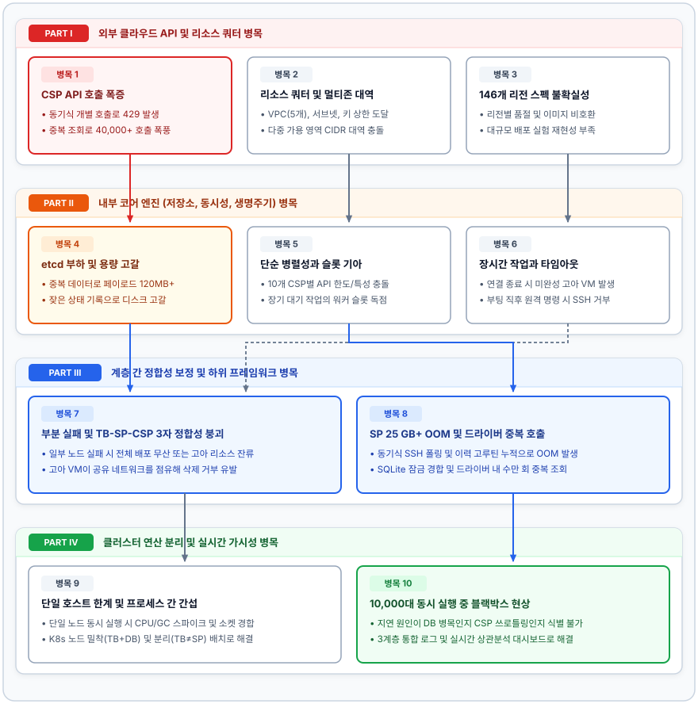

<details>
<summary>Mermaid 원본 코드 보기</summary>

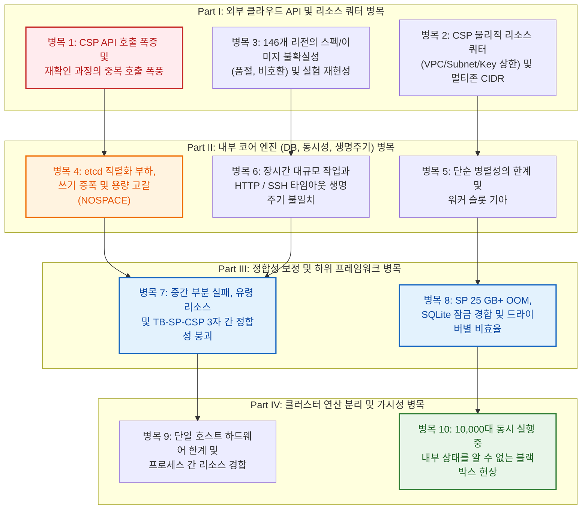

</details>

### 10대 병목별 해결 아키텍처 및 정량적 성과 총괄표

| 구분 | 핵심 병목 | 핵심 해결 메커니즘 | 실측 성과 (10,456 VM 벤치마크) |
| :--- | :--- | :--- | :--- |
| **Part I** | **1. CSP API 호출 폭증 및 중복 조회** | 사용자 조회와 백그라운드 상태 폴링 분리, 9개 CSP Direct 배치/벌크 SDK 연동, Singleflight 및 독립 공인 IP 캐시, 다계층 클라이언트/메타데이터/검증 캐시, 인메모리 접속정보 조립 및 부가 호출 제거 | **CSP 호출 98.6% 감소** (10,456 → ~146); 접속정보 조회: **>120초 타임아웃 → 788.65 ms**; Resume 후 공인 IP 지연: **+0.0 s** |
| **Part I** | **2. CSP 리소스 쿼터 및 네트워크 파편화** | 리전당 단일 공유 VNet 통합, 온디맨드 가용 영역(Zone) 서브넷 동적 확장, 뮤텍스 기반 비충돌 CIDR 자동 할당, 로컬 RSA 2048 키 생성 및 공개키 Import | 146개 리전 공유 리소스 **438 / 438 (100%) 192.41 s 생성**, VPC 쿼터 오류 0건 |
| **Part I** | **3. 스펙/이미지 불확실성 및 반복 재현성** | 선언형 인프라 템플릿, 온디맨드 스펙 동적 등록, 쿼터 인지형 위험도 분석 엔진, 실시간 PostgreSQL 가용성 즉시 반영(Write-Through) | **99.60% (10,414/10,456)** 생성 성공 (9개 CSP 100%); 품절 스펙/가용 영역 실시간 자동 배제 |
| **Part II** | **4. etcd 부하 및 용량 폭증 (NOSPACE)** | 동적 상태(Hot)와 정적 구성(Cold) 저장소 분리, 노드그룹 블루프린트와 노드별 경량 델타 분리, OpenBao 개인키 오프로드, 6단계 계층형 조회 라우터, 50-워커 병렬 삭제 및 24시간 주기 압축, 조각 모음 | **노드 레코드 크기 85-90% 축소** (8-12 KB → 0.8-1.2 KB); 상태 조회 **35.61 ms**; 10,418개 키 **6.8 s** 삭제 |
| **Part II** | **5. 단순 병렬성의 한계와 10개 CSP 이질성** | 10개 CSP 맞춤형 3단계 동시성, 타이밍 제어, 리전 조기 쿼터 취소, 공유 리소스 연관관계 일괄 병합, 10개 CSP 네트워크/수명주기 특화 보정, GCP 전용 쿼터 대기 슬롯(60) 및 이중 SP 세마포어(50 vs. 15), 5단계 적응형 폴링 | **15.70 VMs/s** 지속 생성 (663.26 s); 10개 CSP 146개 리전 동시 수용 및 워커 기아 0건 |
| **Part II** | **6. 장시간 작업과 HTTP/SSH 타임아웃 충돌** | HTTP 요청 취소와 백그라운드 실행 컨텍스트 분리, 게이트웨이 타임아웃 해제(0s), 25분 인프라 작업 락, 능동형 SSH 준비 게이트 및 실시간 SSE 스트리밍 원격 명령 | 클라이언트 연결 종료 시 **반쯤 생성된 고아 VM 0건**; 논블로킹 실시간 SSH 명령 스트리밍 |
| **Part III** | **7. 부분 실패 손실 및 3자 간 정합성 붕괴** | 부분 실패 복구 정책(continue/refine/rollback), 3단계 Fail-Closed Tombstone 삭제 및 유실 IID 자동 재등록, 비동기 SP IID 정리 및 잔여 리소스 감사, 기존 자원 등록 기반 공유 리소스 의존성 반자동 복구, 2회 연속 미발견(2-Strike) 및 종료 상태 불변 가드 | 실패 노드 42개를 **1.83 s** 만에 정제; **공유 리소스 438개 단일 패스 100% 삭제 (149.85 s)**; **Undefined 상태 역전 0건** |
| **Part III** | **8. SP OOM 및 드라이버 비효율** | 동기식 SSH 접속 확인 및 미사용 이력 고루틴 차단([PR #1846](https://github.com/cloud-barista/cb-spider/pull/1846)), 메타DB를 SQLite에서 PostgreSQL로 전환, 10개 CSP 드라이버 3단계 성능 개선([PR #1865](https://github.com/cloud-barista/cb-spider/pull/1865)), OS 타입 힌트 전달([PR #1909](https://github.com/cloud-barista/cb-spider/pull/1909)), Azure/IBM/KT 핀포인트 개선 | **SP 피크 RAM: 25 GB+ (OOM) → 385-514 MiB (~98% 절감)**; VM 단건 조회 지연 **-12% ~ -78% 단축**; NCP 생성 **-59%** |
| **Part IV** | **9. 단일 호스트 한계 및 프로세스 간 간섭** | Kubernetes Helm 통합 차트, 데이터 지역성 밀착 배치(podAffinity), 드라이버 연산 부하 격리(podAntiAffinity), OpenBao 자동 초기화/Unseal 사이드카 | TB (777 MiB)와 SP (514 MiB) 간 CPU/GC/네트워크 경합 완전 분리 |
| **Part IV** | **10. 10k 동시 실행 시의 블랙박스 현상** | 온디맨드 토글형 관측성 스택, 카디널리티 폭발 없는 3계층 통합 JSON 로그 스키마(단일 라인 압축), LogQL 실시간 진행 중 요청 추적 테이블, 2종 커스텀 Grafana 대시보드 | 인바운드 API, SP, Direct SDK, etcd WAL fsync, Pod CPU/RAM의 실시간 상관분석 |

---

# Part I. 외부 클라우드 API 장벽 및 리소스 쿼터 병목 돌파

## 2. 병목 1: CSP API 호출 폭증에 의한 Rate-Limit / 세션 단절 및 재확인 중복 호출

### 2.1 문제 진단
전통적인 동기식 오케스트레이션 구조에서는 사용자의 상태 조회, 생명주기 제어(Suspend, Resume, Terminate), 공인 IP 확인, SSH 접속 정보(accessinfo) 조회가 발생할 때마다 SP를 거쳐 O(N)회의 개별 CSP API 호출이 실행된다. N = 10,456 VM 규모에서는 단 한 번의 상태 조회나 제어 요청이 **10,000건 이상의 API 호출**을 일으켜 즉시 CSP Rate Limit(RequestLimitExceeded / 429 Too Many Requests)에 걸리고, 세션이 끊기며, 재확인을 위한 재시도가 겹치면서 호출 폭풍을 증폭시킨다.

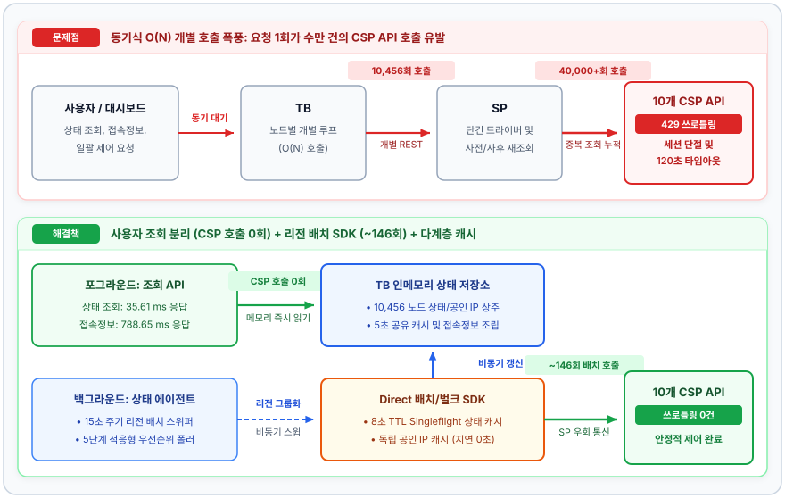

<details>
<summary>Mermaid 원본 코드 보기</summary>

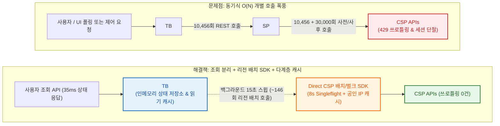

</details>

이 병목을 해결하기 위해 다음 5가지 핵심 메커니즘을 결합함: (1) 사용자 조회 API와 CSP 폴링 경로의 완전 분리, (2) 개별 VM 호출을 리전 단위 Direct 배치/벌크 SDK로 대체, (3) 배치 경로 위에 Lock-Free Singleflight 및 공인 IP 캐시 도입, (4) 내부 SP 호출 경로에 다단 클라이언트, 메타데이터, 검증 캐시 적용, (5) 접속정보 조회 및 프로비저닝 과정의 숨은 VM당 호출 제거.

---

### 2.2 사용자 조회 API와 CSP 폴링의 완전 분리
사용자 조회 요청이 외부 CSP 호출을 직접 유발하는 구조에서는 10,000대 배포 중 대시보드나 CLI가 상태를 조회하는 순간 API 폭풍이 발생한다.
- **분리 메커니즘**: 모든 사용자 조회 API는 외부 CSP나 SP를 호출하지 않고 인메모리 상태 저장소에서만 즉시 값을 읽어 반환한다. 실제 CSP 상태 동기화는 백그라운드 상태 동기화 에이전트 데몬이 노드별 우선순위에 따라 비동기로 전담한다.

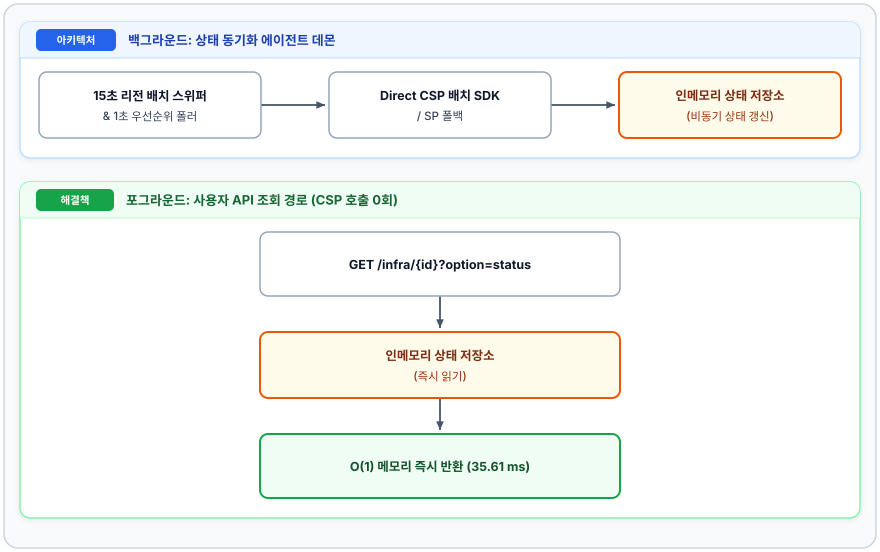

<details>
<summary>Mermaid 원본 코드 보기</summary>

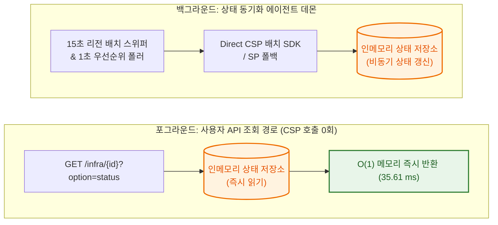

</details>

---

### 2.3 SP 추상화 한계 돌파를 위한 Direct CSP SDK 하이브리드 제어 평면
상태 조회를 백그라운드로 분리하더라도, SP의 **단일 리소스 1:1 추상화 모델**(단건 생성, 조회, 제어 API)만으로는 10,456대를 처리할 때 다음과 같은 **4가지 구조적 추상화 장벽**이 발생한다.
1. **배치/벌크 추상화 부재**: 1회의 REST 호출이 항상 1대의 VM에만 매핑되어 O(N) 호출이 강제됨.
2. **제어 완료까지 블로킹 대기하는 동기식 구조**: SP 드라이버(특히 Azure 등)는 Suspend/Resume/Reboot 호출 시 내부적으로 작업이 끝날 때까지 블로킹 대기하므로 수천 대 동시 제어가 직렬화됨.
3. **SP 자체 IID DB 의존성(시야 한계)**: 생성 타임아웃 등으로 SP DB에 식별자(IID)가 기록되기 전에 생성된 미추적 VM이나, VM 삭제 후 분리된 잔여 리소스(NIC, ENI, PublicIP, EIP, FloatingIP, Disk)를 SP 추상화만으로는 조회, 정리할 수 없음.
4. **실시간 계정 쿼터, 존 품절, 동적 이미지 패밀리 추상화 부재**: 실시간 vCPU 쿼터 사용량, 특정 가용 영역(AZ)의 런타임 재고 소진, 날짜 스탬프가 바뀌는 최신 이미지 패밀리, CSP가 에러 메시지로 제안하는 대체 가용 영역을 표준 인터페이스로 노출하지 못함.

이를 해결하기 위해 TB는 표준 생성/삭제 오케스트레이션에는 SP를 활용하되, 추상화 병목이 발생하는 **9대 핵심 도메인**에서는 **OpenBao 자격증명 파이프라인을 통해 네이티브 CSP SDK(AWS, GCP, Azure, Alibaba, Tencent, IBM, NCP, NHN, KT, OpenStack)를 직접 실행**하는 **하이브리드 제어 평면**을 구축함.

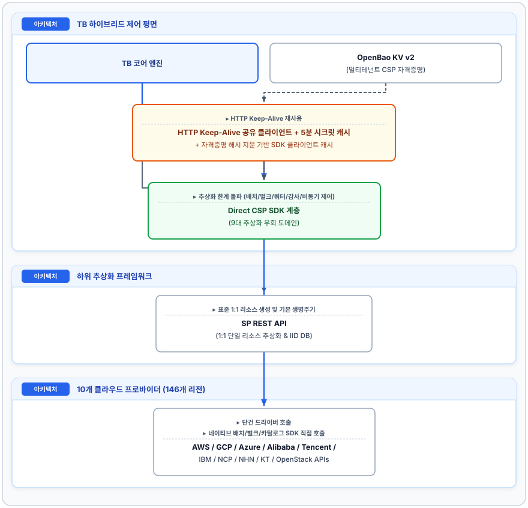

<details>
<summary>Mermaid 원본 코드 보기</summary>

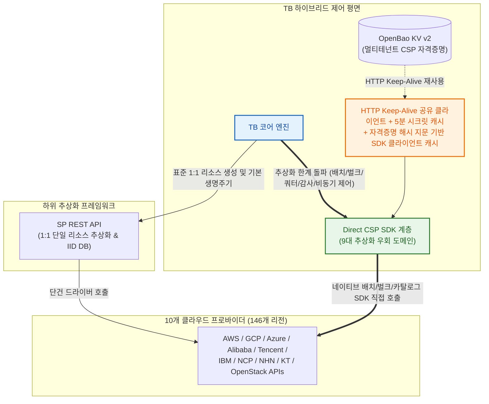

</details>

#### (1) OpenBao 직접 연동 멀티테넌트 자격증명 파이프라인 및 로테이션 안전 SDK 클라이언트 캐시
- **OpenBao Keep-Alive 및 5분 시크릿 캐시**: SP를 거치지 않고 OpenBao KV v2에서 직접 자격증명을 조회함. 10,000대 배치 스윕 시 매번 새로운 TCP 연결이 생성되어 로컬 에페메랄 포트가 고갈되지 않도록 프로세스 단일 HTTP Keep-Alive 연결 풀과 5분 TTL 시크릿 캐시를 결합함.
- **자격증명 변경 감지형 SDK 클라이언트 캐시**: 인증된 CSP SDK 클라이언트(IAM/OAuth 토큰 포함)를 계정 식별자와 자격증명 SHA-256 해시 지문 복합 키로 인메모리에 캐싱함. 자격증명이 로테이션되면 해시 지문이 즉시 달라져 이전 SDK 클라이언트를 자동으로 폐기하고 새 클라이언트로 무중단 교체함.

#### (2) SP 추상화 한계를 해소하는 9대 직접 SDK 실행 도메인 총괄표

| 도메인 | SP 추상화의 구조적 한계 | Direct CSP SDK 해결 메커니즘 |
| :--- | :--- | :--- |
| **1. 리전/구독/프로젝트 배치 상태 조회** | 단건 상태 조회 API가 1대씩만 조회되어 10k 상태 확인에 10,456회 호출 필요 | AWS(호출당 최대 1,000 ID), GCP(프로젝트당 1회 집계 호출로 41개 리전 전체 조회), Azure(구독당 단일 페이지네이션 스트림), 기타 6개 CSP(페이지당 100 ID) 및 OpenStack 직접 배치 조회 |
| **2. 네이티브 벌크 제어 및 완료 대기 없는 비동기 제어 개시** | 1대씩만 제어 가능하며, 특히 Azure 드라이버는 작업 완료까지 동기 블로킹 대기함 | **AWS**: Start/Stop/Terminate 벌크 API 호출.<br/>**Azure**: 비동기 제어 시작 API(동시성 20)로 **제어 요청만 즉시 개시하고 완료 대기 없이 반환**(완료 확인은 백그라운드 배치 스윕에 위임). 단, 일반 Terminate는 부속 NIC/공인 IP 연쇄 정리를 위해 SP 경로를 유지하고 유령 VM 정리만 Direct SDK로 분리 |
| **3. UID/태그 기반 타겟 고아 VM 즉시 탐색** | 생성 타임아웃 시 SP DB에 IID가 기록되지 않아 생성된 VM을 찾을 수 없음 | 9개 퍼블릭 CSP + OpenStack에서 전체 리전 스캔 없이 TB 고유 이름/태그 필터(예: AWS 200개 단위 배치 필터)로 클라우드에 실제 생성된 VM을 즉시 역추적 |
| **4. Direct CSP 실물 인벤토리 및 잔여 리소스 청소** | SP DB에 없는 유령 VM이나 VM 삭제 후 분리된 고아 NIC/공인 IP/디스크를 나열, 삭제할 수 없음 | SP를 우회하여 CSP 실물 자산을 직접 전수 조사하고, TB 관리 리소스(고유 이름 규칙 또는 관리 태그) 판별 후 분리된 고아 NIC, ENI, 공인 IP, EIP, Floating IP, 디스크, 볼륨을 직접 삭제 |
| **5. 실시간 계정 vCPU 쿼터 검증 및 AZ 품절 오버레이** | 정적 카탈로그만 제공할 뿐 실시간 계정/패밀리 vCPU 쿼터 잔량이나 특정 AZ의 런타임 품절을 알 수 없음 | 9개 CSP에 대해 SKU 제약 및 **실시간 vCPU 쿼터 사용량**을 직접 조회(Singleflight + CPU/GPU 비대칭 TTL)하고, 런타임 용량 부족 발생 시 해당 AZ만 핀포인트로 차단하는 품절 오버레이 캐시 적용 |
| **6. CSP별 구조화 에러 파서 및 대체 존 힌트 추출** | SP가 반환하는 원시 에러 문자열이 비정형적이며 방대한 HTTP 헤더 덤프와 민감 정보를 포함함 | 8개 CSP 전용 에러 분석기가 HTTP 헤더 노이즈 제거 및 민감정보 마스킹 후, 실패 유형(계정 쿼터 초과, 존 용량 부족, API 쓰로틀링 등)과 **CSP가 제안한 대체 가용 영역** 및 재시도 힌트를 구조화하여 추출 |
| **7. 동적 최신 이미지 패밀리 해석 및 직접 가격 조회** | Alibaba 등이 날짜가 박힌 공개 이미지 ID를 주기적으로 폐기할 때 정적 카탈로그가 깨짐 | **Alibaba**: 생성 시점에 이미지 패밀리 조회(10분 TTL + Singleflight)로 최신 활성 이미지 ID를 동적 해석.<br/>**Azure**: 최신 이미지 URN 동적 해석. AWS/Azure/GCP/Alibaba 직접 가격 조회 지원 |
| **8. 단일 호출 배치 태그 일괄 기록** | SP 태그 인터페이스는 태그를 개별 호출로 처리하여 다중 태그 부여 시 API 호출이 배증함 | AWS, Azure, GCP 네이티브 태그 SDK를 직접 호출하여 리소스당 모든 태그를 단 1회의 배치 API 호출로 일괄 기록 |
| **9. GCP 방화벽(SG) 사용 중 여부 사전 검증** | GCP는 실행 중인 VM에 네트워크 태그가 붙어 있어도 방화벽 규칙 삭제를 막지 않아 보안 사고 위험이 있음 | 보안그룹 삭제 전 GCP 전체 인스턴스 목록을 직접 조회하여 해당 방화벽 태그를 사용 중인 비종료 VM이 남아 있으면 삭제를 사전 차단 |

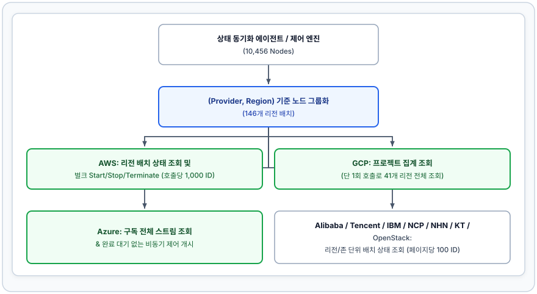

<details>
<summary>Mermaid 원본 코드 보기</summary>

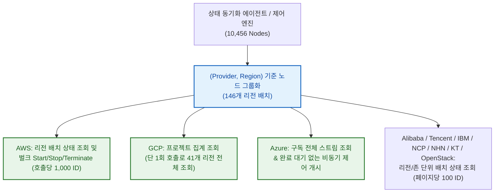

</details>

| CSP | 벤치마크 노드 수 | 기존 주기당 개별 호출 수 | Direct 배치 호출 수 | API 호출 절감률 |
| :--- | :---: | :---: | :---: | :---: |
| **AWS** (27개 리전) | 10,254 | 10,254 | **27** (페이지당 1,000 ID) | **-99.7%** |
| **GCP** (41개 리전) | 41 | 41 | **1** (프로젝트당 집계 조회) | **-97.6%** |
| **Azure** (37개 리전) | 42 | 42 | **1** (구독당 스트림 조회) | **-97.6%** |
| **Alibaba / Tencent / IBM / NCP / NHN / KT** | 115 | 115 | **38** (리전/존당 1회) | **-67.0%** |
| **합계 (10,456 VMs)** | **10,456** | **10,456** | **~67-146** | **-98.6% ~ -99.3%** |

---

### 2.4 Lock-Free Singleflight 배치 상태 캐시 및 무지연 공인 IP 즉시 추출
배치 스위퍼와 제어 작업이 동시에 같은 리전을 조회할 때 중복 배치 호출을 방지해야 하며, 특히 10,414대 VM을 일시정지(Suspended)에서 재개(Resume)할 때 새로 할당되는 동적 공인 IP를 개별 SP VM 조회 호출(10,212회)로 가져오면 **8~12분의 추가 지연**이 발생한다.
- **Lock-Free Singleflight 배치 상태 캐시**: (Provider, Region) 단위로 8초 TTL 캐싱을 제공하며, 동시 요청들을 뮤텍스 락 바깥에서 진행 중(inflight) 채널로 병합한다. 대기자가 깨어난 후 자신의 인스턴스 ID가 병합 결과에 없으면 안전하게 단건 재조회를 수행한다.
- **무지연 공인 IP 독립 캐시**: AWS 인스턴스 배치 조회 응답에는 이미 각 VM의 공인 IP가 포함되어 있다. 배치 상태 조회 시 모든 인스턴스의 공인 IP를 독립된 인메모리 맵에 즉시 저장하고, 배치 스위퍼가 Running 전환을 감지하는 순간 메모리에서 공인 IP를 바로 읽어 반영함으로써 **SP 호출 0회로 10,212대 AWS 공인 IP를 지연 없이(+0.0 s) 동시 복원**한다.

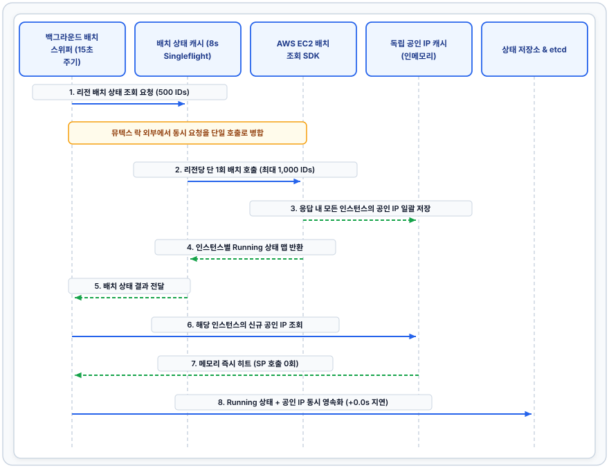

<details>
<summary>Mermaid 원본 코드 보기</summary>

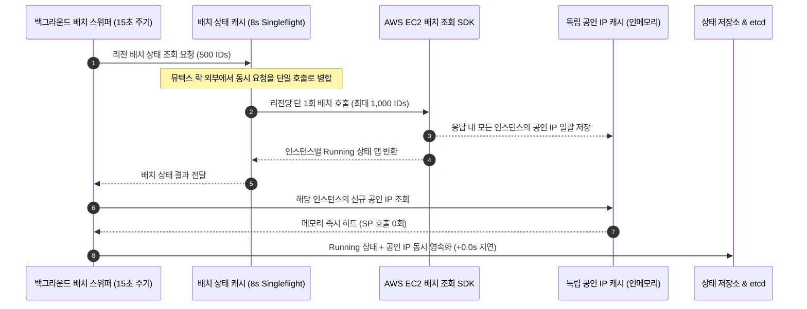

</details>

---

### 2.5 다계층 클라이언트, 메타데이터, 리소스 검증 캐싱 체계
프로비저닝 중 10,456개의 노드 생성 워커가 동시에 커넥션 설정, 리전 정보, 스펙, 이미지, 공유 리소스(VNet, SG, SSHKey) 존재 여부를 반복 조회하는 내부 호출 폭풍을 차단하기 위해 3단계 캐싱을 적용함.
1. **내부 HTTP 클라이언트 캐시, 대기열 캐시 병합 및 서킷 브레이커**:
   - **다단계 TTL**: 데이터 특성에 따라 1초, 2초, 5초, 10초, 60초, 300초의 차등 TTL을 적용함.
   - **SHA-256 요청 본문 해시 캐시 키**: JSON 본문이 포함된 SP GET 요청을 `GET_{url}_{sha256(body)}` 형태로 해싱하여 자격증명 평문 노출 없이 정밀한 캐시 키를 생성함.
   - **대기열 캐시 병합**: 동일 요청 키의 동시 전송을 20개로 제한함. 대기열에 들어간 나머지 워커는 2초 간격(최대 8회)으로 깨어날 때마다 **캐시를 먼저 재확인**하여 선행 요청이 채운 캐시 결과를 네트워크 호출 없이 즉시 공유받음.
   - **서킷 브레이커 및 일시적 오류 재시도**: 5회 연속 실패 시 30초간 회로를 차단하여 하위 엔진을 보호하며, 일시적 네트워크/쓰로틀링 오류 시 멱등 GET/HEAD 요청을 자동 재시도(최대 3회, 5초 지수 백오프 + 지터)함.
2. **메타데이터 및 자격증명 캐싱**: 커넥션 설정, 리전 상세, 스펙, 이미지 및 OpenBao 기반 CSP SDK 클라이언트를 인메모리에 캐싱함.
3. **공유 리소스 검증 TTL 캐시**: 리전별 공유 VNet/SG/SSHKey 존재 확인 결과를 30초(일반 검증) 및 5분(확정 검증) 동안 캐싱함.

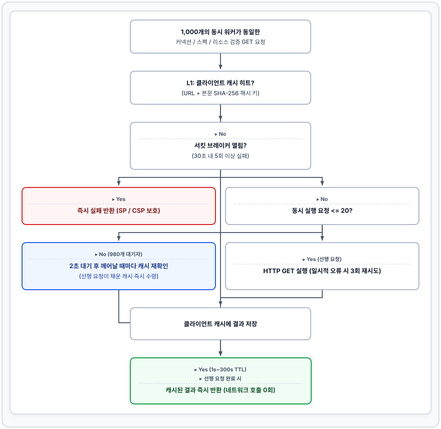

<details>
<summary>Mermaid 원본 코드 보기</summary>

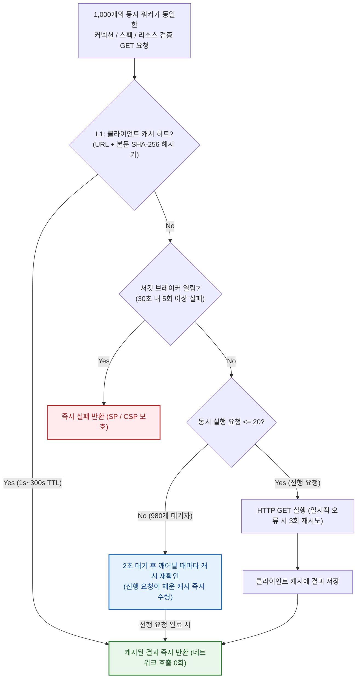

</details>

---

### 2.6 인메모리 접속정보(AccessInfo) 조립 및 프로비저닝 부가 호출 제거
상태 조회와 메타데이터를 최적화한 뒤에도 남아 있던 O(N) 호출 구간인 SSH 접속 정보 조회(`?option=accessinfo`)와 생성 직후의 태그, OS 확인 호출을 제거함.
- **인메모리 접속정보 조립**: 기존에는 노드마다 SP에 VM 조회 및 SSH 키 조회를 개별 호출(10,456회, >120초 타임아웃)했으나, 이를 읽기 캐시의 인프라 정보와 **고유 SSH 키 ID당 1회 로컬 조회**(~146개 리전 키)만으로 인메모리에서 즉시 조립하도록 재설계하여 응답 시간을 **788.65 ms**(152배 이상 단축)로 줄임.
- **생성 직후 개별 CSP 태그 동기화 생략**: VM 생성 직후 VM당 1~2회씩 발생하던 CSP 태그 API 호출(>10,000회)을 기본적으로 생략하고 TB 내부 레이블 인덱싱으로 대체함.
- **노드그룹 단위 OS 타입 사전 해석 및 힌트 전달**: 이미지 및 OS 타입(Windows 여부)을 개별 노드가 아닌 **노드그룹당 1회**만 사전 해석하여 SP에 힌트로 전달함으로써 VM당 중복 이미지 조회를 제거함.

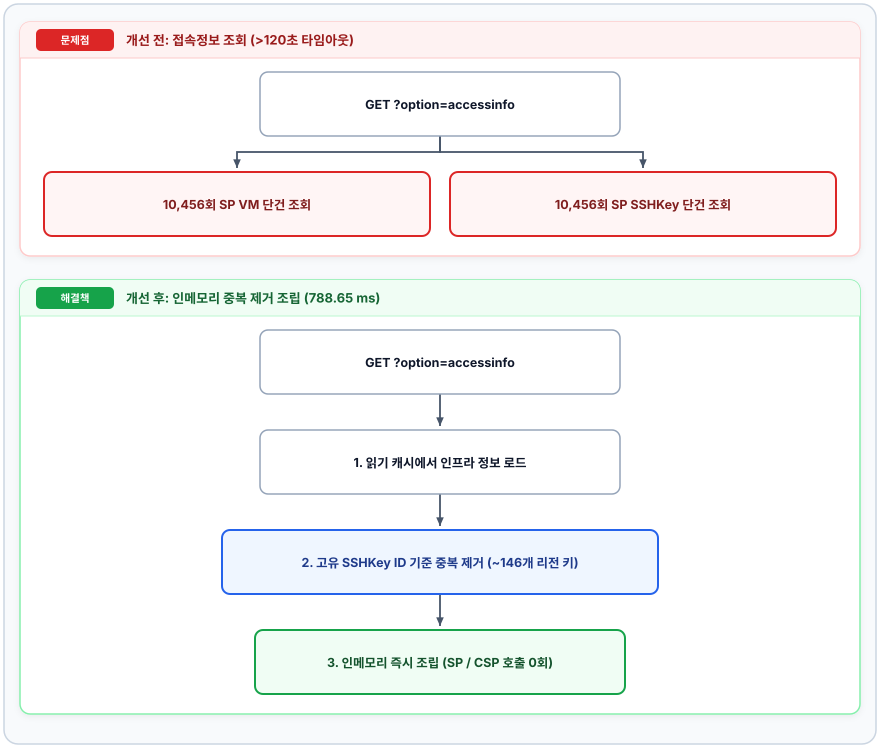

<details>
<summary>Mermaid 원본 코드 보기</summary>

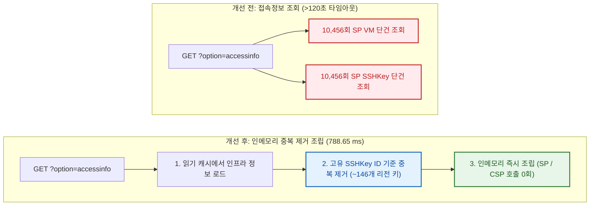

</details>

---

## 3. 병목 2: CSP 물리적 리소스 쿼터(VPC/Subnet/Key 상한) 및 멀티존 네트워크 파편화

### 3.1 문제 진단
API 호출 횟수를 줄이더라도, 클라우드 프로바이더는 **리전당 물리적/논리적 리소스 생성 개수 상한**(쿼터)을 강제한다(예: AWS 기본 리전당 **VPC 최대 5개**). 만약 노드그룹(NodeGroup)마다 별도의 VNet/SecurityGroup/SSHKey를 생성하면 한 리전에 6개 이상의 노드그룹을 배치하는 즉시 VPC 상한 초과(`VpcLimitExceeded`)로 실패한다. 또한 리전 내 모든 가용 영역(Zone)에 미리 서브넷을 만들면 시간과 쿼터가 낭비되며, 멀티존 동시 생성 시 CIDR 대역 충돌이 발생하고, CSP 자체 키 생성 API는 NCP 등에서 엄격한 호출 제한에 걸린다.

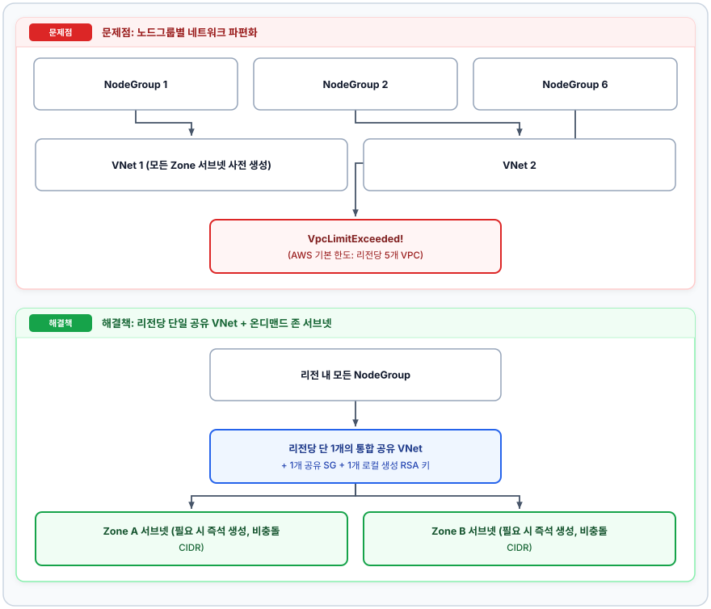

<details>
<summary>Mermaid 원본 코드 보기</summary>

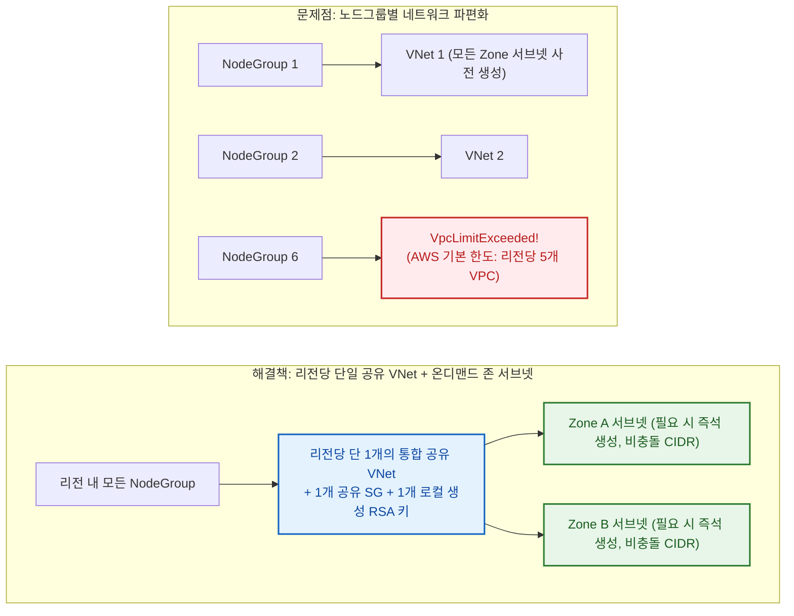

</details>

---

### 3.2 리전당 단일 통합 공유 VNet 아키텍처
한 리전에 몇 개의 노드그룹이나 수천 대의 VM이 배치되든 관계없이, (Provider, Region)당 **단 1개의 공유 VNet, 1개의 공유 Security Group, 1개의 공유 SSH Key**만 생성하여 재사용함으로써 VPC 및 네트워크 쿼터 고갈을 원천 차단함.

### 3.3 온디맨드 가용 영역(Zone) 서브넷 동적 확장 및 비충돌 CIDR 자동 할당
리전 공유 VNet은 최초 기본 서브넷 1개로 시작한다. 이후 특정 가용 영역(Zone)에 노드를 배치하는 노드그룹이 등장하면, VNet 단위 뮤텍스 직렬화 보호 하에 기존 서브넷과 겹치지 않는 프라이빗 CIDR 블록을 자동 계산하여 해당 Zone 서브넷을 즉석에서 생성, 부착한다.

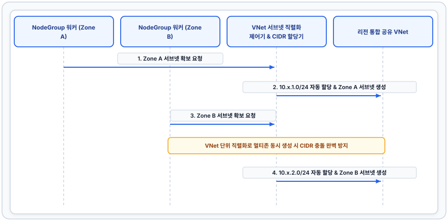

<details>
<summary>Mermaid 원본 코드 보기</summary>

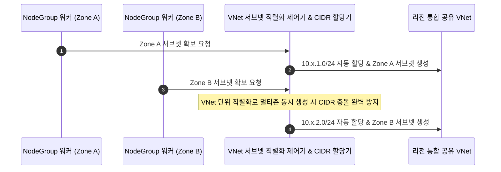

</details>

### 3.4 로컬 RSA 2048 키 생성 후 공개키 Import
CSP의 키 생성 API를 직접 호출하는 대신(멀티 리전 버스트 시 빈번한 쓰로틀링 유발), TB 내부에서 약 5ms 만에 RSA 2048 키쌍을 직접 생성하고 개인키는 **OpenBao**에 안전하게 보관한 뒤 공개키만 CSP(NCP, AWS, Azure, GCP)에 등록하여 키 생성 API 쓰로틀링을 우회함.

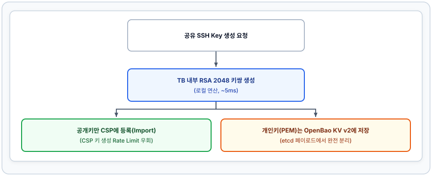

<details>
<summary>Mermaid 원본 코드 보기</summary>

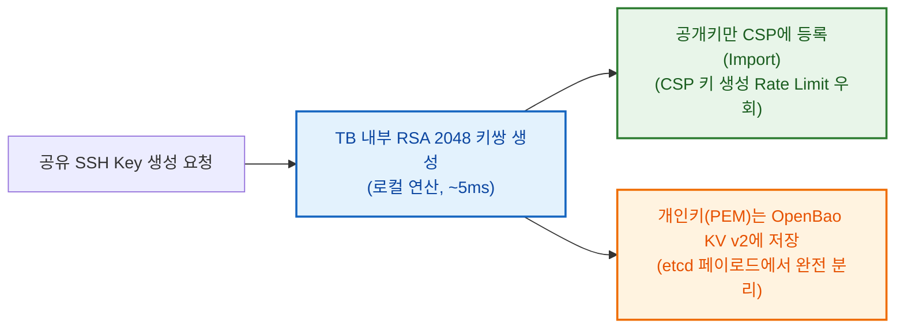

</details>

---

## 4. 병목 3: 146개 리전의 스펙/이미지 불확실성(품절, 비호환) 및 실험 재현성 부족

### 4.1 문제 진단
10개 CSP, 146개 리전에서는 특정 리전/존의 하드웨어 용량 품절, 스펙-이미지 아키텍처 불일치, 로컬 카탈로그 미등록 스펙 문제가 빈번히 발생한다. 이미 품절된 스펙에 수백 대 요청을 그대로 보내면 막대한 시간과 API 쿼터가 낭비된다. 반대로, 실패가 발생할 때마다 무조건 해당 스펙을 블랙리스트에 올리면 **500대 생성 후 리전 vCPU 쿼터 상한에 도달했을 때 멀쩡한 정상 스펙까지 영구 결함으로 오판하여 차단**하는 역효과가 발생한다.

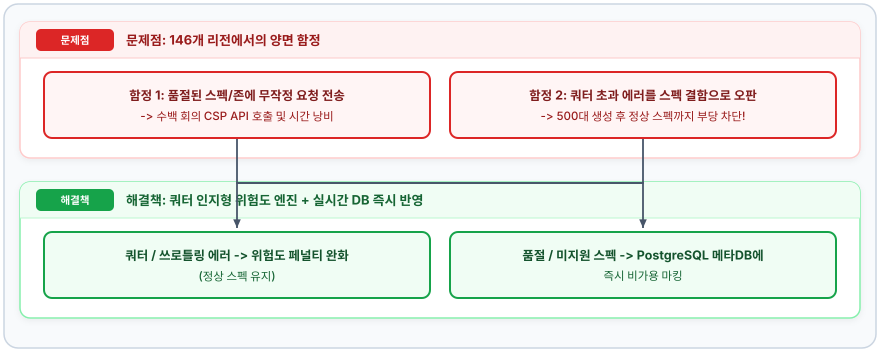

<details>
<summary>Mermaid 원본 코드 보기</summary>

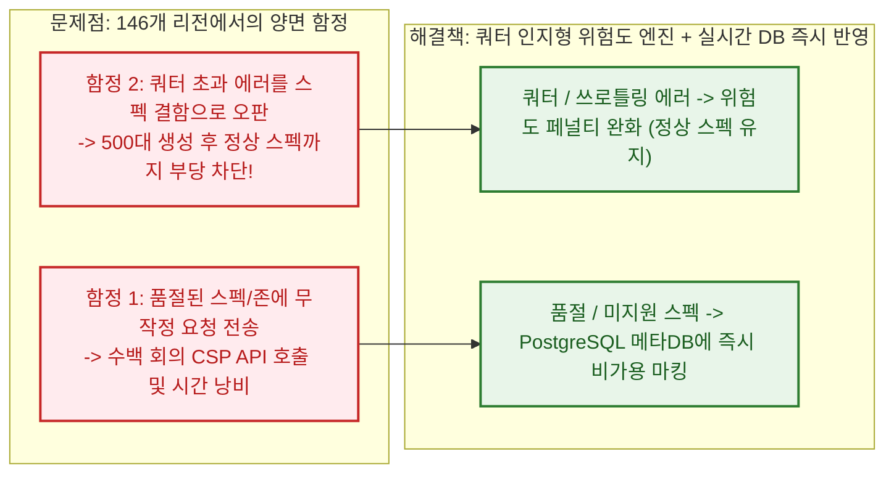

</details>

---

### 4.2 선언형 대규모 인프라 템플릿 및 온디맨드 스펙 동적 등록
- **선언형 템플릿 체계**: 10개 CSP, 146개 리전, 10,456 VM 토폴로지를 버전 관리되는 JSON 템플릿(`infra-global-extream`)으로 정의하고 사전 검증을 지원하여 단일 명령으로 대규모 실험을 반복 재현함.
- **온디맨드 스펙 동적 등록**: 요청된 스펙이 로컬 카탈로그에 없을 경우 배포를 실패시키는 대신 CSP에서 즉시 스펙 정보를 조회, 등록하여 프로비저닝을 이어감.

### 4.3 Direct SDK 실시간 가용성, 쿼터 검증, 동적 이미지 해석 및 메타DB 즉시 반영
- **Direct SDK 실시간 쿼터 검증 및 가용 영역(AZ) 품절 오버레이**:
  - SP의 정적 카탈로그만으로는 알 수 없는 **실시간 계정/패밀리 vCPU 쿼터 사용량**과 SKU 제한을 9개 CSP SDK로 직접 검증(Singleflight)하며, 하드웨어 변동성에 맞춰 **비대칭 TTL**(일반 CPU: 가용 1시간 / 쿼터 초과 5분 / 품절 1분, GPU, 가속기: 가용 5분 / 쿼터 초과 2분 / 품절 1분)을 적용함.
  - **특정 가용 영역(AZ) 핀포인트 품절 오버레이**: AWS나 GCP의 스펙 제공 목록 API는 스펙이 해당 존에 *존재하는지*만 알려줄 뿐 실시간 재고 고갈은 알려주지 않음. 이에 런타임 생성 중 특정 AZ(예: `eu-central-2a`)에서 용량 부족(`InsufficientInstanceCapacity`)이 발생하면 품절 캐시에 해당 AZ만 기록하여 **형제 가용 영역(`eu-central-2b/c`)은 계속 가용 상태로 살려둔 채 품절된 AZ만 정밀 배제**함.
- **동적 최신 이미지 패밀리 해석**: Alibaba 등이 날짜가 포함된 공개 이미지 ID를 예고 없이 폐기하더라도 SP 수정 없이 프로비저닝 시점에 Direct SDK로 이미지 패밀리(10분 TTL + Singleflight) 및 Azure 최신 이미지 URN을 조회하여 활성 이미지 ID로 자동 변환함.
- **CSP별 구조화 에러 분석 및 쿼터 인지형 위험도 평가**: 8개 CSP 전용 에러 분석기가 에러 원문에서 HTTP 헤더 노이즈와 민감정보를 제거하고 실패 원인을 계정 쿼터 초과, 존 용량 부족, API 쓰로틀링, 스펙-이미지 불일치 등으로 정밀 분류하며 CSP가 안내한 대체 가용 영역을 추출함. 실패 원인이 **쿼터 초과, 쓰로틀링**인 경우 위험도 페널티를 완화하여 정상 스펙을 보호하고, 미지원 스펙/이미지는 즉시 PostgreSQL 메타DB에 반영(Write-Through)하여 후속 배포에서 자동 배제함.

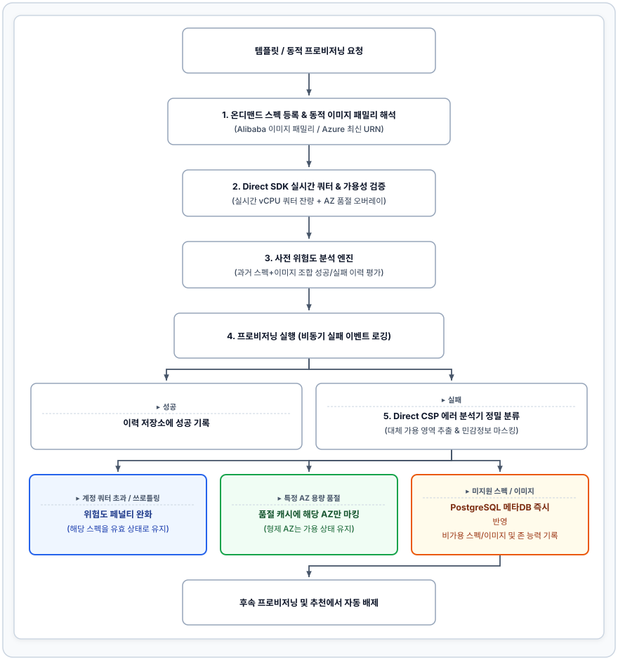

<details>
<summary>Mermaid 원본 코드 보기</summary>

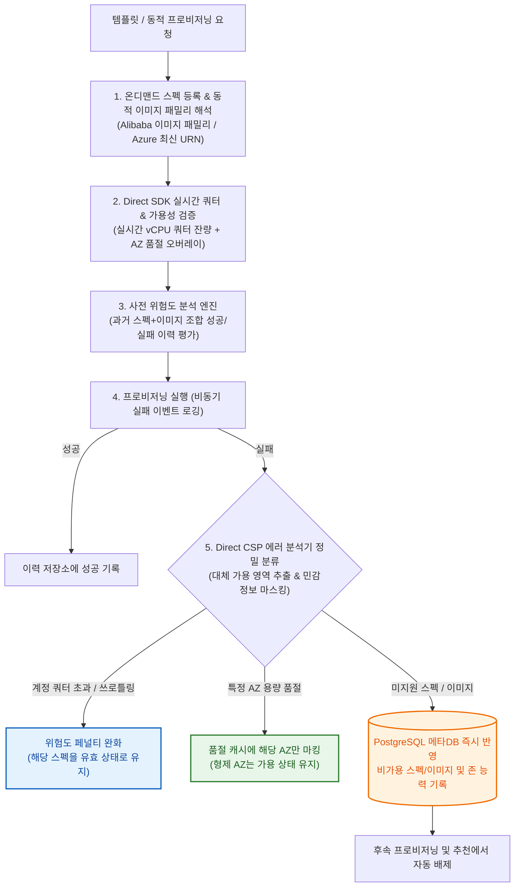

</details>

---

# Part II. 내부 코어 엔진 고도화: DB 저장소, 동시성 제어 및 생명주기

## 5. 병목 4: 메타데이터 DB(etcd) 직렬화 부하, 쓰기 증폭 및 저장 용량 폭증(NOSPACE)

### 5.1 문제 진단
기존 데이터 모델에서는 모든 VM이 약 45개의 공통 필드(스펙, 이미지, VNet, 보안그룹, SSH 키, 지리적 위치 등)를 중복 포함한 거대한 단일 노드 JSON(8-12 KB)으로 etcd에 저장되었다. 10,456 VM 규모에서는 다음 두 가지 치명적 문제가 발생했다.
1. 전체 인프라 조회(`GET /infra/{id}`) 1회마다 **~100 MB의 JSON**을 etcd에서 읽고 역직렬화해야 함.
2. 15초마다 돌아가는 상태/IP 갱신이 10 KB짜리 노드 JSON 전체를 덮어쓰면서 막대한 MVCC 리비전 쓰기 증폭을 일으켜, 결국 etcd 기본 2 GiB 쿼터를 소진하고 용량 초과(`NOSPACE`) 장애를 유발함.

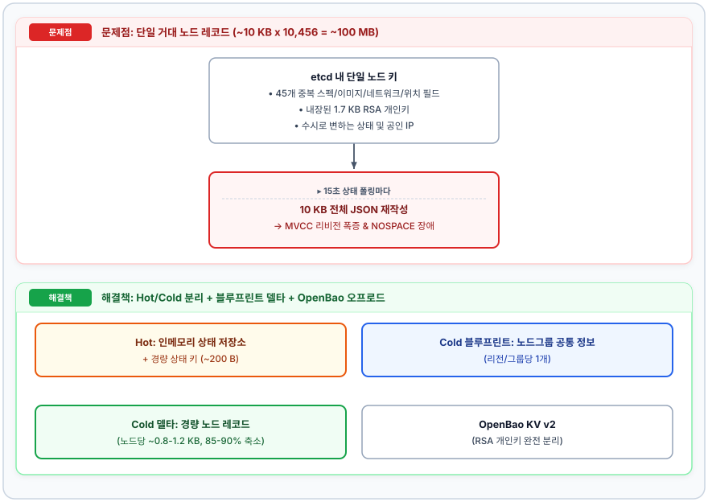

<details>
<summary>Mermaid 원본 코드 보기</summary>

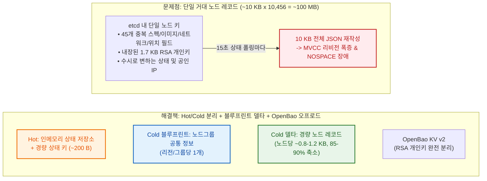

</details>

---

### 5.2 동적 상태(Hot)와 정적 구성(Cold) 저장소 분리
수시로 변하는 동적 상태를 정적 구성 정보와 분리하여 MVCC 쓰기 증폭을 원천 차단한다.
- **메커니즘**: 동적 필드(상태, 네이티브 상태, 목표 상태, 공인 IP, SSH 포트)는 인메모리 상태 저장소에서 관리하며, **실제 상태나 공인 IP가 변경된 경우에만** 별도의 경량 상태 키(~200 B)에 기록하여 etcd 상태 쓰기 용량을 **~95% 절감**함.

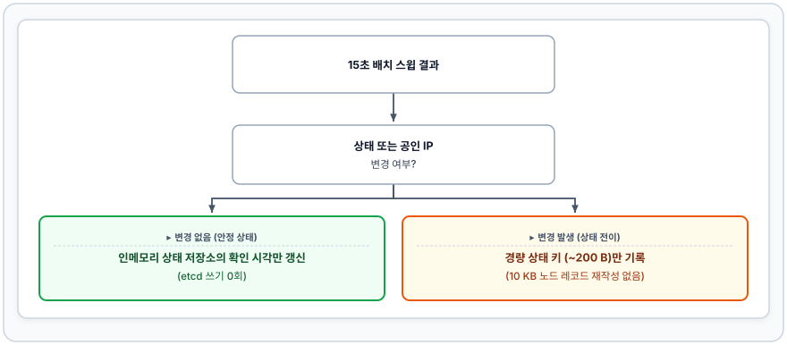

<details>
<summary>Mermaid 원본 코드 보기</summary>

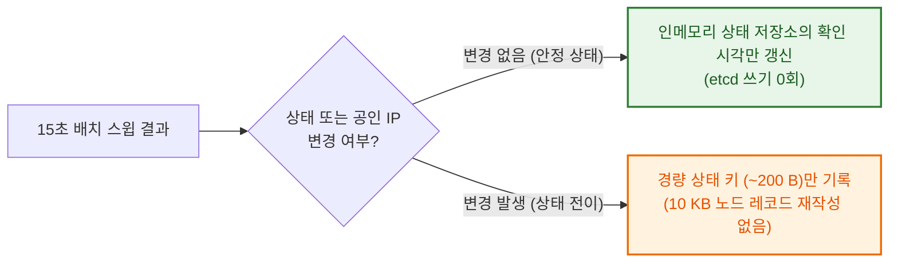

</details>

---

### 5.3 노드그룹 블루프린트와 노드별 경량 델타 분리
정적 노드 레코드 자체의 크기도 1/10 수준으로 줄여 10,000대 생성 및 전체 조회를 가속한다.
- **메커니즘**: 약 45개의 공통 필드는 노드그룹 블루프린트에 **단 1회**만 저장함. 노드 저장 직전 공통 필드를 제거하여 노드 고유 델타(인스턴스 ID, 존 서브넷, IP 등)만 담은 경량 노드 레코드(0.8-1.2 KB)를 기록하고, 읽기 시점에 50개 병렬 워커가 노드그룹 블루프린트 + 경량 노드 레코드 + 인메모리 상태를 실시간 합성(Hydration)함.

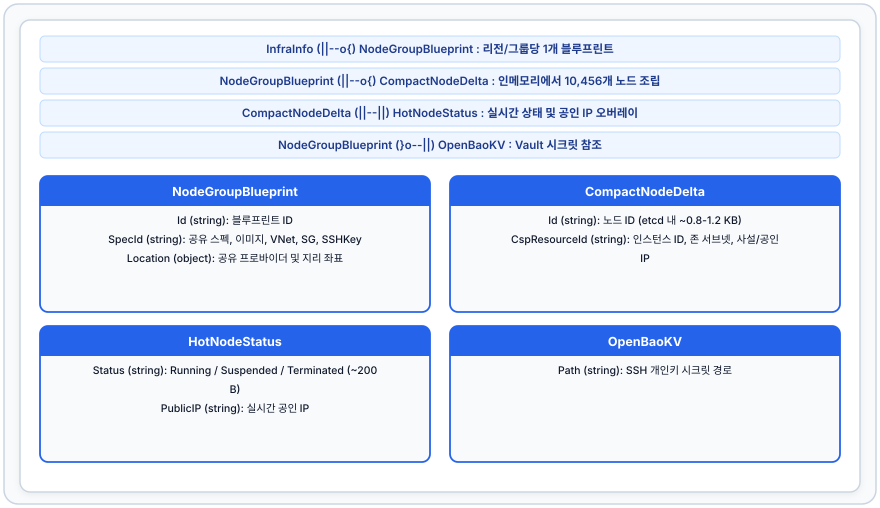

<details>
<summary>Mermaid 원본 코드 보기</summary>

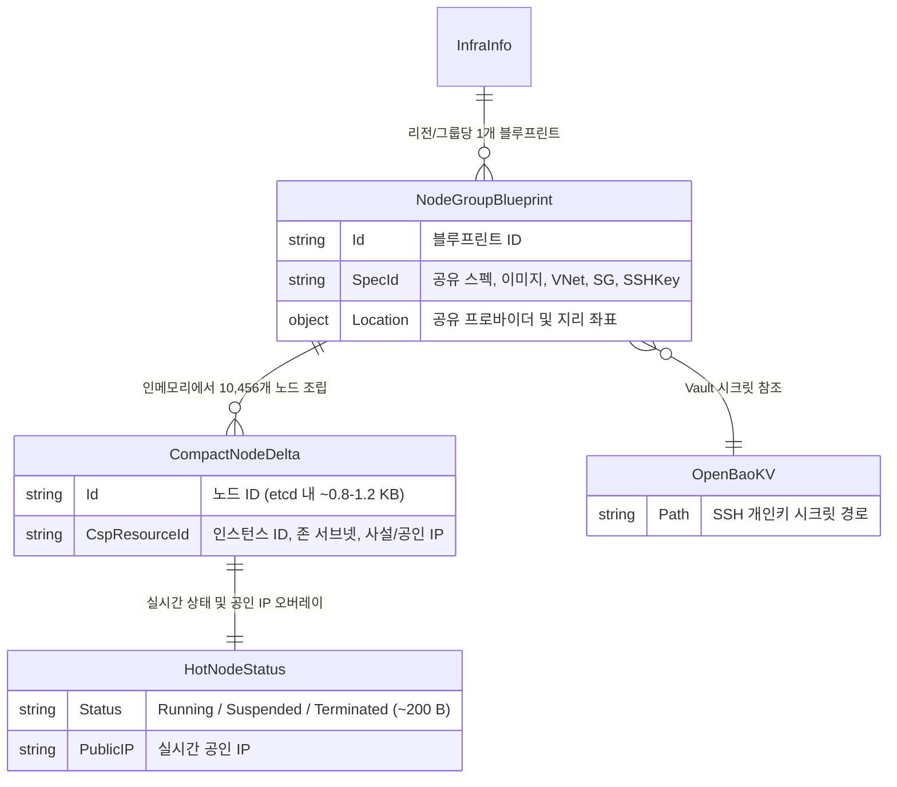

</details>

| 저장소 지표 (10,456-Node Infra 기준) | 기존 단일 노드 레코드 | 블루프린트 + 경량 델타 + 상태 분리 | 개선 효과 |
| :--- | :---: | :---: | :---: |
| **노드당 etcd 레코드 크기** | 8-12 KB | **0.8-1.2 KB** | **85-90% 축소** |
| **10k 인프라 전체 etcd 데이터 크기** | ~95-120 MB | **~10-12 MB** | **~90% 절감** |
| **상태 변경 시 기록되는 페이로드** | ~10 KB | **~200 B** (경량 상태 키) | **쓰기 증폭 ~98% 감소** |

---

### 5.4 6단계 계층형 쿼리 라우터 및 5초 TTL 읽기 캐시(Singleflight)
호출 목적(ID 목록 확인, 대시보드 상태 폴링, 전체 상세 조회, SSH 접속 정보)에 따라 가장 가벼운 저장소 경로로 라우팅하여 불필요한 직렬화 비용을 제거함.

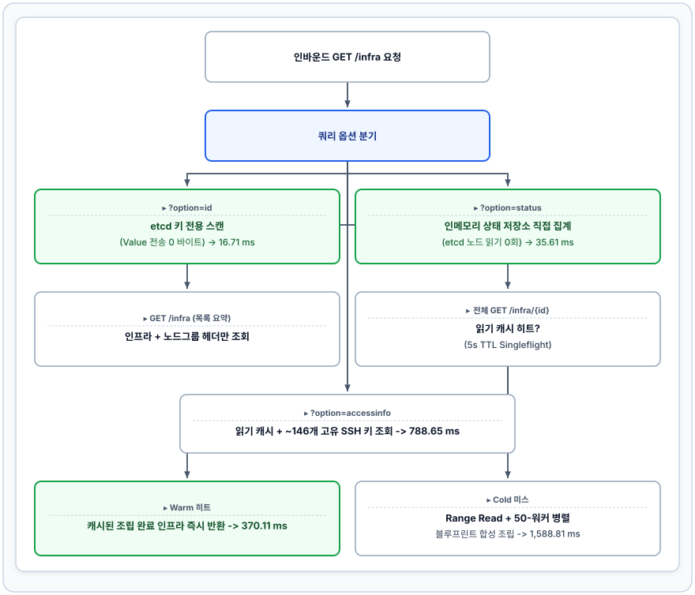

<details>
<summary>Mermaid 원본 코드 보기</summary>

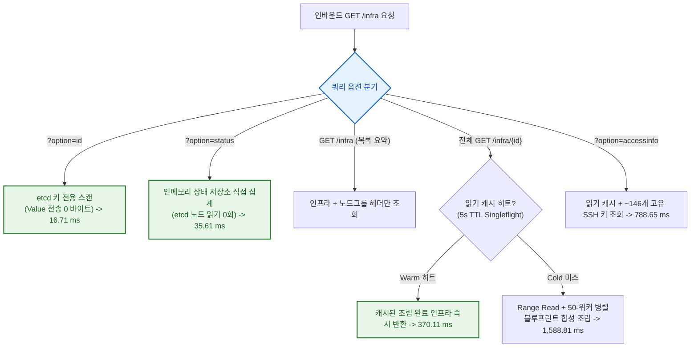

</details>

---

### 5.5 50-워커 병렬 etcd 삭제 및 24시간 주기 압축, 조각 모음(Compact+Defragment) 루프
10,418개 노드 키를 순차 삭제하면 수 분이 소요되며, 대규모 생성, 삭제를 반복하면 디스크 상의 BoltDB 파일이 파편화되어 공간이 고갈된다.
- **4단계 병렬 삭제**: 50개 세마포어 워커로 10,418개 노드 및 상태 키를 **6.8 s (~1,550 keys/sec)** 만에 병렬 삭제함.
- **자동 압축 및 조각 모음 루프**: etcd의 자동 압축(`auto-compaction`)은 내부 페이지에 재사용 표시만 할 뿐 디스크 파일 크기를 줄이지 않으므로, 기동 시 및 매 24시간마다 **압축 및 조각 모음**(Compact + Defragment)을 자동 실행하여 실제 디스크 공간을 회수함 (8 GiB 백엔드 쿼터 적용).

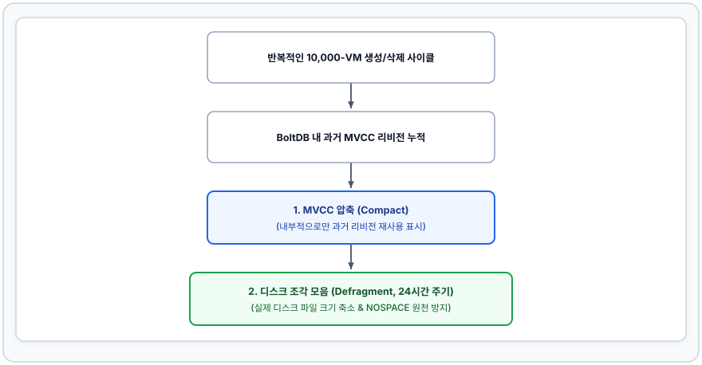

<details>
<summary>Mermaid 원본 코드 보기</summary>

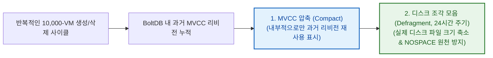

</details>

---

## 6. 병목 5: 단순 병렬성의 한계: 10종 이기종 CSP 특성 적응형 오케스트레이션과 워커 기아 방지

### 6.1 문제 진단
10개 클라우드 프로바이더(AWS, GCP, Azure, Alibaba, Tencent, IBM, NCP, NHN, KT, OpenStack)는 API 속도 제한(Rate Limit), 네트워크/VPC 제약, 비동기 작업 처리 방식이 서로 완전히 다르다. 10,456개 고루틴을 획일적인 병렬성으로 밀어붙이면 다음과 같은 **3가지 복합 장애**가 발생한다.
1. **CSP별 상이한 API 한도와 아키텍처 제약 충돌**: 예를 들어 AWS/GCP/Azure는 리전당 20대 동시 생성을 견디지만, **Tencent Cloud는 계정 전체에 초당 10 req/sec의 엄격한 제한**을 걸어 리전당 20대를 동시에 보내면 즉시 `RequestLimitExceeded`로 연쇄 실패함. 또한 **NCP**는 VPC 내 모든 서브넷이 단일 Zone에 속해야 하고, **GCP**는 VPC 레벨 CIDR을 거부하며, **KT Cloud**는 계정당 단일 VPC 구조여서 이전 티어와 CIDR 충돌(`409 duplicate network cidr`)이 발생함.
2. **단일 세마포어의 Head-of-Line Blocking / 워커 기아**: GCP Rate-Limit(`READ_REQUESTS`)에 걸린 워커가 15~60초 백오프 대기 중에도 활성 리전/노드 세마포어 슬롯을 그대로 쥐고 있어 다른 정상 리전까지 멈추거나, 10,000대 Resume 직후 수백 개의 비동기 공인 IP 조회 고루틴이 전체 SP 동시성 슬롯(50개)을 독점해 상태 폴러가 기아 상태에 빠짐.
3. **쿼터 소진 리전의 무의미한 대기열 소모 및 etcd 연관관계 직렬 병목**: 특정 리전에서 이미 계정 vCPU 쿼터나 용량이 바닥났는데도 대기 중인 수백 개 워커가 차례대로 API를 호출하며 실패를 반복하고, 생성 완료 시 10,000개 노드가 공유 VNet/SG/SSHKey의 연관 객체 목록에 50,000회 이상 직렬 Read-Modify-Write를 수행해 etcd 병목을 유발함.

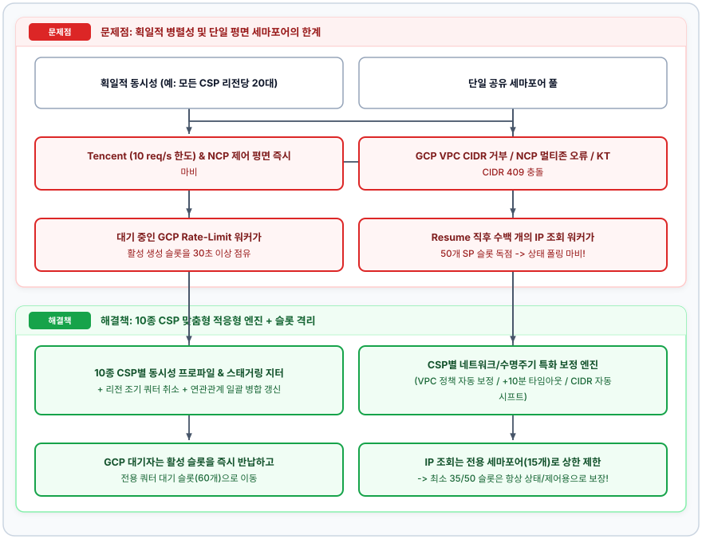

<details>
<summary>Mermaid 원본 코드 보기</summary>

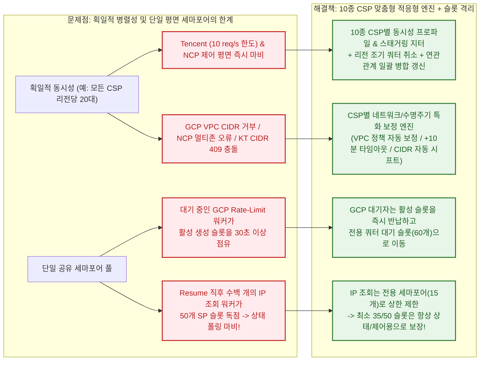

</details>

---

### 6.2 10종 CSP별 3단계 동시성, 타이밍 제어 및 리전 조기 쿼터 취소
10개 CSP의 상이한 API 처리 용량과 Rate Limit 정책을 중앙 동시성 프로파일로 통합하여, 생성, 상태 조회, 자원 등록의 동시성과 스태거링 타이밍을 CSP별로 정밀 조율함.
1. **3단계 계층형 동시성 제어 (CSP → Region → Node)**:
   - **Level 1 (10개 CSP 독립 실행 트리)**: 10개 CSP가 서로 다른 고루틴 트리에서 완전 병렬 실행되어 특정 CSP(예: NCP, NHN)의 지연이 고속 CSP(예: AWS, Alibaba, GCP)의 생성 속도에 전혀 영향을 주지 않음 (`openstack-new01` 등 파생 클라우드도 자동으로 OpenStack 프로파일에 매핑).
   - **Level 2 (CSP별 동시 리전 세마포어)**: 생성 시 동시 리전 수(대부분 30, NCP는 5), 상태 조회 시 동시 리전 수(3~12), 등록 시 동시 커넥션 수(2~5)로 CSP별 동시 활성 리전 수를 차등 제어함.
   - **Level 3 (리전 내 노드 세마포어 + 0~5초 랜덤 런치 지터 + 6단계 쓰로틀링 백오프)**: 리전당 동시 VM 생성 수를 CSP 특성에 맞게 조절(일반 20, NCP 15, **Tencent는 10 req/s 제한에 맞춰 5로 제한**)하고, 각 VM 워커 시작 시 0~5초 랜덤 지터를 부여해 순간 버스트를 분산함. 만약 CSP 쓰로틀링 에러가 발생하면 최대 6회(5s, 10s, 20s, 40s, 60s + 0~3s 지터, 최대 약 2분) 지수 백오프 재시도를 수행함.
2. **리전 단위 조기 쿼터/용량 취소**:
   - 특정 리전에서 쿼터 초과나 하드웨어 용량 부족 에러가 최초 감지되는 즉시 **해당 리전 세마포어 대기열에 서 있던 후속 워커들을 API 호출 전에 즉시 취소**함.
   - 단, 이미 세마포어를 획득해 SP 호출을 진행 중인 워커는 취소하지 않고 안전하게 완주시켜 반쯤 생성된 미추적 VM이 생기지 않도록 이중 컨텍스트 분리 기법을 적용함.
3. **공유 리소스 연관관계 일괄 배치 갱신**:
   - 개별 VM 생성 중에는 공유 리소스의 연관 객체 목록 갱신을 건너뛰고, 모든 워커 완료 후 공유 리소스(VNet, Subnet, SG, SSHKey)당 **단 1회의 일괄 Read-Modify-Write**로 병합 기록하여 **50,000회 이상의 직렬 etcd 트랜잭션을 제거**함.

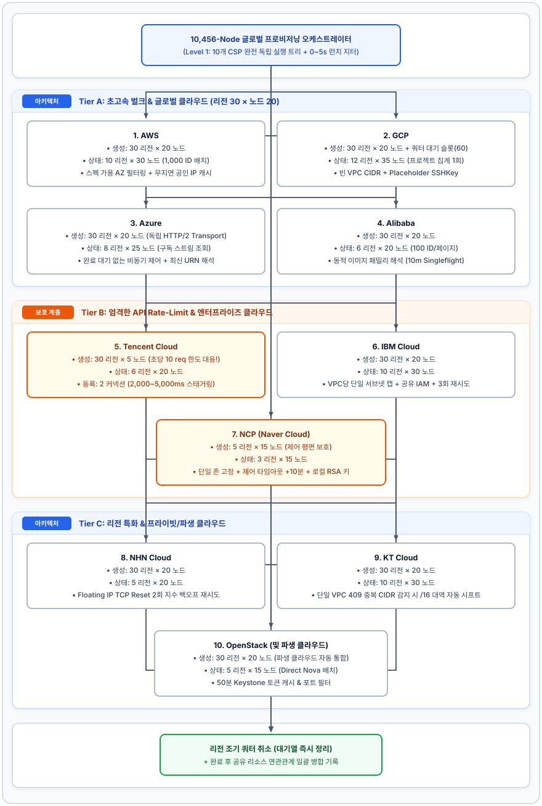

<details>
<summary>Mermaid 원본 코드 보기</summary>

```mermaid
flowchart TD
    START["10,456-Node 글로벌 프로비저닝 오케스트레이터<br/>(Level 1: 10개 CSP 완전 독립 실행 트리 + 0~5s 런치 지터)"]

    subgraph "Tier A: 초고속 벌크 & 글로벌 클라우드 (리전 30 × 노드 20)"
        AWS["1. AWS<br/>• 생성: 30 리전 × 20 노드<br/>• 상태: 10 리전 × 30 노드 (1,000 ID 배치)<br/>• 스펙 가용 AZ 필터링 + 무지연 공인 IP 캐시"]
        GCP["2. GCP<br/>• 생성: 30 리전 × 20 노드 + 쿼터 대기 슬롯(60)<br/>• 상태: 12 리전 × 35 노드 (프로젝트 집계 1회)<br/>• 빈 VPC CIDR + Placeholder SSHKey"]
        AZ["3. Azure<br/>• 생성: 30 리전 × 20 노드 (독립 HTTP/2 Transport)<br/>• 상태: 8 리전 × 25 노드 (구독 스트림 조회)<br/>• 완료 대기 없는 비동기 제어 + 최신 URN 해석"]
        ALI["4. Alibaba<br/>• 생성: 30 리전 × 20 노드<br/>• 상태: 6 리전 × 20 노드 (100 ID/페이지)<br/>• 동적 이미지 패밀리 해석 (10m Singleflight)"]
    end

    subgraph "Tier B: 엄격한 API Rate-Limit & 엔터프라이즈 클라우드"
        TEN["5. Tencent Cloud<br/>• 생성: 30 리전 × 5 노드 (초당 10 req 한도 대응!)<br/>• 상태: 6 리전 × 20 노드<br/>• 등록: 2 커넥션 (2,000~5,000ms 스태거링)"]
        IBM["6. IBM Cloud<br/>• 생성: 30 리전 × 20 노드<br/>• 상태: 10 리전 × 30 노드<br/>• VPC당 단일 서브넷 캡 + 공유 IAM + 3회 재시도"]
        NCP["7. NCP (Naver Cloud)<br/>• 생성: 5 리전 × 15 노드 (제어 평면 보호)<br/>• 상태: 3 리전 × 15 노드<br/>• 단일 존 고정 + 제어 타임아웃 +10분 + 로컬 RSA 키"]
    end

    subgraph "Tier C: 리전 특화 & 프라이빗/파생 클라우드"
        NHN["8. NHN Cloud<br/>• 생성: 30 리전 × 20 노드<br/>• 상태: 5 리전 × 20 노드<br/>• Floating IP TCP Reset 2회 지수 백오프 재시도"]
        KT["9. KT Cloud<br/>• 생성: 30 리전 × 20 노드<br/>• 상태: 10 리전 × 30 노드<br/>• 단일 VPC 409 중복 CIDR 감지 시 /16 대역 자동 시프트"]
        OS["10. OpenStack (및 파생 클라우드)<br/>• 생성: 30 리전 × 20 노드 (파생 클라우드 자동 통합)<br/>• 상태: 5 리전 × 15 노드 (Direct Nova 배치)<br/>• 50분 Keystone 토큰 캐시 & 포트 필터"]
    end

    START --> AWS
    START --> GCP
    START --> AZ
    START --> ALI
    START --> TEN
    START --> IBM
    START --> NCP
    START --> NHN
    START --> KT
    START --> OS

    AWS --> FINISH["리전 조기 쿼터 취소 (대기열 즉시 정리)<br/>+ 완료 후 공유 리소스 연관관계 일괄 병합 기록"]
    GCP --> FINISH
    AZ --> FINISH
    ALI --> FINISH
    TEN --> FINISH
    IBM --> FINISH
    NCP --> FINISH
    NHN --> FINISH
    KT --> FINISH
    OS --> FINISH

    style START fill:#e3f2fd,stroke:#1565c0,stroke-width:2px,color:#0d47a1
    style TEN fill:#fff3e0,stroke:#ef6c00,stroke-width:2px,color:#e65100
    style NCP fill:#fff3e0,stroke:#ef6c00,stroke-width:2px,color:#e65100
    style FINISH fill:#e8f5e9,stroke:#2e7d32,stroke-width:2px,color:#1b5e20
```

</details>

---

### 6.3 10종 CSP별 네트워크, 이미지, 제어 특화 적응형 보정 엔진
각 CSP의 고유한 아키텍처 제약(VPC/서브넷 구조, CIDR 충돌, 이미지 폐기, 동기 블로킹 대기, 타임아웃, TCP 리셋)을 흡수하기 위해 TB 코어 엔진 전반에 CSP 맞춤형 적응 로직을 내장함.

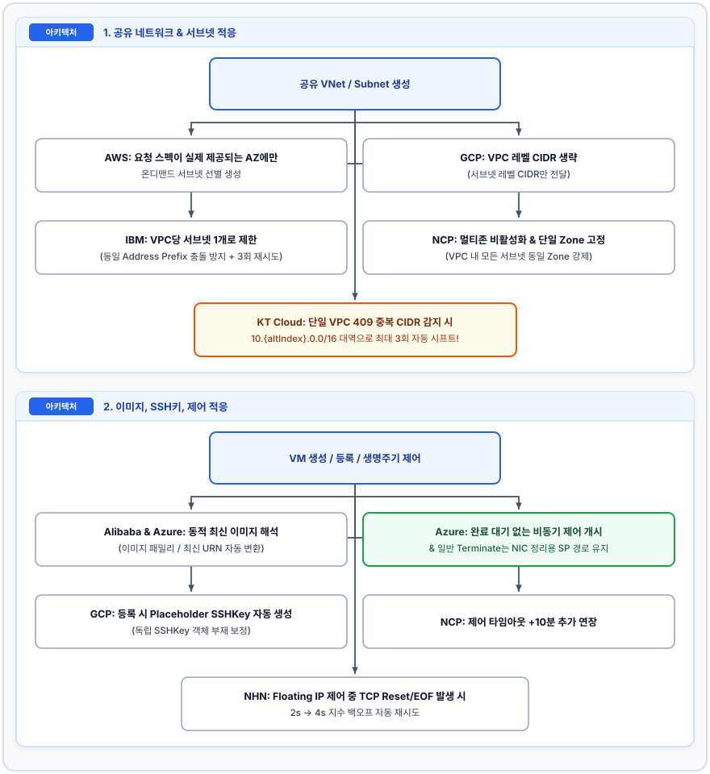

<details>
<summary>Mermaid 원본 코드 보기</summary>

```mermaid
flowchart TB
    subgraph NET["1. 공유 네트워크 & 서브넷 적응"]
        direction LR
        NET_IN["공유 VNet / Subnet 생성"] --> NET_AWS["AWS: 요청 스펙이 실제 제공되는 AZ에만<br/>온디맨드 서브넷 선별 생성"]
        NET_IN --> NET_GCP["GCP: VPC 레벨 CIDR 생략<br/>(서브넷 레벨 CIDR만 전달)"]
        NET_IN --> NET_IBM["IBM: VPC당 서브넷 1개로 제한<br/>(동일 Address Prefix 충돌 방지 + 3회 재시도)"]
        NET_IN --> NET_NCP["NCP: 멀티존 비활성화 & 단일 Zone 고정<br/>(VPC 내 모든 서브넷 동일 Zone 강제)"]
        NET_IN --> NET_KT["KT Cloud: 단일 VPC 409 중복 CIDR 감지 시<br/>10.{altIndex}.0.0/16 대역으로 최대 3회 자동 시프트!"]
    end

    subgraph CTL["2. 이미지, SSH키, 제어 적응"]
        direction LR
        CTL_IN["VM 생성 / 등록 / 생명주기 제어"] --> CTL_ALI["Alibaba & Azure: 동적 최신 이미지 해석<br/>(이미지 패밀리 / 최신 URN 자동 변환)"]
        CTL_IN --> CTL_AZ["Azure: 완료 대기 없는 비동기 제어 개시<br/>& 일반 Terminate는 NIC 정리용 SP 경로 유지"]
        CTL_IN --> CTL_GCP["GCP: 등록 시 Placeholder SSHKey 자동 생성<br/>(독립 SSHKey 객체 부재 보정)"]
        CTL_IN --> CTL_NCP["NCP: 제어 타임아웃 +10분 추가 연장"]
        CTL_IN --> CTL_NHN["NHN: Floating IP 제어 중 TCP Reset/EOF 발생 시<br/>2s -> 4s 지수 백오프 자동 재시도"]
    end

    NET ~~~ CTL

    style NET_IN fill:#e3f2fd,stroke:#1565c0,stroke-width:2px,color:#0d47a1
    style CTL_IN fill:#e3f2fd,stroke:#1565c0,stroke-width:2px,color:#0d47a1
    style NET_KT fill:#fff3e0,stroke:#ef6c00,stroke-width:2px,color:#e65100
    style CTL_AZ fill:#e8f5e9,stroke:#2e7d32,stroke-width:2px,color:#1b5e20
```

</details>

#### 10종 CSP별 동시성 프로파일 및 특화 엔지니어링 총괄 매트릭스

| CSP | 생성 동시성<br/>(리전 × 노드) | 상태 조회 동시성<br/>(리전 × 노드) | 자원 등록 동시성<br/>(커넥션 / 스태거링) | 네트워크, 서브넷, 공유 리소스 특화 처리 | 프로비저닝, 생명주기 제어, 복구 특화 처리 |
| :--- | :---: | :---: | :---: | :--- | :--- |
| **1. AWS** | 30 × 20 | 10 × 30 | 5 (500~2000ms) | 요청 스펙이 실제 제공되는 가용 영역(AZ)에만 온디맨드 서브넷 생성 (예: `t2.nano` 미제공 AZ 자동 회피) | 네이티브 벌크 Start/Stop/Terminate(호출당 1,000 ID); 배치 상태 응답에서 공인 IP 즉시 추출(SP 호출 0회); 특정 AZ 품절 핀포인트 차단 |
| **2. GCP** | 30 × 20<br/>(+ 쿼터 대기 60) | 12 × 35 | 4 (1000~3000ms) | GCP는 VPC 레벨 CIDR을 거부하므로 VPC CIDR은 비우고 서브넷 레벨에서만 CIDR 전달; 리전 서브넷 공유(존별 서브넷 불필요) | `READ_REQUESTS` Rate Limit 발생 시 활성 슬롯을 반납하고 전용 쿼터 대기 슬롯(60개)에서 대기; 프로젝트당 단 1회 집계 호출로 41개 리전 상태 조회 및 방화벽 사용 여부 검증; VM 등록 시 독립 SSHKey 객체가 없으므로 Placeholder SSHKey 자동 생성 |
| **3. Azure** | 30 × 20 | 8 × 25 | 4 (500~2000ms) | 멀티존 서브넷 지원; SP [PR #1878](https://github.com/cloud-barista/cb-spider/pull/1878)로 전체 ARM ID 대신 짧은 리소스 이름을 추출해 VPC/Key 등록 정합성 확보 | 구독당 1회 스트림 상태 조회; **비동기 제어 개시 API(동시성 20)로 요청만 즉시 전송하고 블로킹 완료 대기 제거**; 일반 Terminate는 NIC/PublicIP 연쇄 삭제를 위해 SP로 라우팅하고 유령 VM만 Direct SDK로 제거; 최신 이미지 URN 해석; ARM 클라이언트별 독립 HTTP/2 Transport([PR #1700](https://github.com/cloud-barista/cb-spider/pull/1700)) |
| **4. Alibaba** | 30 × 20 | 6 × 20 | 3 (1000~3000ms) | 멀티존 VSwitch 동적 확장 및 비충돌 프라이빗 CIDR 자동 할당 | 날짜 스탬프가 박힌 공개 이미지가 수시로 폐기되는 문제를 해결하기 위해 생성 직전 Direct SDK로 **이미지 패밀리(10분 TTL + Singleflight) 기반 최신 활성 이미지 ID 동적 해석**; 스펙별 호환 시스템 디스크 타입 자동 매칭 |
| **5. Tencent** | 30 × **5** | 6 × 20 | **2 (2000~5000ms)** | 멀티존 서브넷 지원; 대상 Zone 미지정 시에만 서브넷 조회 수행([PR #1865](https://github.com/cloud-barista/cb-spider/pull/1865)) | **계정 전체 초당 10 req/sec 하드 리밋 대응**: 리전당 동시 생성 노드를 20에서 **5로 낮추고**, 자원 등록 동시성도 2(2~5초 지연)로 가장 보수적으로 조율하여 `RequestLimitExceeded` 연쇄 실패를 근절 |
| **6. IBM** | 30 × 20 | 10 × 30 | 3 (500~2000ms) | SP 드라이버가 다중 존 서브넷에 동일한 Address Prefix를 부여해 충돌하는 문제를 막기 위해 **VPC당 서브넷 수를 1개로 제한**; 공유 리소스 생성 시 3회 재시도(10s, 20s, 30s) 적용 | API Key당 단일 IAM 인증기 공유 캐시([PR #1776](https://github.com/cloud-barista/cb-spider/pull/1776), 호출당 네트워크 왕복 5회 → 1회); OS 타입 힌트([PR #1909](https://github.com/cloud-barista/cb-spider/pull/1909))로 생성 시간 -30% 단축 |
| **7. NCP** | **5 × 15** | **3 × 15** | 2 (1000~3000ms) | NCP VPC 내 모든 서브넷은 반드시 동일 Zone에 있어야 하므로 **멀티존 비활성화 및 단일 Zone 강제 고정**; 로컬 RSA 2048 키 생성 후 공개키만 Import | 엄격한 제어 평면 보호를 위해 동시 리전을 5(상태 조회 3)로 제한; **VM 제어 시 기본 타임아웃에 +10분 추가 연장**; SP에서 Running 이후 3분 루트 디스크 대기를 제거하여 생성 시간 **-59%(237s → 97s)** 단축 |
| **8. NHN** | 30 × 20 | 5 × 20 | 2 (1000~3000ms) | OpenStack 계열 서브넷/라우터 구조 지원; AZ 조회 시 HTTP Transport 누수 제거([PR #1865](https://github.com/cloud-barista/cb-spider/pull/1865)) | Floating IP 연동 제어 중 간헐적 TCP 연결 리셋(`connection reset by peer` / `EOF`) 발생 시 **자동으로 2회 지수 백오프(2s, 4s) 재시도** 수행; `kr2` 리전 Glance 이미지 메타데이터 언마샬링 버그 수정([PR #1909](https://github.com/cloud-barista/cb-spider/pull/1909)) |
| **9. KT Cloud** | 30 × 20 | 10 × 30 | 2 (1000~3000ms) | **계정당 단일 VPC 구조 적응**: 잔존 티어로 인해 `409 duplicate network cidr` 발생 시 **대체 `/16` 대역(`10.{altIndex}.0.0/16`)을 자동 계산해 최대 3회 재시도**; 온디맨드 존 서브넷 확장 비활성화 | SP 드라이버에서 포트포워딩/방화벽 규칙 병렬 생성 및 2초 고정 대기 제거로 생성 시간 **-54%(56s → 26s)** 단축; 병렬 삭제 시 공유 방화벽 정책 404 허용([PR #1705](https://github.com/cloud-barista/cb-spider/pull/1705)) 및 계정 공용 SRCNAT IP 삭제 방지([PR #1877](https://github.com/cloud-barista/cb-spider/pull/1877)) |
| **10. OpenStack** | 30 × 20 | 5 × 15 | 3 (500~2000ms) | `openstack-new01` 등 임의의 파생 클라우드 이름을 OpenStack 패밀리로 자동 통합하여 동일한 Rate Limit 및 네트워크 정책 적용 | Direct Nova 배치 상태/인벤토리 조회 공유; 50분 Keystone 인증 토큰 캐시, Flavor 캐시, DeviceID 포트 필터 적용([PR #1865](https://github.com/cloud-barista/cb-spider/pull/1865)) |

---

### 6.4 GCP 전용 쿼터 대기 슬롯 분리 및 공인 IP 갱신 이중 세마포어 격리
1. **GCP 쿼터 대기 슬롯(60개) 분리**: GCP에서 `READ_REQUESTS` Rate Limit 발생 시 **점유 중인 리전 세마포어와 노드 세마포어를 즉시 반납**하고 전용 쿼터 대기 슬롯(60개)으로 이동해 대기(15s × 시도 횟수 + 지터)함으로써 다른 GCP 리전이 멈추지 않고 생성되도록 보장함 (**41개 GCP 리전 100% 성공**).
2. **이중 세마포어 격리 (공인 IP 전용 15슬롯 → 전체 SP 50슬롯)**: 비-AWS 노드의 폴백 공인 IP 조회 워커(지수 백오프 5s, 10s, 20s, 40s, 60s = 135s 윈도우 및 10분 재시도)는 전체 SP 세마포어(50개) 획득 전에 반드시 공인 IP 전용 세마포어(15개)를 먼저 통과해야 하므로, **항상 최소 35개(70%)의 SP 슬롯이 상태 폴링 및 제어용으로 보존**됨.

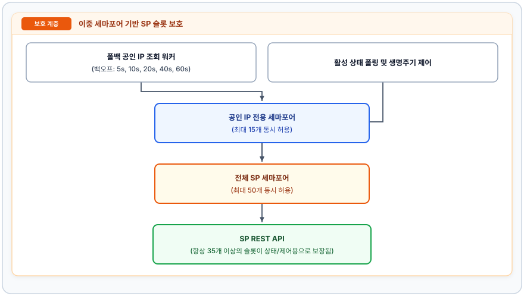

<details>
<summary>Mermaid 원본 코드 보기</summary>

```mermaid
flowchart LR
    subgraph "이중 세마포어 기반 SP 슬롯 보호"
        IP_GORO["폴백 공인 IP 조회 워커<br/>(백오프: 5s, 10s, 20s, 40s, 60s)"] --> IP_SEM["공인 IP 전용 세마포어<br/>(최대 15개 동시 허용)"]
        POLL_GORO["활성 상태 폴링 및 생명주기 제어"] --> GLOB_SEM["전체 SP 세마포어<br/>(최대 50개 동시 허용)"]
        IP_SEM --> GLOB_SEM
        GLOB_SEM --> SP_API["SP REST API<br/>(항상 35개 이상의 슬롯이 상태/제어용으로 보장됨)"]
    end

    style IP_SEM fill:#e3f2fd,stroke:#1565c0,stroke-width:2px,color:#0d47a1
    style GLOB_SEM fill:#fff3e0,stroke:#ef6c00,stroke-width:2px,color:#e65100
    style SP_API fill:#e8f5e9,stroke:#2e7d32,stroke-width:2px,color:#1b5e20
```

</details>

---

### 6.5 5단계 적응형 폴링 우선순위
백그라운드 상태 동기화 에이전트는 노드의 생명주기 상태에 따라 폴링 주기를 동적으로 조절하며, 배치 상태 조회를 지원하는 CSP의 Suspending/Resuming 노드는 개별 폴러에서 자동으로 건너뜀.

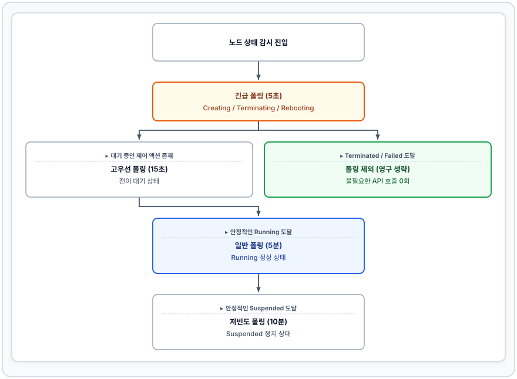

<details>
<summary>Mermaid 원본 코드 보기</summary>

```mermaid
flowchart LR
    START_P["노드 상태 감시 진입"] --> URG["긴급 폴링 (5초)<br/>Creating / Terminating / Rebooting"]
    URG -->|"대기 중인 제어 액션 존재"| HIGH["고우선 폴링 (15초)<br/>전이 대기 상태"]
    HIGH -->|"안정적인 Running 도달"| MED["일반 폴링 (5분)<br/>Running 정상 상태"]
    MED -->|"안정적인 Suspended 도달"| LOW["저빈도 폴링 (10분)<br/>Suspended 정지 상태"]
    URG -->|"Terminated / Failed 도달"| SKIP["폴링 제외 (영구 생략)<br/>불필요한 API 호출 0회"]

    style URG fill:#fff3e0,stroke:#ef6c00,stroke-width:2px,color:#e65100
    style MED fill:#e3f2fd,stroke:#1565c0,stroke-width:2px,color:#0d47a1
    style SKIP fill:#e8f5e9,stroke:#2e7d32,stroke-width:2px,color:#1b5e20
```

</details>

---

## 7. 병목 6: 장시간 대규모 작업과 HTTP / SSH 타임아웃 생명주기의 불일치

### 7.1 문제 진단
10,456대 프로비저닝이나 제어는 수 분이 소요되는 반면, 앞단 리버스 프록시(예: Envoy Gateway 기본 15초 타임아웃)나 클라이언트 HTTP 연결은 중간에 끊어지기 쉽다. 서버가 프로비저닝 루프를 HTTP 요청 컨텍스트에 그대로 묶어두면, 클라이언트 연결 종료 시 진행 중이던 OpenBao 시크릿 읽기나 CSP VM 등록이 도중에 취소(`context canceled`)되어 인프라가 `Preparing` 상태에 영구 고착되거나 미추적 고아 VM이 발생한다.

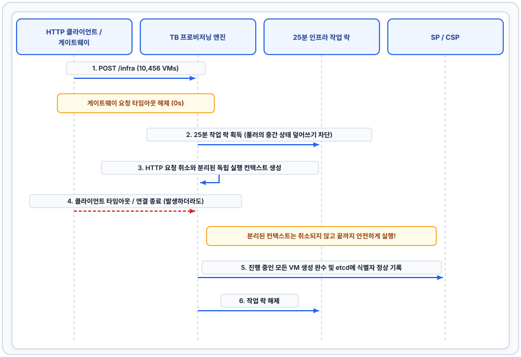

<details>
<summary>Mermaid 원본 코드 보기</summary>

```mermaid
sequenceDiagram
    autonumber
    participant Client as HTTP 클라이언트 / 게이트웨이
    participant TB as TB 프로비저닝 엔진
    participant Lock as 25분 인프라 작업 락
    participant CSP as SP / CSP

    Client->>TB: POST /infra (10,456 VMs)
    Note over Client,TB: 게이트웨이 요청 타임아웃 해제 (0s)
    TB->>Lock: 25분 작업 락 획득 (폴러의 중간 상태 덮어쓰기 차단)
    TB->>TB: HTTP 요청 취소와 분리된 독립 실행 컨텍스트 생성
    Client--xTB: 클라이언트 타임아웃 / 연결 종료 (발생하더라도)
    Note over TB,CSP: 분리된 컨텍스트는 취소되지 않고 끝까지 안전하게 실행!
    TB->>CSP: 진행 중인 모든 VM 생성 완수 및 etcd에 식별자 정상 기록
    TB->>Lock: 작업 락 해제
```

</details>

---

### 7.2 실행 컨텍스트 취소 분리, 게이트웨이 타임아웃 해제 및 25분 작업 락
1. **컨텍스트 취소 전파 차단**: 백그라운드 프로비저닝 및 제어 루프를 HTTP 요청 컨텍스트 취소로부터 분리하여, 한 번 시작된 CSP 리소스 생성이 끝까지 추적, 기록되도록 보장함.
2. **게이트웨이 요청 타임아웃 해제(0s)**: API 및 MCP 라우트의 게이트웨이 타임아웃을 비활성화하여 장기 실행 중 `504 Gateway Timeout`을 방지함.
3. **25분 인프라 작업 락**: 대규모 생성이나 제어 작업 진행 중 백그라운드 스위퍼가 전이 상태(Creating, Suspending, Resuming, Terminating)를 덮어쓰지 못하도록 보호함.

### 7.3 능동형 SSH 준비 게이트 및 비동기 스트리밍 원격 명령
배포 후 원격 명령(Post-Command) 실행 전의 무의미한 고정 대기를 제거하고, 능동형 TCP/SSH 핸드셰이크 준비 게이트, 최초 접속 시 호스트 키 자동 등록, 검증, Bastion/Target 동시성 세마포어, 실시간 SSE 출력 스트리밍, etcd 이력 크기 제한을 적용함.

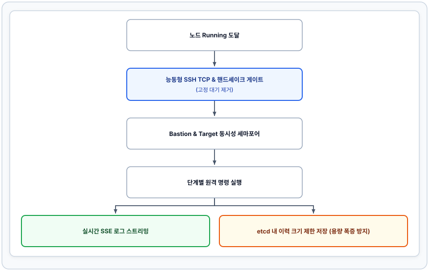

<details>
<summary>Mermaid 원본 코드 보기</summary>

```mermaid
flowchart LR
    VM_UP["노드 Running 도달"] --> GATE["능동형 SSH TCP & 핸드셰이크 게이트<br/>(고정 대기 제거)"]
    GATE --> SEM["Bastion & Target 동시성 세마포어"]
    SEM --> EXEC["단계별 원격 명령 실행"]
    EXEC --> SSE["실시간 SSE 로그 스트리밍"]
    EXEC --> BOUND["etcd 내 이력 크기 제한 저장 (용량 폭증 방지)"]

    style GATE fill:#e3f2fd,stroke:#1565c0,stroke-width:2px,color:#0d47a1
    style SSE fill:#e8f5e9,stroke:#2e7d32,stroke-width:2px,color:#1b5e20
    style BOUND fill:#fff3e0,stroke:#ef6c00,stroke-width:2px,color:#e65100
```

</details>

---

# Part III. 계층 간 정합성 보정 및 하위 프레임워크(SP) 수술

## 8. 병목 7: 부분 실패 시의 실험 시간 손실 및 TB ↔ SP ↔ CSP 3자 간 정합성 붕괴

### 8.1 문제 진단
10개 클라우드 10,000+ VM 환경에서는 부분 실패와 3개 계층 간 데이터 불일치가 필연적으로 발생한다.
1. **부분 생성 실패**: 10,456대 중 42대가 특정 리전 용량 부족(예: AWS `ap-northeast-3` 또는 `eu-central-2a`)으로 실패했을 때 전체를 롤백하면 11분 이상 걸린 10,414대의 정상 인프라까지 소실됨.
2. **3자 간 DB 정합성 불일치 (TB etcd ↔ SP DB ↔ 실제 CSP)**: SP가 별도 메타데이터 DB를 유지하므로, 삭제 중 오류가 발생하면 SP DB에서만 식별자(IID)가 지워지고 **실제 CSP 리소스는 살아남아 계속 과금되는 유령 리소스 문제**가 생기거나, 반대로 Direct SDK로 CSP에서 바로 지우면 SP DB에 잔여 IID가 남음.
3. **클라우드 API의 일시적 응답 누락**: 삭제 중이나 고부하 시 GCP/Azure 목록 API가 인스턴스를 1회 스윕 동안 일시 누락하면 단순 로직은 노드를 `Undefined`로 역전시킴.

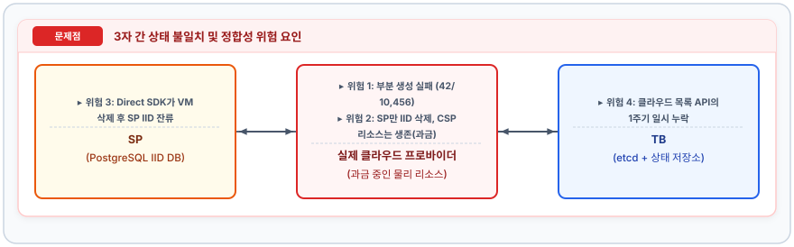

<details>
<summary>Mermaid 원본 코드 보기</summary>

```mermaid
flowchart TB
    subgraph "3자 간 상태 불일치 및 정합성 위험 요인"
        TB_DB[("TB<br/>(etcd + 상태 저장소)")]
        SP_DB[("SP<br/>(PostgreSQL IID DB)")]
        CSP_LIVE[("실제 클라우드 프로바이더<br/>(과금 중인 물리 리소스)")]

        TB_DB <-->|"위험 1: 부분 생성 실패 (42/10,456)"| CSP_LIVE
        SP_DB <-->|"위험 2: SP만 IID 삭제, CSP 리소스는 생존(과금)"| CSP_LIVE
        TB_DB <-->|"위험 3: Direct SDK가 VM 삭제 후 SP IID 잔류"| SP_DB
        CSP_LIVE <-->|"위험 4: 클라우드 목록 API의 1주기 일시 누락"| TB_DB
    end

    style TB_DB fill:#e3f2fd,stroke:#1565c0,stroke-width:2px,color:#0d47a1
    style SP_DB fill:#fff3e0,stroke:#ef6c00,stroke-width:2px,color:#e65100
    style CSP_LIVE fill:#ffebee,stroke:#c62828,stroke-width:2px,color:#b71c1c
```

</details>

---

### 8.2 실패 복구 정책(continue / refine / rollback) 및 1.83초 정제(action=refine)
- **정밀 실패 정제(`action=refine`)**: 정상 Running 노드는 모두 보존한 채 Failed 상태인 노드 레코드와 반쯤 생성된 CSP 리소스만 정밀 타격하여 제거함. 10,456 VM 실측에서 용량 부족으로 실패한 42개 노드를 단 **1.83 s** 만에 정리하여 **10,414 / 10,414 (100%) Running** 인프라로 정규화함.

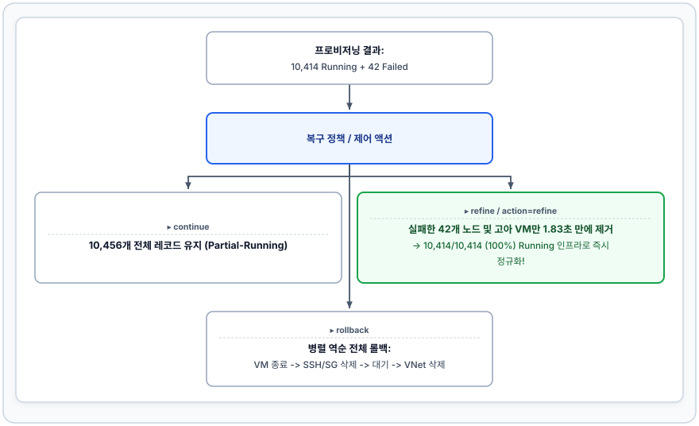

<details>
<summary>Mermaid 원본 코드 보기</summary>

```mermaid
flowchart TD
    PARTIAL["프로비저닝 결과:<br/>10,414 Running + 42 Failed"] --> POLICY{"복구 정책 / 제어 액션"}
    POLICY -->|"continue"| KEEP["10,456개 전체 레코드 유지 (Partial-Running)"]
    POLICY -->|"refine / action=refine"| REFINE["실패한 42개 노드 및 고아 VM만 1.83초 만에 제거<br/>-> 10,414/10,414 (100%) Running 인프라로 즉시 정규화!"]
    POLICY -->|"rollback"| RB["병렬 역순 전체 롤백:<br/>VM 종료 -> SSH/SG 삭제 -> 대기 -> VNet 삭제"]

    style POLICY fill:#e3f2fd,stroke:#1565c0,stroke-width:2px,color:#0d47a1
    style REFINE fill:#e8f5e9,stroke:#2e7d32,stroke-width:2px,color:#1b5e20
```

</details>

---

### 8.3 3단계 Fail-Closed Tombstone 삭제 및 유실 IID 자동 재등록
**"CSP 측 삭제가 확인되기 전에는 절대 로컬 레코드를 지우지 않는다"라는 불변식**을 보장함 ([설계 문서 참조](../../design/resource-deletion-tombstone.md)).
1. **크래시 안전 Tombstone (`Status = Deleting`)**: SP/CSP 삭제 호출 전에 먼저 `Deleting` 상태와 삭제 요청 시각을 기록함.
2. **3단계 검증 계층**:

| 단계 | 검증 수단 | 신뢰도 | 삭제 상태 머신에서의 역할 |
| :---: | :--- | :---: | :--- |
| **Tier 1** | SP 단건 GET 폴링 | 낮음 (SP DB만 보고 응답 가능) | **5×3초 일관성 대기 루프로만 사용**; 단독 로컬 삭제 승인 불가 |
| **Tier 2** | SP 전체 목록 대조 (`onCsp == false`) | 높음 (실제 CSP 목록 열거) | **필수 삭제 승인 게이트** (커넥션 단위 배치 조회로 공유) |
| **Tier 3** | Direct CSP SDK 직접 프로브 | 최고 (SP 완전 우회) | Tier 2 호출 실패 시 CSP에 직접 존재 여부 확인 |

3. **유실 IID(Dead-End IID) 자동 재등록 복구**: 삭제 재시도 시 SP는 "커넥션에 존재하지 않음"을 반환하는데 Tier 2에서는 `onCsp == true`인 경우(SP가 IID만 잃어버려 삭제 불능에 빠진 유령 리소스), TB가 보관 중인 실제 CSP 식별자(`SystemId`)를 이용해 **SP에 리소스를 자동 재등록한 뒤 다시 삭제를 호출**하여 끝까지 제거함.
4. **죽은 노드 참조 자동 정리**: 공유 리소스 일괄 삭제 시 죽은 노드 참조를 자동 정리하고 병렬 역순(보안그룹 → 대기 → VNet → SSHKey)으로 해제하여 **438 / 438 (100%) 공유 리소스를 단일 패스(149.85 s)로 삭제**함.

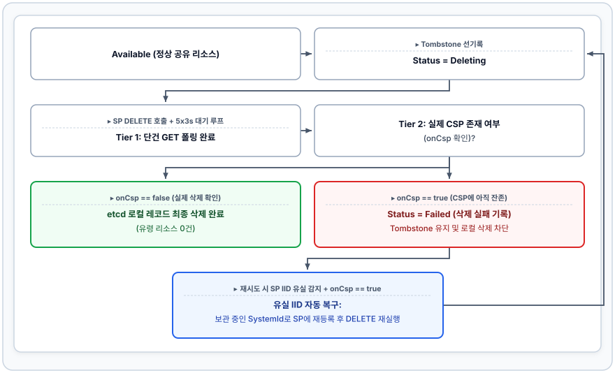

<details>
<summary>Mermaid 원본 코드 보기</summary>

```mermaid
flowchart TD
    AVAIL["Available (정상 공유 리소스)"] -->|"Tombstone 선기록"| DEL_ST["Status = Deleting"]
    DEL_ST -->|"SP DELETE 호출 + 5x3s 대기 루프"| T1["Tier 1: 단건 GET 폴링 완료"]
    T1 --> T2{"Tier 2: 실제 CSP 존재 여부<br/>(onCsp 확인)?"}
    T2 -->|"onCsp == false (실제 삭제 확인)"| PURGE["etcd 로컬 레코드 최종 삭제 완료<br/>(유령 리소스 0건)"]
    T2 -->|"onCsp == true (CSP에 아직 잔존)"| FAIL_ST["Status = Failed (삭제 실패 기록)<br/>Tombstone 유지 및 로컬 삭제 차단"]
    FAIL_ST -->|"재시도 시 SP IID 유실 감지 + onCsp == true"| REPAIR["유실 IID 자동 복구:<br/>보관 중인 SystemId로 SP에 재등록 후 DELETE 재실행"]
    REPAIR --> DEL_ST

    style FAIL_ST fill:#ffebee,stroke:#c62828,stroke-width:2px,color:#b71c1c
    style REPAIR fill:#e3f2fd,stroke:#1565c0,stroke-width:2px,color:#0d47a1
    style PURGE fill:#e8f5e9,stroke:#2e7d32,stroke-width:2px,color:#1b5e20
```

</details>

---

### 8.4 비동기 SP IID 정리, Direct CSP 고아/잔여 리소스 감사 및 방화벽 보호
- **비동기 SP IID 정리**: Direct CSP 벌크 종료가 클라우드에서 VM을 직접 삭제하면, 백그라운드에서 50개 워커가 SP의 등록 해제 API(CSP 호출 0회)를 병렬 호출해 SP DB 정합성을 맞춤.
- **타임아웃 고아 VM 타겟 탐색**: 생성 요청이 네트워크 타임아웃으로 끊겼을 때 SP DB에는 IID가 없더라도 실제로는 클라우드에서 VM이 생성 중일 수 있음. 이때 리전 전체를 스캔하지 않고 10개 CSP의 Direct SDK 태그/이름 필터(예: AWS 200개 단위 배치)로 TB 고유 식별자와 일치하는 고아 VM만 즉시 찾아내어 회수하거나 정리함.
- **Direct CSP 실물 감사 및 VM 부속 잔여 리소스 청소**:
  - SP를 완전히 우회하여 9개 CSP의 실물 자산을 직접 스캔함.
  - TB 관리 대상(고유 이름 규칙 또는 관리 태그)을 식별한 뒤, VM 삭제 후 분리되어 과금을 유발하는 **고아 부속 리소스**(NIC, ENI, 공인 IP, EIP, Floating IP, 디스크, 볼륨)와 미추적 유령 VM을 직접 제거하며, 인프라 메타데이터 최종 삭제 전 잔존 고아 VM 유무를 검증함.
- **GCP 방화벽(보안그룹) 사용 중 여부 사전 검증**: GCP는 실행 중인 VM이 네트워크 태그를 참조하고 있어도 방화벽 규칙 삭제를 허용하므로, 보안그룹 삭제 전에 프로젝트 전체 인스턴스를 직접 확인하여 비종료 VM이 남아 있으면 삭제를 차단함.

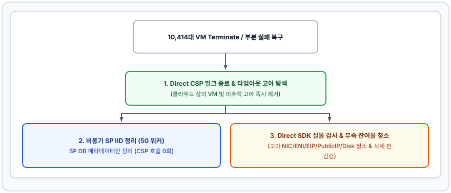

<details>
<summary>Mermaid 원본 코드 보기</summary>

```mermaid
flowchart LR
    TERM["10,414대 VM Terminate / 부분 실패 복구"] --> DIRECT_DEL["1. Direct CSP 벌크 종료 & 타임아웃 고아 탐색<br/>(클라우드 상의 VM 및 미추적 고아 즉시 제거)"]
    DIRECT_DEL --> ASYNC_REG["2. 비동기 SP IID 정리 (50 워커)<br/>SP DB 메타데이터만 정리 (CSP 호출 0회)"]
    DIRECT_DEL --> AUDIT["3. Direct SDK 실물 감사 & 부속 잔여물 청소<br/>(고아 NIC/ENI/EIP/PublicIP/Disk 청소 & 삭제 전 검증)"]

    style DIRECT_DEL fill:#e8f5e9,stroke:#2e7d32,stroke-width:2px,color:#1b5e20
    style ASYNC_REG fill:#e3f2fd,stroke:#1565c0,stroke-width:2px,color:#0d47a1
    style AUDIT fill:#fff3e0,stroke:#ef6c00,stroke-width:2px,color:#e65100
```

</details>

---

### 8.5 공유 리소스 의존성 오류(DependencyViolation) 극복을 위한 기존 자원 등록 기반 반자동 복구
대규모 VM 노드를 종료, 삭제한 뒤 마지막으로 공유 리소스(`DELETE /ns/{nsId}/sharedResources`)를 정리할 때, 이전 생성/삭제 과정에서 발생한 SP 오류나 강제 정리로 인해 **TB(etcd)에는 추적이 끊겼으나 실제 CSP에는 살아남은 미추적 고아 VM 또는 고아 보안그룹**(SecurityGroup)이 공유 VNet/Subnet/SG를 계속 붙잡고 있는 경우가 발생한다. 이때 CSP는 참조 무결성 위반(`DependencyViolation: resource has a dependent object`)으로 공유 리소스 삭제를 거부한다.

이를 안전하고 반자동으로 해결하기 위해 **공유 리소스 연쇄 보호 해제**와 **기존 자원 등록 기능을 역이용한 타겟 의존성 복구**(`POST /ns/{nsId}/sharedResources/recoverDependencies`) 메커니즘을 구축함 ([공유 리소스 관리 가이드 참조](shared-resource-management.md)).

1. **공유 리소스 해제의 의존성 순서 제어 및 실패 전파 보호 가드**:
   - **죽은 참조 자동 정리**: 이미 etcd에서 삭제된 노드의 낡은 참조는 자동으로 일괄 제거하고, 살아 있는 참조가 0건인 리소스만 삭제 대상으로 선별함.
   - **3단계 의존성 순서 및 SSHKey 보존 가드**: 반드시 **SecurityGroup → VNet → SSHKey** 순서로 해제함. 만약 1단계 SecurityGroup 삭제가 고아 VM에 의한 `DependencyViolation`으로 실패하면 해당 커넥션과 상위 VNet을 실패 목록에 기록하여, **상위 VNet과 해당 커넥션의 SSHKey 삭제를 자동 보류**함(살아남은 고아 VM에 접속하거나 정리할 열쇠를 잃어버리지 않도록 보호). 또한 VNet 삭제 실패 시 백그라운드에서 리소스 정합성 재조정(Reconcile)을 자동 트리거함.
2. **기존 자원 등록 기능을 활용한 타겟 의존성 복구**:
   - 클라우드 계정의 모든 자원을 무차별 등록하면 고객의 다른 워크로드까지 오염되므로, 먼저 해당 네임스페이스의 공유 VNet, Subnet, SecurityGroup의 실제 CSP ID 집합(공유 Footprint)만 추출함.
   - **Phase 1 (고아 SecurityGroup 역등록)**: CSP에만 존재하거나 SP에만 남은 미추적 보안그룹을 조회한 뒤, 소유 VPC가 공유 VNet에 속하는 **진짜 의존성 보안그룹만 기존 자원 등록 모드로 TB에 편입**함.
   - **Phase 2 (고아 VM 노드 역등록)**: 두 부류의 미추적 고아 VM을 모두 포획함:
     - **CSP에만 존재하는 고아 VM (SP, TB 모두 미추적)**: 해당 VM이 참조 중인 VPC와 보안그룹 목록을 확인하여 공유 Footprint와 일치할 때만 기존 자원 등록 모드를 통해 **`dep-{shortCspId}`** 이름의 복구용 인프라로 TB에 등록함.
     - **SP에만 남은 미추적 고아 VM (TB 미추적)**: SP에는 등록되어 있으나 TB etcd에서 유실된 VM으로, VPC, Subnet, 보안그룹이 공유 Footprint와 일치하면 동일하게 **`dep-{shortCspId}`** 인프라로 역등록함 (실제 CSP ID가 비어 있는 유령 SP 레코드는 즉시 자동 청소).
   - **반자동 정리 완결**: 보이지 않던 고아 리소스들이 TB의 정식 `dep-{shortCspId}` 인프라 및 보안그룹으로 가시화되므로, 표준 인프라 종료 API(`DELETE /ns/{nsId}/infra/dep-{shortCspId}?option=terminate`)로 고아 VM을 안전하게 종료한 뒤 공유 리소스 삭제를 재호출하여 의존성 오류를 100% 해소함.

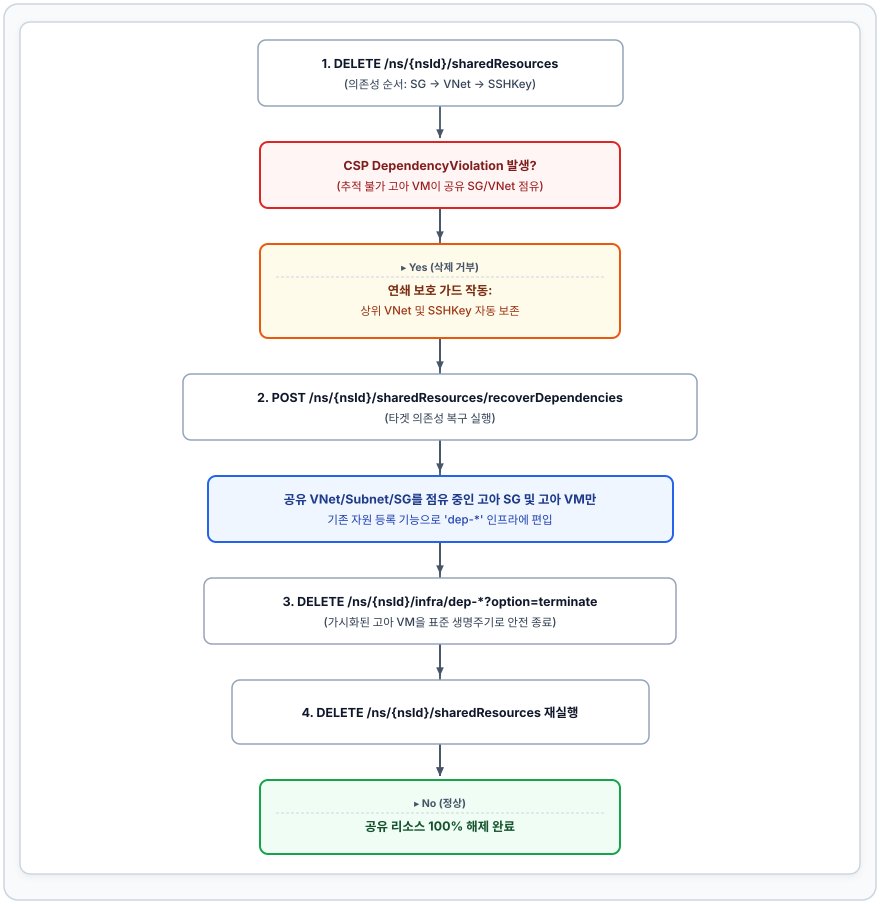

<details>
<summary>Mermaid 원본 코드 보기</summary>

```mermaid
flowchart TD
    DEL1["1. DELETE /ns/{nsId}/sharedResources<br/>(의존성 순서: SG -> VNet -> SSHKey)"] --> VIOL{"CSP DependencyViolation 발생?<br/>(추적 불가 고아 VM이 공유 SG/VNet 점유)"}
    VIOL -->|"No (정상)"| DONE["공유 리소스 100% 해제 완료"]
    VIOL -->|"Yes (삭제 거부)"| GUARD["연쇄 보호 가드 작동:<br/>상위 VNet 및 SSHKey 자동 보존"]
    GUARD --> RECOV["2. POST /ns/{nsId}/sharedResources/recoverDependencies<br/>(타겟 의존성 복구 실행)"]
    RECOV --> ADOPT["공유 VNet/Subnet/SG를 점유 중인 고아 SG 및 고아 VM만<br/>기존 자원 등록 기능으로 'dep-*' 인프라에 편입"]
    ADOPT --> TERM_DEP["3. DELETE /ns/{nsId}/infra/dep-*?option=terminate<br/>(가시화된 고아 VM을 표준 생명주기로 안전 종료)"]
    TERM_DEP --> DEL2["4. DELETE /ns/{nsId}/sharedResources 재실행"]
    DEL2 --> DONE

    style VIOL fill:#ffebee,stroke:#c62828,stroke-width:2px,color:#b71c1c
    style GUARD fill:#fff3e0,stroke:#ef6c00,stroke-width:2px,color:#e65100
    style ADOPT fill:#e3f2fd,stroke:#1565c0,stroke-width:2px,color:#0d47a1
    style DONE fill:#e8f5e9,stroke:#2e7d32,stroke-width:2px,color:#1b5e20
```

</details>


<details>
<summary>Mermaid 원본 코드 보기</summary>

```mermaid
flowchart LR
    subgraph "공유 리소스 의존성 정밀 타겟 스캔 & 역등록 구조"
        FP["1. 공유 Footprint 추출<br/>공유 VNet / Subnet / SG의<br/>실제 CSP ID 집합 확보"] --> INSP["2. 미추적 자원 스캔<br/>(보안그룹 & VM 노드)"]
        INSP --> CASE_A["Case A: CSP에만 존재<br/>(SP/TB 모두 미추적)<br/>-> VM이 참조 중인 VPC/SG 대조"]
        INSP --> CASE_B["Case B: SP DB에만 잔류<br/>(TB 미추적)<br/>-> SP VM 정보의 VPC/Subnet/SG 대조"]
        CASE_A --> MATCH{"공유 Footprint<br/>일치 여부?"}
        CASE_B --> MATCH
        MATCH -->|"불일치 (외부 고객 워크로드)"| SKIP["엄격히 건너뜀 (외부 자원 보호)"]
        MATCH -->|"일치 (삭제 가로막는 진짜 고아)"| REG["기존 자원 등록 실행<br/>('dep-{shortCspId}' 인프라로 편입)"]
    end

    style FP fill:#fff3e0,stroke:#ef6c00,stroke-width:2px,color:#e65100
    style MATCH fill:#e3f2fd,stroke:#1565c0,stroke-width:2px,color:#0d47a1
    style REG fill:#e8f5e9,stroke:#2e7d32,stroke-width:2px,color:#1b5e20
```

</details>

---

### 8.6 2회 연속 미발견(2-Strike NotFound) 확인 및 종료 상태 불변 가드
- **2회 연속 미발견 가드**: 종료 중(`Terminating`)인 노드가 배치 응답에서 빠졌을 때 1회차(15초)에는 `Terminating`을 유지하고, **2회 연속 누락(~30초)** 시에만 `Terminated`로 최종 확정함. 종료 중이 아닌 노드의 일시적 목록 누락은 무시하여 GCP/Azure의 순간적 API 누락으로 인한 `Undefined` 역전을 완벽히 방지함.
- **종료 상태 불변 가드 및 일시정지 빈 IP 오버레이**: 일단 `Terminated`로 확정된 노드의 상태 역전을 차단하고, `Suspended` 전환 시 공인 IP를 즉시 비워 유령 IP 잔류를 방지함.


<details>
<summary>Mermaid 원본 코드 보기</summary>

```mermaid
flowchart LR
    ABSENT["배치 상태 응답에서 인스턴스 누락"] --> IS_TERM{"목표 상태 == Terminated<br/>또는 현재 상태 == Terminating?"}
    IS_TERM -->|"No (Running / Suspended)"| IGNORE["일시적 API 누락으로 간주하고 무시<br/>(Undefined 상태 역전 차단)"]
    IS_TERM -->|"Yes (Terminating)"| STRIKE{"연속 미발견 횟수?"}
    STRIKE -->|"1회차 (15초)"| KEEP_TERM["Status = Terminating 유지<br/>(다음 스윕까지 대기)"]
    STRIKE -->|"2회차 연속 확인 (30초)"| FINAL_TERM["Status = Terminated 최종 확정<br/>(불변 상태 고정 -> 폴링 영구 제외)"]

    style IGNORE fill:#e3f2fd,stroke:#1565c0,stroke-width:2px,color:#0d47a1
    style KEEP_TERM fill:#fff3e0,stroke:#ef6c00,stroke-width:2px,color:#e65100
    style FINAL_TERM fill:#e8f5e9,stroke:#2e7d32,stroke-width:2px,color:#1b5e20
```

</details>

---

## 9. 병목 8: 하위 엔진(SP)의 25 GB+ OOM, SQLite 잠금 경합 및 드라이버별 비효율

### 9.1 문제 진단
10,000-VM 프로파일링 결과, 하위 멀티클라우드 드라이버 프레임워크인 SP 내부에 세 가지 구조적 병목이 존재함을 규명했다.
1. **25 GB+ 메모리 폭증(OOM) 및 고루틴 누적**: VM 생성 시 드라이버 내부에서 동기식 공인 IP 폴링 및 SSH(포트 22) 접속 확인 루프를 돌리고, 관리 웹 화면을 쓰지 않는 상태에서도 VM마다 백그라운드 이력 갱신 고루틴을 띄워 이미지, 스펙, 가격 정보를 연쇄 조회함.
2. **SQLite 파일 잠금 경합**: 로컬 파일 기반 SQLite가 1,000+ 동시 IID 쓰기 시 `database is locked` 오류와 디스크 병목을 유발함.
3. **VM당 3-5배 중복 CSP 호출 및 불필요한 고정 대기**: 생성 전 리전 전체 VM 목록을 조회해 이름 중복을 검사하거나 Windows 이미지 여부를 확인하는 무의미한 사전 조회, 매 요청마다 다시 수행하는 클라우드 재인증, 고정 5-10초 폴링 대기, NCP의 Running 이후 3분 루트 디스크 대기 등이 처리 속도를 저하시킴.


<details>
<summary>Mermaid 원본 코드 보기</summary>

```mermaid
flowchart TB
    subgraph PROB["문제점: 기존 SP VM 생성 실행 경로"]
        direction LR
        S_OLD["VM 생성 요청"] --> AUTH_OLD["매 요청 클라우드 재인증<br/>(Azure 17개 클라이언트 / IBM 5회 왕복)"]
        AUTH_OLD --> PRE_OLD["사전 확인 검사:<br/>전체 VM 목록 스캔 + Windows 이미지 조회"]
        PRE_OLD --> CREATE_OLD["CSP VM 생성 + 고정 5-10초 대기<br/>(NCP: Running 후 루트 디스크 180초 대기)"]
        CREATE_OLD --> POST_OLD["중복 VM 조회 3회 + SSH 접속 폴링<br/>+ 관리 웹 최근 이력 갱신 고루틴"]
        POST_OLD --> OOM["25 GB+ RAM (OOM) & 40분 이상 소요"]
    end

    subgraph SOL["해결책: 수술 완료된 SP 실행 경로"]
        direction LR
        S_NEW["VM 생성 요청<br/>(+ OS 타입 힌트)"] --> AUTH_NEW["50분 TTL 커넥션 캐시<br/>& 공유 IAM 인증기"]
        AUTH_NEW --> CREATE_NEW["즉시 CSP VM 생성<br/>(사전 검사 0회, 적응형 1-3초 폴링)"]
        CREATE_NEW --> POST_NEW["생성 Poller 응답 재사용 (단 1회 조회)<br/>+ PostgreSQL IID 기록"]
        POST_NEW --> LEAN["피크 메모리 385-514 MiB (~98% 절감)"]
    end

    PROB ~~~ SOL

    style OOM fill:#ffebee,stroke:#c62828,stroke-width:2px,color:#b71c1c
    style AUTH_NEW fill:#e3f2fd,stroke:#1565c0,stroke-width:2px,color:#0d47a1
    style LEAN fill:#e8f5e9,stroke:#2e7d32,stroke-width:2px,color:#1b5e20
```

</details>

---

### 9.2 동기식 SSH 접속 확인 및 미사용 관리 웹 이력 고루틴 비활성화 (SP PR [#1846](https://github.com/cloud-barista/cb-spider/pull/1846))
- **개선 메커니즘**:
  1. **드라이버 내 동기식 SSH 접속 확인 비활성화**: 드라이버 계층의 동기식 공인 IP 폴링 및 SSH 포트 22 접속 루프를 우회함.
  2. **관리 웹 비활성화 연동**: 관리 웹 미사용 시 백그라운드 최근 이력 기록 고루틴과 연쇄 이미지/스펙 조회 호출을 완전히 차단함.
- **10,000-VM 벤치마크 실측 효과 (PR #1846)**:
  - **SP 피크 메모리**: **25 GB+ (OOM 크래시) → ~488 MiB (~98% 절감)**.
  - **10,000-VM 일괄 생성 시간**: **40분 이상 → 15분** (이후 추가 최적화를 거쳐 최종 **11.05분** 달성).


---

### 9.3 SP 메타데이터 백엔드를 SQLite에서 PostgreSQL로 전환
Docker Compose 및 Kubernetes Helm 차트 모두에서 SP의 로컬 SQLite 파일 DB를 전용 **PostgreSQL 컨테이너**로 전환하여 파일 잠금 경합을 제거함.


<details>
<summary>Mermaid 원본 코드 보기</summary>

```mermaid
flowchart TB
    subgraph BEFORE["개선 전: 로컬 SQLite 파일 DB"]
        direction LR
        SP1["1,000+ 동시 SP 고루틴"] --> SQLITE["단일 파일 잠금<br/>-> 'database is locked' 오류 & 디스크 병목"]
    end

    subgraph AFTER["개선 후: 전용 PostgreSQL DB"]
        direction LR
        SP2["Stateless SP Pod"] --> PG["전용 PostgreSQL 커넥션 풀<br/>-> Row-Level MVCC 동시성 (잠금 오류 0건)"]
    end

    BEFORE ~~~ AFTER

    style SQLITE fill:#ffebee,stroke:#c62828,stroke-width:2px,color:#b71c1c
    style PG fill:#e8f5e9,stroke:#2e7d32,stroke-width:2px,color:#1b5e20
```

</details>

---

### 9.4 10개 CSP 드라이버 3단계 전면 성능 대수술 (SP PR [#1865](https://github.com/cloud-barista/cb-spider/pull/1865))

#### 1단계: 드라이버별 무의미한 사전 확인 및 사후 중복 조회 제거 내역

| CSP | 제거된 사전 확인 호출 | 축소된 생성 후 / 단건 조회 중복 호출 |
| :--- | :--- | :--- |
| **NCP** | 리전 전체 서버 목록 스캔(이름 중복), 이미지 공개/Windows 확인 | 블록스토리지 목록 2회 → 1회, ACG 조회 N회 → 1회 |
| **NHN** | 이름 중복 서버 목록, VPC 재조회, 이미지/OS 확인, 빈 ID용 SG 조회 | 이미지 GET 2회 → 1회, SG 전체 목록 N회 → 1회, AZ 조회 Transport 누수 제거, Flavor 캐시 |
| **AWS** | 이미지 조회(Windows 판별), 단건 조회 시 미사용 이미지 조회, 중복 태그 조회 | 데이터 디스크가 있을 때만 디바이스 목록 조회 |
| **Azure** | 리소스그룹 전체 VM 목록 스캔, 커스텀 이미지 재조회, 데이터 디스크 사전 조회 루프 | 공인 IP, NIC 생성 후 재조회를 생성 Poller 응답 재사용으로 대체 |
| **GCP** | 이미지 조회(Windows 판별) | 디스크 조회 2회 → 1회; 이미지 패밀리 조회 병렬화 (23.8s → 12.6s) |
| **Alibaba** | 가용 리소스 사전 조회, 이미지 조회(Windows 판별) | VSwitch, 시스템 디스크, 디스크 속성 변경을 필요할 때만 호출 |
| **Tencent** | - | 대상 Zone이 지정되지 않았을 때만 서브넷 목록 조회 |
| **IBM** | 전체 인스턴스 목록, VPC, 스펙, SG, 디스크별 단건 조회, FIP 전체 목록, 이미지, 스냅샷 조회 | 서브넷 전체 목록 → 단건 조회, 부트볼륨 3회 → 1회, 태그 조회 시 인스턴스 재조회 제거 |
| **OpenStack** | 이름 중복 서버 목록, 데이터 디스크 사전 확인, VPC, 서브넷 루프, SG별 조회, 이미지 OS 조회 | Flavor 캐시 추가, 포트 필터 적용, 매핑 SG N회 → 1회 |

#### 2단계 & 3단계: 50분 TTL 커넥션 캐시, NCP 디스크 대기 제거, KT 보안그룹 병렬화
- **50분 TTL 커넥션/인증 캐시**: 매 요청마다 수행하던 클라우드 인증(Azure의 17개 ARM 클라이언트 생성 및 토큰 취득, OpenStack, NHN의 Keystone 재인증)을 자격증명 해시 키 기반 **50분 TTL 캐시**로 재사용함.
- **NCP 3분 루트 디스크 대기 제거**: VM이 Running에 도달한 이후에도 루트 디스크 상태가 `optimizing`에서 `attached`가 될 때까지 평균 3분을 더 기다리던 구간을 제거함(즉시 SSH 접속 및 82-89 MB/s 디스크 쓰기 정상 동작 실험 검증 완료). 이로써 NCP VM 생성 중앙값을 **237초에서 97초로 -59% 단축**함.
- **KT Cloud 보안그룹 규칙 병렬화**: 규칙당 2초 고정 대기를 제거하고 포트포워딩, 방화벽 규칙을 병렬 생성하며 아웃바운드 전체 허용을 단일 네이티브 규칙으로 변경하여, VM당 ACTIVE 이후 드라이버 처리 시간을 **24초 → 12초**(-50%), 보안그룹 규칙 일괄 갱신을 **35초 → 6초**(-83%)로 단축함.

#### PR #1865 실측 성능 개선 요약표 (10개 CSP 중앙값 비교)

| CSP | 노드 생성 시간 (개선 전 → 후) | 생성 시간 단축률 | VM 단건 조회 응답 (개선 전 → 후) | 단건 조회 단축률 |
| :--- | :---: | :---: | :---: | :---: |
| **NCP** | 237 s → **97 s** | **-59% (-140s)** | 0.78 s → **0.55 s** | **-29%** |
| **KT Cloud** | 56 s → **26 s** | **-54% (-30s)** | 2.15 s → **1.55 s** | **-28%** |
| **Azure** | 58 s → **41 s** | **-29% (-17s)** | 2.88 s → **0.62 s** | **-78%** |
| **IBM** | 23 s → **17 s** | **-26% (-6s)** | 4.53 s → **2.15 s** | **-53%** |
| **OpenStack** | 133 s → **122 s** | **-8% (-11s)** | 2.33 s → **1.60 s** | **-31%** |
| **NHN** | 73 s → **68 s** | **-7% (-5s)** | 4.75 s → **3.97 s** | **-16%** |
| **Alibaba** | 11 s → **9 s** | **-18% (-2s)** | 0.83 s → **0.47 s** | **-43%** |
| **GCP** | 27 s → **25 s** | **-7% (-2s)** | 2.64 s → **1.61 s** | **-39%** |
| **AWS** | 19 s → **18 s** | **-5% (-1s)** | 0.78 s → **0.39 s** | **-50%** |
| **Tencent** | 23 s → **23 s** | 0% | 0.59 s → **0.52 s** | **-12%** |

---

### 9.5 OS 타입 힌트 기반 Windows 이미지 확인 조건부 우회 (SP PR [#1909](https://github.com/cloud-barista/cb-spider/pull/1909))
TB가 사전 파악한 OS 타입(Windows 여부)을 생성 요청에 힌트로 전달하면 SP가 사전 Windows 이미지 판별용 CSP API 호출을 완전히 생략함(동시에 NHN `kr2` 리전 Glance 이미지의 메타데이터 언마샬링 생성 실패 버그도 해결).

| CSP (리전 / 스펙) | 순수 VM 생성 (개선 전) | 순수 VM 생성 (개선 후) | 단축 시간 | 개선율 (%) |
| :--- | :---: | :---: | :---: | :---: |
| **KT** (kr1 / 1x1.itl) | 48.0 s | **32.0 s** | -16.0 s | **-33.3%** |
| **IBM** (jp-osa / nxf-2x1) | 20.0 s | **14.0 s** | -6.0 s | **-30.0%** |
| **NHN** (kr1 / t2.c1m1) | 115.0 s | **83.0 s** | -32.0 s | **-27.8%** (+ kr2 생성 불가 버그 해결) |
| **Azure** (australiaeast / standard_b1ls) | 66.0 s | **57.0 s** | -9.0 s | **-13.6%** |
| **GCP** (asia-northeast3 / n1-standard-1) | 22.0 s | **19.0 s** | -3.0 s | **-13.6%** |
| **Tencent** (ap-seoul / sa2.medium2) | 41.0 s | **36.0 s** | -5.0 s | **-12.2%** |
| **Alibaba** (ap-northeast-1 / ecs.e-c1m2.large) | 10.0 s | **9.0 s** | -1.0 s | **-10.0%** |
| **AWS** (ap-northeast-2 / t3.nano) | 22.0 s | **20.0 s** | -2.0 s | **-9.1%** |

---

### 9.6 CSP별 동시성 및 안정성 핀포인트 수술 (SP PR #1700, #1705, #1776, #1859, #1877, #1878, #1889)


<details>
<summary>Mermaid 원본 코드 보기</summary>

```mermaid
flowchart TB
    subgraph AZ_SG["Azure PR #1700: HTTP/2 GOAWAY Transport 격리"]
        direction LR
        AZ_OLD["5개 ARM 클라이언트가 단일 HTTP Transport 공유<br/>-> 60s CANCEL 수신 시 병렬 VM 생성 전체 연쇄 실패"] --> AZ_NEW["클라이언트별 독립 HTTP Transport 할당<br/>-> 리전당 25+ 병렬 생성 안정화"]
    end

    subgraph IBM_SG["IBM PR #1776: 패키지 레벨 공유 IAM 인증기"]
        direction LR
        IBM_OLD["호출마다 7개 인증기 생성 + 정적 리전 조회 2회<br/>-> 요청 1건당 네트워크 왕복 5회 (13리전 검증 시 토큰 26회)"] --> IBM_NEW["API Key당 1개 IAM 인증기 공유 캐시<br/>-> 요청당 왕복 5회 -> 1회 (응답 속도 2~3배 향상)"]
    end

    AZ_SG ~~~ IBM_SG

    style AZ_OLD fill:#ffebee,stroke:#c62828,stroke-width:2px,color:#b71c1c
    style IBM_OLD fill:#ffebee,stroke:#c62828,stroke-width:2px,color:#b71c1c
    style AZ_NEW fill:#e8f5e9,stroke:#2e7d32,stroke-width:2px,color:#1b5e20
    style IBM_NEW fill:#e8f5e9,stroke:#2e7d32,stroke-width:2px,color:#1b5e20
```

</details>

| SP PR | 대상 CSP | 해결한 근본 원인 | 개선 효과 |
| :---: | :---: | :--- | :--- |
| **[#1700](https://github.com/cloud-barista/cb-spider/pull/1700)** | Azure | 단일 HTTP Transport 공유로 인해 60초 HTTP/2 GOAWAY(CANCEL) 발생 시 병렬 생성 전체가 중단되는 현상 | ARM 클라이언트별 독립 HTTP Transport 분리 → 리전당 25+ 병렬 생성 달성 |
| **[#1776](https://github.com/cloud-barista/cb-spider/pull/1776)** | IBM | 요청마다 7개 서비스의 IAM 인증기 신규 생성 + 정적 리전 조회 2회 = 호출당 5회 왕복 | API Key당 단일 IAM 인증기 공유 → **왕복 5회 → 1회 (2-3배 가속)** |
| **[#1705](https://github.com/cloud-barista/cb-spider/pull/1705)** | KT Cloud | 병렬 VM 삭제 시 공유 방화벽 정책 ID를 1번 VM이 지우면 2..N번 VM이 404로 무한 펜딩되는 버그 | 이미 삭제된 정책 ID 404 허용으로 다중 VM 병렬 삭제 정상화 |
| **[#1859](https://github.com/cloud-barista/cb-spider/pull/1859)** | KT / NHN | 스냅샷 생성 시 이미지가 Active가 될 때까지 장시간 동기 블로킹 호출 | 비동기 스냅샷 요청 개시 + 상태 폴링 방식으로 전환 |
| **[#1877](https://github.com/cloud-barista/cb-spider/pull/1877)** | KT / NCP | KT VM 종료 시 계정 공용 SRCNAT IP 삭제 버그; NCP 동시 ACG 규칙 변경 시 오류 실패 | 계정 SRCNAT IP 보존; NCP ACG 반영 중 재시도 추가 |
| **[#1878](https://github.com/cloud-barista/cb-spider/pull/1878)** | Azure | VPC/Key 등록 시 전체 ARM ID를 이름으로 넘겨 기존 리소스 등록이 실패하는 버그 | 짧은 리소스 이름을 추출하여 리소스 등록 100% 성공 |
| **[#1889](https://github.com/cloud-barista/cb-spider/pull/1889)** | KT Cloud | 고동시성 VM 생성 시 공유 키-값 슬라이스 동시 수정으로 인한 데이터 레이스 | 요청별 독립 슬라이스 복제본 생성으로 레이스 컨디션 제거 |

---

# Part IV. 클러스터 인프라 확장 및 실시간 관측성

## 10. 병목 9: 단일 호스트 하드웨어 한계와 프로세스 간 리소스 간섭

### 10.1 문제 진단
단일 호스트(Docker Compose)에서 TB, SP, etcd, 2개의 PostgreSQL, OpenBao를 함께 구동하면 10,000-VM 버스트 시 CPU, Go GC, 메모리, 네트워크 소켓을 두고 심각한 간섭이 발생한다. 반대로 Kubernetes 클러스터에 아무 규칙 없이 Pod를 분산 배치하면 TB와 etcd/PostgreSQL 사이에 노드 간 네트워크 홉이 생겨 50-워커 병렬 조회 성능이 저하된다.


<details>
<summary>Mermaid 원본 코드 보기</summary>

```mermaid
flowchart TB
    subgraph PA["문제 A: 단일 호스트 리소스 경합"]
        direction LR
        HOST["단일 물리 호스트"] --> CONT["TB + SP + etcd + 2x Postgres가<br/>CPU, Go GC, 네트워크 소켓을 두고 경합"]
    end

    subgraph PB["문제 B: 무작위 K8s 노드 분산"]
        direction LR
        N1["노드 1: TB"] <-->|"50-워커 병렬 조립(Hydration) 중<br/>느린 노드 간 네트워크 홉 발생"| N2["노드 2: etcd & Postgres"]
    end

    PA ~~~ PB

    style CONT fill:#ffebee,stroke:#c62828,stroke-width:2px,color:#b71c1c
    style N2 fill:#fff3e0,stroke:#ef6c00,stroke-width:2px,color:#e65100
```

</details>

---

### 10.2 토폴로지 인지형 Pod 배치 (podAffinity + podAntiAffinity)
Kubernetes Helm 차트에서 두 가지 스케줄링 규칙을 결합함.
1. **데이터 지역성 밀착 배치 (`podAffinity`)**: TB를 전용 etcd 및 PostgreSQL과 **동일한 워커 노드**에 배치함으로써 50-워커 병렬 etcd 조회/삭제가 로컬 루프백 인터페이스에서 지연 없이 처리되도록 함.
2. **드라이버 연산 부하 격리 (`podAntiAffinity`)**: 가용한 다른 워커 노드가 있으면 SP를 **TB와 다른 노드에 분리 배치**하여 CPU 스파이크, Go GC 일시 정지, 대외 CSP 소켓 버퍼를 격리함.


<details>
<summary>Mermaid 원본 코드 보기</summary>

```mermaid
flowchart LR
    subgraph "Kubernetes 워커 노드 1 (podAffinity 기반 데이터 지역성 확보)"
        TB["Pod: TB<br/>(피크 777 MiB, 1.32 Cores)"]
        ETCD["StatefulSet: TB etcd<br/>(8 GiB 쿼터 + 1시간 자동 Compaction)"]
        PGTB["StatefulSet: TB Postgres"]
        BAO["StatefulSet: OpenBao<br/>(+ 자동 초기화 Job & Unsealer 사이드카)"]
        TB <-->|"노드 내부 루프백 (네트워크 홉 0)"| ETCD
        TB <-->|"노드 내부 루프백"| PGTB
        TB <--> BAO
    end

    subgraph "Kubernetes 워커 노드 2 (podAntiAffinity 기반 연산 부하 격리)"
        SP["Pod: SP<br/>(피크 514 MiB, 0.27 Cores)"]
        PGSP["StatefulSet: SP Postgres"]
        SP <--> PGSP
    end

    TB -->|"노드 간 내부 REST 호출"| SP

    style TB fill:#e3f2fd,stroke:#1565c0,stroke-width:2px,color:#0d47a1
    style ETCD fill:#e8f5e9,stroke:#2e7d32,stroke-width:2px,color:#1b5e20
    style SP fill:#fff3e0,stroke:#ef6c00,stroke-width:2px,color:#e65100
```

</details>

---

### 10.3 OpenBao 자동 초기화/Unseal, Gateway API 및 통합 운영 환경
- **OpenBao 생명주기 자동화**: 최초 설치 시 초기화 Job이 OpenBao를 초기화하여 키를 K8s Secret에 저장하고 KV v2 시크릿 엔진을 마운트하며, Unsealer 사이드카가 Pod 재시작 시마다 자동으로 볼트를 잠금 해제(Unseal)함.
- **표준 Gateway API 및 MCP 게이트웨이**: 단일 진입점에서 웹 UI, TB API(요청 타임아웃 해제), MCP 게이트웨이(RS256 JWT 인증)를 통합 라우팅함.
- **Docker Compose와 동일한 운영 경험**: 기동, 초기 데이터 적재, 자동 복구형 포트포워딩, 컨테이너 핫빌드 명령을 Docker Compose와 1:1로 호환되게 제공함.


<details>
<summary>Mermaid 원본 코드 보기</summary>

```mermaid
flowchart LR
    DEV["운영자 CLI: 클러스터 기동 -> 초기화 -> 포트포워딩"] --> GW["K8s Gateway API (:8080 / :8443 TLS)"]
    GW -->|"/"| MAPUI["웹 대시보드 (MapUI)"]
    GW -->|"/tumblebug (timeout=0s)"| TB_SVC["TB 서비스 (/livez & 심층 /readyz)"]
    GW -->|"/mcp (Strict RS256 JWT)"| AGW["MCP 게이트웨이 -> Stateless MCP 서버"]

    style GW fill:#e3f2fd,stroke:#1565c0,stroke-width:2px,color:#0d47a1
    style TB_SVC fill:#e8f5e9,stroke:#2e7d32,stroke-width:2px,color:#1b5e20
```

</details>

---

## 11. 병목 10: 블랙박스 현상: 10,000대 동시 실행 중 내부 병목 및 장애 지점 파악 불가

### 11.1 문제 진단
146개 리전에 걸쳐 10,456대 VM이 동시에 생성, 제어될 때, 내부에서는 **인바운드 REST API**, **아웃바운드 SP 호출**, **Direct CSP SDK 호출**의 3개 계층에서 수만 건의 작업이 동시에 흐른다. 관측 체계가 없으면 지연 원인이 etcd WAL fsync 병목인지, 멈춰 있는 장기 요청 때문인지, 특정 CSP의 배치 조회 쓰로틀링 때문인지 식별할 수 없다. 그렇다고 Prometheus 메트릭에 VM ID별 레이블을 달면 즉시 **10,000개 이상의 시계열 카디널리티 폭발**이 발생한다.

### 11.2 온디맨드 토글형 제로 오버헤드 관측성 스택
대규모 시험 직전에만 별도 모니터링 네임스페이스에 메트릭 수집기(30초 스크랩, 24시간 임시 스토리지)와 로그 수집 스택(Loki + Promtail)을 원클릭으로 활성화하고, 시험 후 즉시 제거하여 평상시 클러스터 리소스 소모를 0으로 유지함.

---

### 11.3 카디널리티 폭발 없는 3계층 통합 JSON 로그 스키마 및 Loki 파서 보호
메트릭 레이블 카디널리티 비용 없이 **요청 활동성**과 **시스템 부하**를 상관분석하기 위해, TB는 3개 상호작용 계층 모두에서 동일한 구조의 시작/종료 JSON 로그를 출력함.


<details>
<summary>Mermaid 원본 코드 보기</summary>

```mermaid
flowchart TB
    subgraph "TB 3계층 구조화 JSON 로그 출력기"
        L1_LOG["Layer 1: 인바운드 REST API<br/>요청 시작 / 완료 / 에러 로그<br/>필드: Method, URI, status, latency"]
        L2_LOG["Layer 2: 아웃바운드 SP 호출<br/>내부 호출 시작 / 성공 / 실패 로그<br/>필드: Method, URI (/spider/op), status, latency"]
        L3_LOG["Layer 3: Direct CSP SDK 호출<br/>SDK 호출 시작 / 성공 / 실패 로그<br/>필드: provider, op, region, count, latency"]
    end

    subgraph "로그 정제 및 Loki 파서 보호 계층"
        COMPACT["단일 라인 JSON 압축기<br/>멀티라인 CSP 에러 JSON을 한 줄로 압축"]
        FILTER["노이즈 필터 + 50 KB 본문 절삭<br/>헬스체크 및 고빈도 폴링 노이즈 억제"]
    end

    subgraph "Loki + Prometheus -> 2종 커스텀 Grafana 대시보드 (:3000)"
        LOKI_DB[("Loki LogQL 엔진<br/>호출률 / p95 지연 / 에러율<br/>+ 실시간 진행 중 요청 차감 계산<br/>+ 서브시스템별 활동성")]
        PROM_DB[("Prometheus 엔진<br/>Pod CPU/RAM/네트워크<br/>+ OOM/재시작 감시<br/>+ etcd DB 크기 & WAL p99")]
        GRAF["Grafana 대시보드:<br/>1. Control Plane & etcd<br/>2. Interactions & Load"]
    end

    L1_LOG --> COMPACT
    L2_LOG --> COMPACT
    L3_LOG --> COMPACT
    COMPACT --> FILTER
    FILTER --> LOKI_DB
    LOKI_DB --> GRAF
    PROM_DB --> GRAF

    style COMPACT fill:#e3f2fd,stroke:#1565c0,stroke-width:2px,color:#0d47a1
    style LOKI_DB fill:#fff3e0,stroke:#ef6c00,stroke-width:2px,color:#e65100
    style PROM_DB fill:#fff3e0,stroke:#ef6c00,stroke-width:2px,color:#e65100
    style GRAF fill:#e8f5e9,stroke:#2e7d32,stroke-width:2px,color:#1b5e20
```

</details>

#### 대규모 Loki 파이프라인 안정성을 위한 3가지 로그 엔지니어링 기법
1. **멀티라인 에러 JSON의 단일 라인 압축**: 외부 CSP나 SP가 반환하는 멀티라인 에러 본문이 그대로 로그에 찍히면 줄바꿈마다 컨테이너 로그가 쪼개져 Loki의 JSON 파서가 깨짐. 모든 내장 JSON을 한 줄로 압축하여 파싱 무결성을 보장함.
2. **LogQL 기반 실시간 진행 중 요청 추적 테이블**: 요청 진입 시 시작 로그를 찍고 완료 시 종료 로그를 찍은 뒤, LogQL에서 두 카운트의 차이를 계산하여 별도 분산 트레이싱 DB 없이도 **현재 실행 중인 장기 요청 목록**을 실시간 테이블로 시각화함.


<details>
<summary>Mermaid 원본 코드 보기</summary>

```mermaid
flowchart LR
    START_CNT["LogQL: 요청 시작 로그 집계<br/>(Method, 라우트 기준)"] --> DIFF["차감 계산: 시작 수 - 완료 수 > 0"]
    END_CNT["LogQL: 요청 완료/에러 로그 집계<br/>(Method, 라우트 기준)"] --> DIFF
    DIFF --> TABLE["Grafana 실시간 테이블:<br/>현재 실행 중인 장기 API 요청 표시!"]

    style DIFF fill:#e3f2fd,stroke:#1565c0,stroke-width:2px,color:#0d47a1
    style TABLE fill:#e8f5e9,stroke:#2e7d32,stroke-width:2px,color:#1b5e20
```

</details>

3. **서브시스템별 활동성 추적 및 노이즈 필터링**: 헬스체크 프로브 로그를 억제하고 50 KB 초과 응답 본문을 절삭하며, 호출 소스별로 분당 로그 발생량(lines/min)을 추출해 프로비저닝, 상태동기화, 제어 서브시스템의 실시간 활동성을 그래프로 시각화함.

---

### 11.4 자동 프로비저닝되는 2종의 커스텀 Grafana 대시보드

| 대시보드 | 패널 행 | 핵심 메트릭 및 LogQL / PromQL 시그널 | 10,000-VM 시험 중 진단 목적 |
| :--- | :--- | :--- | :--- |
| **1. Control Plane & etcd** | **컨트롤 플레인 부하** | Pod별 CPU (cores), Working Set RAM (bytes), 네트워크 송신량 (B/s), CFS 쓰로틀링 비율 | TB (777 MiB) 및 SP (514 MiB) 리소스 안정성 검증 |
| | **안정성** | 컨테이너 재시작 횟수(1h), OOMKilled 카운터 (0 = 정상) | 메모리 폭증이나 크래시 루프 즉각 감지 |
| | **etcd 상태** | 리더 유무, MVCC DB 전체 크기, WAL fsync p99 지연(s), Proposal 커밋/실패율, 활성 Watch/Lease 수 | 8 GiB 쿼터 대비 etcd DB 크기 추이 및 디스크 I/O 병목 감시 |
| **2. Interactions & Load** | **Row 1: 인바운드 API** | 분당 요청 수, p95 지연, HTTP >= 400 분당 에러 수, **실시간 진행 중 요청 테이블**, 서브시스템별 분당 로그 발생량 | 현재 진행 중인 사용자 요청 및 가장 바쁜 코어 서브시스템 실시간 식별 |
| | **Row 2: 아웃바운드 SP** | SP 오퍼레이션별 분당 호출 수, p95 지연 (ms), 분당 SP 에러 수 | 느린 SP 엔드포인트 및 드라이버 오류 포착 |
| | **Row 3: Direct CSP SDK** | 프로바이더 + 오퍼레이션별 분당 호출 수, p95 지연 (ms), 분당 Direct-SDK 에러 수 | CSP별 리전 배치 상태 조회 및 벌크 Suspend/Resume/Terminate 성능 감시 |
| | **Row 4: 동기화된 리소스 부하** | 위 상호작용 그래프와 동일 시간축으로 정렬된 Pod CPU 및 Working Set 메모리 | API/SDK 호출 스파이크와 CPU, 메모리 곡선을 상하 대조하여 원인 즉각 규명 |

---

## 12. End-to-End 종합 검증 결과 (10개 CSP, 146개 리전, 10,456 VMs)

위 10대 병목 해결 아키텍처를 모두 적용하여 수행한 8단계 전체 생명주기 실측 요약임(CSP별 심층 분석은 [한국어 테스트 보고서](../../testing/ko/06-large-scale-multicloud-vm-lifecycle.md) / [영문 테스트 보고서](../../testing/en/06-large-scale-multicloud-vm-lifecycle.md) 참조).

| 단계 | 수행 작업 | 대상 규모 | 실측 결과 | 피크 Pod 메모리 (TB / SP) |
| :--- | :--- | :--- | :--- | :---: |
| **Stage 0** | 공유 리소스 일괄 생성 (`POST /sharedResources`) | 146개 리전 (438 VNet/SG/SSHKey) | **192.41 s** 만에 **438 / 438 (100.0%)** 생성 완료 | 225 MiB / 153 MiB |
| **Stage 1** | 대규모 프로비저닝 (`POST /infra`) | 10,456 VMs (10개 CSP, 146개 리전) | **663.26 s** 만에 **10,414 / 10,456 Running (99.60%)** (15.70 VMs/s; 9개 CSP 100%) | 743 MiB / 385 MiB |
| **Stage 2** | 9종 조회 API 벤치마크 | 10,456-Node Infra (5회 반복 중앙값) | ID 조회: **16.71 ms**, 상태 조회: **35.61 ms**, 캐시 상세 조회: **370.11 ms**, 접속정보 조회: **788.65 ms** | 777 MiB / 385 MiB |
| **Stage 3** | 실패 노드 정제 (`?action=refine`) | 용량 부족 실패 42개 노드 | **1.83 s 만에 정리 완료** → **10,414 / 10,414 (100.0%) Running** 정규화 | 758 MiB / 385 MiB |
| **Stage 4** | 일괄 일시정지 (`?action=suspend`) | 10,414 Running VMs | API **78.53 s**, **184.3 s** 만에 99.95% Suspended, **잔류 공인 IP 0건** | 744 MiB / 487 MiB |
| **Stage 5** | 일괄 재개 (`?action=resume`) | 10,414 Suspended VMs | API **65.82 s**, **183.94 s**에 **100% Running 및 100% 공인 IP 동시 완료 (+0.0 s 지연)** | 748 MiB / 514 MiB |
| **Stage 6** | 일괄 종료 (`?option=terminate`) | 10,414 Running VMs | **270.83 s** 만에 **10,414 / 10,414 (100.0%) Terminated** (Undefined 역전 0건) | 756 MiB / 514 MiB |
| **Stage 7** | 인프라 삭제 (`DELETE /infra/{id}`) | 10,414개 종료 노드 레코드 | **117.18 s** (etcd 10,418개 키 **6.8 s** 병렬 삭제 + 비동기 SP IID 정리) | 714 MiB / 460 MiB |
| **Stage 8** | 공유 리소스 일괄 정리 (`DELETE /sharedResources`) | 438개 공유 리소스 (146개 리전) | **149.85 s** 만에 **단일 패스로 438 / 438 (100.0%) 완전 삭제** | 520 MiB / 460 MiB |
