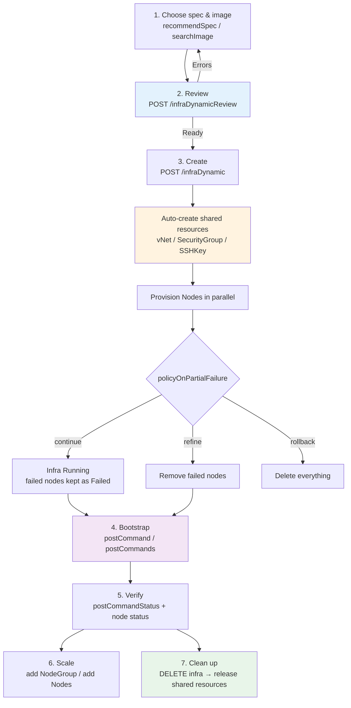

# 인프라 프로비저닝 (Infra Provisioning)

이 문서는 CB-Tumblebug를 사용하여 **인프라를 생성**하는 전체 과정을 다루는 엔드투엔드(End-to-End) 가이드입니다. 프로비저닝 요청에 포함되는 내용, 자동으로 생성되는 리소스, 배포 후 명령어(Post-deployment commands)를 통해 노드를 부트스트랩하는 방법, 그리고 검증, 확장(Scale), 정리(Clean up)하는 방법을 설명합니다.

이 문서는 다른 가이드에서 깊이 있게 다루는 주제들을 하나로 연결합니다:
[Spec & Image 추천](spec-image-recommendation.md) (실행할 사양 및 이미지 선택),
[리소스 템플릿](resource-template-management.md) (재사용 가능한 네트워크/SG 구성 의도),
[공유 리소스](shared-resource-management.md) (자동 생성되는 리소스),
[Infra 리소스 모델 및 수명 주기](infra-resource-model-and-lifecycle-management.md)
(생성 후 상태 및 제어), 그리고
[원격 명령 및 파일 전송](remote-command-and-file-transfer.md)
(배포 후 명령어에서 재사용하는 실행 엔진).

## 🗺️ 프로비저닝 흐름 (The Provisioning Flow)



**설계 원칙:** 요청은 *선언적(Declarative)이고 CSP에 종속되지 않습니다(CSP-agnostic)*. 사용자가 노드 그룹(스펙 + 이미지 + 크기)을 기술하면, CB-Tumblebug가 연결(Connection)을 확인하고, 네트워크 사전 요구 사항을 생성하며, 병렬로 프로비저닝을 수행한 뒤 단일 집계 상태를 보고합니다.

## 📦 요청 구조 (The Request)

`POST /tumblebug/ns/{nsId}/infraDynamic`

```jsonc
{
  "name": "web-cluster",
  "description": "Front tier",
  "policyOnPartialFailure": "continue",   // continue (default) | refine | rollback
  "nodeGroups": [
    {
      "name": "web",                       // NodeGroup id prefix → nodes become web-1, web-2, ...
      "specId": "aws+ap-northeast-2+t3a.medium",
      "imageId": "ami-0abc...",            // omit to let the server pick a matching basic image
      "nodeGroupSize": 3,
      "label": { "role": "web", "tier": "front" },
      "rootDiskType": "default",
      "rootDiskSize": 0                    // 0 = CSP default
    }
  ]
}
```

| 필드 | 의미 |
|---|---|
| `nodeGroups[]` | (스펙, 이미지) 조합당 하나의 항목; 항목당 `nodeGroupSize`만큼의 노드가 생성됨 |
| `specId` | [`recommendSpec`](spec-image-recommendation.md)에서 조회한 값 — 직접 수동으로 작성하지 않음 |
| `imageId` | [`searchImage`](spec-image-recommendation.md)에서 조회한 값; 스펙의 프로바이더/리전과 일치해야 함 |
| `label` | 그룹의 모든 노드에 적용되는 자유 형식의 키/값 — 추후 `labelSelector` 타겟팅의 기준이 됨 |
| `policyOnPartialFailure` | 일부 노드 생성이 실패했을 때의 처리 방식 (아래 참조) |
| `vNetTemplateId` / `sgTemplateId` | 내장 기본값 대신 [리소스 템플릿](resource-template-management.md)을 적용 |

### 부분 실패 정책 (Partial-failure policy)

| 값 | 동작 | 사용 시점 |
|---|---|---|
| `continue` (기본값) | 성공한 노드는 유지하고, 실패한 노드는 `Failed` 상태로 남겨둠 | 최선형(Best-effort) 용량 확보; 추후 `refine`으로 정리 |
| `refine` | 생성 후 실패한 노드를 자동으로 제거 | 성공한 노드들만으로 구성된 깔끔한 Infra를 원할 때 |
| `rollback` | 하나라도 노드가 실패하면 전체 Infra를 삭제 | 전체 성공 또는 전체 취소(All-or-nothing) 배포 |

### 생성 전 사전 검토 (Review before creating)

`POST /tumblebug/ns/{nsId}/infraDynamicReview`는 **동일한 요청 본문**을 받아 아무것도 프로비저닝하지 않은 채 노드 그룹별 판정 결과(`Ready` / `Error`), 확인된 연결 정보, 예상 시간당 비용을 반환합니다. 이 단계를 먼저 수행하면 대부분의 프로비저닝 실패(사용 불가능한 스펙, 스펙/이미지 불일치, 쿼터 부족이 빈번한 리전 등)를 사전 에러 메시지로 미리 확인할 수 있습니다.

### Hold 옵션

`POST .../infraDynamic?option=hold`는 Infra 객체와 공유 리소스만 생성하고 노드 프로비저닝 직전에 멈추어 계획을 점검할 수 있게 해줍니다. 계속 진행하려면 `GET .../control/infra/{infraId}?action=continue`를 호출하고, 취소하려면 `action=withdraw`를 호출합니다.

## 🏗️ 자동으로 생성되는 리소스 (What Gets Created Automatically)

네트워크를 미리 생성해 둘 필요가 없습니다. 네임스페이스에서 특정 연결(Connection)을 처음 사용할 때 CB-Tumblebug는 다음 리소스를 생성합니다:

| 리소스 | 기본 이름 | 비고 |
|---|---|---|
| **vNet + Subnet** | `{nsId}-shared-{connectionName}` | CIDR 자동 할당; 이후 생성되는 Infra들이 재사용함 |
| **SecurityGroup** | `{infraId}-{nodeGroupName}` | NodeGroup당 생성; 기본적으로 **SSH (22) 인바운드만** 허용됨 |
| **SSHKey** | `{infraId}-{connectionName}` | Infra에서 개인키 다운로드 가능 |

알아두어야 할 두 가지 중요한 결과:

1. **서비스 포트는 기본적으로 닫혀 있습니다.** 웹 서버를 설치한 후에는 포트를 명시적으로 열어야 합니다:
   ```
   POST /tumblebug/ns/{nsId}/resources/securityGroup/{sgId}/rules
   { "firewallRules": [ { "Ports": "80,443", "Protocol": "TCP", "Direction": "inbound", "CIDR": "0.0.0.0/0" } ] }
   ```
2. **공유 리소스는 Infra가 삭제된 후에도 유지됩니다.** Infra를 삭제해도 공유 리소스는 해제되지 않습니다 — 자세한 내용은 [공유 리소스 관리](shared-resource-management.md)를 참조하세요.

## 🏷️ 레이블: 추후 타겟팅을 위한 프로비저닝 시점의 투자

`nodeGroups[].label`에 설정된 레이블은 모든 노드에 복사되며 시스템 레이블(`sys.infraId`, `sys.nodeGroupId` 등)과 병합됩니다. 이 레이블들은 이후 이어지는 모든 작업의 주소 지정(Addressing) 메커니즘이 됩니다:

```bash
# Run a command only on workers
POST /ns/{nsId}/cmd/infra/{infraId}?labelSelector=role=worker

# Bootstrap only the control plane during creation (see postCommands below)
"postCommands": [ { "command": ["..."], "labelSelector": "role=control" } ]
```

NodeGroup 전반에 걸쳐 레이블 체계(`role`, `tier`, `env`)를 일관되게 유지하세요 — 나중에 NodeGroup을 추가하거나 타겟팅된 작업을 실행할 때 큰 도움이 됩니다.

## 🚀 배포 후 명령어 (부트스트랩 / Post-deployment Commands)

배포 후 명령어는 프로비저닝된 노드를 실제로 동작하는 시스템으로 전환합니다. 이 명령어들은 [원격 명령](remote-command-and-file-transfer.md)과 동일한 엔진을 통해 실행되므로, 배스천(Bastion) 라우팅, TOFU 호스트 키 검증, 노드별 병렬 실행, `$$Func()` 플레이스홀더, 명령어 상태 이력이 모두 동일하게 적용됩니다.

`postCommands[]`는 단일 진입점 역할을 합니다: 각각 자체적인 실행 대상을 가지는 **단계**(Phases)들을 담고 있으며, 각 단계는 **순차적으로** 실행됩니다. "모든 노드에서 이 명령어들을 실행하라"는 단순한 요청은 단 하나의 단계로 표현됩니다.

### 단일 단계 (단순 케이스)

```jsonc
"postCommands": [
  {
    "command": ["sudo apt-get update", "sudo apt-get install -y nginx"],
    "timeoutMinutes": 10,
    "labelSelector": "role=web"     // optional target; default = all nodes
  }
]
```

### 순차적 단계 (다단계 부트스트랩)

여러 단계를 사용하면 컨트롤 플레인 설정 후 워커 노드를 조인하는 구조를 만들 수 있습니다:

```jsonc
"postCommands": [
  { "command": ["k8s-control-plane-setup.sh"], "nodeGroupId": "control", "timeoutMinutes": 15 },
  { "command": ["k8s-worker-join.sh"],         "labelSelector": "role=worker",
    "continueOnError": false }                  // default: a failed phase skips the rest
]
```

| 필드 | 의미 |
|---|---|
| `command[]` | 각 대상 노드에서 순서대로 실행되는 명령어들 |
| `nodeGroupId` / `nodeId` / `labelSelector` | 대상 범위 — 단계당 **최대 하나만** 지정 가능; 생략 시 모든 노드 대상 |
| `timeoutMinutes` | 해당 단계의 제한 시간 예산 (기본값 30; 모든 단계의 합계가 120 이하여야 함) |
| `continueOnError` | `true`인 경우 이 단계가 실패하더라도 이후 단계들을 계속 실행함 |
| `userName` | 각 노드가 자체적으로 검증된 SSH 사용자를 사용하도록 **비워 두세요** (혼합된 이미지 환경에서도 그대로 작동함) |

단계에 두 개 이상의 대상이 설정되었거나, 단계에 명령어가 없거나, 누적 제한 시간이 예산을 초과하는 경우 요청은 400 에러로 거부됩니다.

### 동기식 vs 비동기식 (Synchronous vs Asynchronous)

노드는 `Running` 상태가 되는 순간부터 과금이 시작되며, 긴 부트스트랩 작업은 클라이언트나 프록시의 타임아웃을 초과할 수 있습니다. 따라서 **비동기식 실행을 권장합니다**:

```jsonc
"postCommandAsync": true
```

| | 동기식 (기본값) | 비동기식 |
|---|---|---|
| 응답 반환 시점 | 부트스트랩이 완료된 후 | 노드가 프로비저닝되자마자 즉시 |
| 응답 내 `postCommandStatus` | 종료 상태 (`Completed` / ...) | **`Running`** |
| `postCommandResults` | 이미 채워져 있음 | 단계가 완료됨에 따라 채워짐 |
| `postCommandRequestId` | 존재함 (이력/재조회용) | 존재함 (실시간 스트리밍용) |

응답 형태는 두 모드에서 모두 동일합니다 — `postCommandStatus`가 유일한 구분자이므로 클라이언트는 모드별 파싱 로직을 따로 구현할 필요가 없습니다.

백그라운드 실행은 요청 컨텍스트와 분리되어 있으므로, 클라이언트의 연결이 끊어지더라도 부트스트랩이 취소되지 않습니다.

### 진행 상황 모니터링 (Watching progress)

```bash
# Live stream (Server-Sent Events): CommandStatus → CommandLog → CommandDone
GET /tumblebug/ns/{nsId}/stream/cmd/infra/{infraId}?xRequestId={postCommandRequestId}

# Or poll the Infra object until the status becomes terminal
GET /tumblebug/ns/{nsId}/infra/{infraId}
```

### 결과 해석하기 (Interpreting the result)

```jsonc
{
  "status": "Running:3 (R:3/3)",              // node status — independent of bootstrap
  "postCommandStatus": "CompletedWithErrors",
  "postCommandRequestId": "pc-web-cluster-tb1a2b3c",
  "postCommandResults": [
    { "phase": 1, "target": "nodeGroupId=control", "status": "Completed", "results": { "results": [ ... ] } },
    { "phase": 2, "target": "labelSelector=role=worker", "status": "Failed",
      "results": { "results": [ { "nodeId": "worker-1", "error": "Process exited with status 7" } ] } },
    { "phase": 3, "target": "all nodes", "status": "Skipped" }
  ]
}
```

| `postCommandStatus` | 의미 | 일반적인 조치 |
|---|---|---|
| `None` | 배포 후 명령어가 요청되지 않음 | — |
| `Running` | 아직 실행 중 (비동기식) | 스트리밍 또는 폴링 |
| `Completed` | 모든 대상 노드에서 성공함 | 다음 작업 진행 |
| `CompletedWithErrors` | 일부 노드에서 실패함 | 노드별 `error`를 확인하고 해당 노드에 대해 재실행 |
| `Failed` | 모든 대상 노드가 실패했거나 실행을 시작할 수 없었음 | SSH/사용자/이미지 가정 사항 확인 |
| `Skipped` (단계별) | `continueOnError: false`인 이전 단계가 실패함 | 이전 단계를 먼저 수정 |

**Infra 생성 성공과 부트스트랩 성공은 별개의 신호입니다.** 부트스트랩이 실패하더라도 노드는 `Running` 상태일 수 있습니다. 바로 이 때문에 별도의 상태 필드가 존재하며, API 응답에 노드별 에러 문자열이 노출됩니다.

### 실무 참고 사항 (Practical notes)

- **SSH 준비 상태 게이트(SSH readiness gate).** 첫 번째 단계를 시작하기 전에 서버는 고정된 시간 동안 대기(sleep)하는 대신 SSH 연결 가능 여부를 (제한된 시간 내에서) 폴링합니다. 이를 통해 새로 생성된 노드에서 발생하는 대부분의 cloud-init 경합 상태(race condition)를 제거합니다. 실제 인증/설정 에러는 여전히 노드별로 보고됩니다.
- **타임아웃은 단계별로 적용됩니다.** 더 세밀한 제어가 필요하면 작업을 더 많은 단계로 나누세요.
- **실패는 기록됩니다.** 모든 실행은 노드별 명령어 상태 이력에 나타나며 `postCommandRequestId`를 통해 다시 조회할 수 있습니다.
- **재실행.** 부트스트랩은 자동으로 재시도되지 않습니다. 영향을 받은 노드를 대상으로 `POST /ns/{nsId}/cmd/infra/{infraId}`를 호출하여 실패한 부분을 다시 실행하세요.

## 📈 기존 Infra 확장하기 (Scaling an Existing Infra)

자주 혼동되는 두 가지 서로 다른 작업이 있습니다:

| 목표 | API | 비고 |
|---|---|---|
| **새 NodeGroup 추가** (다른 스펙/이미지/레이블) | `POST /ns/{nsId}/infra/{infraId}/nodeGroupDynamic` | `label`, `postCommands` (기본적으로 새 그룹으로 범위가 지정됨), `postCommandAsync` 지원 |
| **기존 NodeGroup에 노드 추가** | `POST /ns/{nsId}/infra/{infraId}/nodegroup/{nodegroupId}` (`{"numNodesToAdd": N}` 포함) | 그룹과 동일한 스펙/이미지 사용; 부트스트랩 필드 없음 |

NodeGroup 추가에는 `infraDynamicReview`와 동일한 의미를 갖는 자체 검토 엔드포인트(`.../nodeGroupDynamicReview`)가 있습니다.

```jsonc
// Add GPU workers and bootstrap only them
{
  "name": "worker-gpu",
  "specId": "aws+us-east-1+g4dn.xlarge",
  "imageId": "ami-0abc...",
  "nodeGroupSize": 2,
  "label": { "role": "worker", "accelerator": "gpu" },
  "postCommands": [ { "command": ["curl -fsSL https://.../worker-setup.sh | bash"] } ],
  "postCommandAsync": true
}
```

## 💾 데이터 디스크 추가하기 (Adding Data Disks)

데이터 디스크는 단일 가용 영역(Availability Zone)에 존재하며 동일한 영역에 있는 Node에만 연결(Attach)할 수 있습니다. 생성하는 방법은 두 가지입니다:

| 목표 | API | 가용 영역 (Zone) |
|---|---|---|
| **Node용으로 생성 및 연결** (권장) | `POST /ns/{nsId}/infra/{infraId}/node/{nodeId}/dataDisk` | Node의 영역을 상속받음; `zone`으로 재정의 가능 |
| **독립형 디스크 생성** | `POST /ns/{nsId}/resources/dataDisk` | 지정된 경우 `zone`, 그렇지 않으면 연결(Connection)에 할당된 영역 |

```jsonc
// Node-scoped: no zone needed, it follows the Node (even if the Node is in a non-default zone)
{ "name": "data-1", "diskType": "gp3", "diskSize": 100 }
```

기존 디스크의 연결/분리(Attach/Detach)는 `PUT /ns/{nsId}/infra/{infraId}/node/{nodeId}/dataDisk?option=attach|detach`를 사용합니다. 교차 영역(Cross-zone) 연결은 `InvalidVolume.ZoneMismatch`와 같은 CSP 에러를 발생시키는 대신 사전에 거부됩니다.

## ✅ 배포 검증하기 (Verifying a Deployment)

```bash
# Aggregated node status (Running:3 (R:3/3), Partial-Failed:1 (R:2/3), ...)
GET /tumblebug/ns/{nsId}/infra/{infraId}?option=status

# Access information (public/private IPs, SSH ports, per NodeGroup)
GET /tumblebug/ns/{nsId}/infra/{infraId}?option=accessinfo

# Bootstrap outcome
GET /tumblebug/ns/{nsId}/infra/{infraId}     # → postCommandStatus / postCommandResults
```

전체 상태 어휘 및 제어 작업(`suspend`, `resume`, `reboot`, `refine`, `terminate`)에 대해서는 [Infra 리소스 모델 및 수명 주기](infra-resource-model-and-lifecycle-management.md)를 참조하세요.

## 🧹 정리하기 (Cleaning Up)

```bash
# 1. Terminate nodes and delete the Infra (recommended)
DELETE /tumblebug/ns/{nsId}/infra/{infraId}?option=terminate

# 2. Optionally release the shared network resources of the namespace
DELETE /tumblebug/ns/{nsId}/sharedResources
```

> ⚠️ **`option=force` 사용을 피하세요.** 이 옵션은 **CSP에서의 종료를 확인하지 않고** CB-Tumblebug 레코드를 삭제하므로, 계속 과금되고 `DependencyViolation`으로 vNet/SecurityGroup 삭제를 가로막는 고아(Orphaned) 인스턴스를 남기게 됩니다. 이 옵션은 삭제 불가능한 상태에 빠진 인프라를 위한 최후의 수단으로만 존재합니다. 사용 시 응답에는 남아 있을 수 있는 노드 목록을 나열하는 `[WARNING]` 줄이 포함됩니다. `POST /tumblebug/inspectResources`로 확인하고 복구 방법은 [공유 리소스 관리](shared-resource-management.md)를 참조하세요.

종료가 아직 진행 중인 경우 삭제 호출이 이를 알려주므로, 강제 삭제(`force`)하는 대신 몇 분 후에 다시 시도해야 합니다.

## 🍳 레시피 (Recipes)

### 1. 웹 서버 배포, 포트 개방 및 검증

```jsonc
// 1) create + bootstrap asynchronously
POST /ns/default/infraDynamic
{
  "name": "web-sv",
  "nodeGroups": [ { "name": "web", "specId": "aws+us-west-1+t3a.medium",
                    "imageId": "ami-0abc...", "nodeGroupSize": 3, "label": { "role": "web" } } ],
  "postCommandAsync": true,
  "postCommands": [ { "command": [
      "sudo apt-get update -qq && sudo DEBIAN_FRONTEND=noninteractive apt-get install -y -qq nginx",
      "echo \"<h1>$(hostname)</h1>\" | sudo tee /var/www/html/index.html >/dev/null && sudo systemctl enable --now nginx" ] } ]
}
// 2) watch: GET /ns/default/stream/cmd/infra/web-sv?xRequestId={postCommandRequestId}
// 3) open the port: POST /ns/default/resources/securityGroup/web-sv-web/rules  { Ports: "80", ... }
```

### 2. Kubernetes: 컨트롤 플레인 먼저, 그 다음 워커 노드

```jsonc
"postCommands": [
  { "command": ["curl -fsSL .../k8s-control-plane-setup.sh | bash"],
    "nodeGroupId": "control", "timeoutMinutes": 20 },
  { "command": ["curl -fsSL .../k8s-worker-setup.sh | bash -s -- --join '<JOIN_CMD>'"],
    "labelSelector": "role=worker", "timeoutMinutes": 20 }
]
```
2단계는 1단계가 성공한 후에만 실행됩니다. 1단계가 실패하면 2단계는 `Skipped`로 표시됩니다.

### 3. 커스텀 이미지 구워내기 (Bake a custom image)

프로비저닝 + 부트스트랩 + 스냅샷 생성은 [클라우드 독립적 이미지(Cloud-Agnostic Image)](cloud-agnostic-image.md) 워크플로우를 통해 자동화됩니다. 여기서는 배포 후 명령어가 **동기식으로** 실행되며(스냅샷을 찍기 전에 부트스트랩 결과를 알아야 하므로), 부트스트랩 실패 시 빌드를 중단할지 여부는 `policyOnPostCommandFailure`가 결정합니다.

## 📋 API 요약

| 목적 | 엔드포인트 |
|---|---|
| 프로비저닝 요청 사전 검토 | `POST /tumblebug/ns/{nsId}/infraDynamicReview` |
| Infra 생성 | `POST /tumblebug/ns/{nsId}/infraDynamic[?option=hold]` |
| NodeGroup 추가 | `POST /tumblebug/ns/{nsId}/infra/{infraId}/nodeGroupDynamic` |
| NodeGroup 추가 사전 검토 | `POST /tumblebug/ns/{nsId}/infra/{infraId}/nodeGroupDynamicReview` |
| NodeGroup에 노드 추가 | `POST /tumblebug/ns/{nsId}/infra/{infraId}/nodegroup/{nodegroupId}` |
| 부트스트랩 진행 상황 스트리밍 | `GET /tumblebug/ns/{nsId}/stream/cmd/infra/{infraId}?xRequestId={id}` |
| 데이터 디스크 생성 및 연결 | `POST /tumblebug/ns/{nsId}/infra/{infraId}/node/{nodeId}/dataDisk` |
| 데이터 디스크 연결/분리 | `PUT /tumblebug/ns/{nsId}/infra/{infraId}/node/{nodeId}/dataDisk?option=attach` |
| 서비스 포트 개방 | `POST /tumblebug/ns/{nsId}/resources/securityGroup/{sgId}/rules` |
| Infra 삭제 | `DELETE /tumblebug/ns/{nsId}/infra/{infraId}?option=terminate` |
| 공유 리소스 해제 | `DELETE /tumblebug/ns/{nsId}/sharedResources` |
