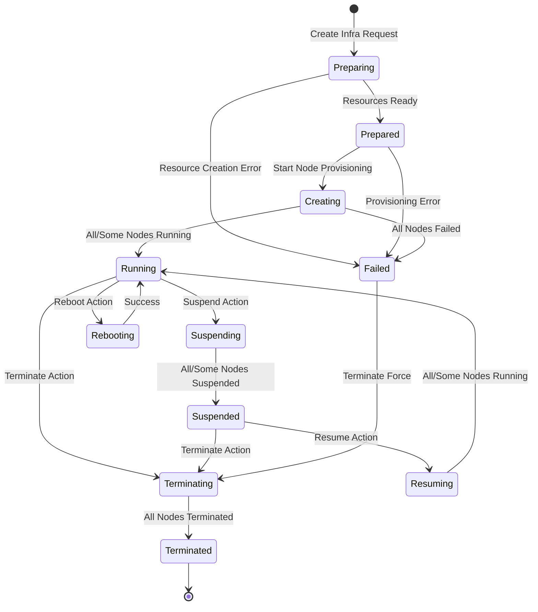
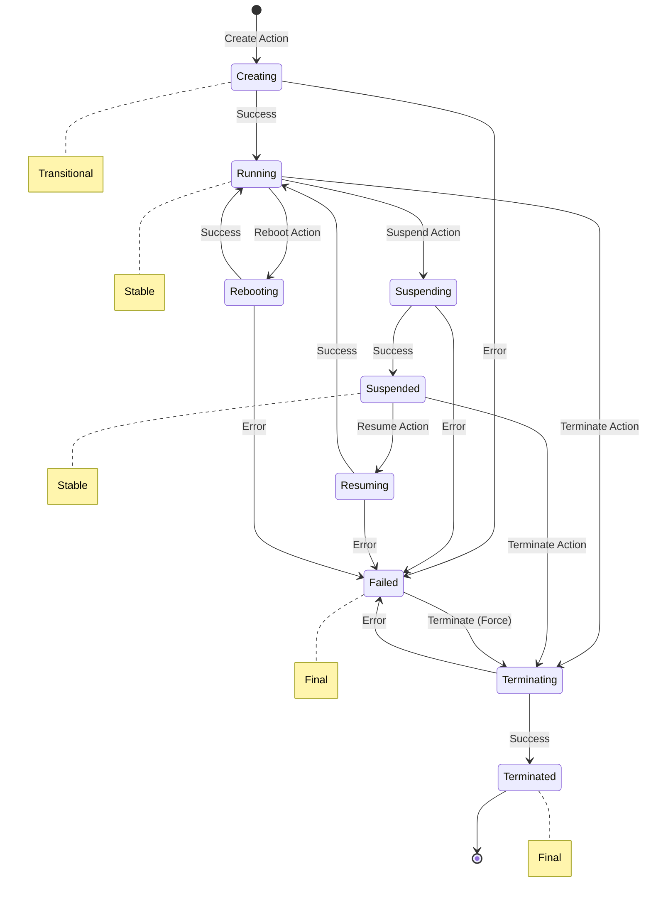
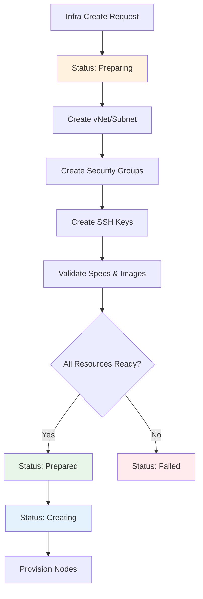
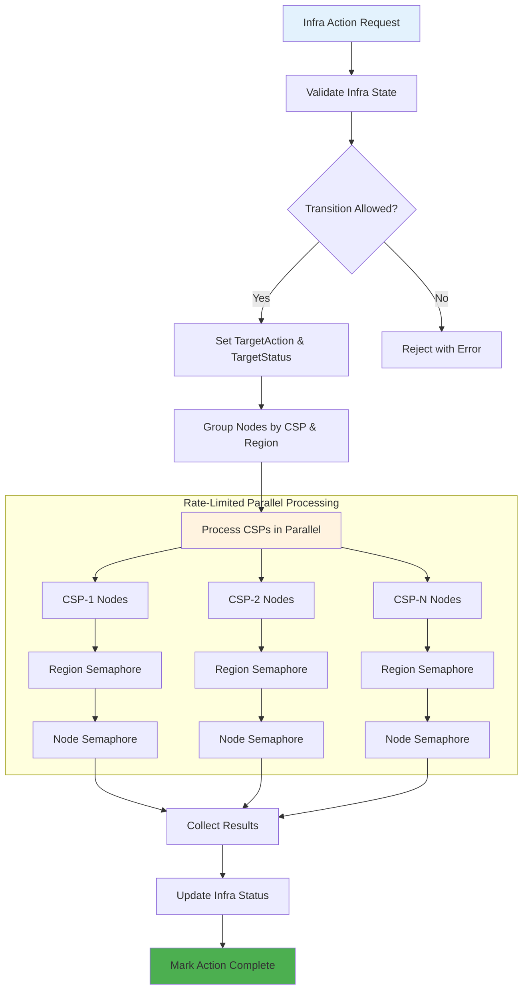
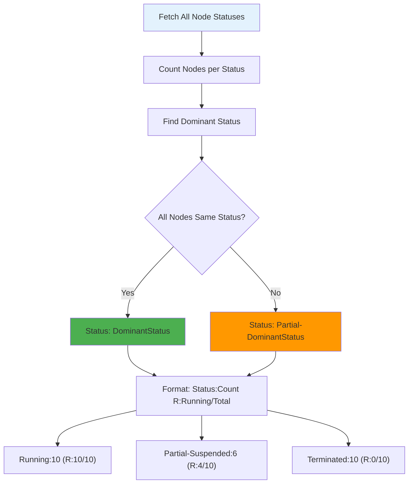
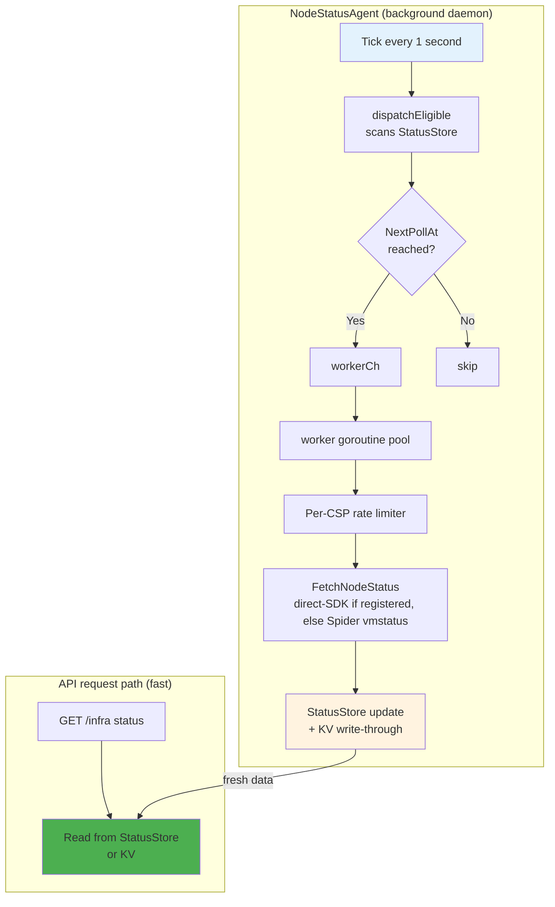
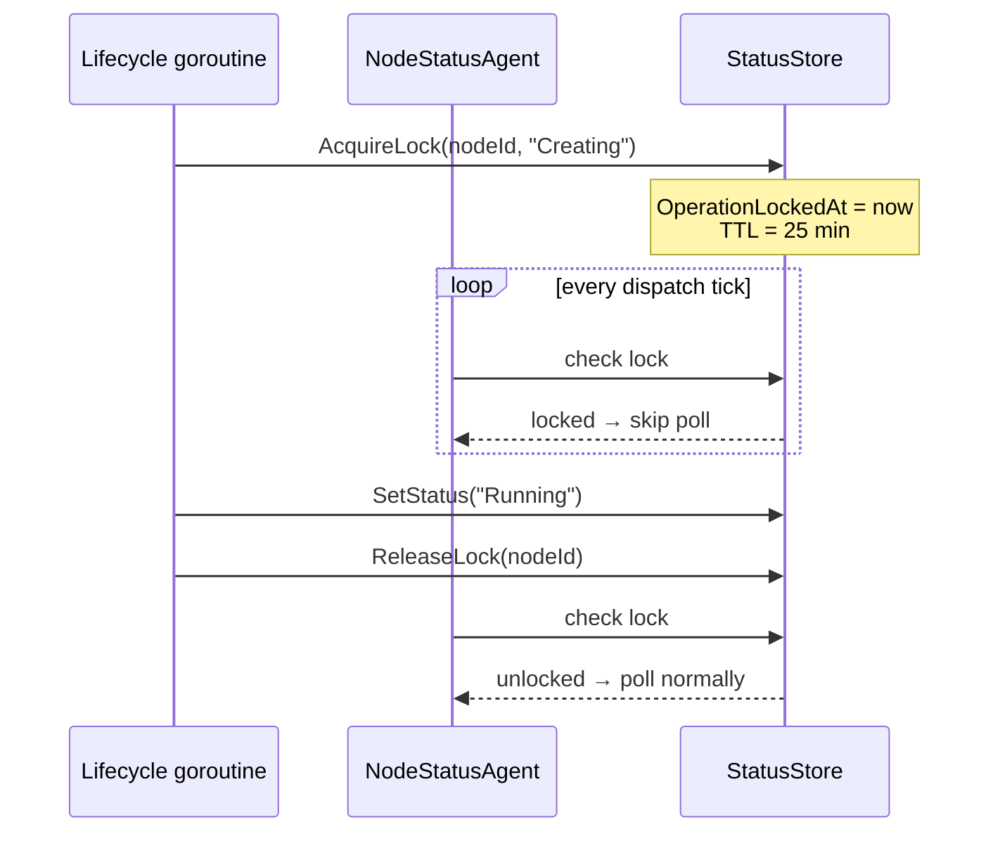
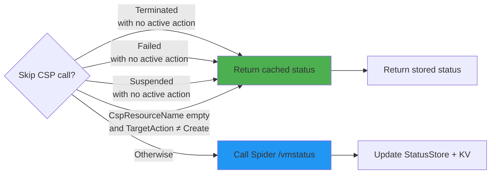
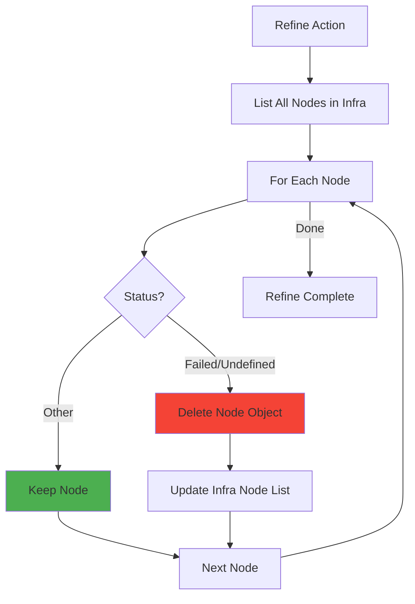
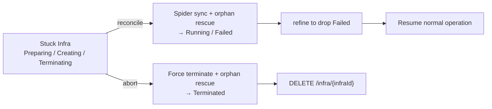

# Infra 리소스 모델 및 수명주기 관리

이 문서는 CB-Tumblebug의 **Infra** 리소스 모델에 대한 종합 가이드로, **Infra**, **NodeGroup**, **Node**의 개념적 구조와 용어, 그리고 수명주기(Lifecycle) 관리를 다룹니다. 리소스 계층 구조, 명명 배경, 상태 전이, 제어 액션(Control Action), 상태 관리 및 내부 메커니즘을 설명합니다.

> 💡 요청 구조, 자동 생성되는 공유 리소스, 배포 후 부트스트랩(Post-deployment bootstrap), 스케일링, 정리(Cleanup) 등 *생성* 경로 자체에 대한 자세한 내용은
> [Infra 프로비저닝](infra-provisioning.md)을 참조하세요. 참고로 노드 상태와 부트스트랩 상태는
> 별개의 신호입니다. 즉, `postCommandStatus`가 부트스트랩 실패를 보고하는 동안에도 Infra 상태는 `Running`일 수 있습니다.

## 🔑 주요 개념 및 용어

### 현재 용어

CB-Tumblebug은 서버 인프라 모델에 대해 다음과 같은 용어를 사용합니다:

| 현재 용어 | 의미 |
|--------------|---------|
| **Infra** | 하나 이상의 CSP에 걸쳐 구성될 수 있는 관리 가능한 컴퓨트 리소스 집합입니다. |
| **NodeGroup** | 동일한 구성을 공유하며 일반적으로 함께 관리되거나 스케일링되는 Node 그룹입니다. |
| **Node** | 개별 서버 컴퓨트 단위로, 현재는 주로 가상 머신(VM) 형태로 프로비저닝됩니다. |

이 가이드 전반과 사용자 대면 API에서는 위와 같은 현재 용어를 사용합니다.

> **레거시 용어:** 이전 문서나 내부 식별자에서는 **Infra**, **NodeGroup**, **Node**에 각각 대응하는 용어로 **MCI**, **SubGroup**, **VM**을 사용할 수 있습니다. 기존 스토리지 및 CB-Spider 인터페이스와의 호환성을 위해 일부 내부 `vm` 식별자는 그대로 유지됩니다.

### 리소스 계층 구조

CB-Tumblebug은 멀티 클라우드 컴퓨트 리소스를 명확한 계층 구조로 구성합니다. 서버 워크로드의 경우, 여러 NodeGroup이 동일한 네트워크 경계를 공유할 때 Infra 내부에 암묵적(Implicit) Cluster 뷰가 도출될 수도 있습니다.

```
Namespace
└── Infra (server infra, multi-CSP)
    ├── Cluster-1 (implicit, vNet-1)
    │   ├── NodeGroup-A (AWS ap-northeast-2)
    │   │   ├── Node-A1 (VM instance)
    │   │   ├── Node-A2 (VM instance)
    │   │   └── Node-A3 (VM instance)
    │   └── NodeGroup-B (AWS ap-northeast-2)
    │       ├── Node-B1 (bare-metal instance)
    │       └── Node-B2 (bare-metal instance)
    └── Cluster-2 (implicit, vNet-2)
        └── NodeGroup-C (GCP asia-northeast3)
            └── Node-C1 (VM instance)
Namespace
└── Infra (server infra, single-CSP)
    └── Cluster-1 (implicit, vNet-1)
        └── NodeGroup-A (AWS, migrated-app)
            ├── Node-A1
            └── Node-A2            
```

### Infra란?

**Infra**는 서로 다른 클라우드 서비스 프로바이더(CSP)에 걸쳐 배포된 여러 컴퓨트 Node를 단일 관리 엔티티로 묶는 논리적 단위입니다. 하나의 Infra에는 AWS, Azure, GCP, Alibaba 및 기타 클라우드의 Node가 동시에 포함될 수 있습니다.

- **API 경로:** `/ns/{nsId}/infra/{infraId}`
- **Go 타입:** `InfraInfo`

### NodeGroup이란?

**NodeGroup**은 Infra 내에서 동종(Homogeneous) Node들을 묶은 논리적 그룹입니다. 동일한 NodeGroup에 속한 Node들은 동일한 구성(동일한 스펙, 이미지, 리전 등)을 공유하며 일반적으로 함께 스케일링됩니다.

- **API 경로:** `/ns/{nsId}/infra/{infraId}/nodegroup/{nodegroupId}`
- **Go 타입:** `NodeGroupInfo`

"NodeGroup"이라는 명칭은 의도적으로 Kubernetes의 NodeGroup 개념과 맞춘 것이지만, 현재 CB-Tumblebug의 NodeGroup은 Kubernetes 워커 노드가 아닌 VM을 관리합니다.

### Node란?

**Node**는 Infra 내의 개별 컴퓨트 단위입니다. 개념적으로 Node는 클라우드 또는 인프라 프로바이더가 사용자를 위해 할당하고 관리할 수 있는 **서버 인스턴스**를 의미합니다.

Node의 예시는 다음과 같습니다:

- 가상 머신(VM) 인스턴스
- 베어메탈 서버 인스턴스
- 향후 지원될 수 있는 기타 서버 형태의 컴퓨트 리소스

현재 CB-Tumblebug 구현에서 대부분의 Node는 CSP 드라이버를 통해 가상 머신으로 프로비저닝됩니다. 하지만 사용자 대면 추상화인 `Node`는 향후 핵심 리소스 이름을 다시 변경하지 않고도 모델을 확장할 수 있도록 의도적으로 `VM`보다 넓은 개념으로 설계되었습니다.

- **API 경로:** `/ns/{nsId}/infra/{infraId}/node/{nodeId}`
- **Go 타입:** `NodeInfo`

### Cluster (암묵적 서버 워크로드 뷰)

`Infra` 및 `NodeGroup` 리소스를 통해 관리되는 **서버 워크로드**에 대해, CB-Tumblebug은 이제 Infra 내부에서 암묵적 **Cluster** 뷰를 제공합니다. 이는 기존 Kubernetes 클러스터 리소스(`/k8sCluster`)와는 별개이며, Kubernetes 워크로드가 아닌 VM 기반 또는 일반 서버 워크로드를 위한 것입니다.

**Cluster**는 사용자가 명시적으로 생성하지 않습니다. 대신, 주로 동일한 네트워크 경계(예: 동일한 `vNet`)를 공유하는 NodeGroup과 Node들을 그룹화하여 조회 시점에 Infra 토폴로지로부터 동적으로 합성(Synthesize)됩니다.

- Cluster는 Infra의 상위가 아니라 Infra **내부**에 존재합니다.
- Cluster는 **별도로 생성되거나 영구 저장(Persist)되지 않습니다.**
- Cluster는 Infra 또는 Cluster 정보를 조회할 때 동적으로 합성됩니다.
- 현재 구현에서 기본 그룹화 키는 공유 `vNet`입니다.
- 이는 비-Kubernetes 서버 워크로드에 대해 대응하는 추상화를 제공함으로써 기존 Kubernetes 클러스터 모델을 보완합니다.

```
Namespace
└── Infra (server infra)
    ├── Cluster-1 (implicit, vNet-1)
    │   ├── NodeGroup-A (AWS, app)
    │   │   ├── Node-A1
    │   │   └── Node-A2
    │   └── NodeGroup-B (AWS, batch)
    │       ├── Node-B1
    │       └── Node-B2
    └── Cluster-2 (implicit, vNet-2)
        └── NodeGroup-C (Azure, db)
            └── Node-C1
```

이 모델에서는 동일한 vNet(또는 이에 상응하는 네트워크 경계)을 공유하는 NodeGroup들이 암묵적으로 하나의 Cluster를 형성합니다. 클러스터 경계는 사용자의 명시적 선언이 아니라 기반 네트워크 토폴로지에 의해 결정됩니다.

#### 통합 리소스 계층 구조: Infra vs Multi-K8s Cluster

CB-Tumblebug은 개념적 일관성을 위해 서로 다른 워크로드 유형에 대해 두 가지 대응하는 최상위 추상화를 제공합니다:

```
Namespace
└── Infra (server infra, multi-CSP)
    ├── Cluster-1 (implicit, vNet-1)
    │   ├── NodeGroup-A (AWS, app)
    │   │   ├── Node-A1
    │   │   └── Node-A2
    │   └── NodeGroup-B (AWS, batch)
    │       ├── Node-B1
    │       └── Node-B2
    └── Cluster-2 (implicit, vNet-2)
        └── NodeGroup-C (Azure, db)
            └── Node-C1

Namespace
└── Multi-K8s Cluster (container infra)
    ├── K8s Cluster-1 (AWS EKS)
    │   ├── K8s NodeGroup-A
    │   │   ├── Worker Node A1
    │   │   └── Worker Node A2
    │   └── K8s NodeGroup-B
    │       └── Worker Node B1
    └── K8s Cluster-2 (Azure AKS)
        └── K8s NodeGroup-C
            └── Worker Node C1
```

**주요 정렬(Alignment) 포인트:**
- **Infra**와 **Multi-K8s Cluster** 모두 Namespace 내의 최상위 리소스 그룹입니다.
- 두 모델 모두 조직화 계층으로 **Cluster**를 포함합니다(Infra는 암묵적, Multi-K8s Cluster는 명시적).
- 두 모델 모두 동종 리소스 그룹화를 위해 **NodeGroup**을 사용합니다.
- **Node**는 컴퓨트 단위를 나타냅니다(Infra의 경우 VM, K8s 클러스터의 경우 워커 노드).

> **용어 참고:** 향후 버전에서는 보다 일관된 명명 체계를 제공하기 위해 "Multi-K8s Cluster"라는 용어가 "**Infra**"로 변경될 수 있습니다. 이러한 변경은 서버 워크로드와 컨테이너 워크로드 모두가 동일한 통합 "Infra" 개념 아래에서 관리된다는 점을 명확히 해줄 것입니다.

#### Cluster 조회 API

Infra 내의 암묵적 Cluster 뷰는 다음 API를 통해 조회할 수 있습니다:

- `GET /ns/{nsId}/infra/{infraId}/cluster`
- `GET /ns/{nsId}/infra/{infraId}/cluster/{clusterId}`

또한 Infra 상세 응답에는 `InfraInfo`의 일부로 합성된 클러스터 뷰가 포함될 수 있습니다.

> VM 기반 Infra와 Kubernetes 리소스 간의 명칭 통일(Node, NodeGroup, Cluster)은 의도된 것으로, 기반 컴퓨트 유형에 관계없이 일관된 멘탈 모델을 제공합니다.

> **Infra 유연성 참고:** Infra는 단일 CSP 내의 인프라(예: 온프레미스에서 AWS로의 클라우드 마이그레이션)를 나타낼 수도 있고, 여러 CSP에 동시에 걸친 인프라(예: AWS, Azure, GCP에 걸친 지리적 분산 배포)를 나타낼 수도 있습니다.

## 📊 상태 상수 (Status Constants)

### Infra 상태

다음 상태값들은 Infra의 현재 상태를 나타냅니다:


| 상태 | 설명 | 안정 상태 여부 (Stable?) |
|--------|-------------|---------|
| `Preparing` | Infra 리소스를 준비 중 (vNet, SecurityGroup, SSH Key) | 아니오 (전이 중) |
| `Prepared` | Infra 리소스 준비 완료, Node 프로비저닝 준비됨 | 아니오 (전이 중) |
| `Creating` | Node를 프로비저닝 중 | 아니오 (전이 중) |
| `Running` | 모든 Node가 실행 중 | 예 |
| `Suspending` | Node를 일시 중지(Suspend)하는 중 | 아니오 (전이 중) |
| `Suspended` | 모든 Node가 일시 중지됨 | 예 |
| `Resuming` | Node를 재개(Resume)하는 중 | 아니오 (전이 중) |
| `Rebooting` | Node를 재부팅하는 중 | 아니오 (전이 중) |
| `Terminating` | Node를 종료(삭제)하는 중 | 아니오 (전이 중) |
| `Terminated` | 모든 Node가 종료됨 | 예 (최종) |
| `Failed` | Infra 생성 실패 | 예 (최종) |
| `Undefined` | Infra 상태를 확인할 수 없음 | 예 |
| `Partial-*` | 혼합된 Node 상태 (예: `Partial-Running`, `Partial-Suspended`) | 예 |

### Node 상태

다음 상태값들은 개별 Node의 현재 상태를 나타냅니다:

| 상태 | 설명 | 안정 상태 여부 (Stable?) |
|--------|-------------|---------|
| `Creating` | Node를 프로비저닝 중 | 아니오 (전이 중) |
| `Running` | Node가 실행 중이며 접근 가능함 | 예 |
| `Suspending` | Node를 일시 중지하는 중 | 아니오 (전이 중) |
| `Suspended` | Node가 일시 중지(중지)됨 | 예 |
| `Resuming` | 일시 중지 상태에서 Node를 재개하는 중 | 아니오 (전이 중) |
| `Rebooting` | Node를 재부팅하는 중 | 아니오 (전이 중) |
| `Terminating` | Node를 종료(삭제)하는 중 | 아니오 (전이 중) |
| `Terminated` | Node가 종료됨 | 예 (최종) |
| `Failed` | Node 생성 또는 작업 실패 | 예 (최종) |
| `Undefined` | Node 상태를 확인할 수 없음 | 예 |

### 액션 상수 (Action Constants)

Infra/Node에 대해 수행할 수 있는 액션입니다. 목적에 따라 세 그룹으로 나뉩니다.

**수명주기 (정상 운영):**

| 액션 | 설명 | 목표 상태 (Target Status) |
|--------|-------------|---------------|
| `Create` | 새 Node 생성 | Running |
| `Suspend` | 종료(삭제)하지 않고 Node 중지 | Suspended |
| `Resume` | 일시 중지된 Node 시작 | Running |
| `Reboot` | Node 재시작 | Running |
| `Terminate` | Node 영구 삭제 | Terminated |
| `Refine` | 상태가 `Failed` 또는 `Undefined`인 Node를 Infra 메타데이터에서 제거합니다. 해당 Node들에 대해 **CSP 측 종료 호출은 수행하지 않습니다**. | - |

**Hold 게이트 (`option=hold`로 `POST /infra`를 호출한 직후에만 유효):**

| 액션 | 설명 |
|--------|-------------|
| `Continue` | 메모리에 대기 중인(holding) 고루틴에 프로비저닝을 **계속 진행**하도록 신호를 보냅니다. |
| `Withdraw` | 메모리에 대기 중인(holding) 고루틴에 프로비저닝을 **취소**하도록 신호를 보냅니다. |

> Hold 게이트 액션은 대기 중인 고루틴이 메모리에 살아 있는 동안에만 동작합니다. 서버 재시작 후에는 실패하므로, 이 경우 아래의 장애 복구(Crash recovery) 액션을 대신 사용하세요.

**장애 복구 (서버 재시작 또는 부분 실패 후 멈춘 Infra 복구):**

| 액션 | 설명 |
|--------|-------------|
| `Reconcile` | **정방향(Forward)** 복구입니다. 전이 중인 각 Node에 대해 Spider에 실제 CSP 상태를 조회하고, CSP 측 고아(Orphan) VM(크래시 전에 생성되었으나 TB에 기록되지 않은 VM)을 흡수합니다. CSP에서 매칭할 수 없는 Node는 이후 `refine`으로 제거할 수 있도록 `Failed`로 표시됩니다. **새로운 Spider 생성 호출은 발생하지 않습니다.** |
| `Abort` | **역방향(Backward)** 복구입니다. 최종 상태가 아닌 모든 Node를 병렬로 강제 종료(고아 VM 구제 포함)한 다음, `refine`을 통해 남아 있는 `Failed` 잔여물을 정리합니다. 최종 `DELETE` 호출은 운영자가 직접 수행합니다. |

## 🔄 상태 전이 다이어그램

### Infra 상태 전이

Infra는 다단계 수명주기를 따릅니다: **준비(Preparation) → 프로비저닝(Provisioning) → 운영(Operation) → 종료(Termination)**

> **참고:** 대부분의 상태는 Infra 내에 여러 Node 상태가 혼재되어 있음을 나타내는 `Partial-` 접두사(예: `Partial-Running`)를 가질 수 있습니다.



**상태 형식:** `(Partial-){Status}:{Count} (R:{RunningCount}/{TotalCount})`

| 상태 예시 | 의미 |
|----------------|---------|
| `Running:5 (R:5/5)` | 5개 Node 모두 실행 중 |
| `Partial-Running:3 (R:3/5)` | 5개 중 3개 Node가 실행 중이며, 나머지는 다른 상태임 |
| `Partial-Suspended:4 (R:1/5)` | 4개 Node가 일시 중지됨, 1개는 여전히 실행 중 |
| `Terminated:5 (R:0/5)` | 5개 Node 모두 종료됨 |

### Node 상태 전이

개별 Node는 보다 단순한 수명주기를 따릅니다:



### 준비 단계(Preparation Phase) 세부 과정

`Preparing` → `Prepared` 단계에서는 Node 프로비저닝에 앞서 공유 리소스를 생성합니다:



## 🎮 제어 액션 (Control Actions)

### 허용되는 상태 전이

시스템은 액션을 실행하기 전에 상태 전이 유효성을 검증합니다. 아래는 상태 전이 매트릭스입니다:

| 현재 상태 | Suspend | Resume | Reboot | Terminate | Reconcile | Abort |
|----------------|---------|--------|--------|-----------|-----------|-------|
| Preparing      | ❌     | ❌    | ❌    | ❌        | ✅        | ✅    |
| Prepared       | ❌     | ❌    | ❌    | ❌        | ✅        | ✅    |
| Creating       | ❌     | ❌    | ❌    | ❌        | ✅        | ✅    |
| Running        | ✅     | ❌    | ✅    | ✅        | ✅ (no-op) | ✅    |
| Suspending     | ✅ (동일 액션 재시도) | ❌ | ❌ | ❌ | ✅ | ✅ |
| Suspended      | ❌     | ✅    | ❌    | ✅        | ✅ (no-op) | ✅    |
| Resuming       | ❌     | ✅ (동일 액션 재시도) | ❌ | ❌ | ✅ | ✅ |
| Rebooting      | ❌     | ❌    | ✅ (동일 액션 재시도) | ❌ | ✅ | ✅ |
| Terminating    | ❌     | ❌    | ❌    | ✅ (멱등 재시도) | ✅ | ✅ |
| Terminated     | ❌     | ❌    | ❌    | ✅ (no-op) | ❌       | ❌ (no-op) |
| Failed         | ❌     | ❌    | ❌    | ✅ (Force) | ✅        | ✅    |
| `Partial-*`    | ❌     | ❌    | ❌    | ✅ (Force) | ✅        | ✅    |

> `Reconcile` 및 `Abort`는 장애 복구 액션으로, 운영자가 `force` 플래그에 의존하지 않고도 멈춘 Infra를 언제든 복구할 수 있도록 최종 상태가 아닌 상태(`Preparing` / `Creating` / `Terminating`과 같은 전이 상태 포함)에서도 의도적으로 허용됩니다.
>
> **동일 액션 재시도(Same-action retry):** Node/Infra가 일치하는 전이 상태에 머물러 있는 동안 이미 현재 `TargetAction`으로 설정된 *동일한* 액션을 다시 요청하는 것(예: 이미 `Suspending`인 상태에서 `suspend`를 다시 호출)은 허용되며 CSP로 제어 호출을 다시 디스패치합니다. 이는 CSP가 원래 요청을 실제로 수신하지 못해 Node가 전이 상태에 무기한 갇히는 상황을 방지하기 위해 존재합니다. *다른* 액션을 요청하는 것(예: `Suspending` 상태에서 `resume` 요청)은 여전히 차단됩니다. 단, `Creating`은 중복 VM이 프로비저닝될 위험이 있으므로 이 허용 대상에서 제외됩니다.

### Infra 수준 액션

Infra에 액션을 적용하면 내부의 모든 Node로 전파됩니다:



### Node 수준 액션

개별 Node 액션도 유사한 패턴을 따르지만 지정된 Node에만 영향을 미칩니다:

```go
// Example: Suspend a specific Node
HandleInfraNodeAction(nsId, infraId, nodeId, "suspend", force)
```

## 📈 상태 관리 (Status Management)

### Infra 상태 집계

Infra 상태는 모든 Node 상태로부터 집계됩니다. 집계 로직은 가장 우세한(Dominant) Node 상태를 기반으로 전체 Infra 상태를 결정합니다:



### 상태 카운트 구조체

```go
type StatusCountInfo struct {
    CountTotal       int  // Total Nodes in Infra
    CountCreating    int  // Nodes being created
    CountRunning     int  // Running Nodes
    CountFailed      int  // Failed Nodes
    CountSuspended   int  // Suspended Nodes
    CountRebooting   int  // Rebooting Nodes
    CountTerminated  int  // Terminated Nodes
    CountSuspending  int  // Nodes being suspended
    CountResuming    int  // Nodes being resumed
    CountTerminating int  // Nodes being terminated
    CountUndefined   int  // Nodes with undefined status
}
```

## 🔧 내부 메커니즘

### TargetAction 및 TargetStatus

각 Infra와 Node는 두 가지 추적 필드를 유지합니다:

- **TargetAction**: 현재 수행 중인 액션 (예: `Create`, `Terminate`)
- **TargetStatus**: 액션 완료 후 예상되는 최종 상태 (예: `Running`, `Terminated`)

`TargetStatus == CurrentStatus`가 되면 액션이 완료된 것으로 간주되며, 두 필드 모두 `None` (ActionComplete/StatusComplete)으로 설정됩니다.

### Node Status Agent

**Node Status Agent** (`NodeStatusAgent`)는 백그라운드 데몬으로, 메모리 내에서 최신 Node 상태 정보를 지속적으로 유지하여 CSP 폴링을 API 요청 처리와 분리(Decouple)합니다.

#### 왜 백그라운드 데몬인가?

데몬이 없다면 모든 `GET /infra/{id}` 호출이 실시간으로 모든 CSP API로 팬아웃(Fan-out)됩니다. 200개 노드로 구성된 멀티 클라우드 Infra의 경우, 상태 요청 한 번에 200개의 동시 CSP 호출이 발생하여 속도 제한(Rate limit)에 쉽게 걸리게 됩니다. 실제로 데몬이 도입되기 전 온디맨드 풀(Pull-on-demand) 모델에서는 라이브 테스트 중 4분 동안 1,061회의 CSP 상태 호출이 관측되기도 했습니다.

#### 아키텍처 개요



#### 인메모리 StatusStore

`StatusStore`는 `"nsId/infraId/nodeId"`를 키로 사용하는 싱글톤 스레드 안전(Thread-safe) 맵입니다. 각 항목은 가장 최근에 CSP에서 폴링한 상태, 네이티브 상태, 공인 IP 및 스케줄링 메타데이터(다음 폴링 시각, 우선순위)를 보유합니다. 상태 쓰기는 KV 스토어에 원자적으로(Atomically) Write-through되므로 데몬이 재시작되어도 데이터가 유지됩니다.

#### 폴링 우선순위 (Poll Priorities)

StatusStore의 각 Node 항목은 데몬이 CSP를 다시 확인하는 주기를 제어하는 **폴링 우선순위**를 가집니다:

| 우선순위 | 주기 | 할당 시점 |
|---|---|---|
| `PollUrgent` | ~5초 | 시작 시 복구 전용: 데몬 시작 시 보류 중인 `TargetAction`이 있는 상태로 발견된 Node(작업 도중 서버 재시작), 또는 작업 잠금(Operation lock)의 TTL(25분)이 예기치 않게 만료된 경우 |
| `PollHigh` | ~15초 | 전이 상태: Creating, Suspending, Resuming, Rebooting, Terminating; 또한 `TargetAction`이 아직 보류 중인 Suspended 상태 |
| `PollNormal` | ~5분 | Running 상태의 Node (안정 상태) |
| `PollRecover` | ~10분 | Undefined 상태의 Node |
| `PollSkip` | 폴링 안 함 | Terminated, Failed (최종 상태), 또는 `TargetAction`이 이미 `Complete`인 Suspended 상태 |

> **새로 생성된 Node는** 생성 작업 잠금이 해제되는 즉시 `PollHigh`에서 시작하므로, Creating → Running으로의 전이가 약 15초 단위로 추적됩니다.

#### 작업 잠금 (Operation Lock)

`AcquireLock`/`ReleaseLock`은 **Create 작업(Spider `POST /vm` 호출)에만** 사용됩니다. 생성 요청이 진행 중인 동안에는 Spider가 아직 CSP 리소스를 할당하지 않았고 전이 상태를 읽어와도 의미가 없으므로 데몬이 해당 Node를 폴링해서는 안 됩니다. **작업 잠금**(Operation lock)이 이를 방지합니다:



`TargetAction`이 여전히 설정된 상태에서 잠금 TTL이 만료되면(예: 작업 도중 서버 크래시), 데몬은 경고를 로깅하고 잠금을 해제한 뒤 해당 Node를 `PollUrgent`로 승격시켜 불일치를 빠르게 감지합니다. 이후 `action=reconcile`을 실행하면 상태가 올바르게 교정됩니다.

Suspend/Resume/Reboot/Terminate는 이 잠금을 획득하지 **않으며**, 대신 아래 "장애 처리(Failure Handling)"에서 설명하는 전이 상태 폴링 및 연속 횟수(Streak) 기반 확인에 의존합니다.

#### 시작 스캔 (Startup Scan)

데몬 시작 시 `StartupScan`은 KV 스토어에서 모든 Node 레코드를 읽어 StatusStore를 채웁니다:

- **보류 중인 `TargetAction`이** 있는 **전이 상태**(`Creating`, `Terminating` 등)의 Node는 `PollUrgent`로 승격되고 경고가 기록됩니다. 이는 작업 도중 서버가 재시작되었을 가능성이 높음을 나타냅니다.
- **안정 상태**(`Running`, `Suspended` 등)의 Node는 시작 시 한꺼번에 몰리는 현상(Thundering-herd burst)을 방지하기 위해 첫 번째 폴링 주기에 걸쳐 고르게 분산됩니다.
- **최종 상태**(`Terminated`, `Failed`)의 Node는 `PollSkip`으로 설정되어 추가적인 CSP 호출을 수행하지 않습니다.

#### 스마트 상태 스킵 (Smart Status Skipping)

CSP API 호출을 수행하기 전에 `FetchNodeStatus`는 왕복 호출(Round-trip)을 완전히 건너뛸 수 있는 몇 가지 조건을 확인합니다:



이러한 스킵 로직은 종료되거나 일시 중지된 Node가 많은 대규모 Infra에서 CSP API 호출을 **30~50%** 줄여줍니다.

#### 장애 복구 및 고아 VM 구제와의 관계

NodeStatusAgent는 상태를 지속적으로 추적하지만 스스로 불일치를 조정(Reconcile)하려고 시도하지는 **않습니다**. Node가 `Undefined` 상태가 되면(예: 생성 중 Spider가 VM 식별 정보를 제공하지 않고 500 에러를 반환한 경우), 에이전트는 단순히 해당 상태를 캐시하고 보고합니다. 실제 복구는 명시적으로 트리거됩니다:

| 메커니즘 | 실행 주체 | 목적 |
|---|---|---|
| `action=reconcile` | 운영자 | 전이 중이거나 Undefined인 모든 Node에 대해 Spider를 다시 조회하고, `/allvm`을 조회하여 TB에 기록되지 않은 고아 VM을 찾아 매칭된 고아 VM을 흡수합니다. |
| `action=refine` | 운영자 | TB에서 Failed/Undefined 상태의 Node 메타데이터를 제거합니다 (CSP 호출 없음). |
| `action=abort` | 운영자 | 최종 상태가 아닌 모든 Node를 강제 종료하고 고아 VM 구제를 실행한 뒤, refine으로 잔여물을 정리합니다. |

전체 흐름은 [장애 복구](#crash-recovery-reconcile-and-abort)를 참조하세요.

### 제어 작업에 대한 속도 제한 (Rate Limiting)

CB-Spider를 통해 라우팅되는 Node(개별 `ControlNodeAsync` 디스패치)는 프로비저닝과 동일한 계층적 속도 제한을 사용합니다:

| CSP | 최대 동시 리전 수 | 리전당 최대 Node 수 |
|-----|------------------------|-------------------|
| AWS | 10 | 30 |
| Azure | 8 | 25 |
| GCP | 12 | 35 |
| NCP | 3 | 15 |
| Alibaba | 6 | 20 |

### Direct-SDK 우회 (CB-Spider 선택적 우회)

일부 CSP의 경우, CB-Tumblebug은 CB-Spider를 거치지 않고 `src/core/csp`에 프로바이더별로 등록된 CSP 자체 SDK를 직접 호출할 수 있습니다:

- **상태 확인** (`BatchVMStatusFunc`): AWS, GCP, Azure, Alibaba, Tencent. 백그라운드 폴러와 온디맨드 상태 엔드포인트 모두에서 사용되며, 해당 프로바이더들에 대해서는 CB-Spider의 `/vmstatus`를 호출하지 않습니다.
- **제어 액션** (`BatchVMControlFunc`, Suspend/Resume/Reboot/Terminate\*): AWS(단일 호출당 다중 인스턴스를 처리하는 진정한 배칭) 및 Azure(VM별 호출이며 동시성이 제한되지만, CB-Spider의 Azure 드라이버처럼 CSP의 완료 확인까지 블로킹하지 않고 CSP가 요청을 수락한 직후 즉시 반환함).

  \* Terminate는 아직 어떤 프로바이더에 대해서도 의도적으로 우회하지 **않습니다**. CB-Spider 드라이버는 종속 리소스(예: VM 삭제 시 연쇄 삭제되지 않는 Azure의 NIC/PublicIP)도 함께 정리하므로, 이를 처음부터 재구현하면 해당 로직을 중복 작성해야 하기 때문입니다.

`ControlNodeAsync`는 CB-Spider HTTP 요청을 구성하기 전에 Node의 `(provider, action)`에 대해 등록된 제어 핸들러가 있는지 확인합니다. 핸들러가 존재하면 별도의 코드 경로를 동기화할 필요 없이 동일한 재시도/백오프 및 에러 처리 로직(실패 시 `FetchNodeStatus` 동기화, CSP 거부 시 `TargetAction` 초기화 등) 내에서 해당 핸들러를 대신 사용합니다.

벌크 제어 핸들러가 있는 프로바이더의 경우, `ControlNodesInParallel`은 대상 Node들을 `(provider, region, credentialHolder)`별로 그룹화하여 개별 디스패치로 폴백(Fallback)하기 전에 `runBulkControlForRegion`을 통해 배치 호출을 한 번 수행합니다. 다음과 같은 경우에는 Node가 개별 디스패치(`ControlNodeAsync`, 이 경우에도 직접 핸들러가 있으면 우선 사용)로 넘어갑니다: 해당 프로바이더+액션에 등록된 벌크 핸들러가 없는 경우, 전체 배치 호출이 에러를 반환한 경우, 또는 배치 호출은 성공했으나 결과 맵에서 해당 특정 인스턴스가 누락된 경우(조용히 성공으로 가정하지 않고 인스턴스별 실패로 처리함 — 아래 "장애 처리" 참조).

## 🛡️ 장애 처리 (Failure Handling)

### 연속 횟수 기반 확인 (단일 샘플 오탐 방지)

단 한 번의 모호한 폴링 결과로 Node의 상태를 뒤집어서는 안 됩니다. 상태 전이 도중 발생하는 일시적인 CSP 읽기 오류는 실제 작업 완료나 실제 리소스 소멸과 똑같아 보이기 때문입니다. 따라서 여러 `sync.Map` 기반의 연속 횟수(Streak) 카운터는 조치를 취하기 전에 몇 차례 연속으로 일치하는 폴링 결과가 나올 것을 요구합니다:

| Streak 카운터 | 위치 | 필요한 연속 조건 (N회) | 수행 동작 |
|---|---|---|---|
| `terminatingFailStreak` | `FetchNodeStatus` (direct-SDK 경로) | 폴링 에러, **또는** 성공한 배치 상태 응답에서 해당 인스턴스가 누락된 경우 | `Terminating` 상태의 Node를 `Terminated`로 승격 |
| `batchNotFoundStreak` | `runBatchSweep` | 배치 상태 스윕에서 `Running` 상태의 Node에 대한 "not found" 결과 | 해당 Node를 `Undefined`로 전환 |
| `suspendResumeRebootFailStreak` | `FetchNodeStatus` | 폴링 에러 **또는** 인식할 수 없는 네이티브 상태 | `Suspending`/`Resuming`/`Rebooting` 상태의 Node 대기 포기 (무기한 대기하는 대신 `Undefined`로 강등) |

특히 `terminatingFailStreak` 케이스는 주목할 만합니다. Direct-SDK 배치 호출은 에러 없이 성공하더라도 결과 맵에서 특정 인스턴스 하나를 단순히 누락할 수 있습니다(예: CSP의 목록 조회 API가 상태 전이 중인 인스턴스를 반환하지 않는 경우). 과거에는 이러한 누락을 명백한 에러와 동일한 연속 횟수(Streak) 조건 없이 즉각적인 종료 확인으로 처리했기 때문에, 단 한 번의 폴링 누락만으로도 아직 살아 있는 Node가 `Terminated`로 승격되었고, 결과적으로 `DelInfra`의 종료 대기 루프가 조기에 완료되어 CSP가 실제로 종료를 끝내지 않은 Node의 메타데이터가 삭제되는 문제가 있었습니다.

### 삭제 재검증 (Delete Re-Verification)

`DelInfraNode`(단일 Node)와 `DelInfra`(전체 Infra, `option=terminate`) 모두 고정된 대기 시간만으로 충분하다고 가정하지 않고, KV 메타데이터를 제거하기 전에 CSP 측 상태를 다시 확인합니다:

- `DelInfra`는 어떤 Node도 `Terminating`을 보고하지 않을 때까지 Node 수에 비례하는 타임아웃(최소 10분, 최대 60분)을 두고 (`GetInfraStatus`를 통해) `StatusStore`를 폴링합니다.
- `DelInfraNode`는 Terminate를 실행한 후 `FetchNodeStatus`를 최대 3회(3초 간격) 호출하며, Node가 `Terminated`, `Undefined`, 또는 `Failed`에 도달하지 않으면 `"node %s not yet confirmed terminated"`를 반환하며 삭제를 거부합니다.

두 함수 모두 최종 상태에 실제로 도달하기 위해 앞서 설명한 연속 횟수(Streak) 기반 확인에 의존합니다. CSP가 아직 종료를 완료하지 않은 Node의 메타데이터를 삭제하면 기반 CSP 리소스가 고아(Orphan) 상태로 남게 되며, 이에 의존하는 리소스(예: 종속성 위반으로 인해 CB-Spider가 삭제를 거부하게 되는 공유 SecurityGroup이나 SSH 키)까지 삭제할 수 없게 됩니다.

### Refine 액션

`refine` 액션은 Infra의 메타데이터에서 `Failed` 또는 `Undefined` 상태의 Node를 제거합니다. 이 액션은 CSP 측 종료 호출을 전혀 수행하지 **않으며**, 사용 가능한 CSP 리소스가 처음부터 없었거나 더 이상 존재하지 않는 Node들에 대해 TB 메타데이터만 정리합니다.



<a id="crash-recovery-reconcile-and-abort"></a>
### 장애 복구: `reconcile` 및 `abort`

Infra가 프로비저닝되거나 종료되거나 기타 상태 전이 중인 동안 cb-tumblebug 서버가 재시작(또는 크래시)되면 메모리 내의 오케스트레이션 상태가 유실됩니다. 그러면 진행을 담당하는 고루틴이 사라져 Infra가 전이 상태(`Preparing`, `Prepared`, `Creating`, `Terminating` 등)에 "멈춘(Stuck)" 상태가 됩니다.

`reconcile`과 `abort` 액션은 전체 클러스터를 재시작하거나 KV를 수동으로 편집하지 **않고도** 이러한 상황에서 복구하기 위해 존재합니다. 두 액션 모두 Spider를 단일 진실 공급원(Source of truth)으로 사용합니다:

- **`reconcile`은** Infra를 Running 방향(**정방향**)으로 진행시킵니다:
  - 알려진 `cspResourceName`이 있는 각 전이 상태 Node에 대해 Spider에서 실제 상태를 가져와 저장합니다.
  - `cspResourceName`이 누락된 Node(Spider가 VM IID를 반환하기 전에 서버가 종료된 경우)에 대해서는 연결(Connection)당 한 번씩 Spider `/allvm`을 조회하고 `IID.NameId == Node.Uid` 조건으로 매칭을 시도합니다. 매칭된 고아 VM은 Spider `/regvm`을 통해 흡수되어 Node를 관리 가능한 상태로 만듭니다.
  - 여전히 매칭할 수 없는 Node는 이후 `refine`으로 정리할 수 있도록 `Failed`로 표시됩니다.
  - **Node가 0개인** 채로 `Preparing` / `Prepared`에 멈춘 Infra(공유 리소스 준비 중 서버가 종료된 경우)는 상황을 설명하는 `systemMessage`와 함께 `Failed`로 표시됩니다. 원본 생성 요청이 그대로 저장되지 않으므로 해당 지점에서 안전하게 자동 재개할 방법이 없기 때문입니다.

- **`abort`는** Infra를 Terminated 방향(**역방향**)으로 진행시킵니다:
  - 최종 상태가 아닌 모든 Node는 일반 `terminate` 액션과 동일한 계층적 CSP→리전→Node 속도 제한 팬아웃을 사용하여 병렬로 강제 종료됩니다.
  - `cspResourceName`이 누락된 Node는 동일한 고아 VM 구제 경로를 거칩니다. CSP에 VM이 존재하면 흡수한 뒤 종료하고, 존재하지 않으면 Node를 `Failed`로 표시합니다.
  - 남아 있는 모든 `Failed` 잔여물은 내부 `refine` 호출을 통해 일괄 정리됩니다.
  - 최종 `DELETE /infra/{infraId}` 호출은 자동으로 수행되지 **않으며**, 정리 작업이 완료된 후 운영자가 명시적으로 실행합니다.



**`reconcile`과 `abort` 중 선택하기:**

| 상황 | 권장 액션 |
|---|---|
| 대부분의 Node가 이미 Running이고, 재시작 후 몇 개만 `Creating`에 멈춰 있는 경우 | `reconcile` 실행 후, `Failed`로 남은 항목이 있으면 `refine` 실행 |
| 프로비저닝 초기에 크래시가 발생하여 생성된 Node가 거의 없고 이를 유지할 필요가 없는 경우 | `abort` 실행 후 `DELETE` |
| 재시작 후 Infra가 `Terminating`에 멈춰 있는 경우 | `abort` (멱등성을 가지므로 다시 실행해도 안전함) |
| Node가 0개인 채로 Infra가 `Preparing` / `Prepared`에 멈춰 있는 경우 | `abort` (이후 `DELETE`를 통해 공유 리소스를 정리함) 실행 후 재생성 |
| 먼저 상태를 점검해 보고 싶은 경우 | `reconcile` (읽기 전용에 가까움: 아무것도 강제 종료하지 않으며 Failed 표시만 수행함) |

**Hold 게이트 vs 장애 복구 (혼동 주의):**

| 목표 | 사용할 액션 |
|---|---|
| `option=hold`로 대기시켜 둔 프로비저닝 재개 | `continue` |
| `option=hold`로 대기시켜 둔 프로비저닝 취소 | `withdraw` |
| 서버 재시작 후 멈춰 있는 Infra 복구 | `reconcile` 또는 `abort` |

대기 중인 고루틴이 없을 때(예: 재시작 후) `continue` / `withdraw`를 호출하면 API는 `reconcile` / `abort`를 안내하는 설명 에러를 반환합니다.

### Force 플래그

대부분의 액션은 상태 유효성 검증을 우회하는 `force` 플래그를 지원합니다:

```go
// Normal action (validates state transitions)
HandleInfraAction(nsId, infraId, "terminate", false)

// Force action (skips validation)
HandleInfraAction(nsId, infraId, "terminate", true)
```

**`force`는 신중하게 사용하세요** - 잘못 사용하면 상태 불일치를 초래할 수 있습니다.

## 📋 API 레퍼런스

### Infra 제어 엔드포인트

```
GET /tumblebug/ns/{nsId}/control/infra/{infraId}?action={action}[&force={true|false}]
```

**파라미터:**
- `action` (필수): 다음 중 하나
  - 수명주기: `suspend`, `resume`, `reboot`, `terminate`, `refine`
  - Hold 게이트: `continue`, `withdraw`
  - 장애 복구: `reconcile`, `abort`
- `force` (선택, 기본값 `false`): 상태 전이 유효성 검증을 우회합니다. 주의해서 사용하세요.

### Node 제어 엔드포인트

```
GET /tumblebug/ns/{nsId}/control/infra/{infraId}/node/{nodeId}?action={action}[&force={true|false}]
```

**파라미터:**
- `action` (필수): `suspend`, `resume`, `reboot`, `terminate` 중 하나
- `force` (선택, 기본값 `false`)

### Infra 상태 조회

```
GET /tumblebug/ns/{nsId}/infra/{infraId}?option=status
```

**응답:**
```json
{
  "id": "infra-01",
  "name": "infra-01",
  "status": "Running:5 (R:5/5)",
  "statusCount": {
    "countTotal": 5,
    "countRunning": 5,
    "countFailed": 0,
    ...
  },
  "targetStatus": "None",
  "targetAction": "None",
  "node": [...]
}
```

## 🔑 모범 사례 (Best Practices)

### 1. 액션 수행 전 상태 확인

액션을 수행하기 전에는 항상 현재 상태를 확인하세요:

```go
infraStatus, err := GetInfraStatus(nsId, infraId)
if err != nil {
    return err
}
if infraStatus.TargetAction != model.ActionComplete {
    return fmt.Errorf("Infra is under %s, please try later", infraStatus.TargetAction)
}
```

### 2. 정리를 위해 Refine 사용

프로비저닝 실패 후에는 `refine`을 사용하여 Infra 메타데이터에서 `Failed` / `Undefined` 상태로 남은 Node를 제거하세요. `refine`은 CSP 측의 어떤 리소스도 종료하지 **않으며**, 메타데이터만 정리합니다. 만약 CSP에 고아 VM이 여전히 남아 있다고 의심되면 먼저 `reconcile`을 실행하여 고아 VM을 흡수한 다음 `refine`을 실행하세요.

```bash
curl "http://localhost:1323/tumblebug/ns/default/control/infra/my-infra?action=refine"
```

### 2-1. 서버 재시작 후 멈춘 Infra 복구하기

Infra가 생성되거나 종료되는 동안 cb-tumblebug이 재시작된 경우, Infra가 전이 상태(`Creating`, `Terminating` 등)에 멈춰 있을 수 있습니다. 다음 중 하나를 선택하세요:

```bash
# Try to drive forward to Running (sync with Spider, absorb orphan VMs)
curl "http://localhost:1323/tumblebug/ns/default/control/infra/my-infra?action=reconcile"
# Then drop any Nodes that ended up Failed
curl "http://localhost:1323/tumblebug/ns/default/control/infra/my-infra?action=refine"
```

```bash
# Or give up and tear everything down
curl "http://localhost:1323/tumblebug/ns/default/control/infra/my-infra?action=abort"
# When all Nodes are Terminated, remove Infra metadata + shared resources
curl -X DELETE "http://localhost:1323/tumblebug/ns/default/infra/my-infra?option=terminate"
```

이 목적으로 `continue` / `withdraw`를 호출하지 **마세요**. 해당 액션들은 메모리에 대기 중인(hold) 고루틴에만 신호를 보내므로 재시작 후에는 에러를 반환합니다.

### 3. 전이 상태 대기

Infra가 전이 상태(Creating, Suspending 등)에 있는 동안에는 새로운 액션을 수행하지 마세요:

```go
if strings.Contains(infraStatus.Status, model.StatusCreating) ||
   strings.Contains(infraStatus.Status, model.StatusTerminating) {
    return errors.New("Infra is in transitional state")
}
```

### 4. Partial 상태 처리

Node들의 상태가 혼합되어 있을 때 Infra가 "Partial-" 상태가 될 수 있음에 유의하세요:

```go
if strings.HasPrefix(infraStatus.Status, "Partial-") {
    // Some Nodes may need individual attention
    for _, node := range infraStatus.Node {
        if node.Status == model.StatusFailed {
            // Handle failed Node
        }
    }
}
```
