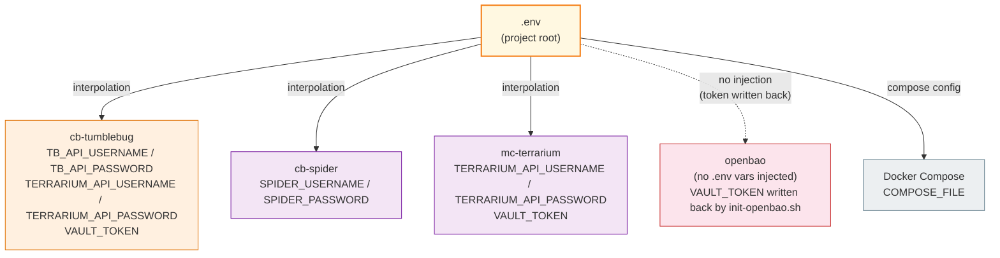
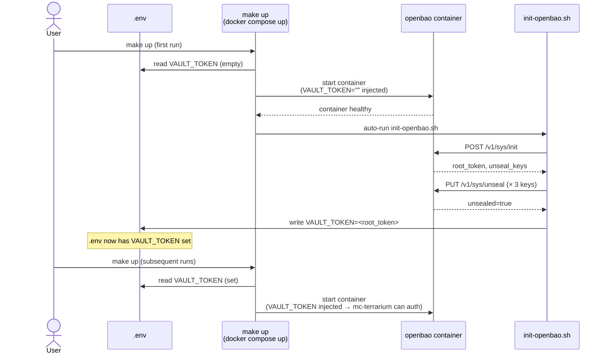
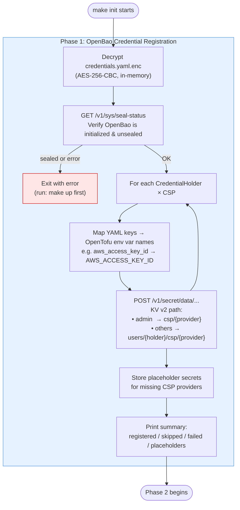
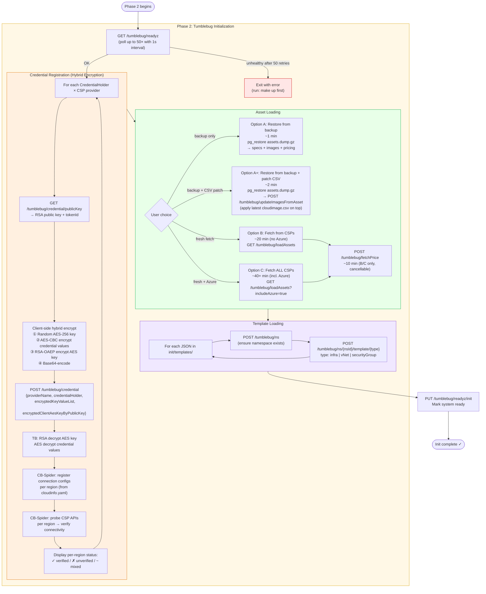
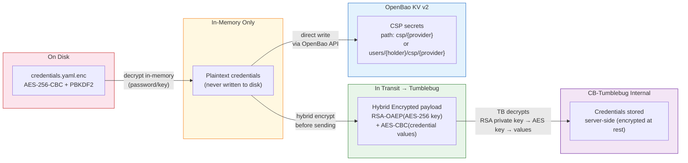

# CB-Tumblebug `make init` 초기화 워크플로우

## 개요

`make init`은 CB-Tumblebug의 기본 초기화 명령어입니다. 이 명령어는 다음 두 단계의 프로세스를 오케스트레이션합니다:

1. **1단계 — OpenBao 자격 증명 등록 (Phase 1 — OpenBao Credential Registration)**: `credentials.yaml.enc`를 복호화하고 CSP 자격 증명을 OpenBao(Vault 호환 시크릿 매니저)에 저장하여 MC-Terrarium의 OpenTofu/Terraform 템플릿에서 사용할 수 있도록 합니다.
2. **2단계 — Tumblebug 초기화 (Phase 2 — Tumblebug Initialization)**: 동일한 자격 증명을 (엔드투엔드 하이브리드 암호화를 사용하여) CB-Tumblebug에 등록한 다음, 클라우드 에셋 데이터(Compute 스펙, OS 이미지, 가격 정보)와 인프라 템플릿을 시스템에 로드합니다.

`make init`이 완료되면 CB-Tumblebug는 멀티클라우드 인프라 프로비저닝을 위한 모든 준비를 마치고 완전히 작동 가능한 상태가 됩니다.

---

## 0단계 — Docker Compose 및 `.env`

`make init`을 실행하려면 모든 서비스가 이미 실행 중이어야 합니다(`make up`). 서비스가 시작되기 전에 Docker Compose는 프로젝트 루트에 있는 `.env` 파일을 읽어 각 컨테이너에 환경 변수를 주입합니다.

### `.env`가 로드되는 방식

Docker Compose는 프로젝트 루트 디렉토리(`docker-compose.yaml`이 위치한 곳)에서 `.env`를 자동으로 읽어들입니다. 명시적으로 참조할 필요 없이 관례에 따라 자동으로 로드됩니다.

```bash
# Copy the example file and fill in your values
cp .env.example .env
# (edit .env)
make up
```

### `.env` 변수 맵

아래 다이어그램은 어떤 `.env` 변수가 어떤 컨테이너로 전달되는지, 그리고 변수가 누락되었을 때 어떻게 동작하는지를 보여줍니다.



### 변수 레퍼런스

| 변수 | 사용하는 컨테이너 | 누락 시 동작 | 설정 주체 |
|---|---|---|---|
| `COMPOSE_FILE` | Docker Compose (메타) | 기본값으로 `docker-compose.yaml`만 사용 | 사용자 (Traefik 오버레이 선택) |
| `TB_API_USERNAME` | `cb-tumblebug` | **에러 — 시작 실패** | 사용자 |
| `TB_API_PASSWORD` | `cb-tumblebug` | **에러 — 시작 실패** | 사용자 |
| `SPIDER_USERNAME` | `cb-spider` | **에러 — 시작 실패** | 사용자 |
| `SPIDER_PASSWORD` | `cb-spider` | **에러 — 시작 실패** | 사용자 |
| `TERRARIUM_API_USERNAME` | `cb-tumblebug`, `mc-terrarium` | **에러 — 시작 실패** | 사용자 |
| `TERRARIUM_API_PASSWORD` | `cb-tumblebug`, `mc-terrarium` | **에러 — 시작 실패** | 사용자 |
| `VAULT_TOKEN` | `cb-tumblebug`, `mc-terrarium` | 빈 문자열 (조용한 기본값 `:-`) | 첫 `make up` 이후 `init-openbao.sh`가 자동으로 기록 |
| `VAULT_ADDR` | (호스트 측 참조용) | `http://localhost:8200` | 사용자 (거의 변경하지 않음) |

> **`VAULT_TOKEN`에 대한 참고 사항**: `:?` 변수들은 정의되지 않은 경우 명확한 에러 메시지와 함께 `docker compose up`을 중단시킵니다. 반면 `VAULT_TOKEN`은 첫 시작 시 `init-openbao.sh`에 의해 `.env`에 자동으로 기록되므로 수동으로 설정할 필요가 없으며, 따라서 `:-`(빈 기본값)를 사용합니다.

### `COMPOSE_FILE` — Traefik 활성화하기

`COMPOSE_FILE`은 시작 시 어떤 Compose 파일들을 병합할지 제어하는 특별한 Docker Compose 변수입니다:

```bash
# Default: only core services
COMPOSE_FILE=docker-compose.yaml

# With Traefik reverse proxy (HTTPS, routing):
COMPOSE_FILE=docker-compose.yaml:docker-compose.traefik.yaml
```

### OpenBao 및 `VAULT_TOKEN` 수명 주기

`VAULT_TOKEN`은 `.env.example`에서 비어 있는 상태로 시작합니다. 첫 번째 `make up` 실행 시 `init-openbao.sh`가 OpenBao를 초기화하고 루트 토큰을 획득한 뒤 **이를 `.env`에 자동으로 다시 기록합니다**. 이후 실행되는 `make up`과 `make init`은 별도의 수동 작업 없이도 이 토큰을 자동으로 읽어 사용합니다.



---

## 전체 상호작용 다이어그램

아래 다이어그램은 `make init`이 처음부터 끝까지 각 컴포넌트와 어떻게 상호작용하는지 보여줍니다.

```mermaid
sequenceDiagram
    autonumber
    actor User
    box Local Host
        participant Script as multi-init.sh<br/>init.sh / init.py
        participant EncFile as credentials.yaml.enc<br/>(~/.cloud-barista/)
        participant Templates as init/templates/<br/>(Infra / vNet / SG)
    end

    box Docker Compose Environment
        participant OpenBao as OpenBao<br/>:8200<br/>KV v2 Secret Engine
        participant TB as CB-Tumblebug<br/>:1323
        participant Spider as CB-Spider<br/>:1024
        participant PG as PostgreSQL<br/>:5432<br/>Specs / Images DB
    end

    box Cloud Providers
        participant CSPs as AWS / GCP / Azure<br/>Alibaba / IBM / NCP<br/>NHN / KT / Others
    end

    User->>Script: make init (enter password once)

    rect rgb(230, 245, 255)
        Note over Script,OpenBao: ── Phase 1: OpenBao Credential Registration ──

        Script->>EncFile: Decrypt credentials.yaml.enc<br/>(AES-256-CBC, in-memory only)
        EncFile-->>Script: Plaintext credentials (YAML)

        Script->>OpenBao: GET /v1/sys/seal-status
        OpenBao-->>Script: initialized=true, sealed=false

        loop For each CredentialHolder × CSP provider
            Script->>OpenBao: POST /v1/secret/data/csp/{provider}<br/>(admin holder)<br/>or /v1/secret/data/users/{holder}/csp/{provider}
            OpenBao-->>Script: 200 OK – secret stored
        end

        Script->>OpenBao: POST placeholder secrets<br/>for providers without credentials
        OpenBao-->>Script: Placeholders stored
        Note over Script: Phase 1 complete – summary printed<br/>(registered / skipped / failed / placeholders)
    end

    rect rgb(255, 248, 230)
        Note over Script,CSPs: ── Phase 2: Tumblebug Initialization ──

        loop Poll until healthy (max 50 retries)
            Script->>TB: GET /tumblebug/readyz
            TB-->>Script: 200 OK
        end

        loop For each CredentialHolder × CSP provider
            Script->>TB: GET /tumblebug/credential/publicKey
            TB-->>Script: RSA public key + tokenId

            Note over Script: Hybrid encrypt credentials<br/>① Generate random AES-256 key<br/>② Encrypt credential values (AES-CBC)<br/>③ Encrypt AES key with RSA public key<br/>④ Base64-encode all

            Script->>TB: POST /tumblebug/credential<br/>{providerName, credentialHolder,<br/>encryptedKeyValueList, encryptedAESKey}
            TB->>TB: Decrypt AES key (RSA private key)<br/>Decrypt credential values (AES key)
            TB->>Spider: Register cloud connection configs<br/>(per region × credential)
            Spider->>CSPs: Verify connection (cloud API probe)
            CSPs-->>Spider: Connection verified / failed
            Spider-->>TB: per-region status
            TB-->>Script: ✓ verified / ✗ unverified regions
        end
    end

    rect rgb(240, 255, 240)
        Note over Script,CSPs: ── Asset Loading (user selects one option) ──

        alt Option A – Restore from backup (~1 min)
            Script->>TB: POST /tumblebug/ns  (ensure 'system' namespace)
            TB-->>Script: namespace ready
            Script->>PG: pg_restore assets/assets.dump.gz<br/>(specs + images + pricing)
            PG-->>Script: Restore complete
        else Option A+ – Restore from backup + patch CSV (~2 min)
            Script->>TB: POST /tumblebug/ns  (ensure 'system' namespace)
            TB-->>Script: namespace ready
            Script->>PG: pg_restore assets/assets.dump.gz<br/>(specs + images + pricing)
            PG-->>Script: Restore complete
            Script->>TB: POST /tumblebug/updateImagesFromAsset<br/>(apply latest cloudimage.csv on top)
            TB->>PG: Upsert images from CSV
            PG-->>TB: Updated
            TB-->>Script: patch complete
        else Option B – Fetch from CSPs, skip Azure (~20 min)
            Script->>TB: GET /tumblebug/loadAssets
            TB->>Spider: Fetch compute specs per region (parallel)
            TB->>Spider: Fetch OS images per region (parallel)
            Spider->>CSPs: Cloud API calls
            CSPs-->>Spider: Spec & image data
            Spider-->>TB: Aggregated data
            TB->>PG: Store specs and images
            PG-->>TB: Stored
            TB-->>Script: loadAssets complete
        else Option C – Fetch ALL CSPs including Azure (~40 min)
            Script->>TB: GET /tumblebug/loadAssets?includeAzure=true
            TB->>Spider: Fetch specs + images (all CSPs, parallel)
            Spider->>CSPs: Cloud API calls (incl. Azure)
            CSPs-->>Spider: Full data
            Spider-->>TB: Aggregated data
            TB->>PG: Store specs and images
            PG-->>TB: Stored
            TB-->>Script: loadAssets complete
        end

        opt Price fetching (Options B / C only, ~10 min, cancellable)
            Script->>TB: POST /tumblebug/fetchPrice
            TB->>CSPs: Fetch pricing APIs
            CSPs-->>TB: Pricing data
            TB->>PG: Update price per spec
            PG-->>TB: Updated
            TB-->>Script: fetchPrice complete
        end
    end

    rect rgb(255, 240, 255)
        Note over Script,TB: ── Template Loading ──

        loop For each JSON file in init/templates/
            Script->>TB: POST /tumblebug/ns  (ensure namespace)
            TB-->>Script: namespace ready
            Script->>TB: POST /tumblebug/ns/{nsId}/template/{type}<br/>(type: infra | vNet | securityGroup)
            TB-->>Script: template stored
        end
    end

    Script->>TB: PUT /tumblebug/readyz/init
    TB-->>Script: initialization marked complete
    Script-->>User: Init complete ✓<br/>(elapsed time summary)
```



---

## `make init` 실행 중 컴포넌트별 역할

| 컴포넌트 | `make init` 실행 중 역할 |
|-----------|------------------------|
| **multi-init.sh / init.py** | 오케스트레이터: 자격 증명을 복호화하고 모든 API를 호출하며 결과를 보고함 |
| **credentials.yaml.enc** | 암호화된 자격 증명 소스 — 메모리 내에서만 복호화되며 디스크에 평문으로 기록되지 않음 |
| **OpenBao** (`:8200`) | KV v2에 CSP 자격 증명을 저장함; 이후 MC-Terrarium의 OpenTofu 템플릿에서 사용됨 |
| **CB-Tumblebug** (`:1323`) | 암호화된 자격 증명을 수신하고 연결을 관리하며 에셋 로딩을 트리거하고 템플릿을 저장함 |
| **CB-Spider** (`:1024`) | 리전별 연결 구성을 등록하고 CSP API를 프로브(Probe)하여 연결 상태를 검증함 |
| **PostgreSQL** (`:5432`) | 로드된 Compute 스펙, OS 이미지 및 가격 데이터를 저장함 |
| **CSPs** | 연결 검증, Compute 스펙, OS 이미지 및 가격 정보에 대한 신뢰할 수 있는 원본(Source of truth) |

---

## 단계별 상세 설명

### 1단계 — OpenBao 자격 증명 등록 (Phase 1 — OpenBao Credential Registration)



### 2단계 — Tumblebug 초기화 (Phase 2 — Tumblebug Initialization)



---

## 보안 설계 (Security Design)

`make init`은 모든 단계에서 CSP 자격 증명을 보호하기 위해 **2계층 암호화 전략**(Two-layer encryption strategy)을 적용합니다:



| 단계 | 메커니즘 |
|-------|-----------|
| 디스크 저장 | `credentials.yaml.enc` — PBKDF2 키 파생을 사용한 AES-256-CBC |
| 인메모리 복호화 | 평문은 RAM에만 존재하며 디스크에는 절대 기록되지 않음 |
| Tumblebug로 전송 | 하이브리드 RSA-OAEP + AES-256-CBC 암호화; Tumblebug가 RSA 개인키를 보유함 |
| OpenBao 저장 | 접근 제어 정책이 적용된 네이티브 KV v2 시크릿 엔진 |

---

## 소요 시간 예측 (Time Estimates)

| 모드 | 소요 시간 | 포함되는 데이터 |
|------|----------|---------------|
| 1단계 (OpenBao) | 약 1분 | KV v2 내 CSP 자격 증명 |
| 2단계 – 자격 증명 등록 | 약 1~2분 | 모든 자격 증명 소유자(Holder) × CSP × 리전 |
| 2단계 – 에셋 복원 (Option A) | 약 1분 | 스펙 + 이미지 + 가격 정보 (백업으로부터 복원) |
| 2단계 – 에셋 복원 + CSV 패치 (Option A+) | 약 2분 | 스펙 + 이미지 + 가격 정보 (백업으로부터 복원) + 최신 `cloudimage.csv` 덮어쓰기 적용 |
| 2단계 – 에셋 조회, Azure 제외 (Option B) | 약 20분 | 스펙 + 이미지 (CSP로부터 실시간 조회) |
| 2단계 – 에셋 조회, 모든 CSP (Option C) | 약 40분 이상 | Azure를 포함한 스펙 + 이미지 (실시간 조회) |
| 2단계 – 가격 정보 조회 (Option B/C 전용) | 약 10분 | 모든 스펙에 대한 가격 정보 |

---

## 빠른 참조 (Quick Reference)

```bash
# Full initialization (recommended)
make init

# Skip the interactive prompt and auto-select asset backup restore
make init -y

# Initialize with specific options (see init/README.md)
./init/multi-init.sh --help
```

**사전 준비 사항:**
- 모든 서비스 실행 중: `make up`
- `~/.cloud-barista/credentials.yaml.enc` 경로에 암호화된 자격 증명 파일 준비
  - 템플릿에서 생성: `./init/genCredential.sh`
  - 암호화: `./init/encCredential.sh`

**관련 문서:**
- [자격 증명 및 연결 가이드](credential-and-connection.md)
- [에셋 백업 및 복원 가이드](assets-backup-restore.md)
- [리소스 템플릿 관리 가이드](resource-template-management.md)
- [init/README.md](../../../init/README.md)
