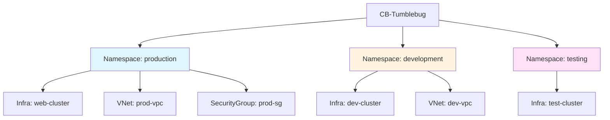
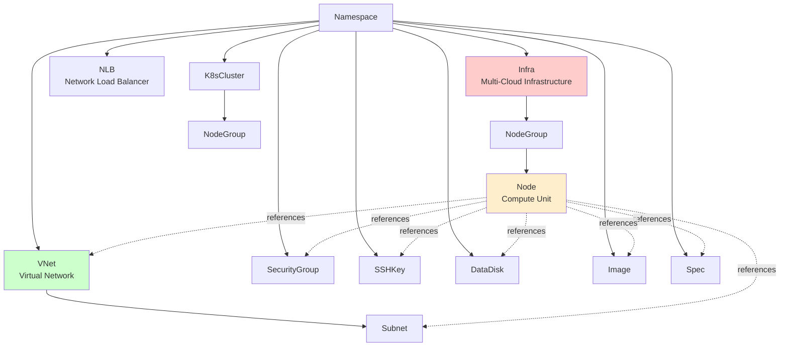
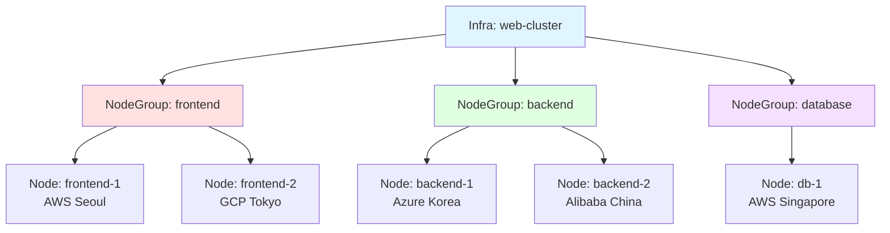
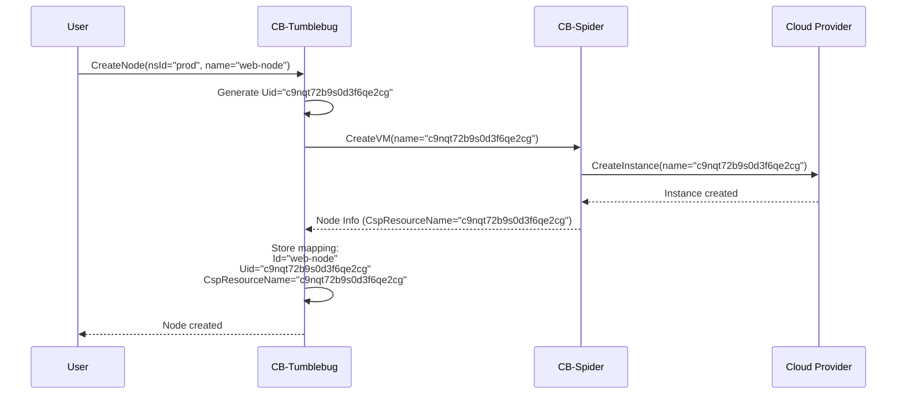
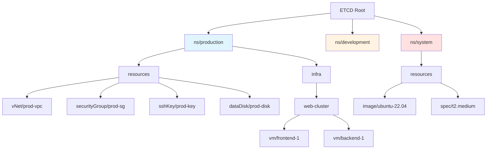
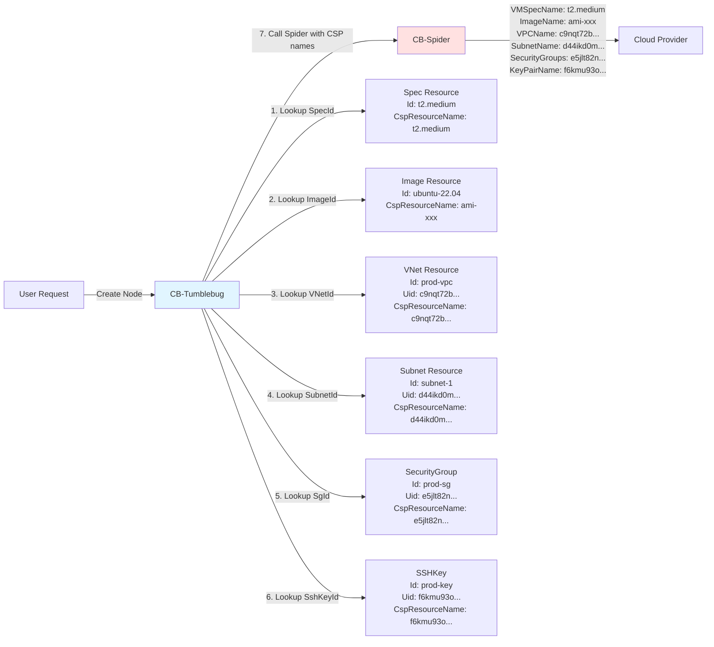
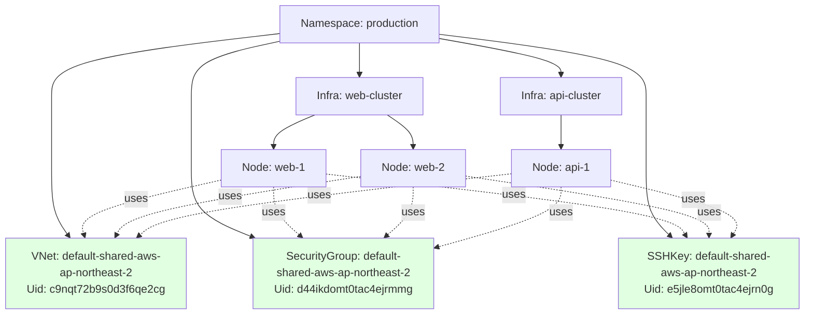
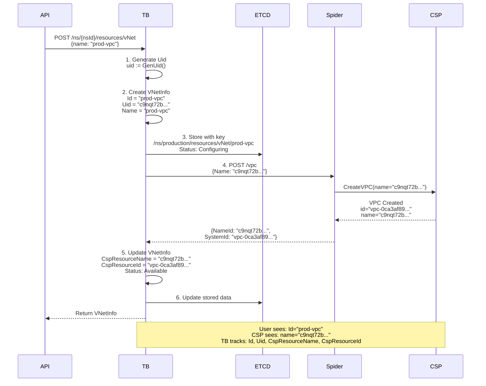
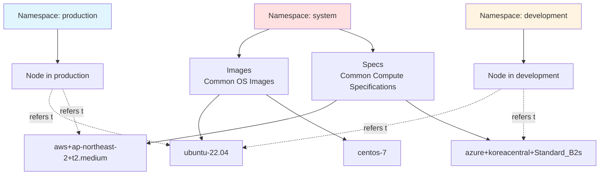

# CB-Tumblebug 네임스페이스 및 리소스 식별 체계 관리

## 개요

CB-Tumblebug은 멀티클라우드 환경에서 리소스를 관리하기 위해 **네임스페이스(Namespace) 기반 논리적 격리**와 **UID 기반 식별 시스템**을 사용합니다. 이 문서는 CB-Tumblebug의 네임스페이스 개념과 리소스 식별 메커니즘을 설명합니다.

## 네임스페이스의 역할

### 1. 논리적 리소스 격리

네임스페이스는 CB-Tumblebug에서 리소스를 격리하는 **핵심 논리적 경계**입니다. 다른 네임스페이스의 간섭 없이 클라우드 리소스를 구성하고 관리할 수 있는 독립적인 작업 공간 역할을 합니다.

**주요 활용 사례:**
- **환경 분리**: `production`, `staging`, `development`
- **팀 격리**: `team-alpha`, `team-beta`, `team-gamma`
- **프로젝트 경계**: `project-web`, `project-mobile`, `project-analytics`
- **고객 분리**: `customer-a`, `customer-b` (멀티테넌시)



### 2. 네임스페이스 독립성: 서로 다른 네임스페이스에서의 동일 ID 사용

서로 다른 네임스페이스의 리소스는 완전히 격리되어 있으므로, 네임스페이스 간에 충돌 없이 **동일한 리소스 ID**를 사용할 수 있습니다.

```mermaid
graph TB
    subgraph NS_PROD["Namespace: production"]
        Infra_PROD["Infra<br/>Id: web-cluster<br/>Uid: c9nqt72b9s0d"]
        VM_PROD_1["Node<br/>Id: frontend-1<br/>Uid: d44ikdom"]
        VM_PROD_2["Node<br/>Id: backend-1<br/>Uid: e5jle8om"]
        VNET_PROD["VNet<br/>Id: main-vpc<br/>Uid: f6kmu93o"]
        
        Infra_PROD --> VM_PROD_1
        Infra_PROD --> VM_PROD_2
        VM_PROD_1 -.uses.-> VNET_PROD
        VM_PROD_2 -.uses.-> VNET_PROD
    end
    
    subgraph NS_DEV["Namespace: development"]
        Infra_DEV["Infra<br/>Id: web-cluster<br/>Uid: g8pov15q9t2e"]
        VM_DEV_1["Node<br/>Id: frontend-1<br/>Uid: h9qpw26r0u3f"]
        VM_DEV_2["Node<br/>Id: backend-1<br/>Uid: i0rqx37s1v4g"]
        VNET_DEV["VNet<br/>Id: main-vpc<br/>Uid: j1sry48t2w5h"]
        
        Infra_DEV --> VM_DEV_1
        Infra_DEV --> VM_DEV_2
        VM_DEV_1 -.uses.-> VNET_DEV
        VM_DEV_2 -.uses.-> VNET_DEV
    end
    
    subgraph NS_TEST["Namespace: testing"]
        Infra_TEST["Infra<br/>Id: web-cluster<br/>Uid: k2tsz59u3x6i"]
        VM_TEST_1["Node<br/>Id: frontend-1<br/>Uid: l3uta60v4y7j"]
        VNET_TEST["VNet<br/>Id: main-vpc<br/>Uid: m4vub71w5z8k"]
        
        Infra_TEST --> VM_TEST_1
        VM_TEST_1 -.uses.-> VNET_TEST
    end
    
    style NS_PROD fill:#e1f5ff
    style NS_DEV fill:#fff4e1
    style NS_TEST fill:#ffe1f5
    
    style Infra_PROD fill:#ffcccc
    style Infra_DEV fill:#ffcccc
    style Infra_TEST fill:#ffcccc
```



**주요 특징:**
- ✅ **동일 ID 허용**: 세 네임스페이스 모두 Infra Id로 `web-cluster`, Node Id로 `frontend-1`, VNet Id로 `main-vpc`를 사용합니다.
- ✅ **고유한 UID**: 각 리소스는 고유한 `Uid`를 가지므로 CSP 수준에서 충돌이 발생하지 않도록 보장합니다.
- ✅ **독립적인 수명주기**: `production`에서 `web-cluster`를 삭제해도 `development`나 `testing`에는 영향을 주지 않습니다.
- ✅ **격리된 구성**: 동일한 논리적 구조를 네임스페이스별로 서로 다른 설정으로 배포할 수 있습니다.

### 3. 네임스페이스 구조

```go
type NsInfo struct {
    ResourceType string   // "ns"
    Id           string   // Namespace ID (user-defined)
    Uid          string   // Unique identifier (auto-generated)
    Name         string   // Display name
    Description  string   // Description
}
```

**주요 특성:**
- **Id**: 사용자 정의 네임스페이스 식별자 (예: `production`, `dev-team-a`)
- **Uid**: 시스템이 자동으로 생성하는 전역 고유 식별자
- **시스템 네임스페이스**: `system` - 공통 리소스(image, spec 등)를 저장합니다.

> **참고:** `Id` 필드는 리소스 생성 시 사용자가 제공한 `Name`으로부터 파생됩니다. `Name: "production"`으로 네임스페이스를 생성하면 시스템은 `Id: "production"`도 동일하게 설정합니다. 이 패턴은 CB-Tumblebug의 모든 리소스 타입(VNet, Infra, Node, SecurityGroup 등)에 일관되게 적용됩니다.

## 리소스 계층 구조

### 1. 전체 리소스 계층 구조



### 2. Infra 내부 구조

Infra(멀티클라우드 인프라)는 여러 클라우드의 Node들을 논리적으로 그룹화하는 컨테이너입니다.



## 리소스 식별 시스템

### 1. 3단계 식별자 체계

CB-Tumblebug의 모든 리소스는 다음과 같은 식별자들을 가집니다:

| 식별자 | 목적 | 생성 시점 | 예시 |
|---|---|---|---|
| **Id** | CB-Tumblebug 내부 식별용 (사용자 정의) | 리소스 생성 요청 시 | `web-node-01` |
| **Uid** | 전역 고유 식별자 (CSP 리소스 이름용) | 생성 시 자동 생성 | `c9nqt72b9s0d3f6qe2cg` |
| **CspResourceName** | CSP 네이티브 리소스 이름 (Spider의 `NameId`) | CSP 리소스 생성 후 | `c9nqt72b9s0d3f6qe2cg` |
| **CspResourceId** | CSP 내부 시스템 ID (Spider의 `SystemId`) | CSP 리소스 생성 후 | `i-0d6c7d2a0f4d0ba2a` |

> **CSP 식별자 참고 사항:**
> - **CspResourceName**: CB-Spider의 `IId.NameId`에 매핑됩니다 — CB-Tumblebug이 할당하고(일반적으로 `Uid`) Spider가 리소스를 관리하는 데 사용하는 이름입니다.
> - **CspResourceId**: CB-Spider의 `IId.SystemId`에 매핑됩니다 — 클라우드 서비스 제공자(CSP)가 할당한 실제 내부 ID입니다(예: AWS 인스턴스 ID `i-xxx`, Azure 리소스 ID, GCP 리소스 ID).
> - CB-Tumblebug은 완벽한 리소스 추적을 유지하고 CSP의 네이티브 ID가 필요한 "register(등록)" 등의 작업을 지원하기 위해 두 식별자를 모두 메타데이터로 저장합니다.

### 2. Uid 생성 메커니즘

```go
// GenUid generates a globally unique identifier
func GenUid() string {
    return uid.New().String()  // Uses rs/xid library
}
```

**Uid 특성:**
- **길이**: 20자 Base32 인코딩 문자열
- **구성**: 타임스탬프(4바이트) + 머신 ID(3바이트) + 프로세스 ID(2바이트) + 카운터(3바이트)
- **전역 고유성**: 시간, 머신, 프로세스를 조합하여 충돌 방지
- **예시**: `c9nqt72b9s0d3f6qe2cg`, `d44ikdomt0tac4ejrmmg`

### 3. 왜 Uid를 CSP 리소스 이름으로 사용할까요?

**문제점:**
- CB-Tumblebug의 네임스페이스 개념은 CB-Spider나 Terrarium(OpenTofu)에는 존재하지 않습니다.
- 여러 네임스페이스에서 동일한 리소스 `Id`를 사용할 수 있습니다(예: `prod`의 `web-node`, `dev`의 `web-node`).
- 이로 인해 CSP 수준에서 리소스 이름 충돌이 발생할 수 있습니다.

**해결책:**


**코드 예시 (VNet 생성):**

```go
// CreateVNet in src/core/resource/vnet.go
func CreateVNet(nsId string, vNetReq *model.VNetReq) (model.VNetInfo, error) {
    // 1. Generate Uid for TB internal use
    uid := common.GenUid()
    vNetInfo.Uid = uid
    vNetInfo.Id = vNetReq.Name        // User-defined name
    vNetInfo.Name = vNetReq.Name
    
    // 2. Create subnets with their own Uids
    for _, subnetInfo := range vNetReq.SubnetInfoList {
        vNetInfo.SubnetInfoList = append(vNetInfo.SubnetInfoList, model.SubnetInfo{
            Id:   subnetInfo.Name,
            Uid:  common.GenUid(),      // Each subnet gets unique Uid
            // ...
        })
    }
    
    // 3. Call Spider with Uid as resource name
    spReqt := spiderCreateVPCRequest{}
    spReqt.ReqInfo.Name = vNetInfo.Uid  // ← Use Uid, not user-defined name!
    
    // Subnet names also use Uid
    for _, subnetInfo := range vNetInfo.SubnetInfoList {
        spReqt.ReqInfo.SubnetInfoList = append(..., spiderAddSubnetRequestInfo{
            Name: subnetInfo.Uid,  // ← Use Uid
            // ...
        })
    }
    
    // 4. Spider creates VPC with Uid as name in CSP
    // 5. CSP returns IId with both NameId and SystemId
    var spResp spiderVPCInfo
    err = callSpider(spReqt, &spResp)
    
    // 6. Store both CSP identifiers
    vNetInfo.CspResourceName = spResp.IId.NameId   // Spider's NameId (= our Uid)
    vNetInfo.CspResourceId = spResp.IId.SystemId   // CSP's internal ID (e.g., vpc-0ca3af89...)
    
    // 7. Also store subnet CSP IDs
    for i, spSubnetInfo := range spResp.SubnetInfoList {
        vNetInfo.SubnetInfoList[i].CspResourceId = spSubnetInfo.IId.SystemId
    }
    
    return vNetInfo, nil
}
```

**왜 `CspResourceName`과 `CspResourceId`를 모두 저장할까요?**

1. **CspResourceName (NameId)**:
   - 일반적인 리소스 관리 작업(조회, 삭제, 업데이트)에 사용됩니다.
   - CB-Spider가 리소스를 식별하기 위해 사용하는 이름입니다.
   - 일반적으로 CB-Tumblebug이 생성한 `Uid`와 일치합니다.

2. **CspResourceId (SystemId)**:
   - CSP의 실제 내부 식별자입니다(예: AWS: `i-0d6c7d2a0f4d0ba2a`, Azure: `/subscriptions/.../resourceGroups/...`).
   - 기존 CSP 리소스를 CB-Tumblebug으로 가져오는 "register(등록)" 작업에 필수적입니다.
   - 교차 참조 및 감사(Auditing)에 사용됩니다.
   - 완벽한 리소스 추적성을 제공합니다.

**예시: Register 작업**
```go
// When registering an existing Node from CSP
// User must provide the CSP's native ID (CspResourceId)
requestBody.ReqInfo.CSPid = vmInfoData.CspResourceId  // e.g., "i-0d6c7d2a0f4d0ba2a"
```

## KeyValue 스토어 구조

### 1. 리소스 키 생성 패턴

```go
// GenResourceKey generates ETCD key for resources
func GenResourceKey(nsId string, resourceType string, resourceId string) string {
    // Pattern: /ns/{nsId}/resources/{resourceType}/{resourceId}
    return "/ns/" + nsId + "/resources/" + resourceType + "/" + resourceId
}

// GenInfraKey generates ETCD key for Infra and VMs
func GenInfraKey(nsId string, infraId string, vmId string) string {
    if vmId != "" {
        return "/ns/" + nsId + "/infra/" + infraId + "/vm/" + vmId
    } else if infraId != "" {
        return "/ns/" + nsId + "/infra/" + infraId
    } else if nsId != "" {
        return "/ns/" + nsId
    }
    return ""
}
```

### 2. ETCD 키 구조



**실제 키 예시:**
```
/ns/production/resources/vNet/prod-vpc
/ns/production/resources/securityGroup/prod-sg
/ns/production/resources/sshKey/prod-key
/ns/production/infra/web-cluster
/ns/production/infra/web-cluster/vm/frontend-1
/ns/production/infra/web-cluster/vm/backend-1
/ns/system/resources/image/ubuntu-22.04
/ns/system/resources/spec/aws+ap-northeast-2+t2.medium
```

## 리소스 참조 관계

### 1. Node 생성 시 리소스 참조



### 2. 리소스 생성 코드 예시

```go
// From src/core/infra/provisioning.go
func CreateNode(ctx context.Context, wg *sync.WaitGroup, nsId string, infraId string, vmInfoData *model.NodeInfo, option string) error {
    // 1. Lookup Spec's CSP resource name
    requestBody.ReqInfo.VMSpecName, err = resource.GetCspResourceName(
        nsId, model.StrSpec, vmInfoData.SpecId)
    
    // 2. Lookup VNet's CSP resource name (this is Uid)
    requestBody.ReqInfo.VPCName, err = resource.GetCspResourceName(
        nsId, model.StrVNet, vmInfoData.VNetId)
    
    // 3. Lookup Subnet's CSP resource name (this is Uid)
    subnetInfo := ... // Get subnet info
    requestBody.ReqInfo.SubnetName = subnetInfo.CspResourceName  // Uid
    
    // 4. Lookup SecurityGroup's CSP resource name (Uid)
    for _, sgId := range vmInfoData.SecurityGroupIds {
        cspSgName, err := resource.GetCspResourceName(
            nsId, model.StrSecurityGroup, sgId)
        requestBody.ReqInfo.SecurityGroupNames = append(..., cspSgName)
    }
    
    // 5. Lookup SSHKey's CSP resource name (Uid)
    requestBody.ReqInfo.KeyPairName, err = resource.GetCspResourceName(
        nsId, model.StrSSHKey, vmInfoData.SshKeyId)
    
    // 6. Call CB-Spider with all CSP resource names (Uids)
    // Spider doesn't know about TB's namespace or user-defined names
    err = callSpider(requestBody)
    
    return err
}
```

## 공유 리소스 (Shared Resources)

### 1. 공유 리소스 개념

여러 Node가 공유하는 네트워크 리소스는 `-shared-` 접미사를 가집니다.

```go
const StrSharedResourceName string = "-shared-"

// Example: "default-shared-aws-ap-northeast-2"
```

### 2. 공유 리소스 패턴



**공유 리소스 특성:**
- **재사용성**: 동일한 Connection을 사용하는 Node들이 공유합니다.
- **자동 생성**: Infra Dynamic 생성 시 자동으로 생성됩니다.
- **명명 규칙**: `{nsId}-shared-{connectionName}`
- **CSP 리소스 이름**: `Uid`를 사용합니다(예: `c9nqt72b9s0d3f6qe2cg`).

## 리소스 수명주기와 식별자

### 1. 리소스 생성 흐름



### 2. 식별자 매핑 테이블

| TB 내부 ID | TB 전역 ID | CSP 리소스 이름 (Spider NameId) | CSP 시스템 ID (Spider SystemId) |
|-------------|-------------|-----------|--------------|
| Id: `prod-vpc` | Uid: `c9nqt72b9s0d3f6qe2cg` | CspResourceName: `c9nqt72b9s0d3f6qe2cg` | CspResourceId: `vpc-0ca3af89d65a3b478` |
| Id: `web-node-01` | Uid: `d44ikdomt0tac4ejrmmg` | CspResourceName: `d44ikdomt0tac4ejrmmg` | CspResourceId: `i-0d6c7d2a0f4d0ba2a` |
| Id: `prod-sg` | Uid: `e5jle8omt0tac4ejrn0g` | CspResourceName: `e5jle8omt0tac4ejrn0g` | CspResourceId: `sg-04dcc53ef58a49869` |

**식별자 흐름:**
```
User Input (Id: "prod-vpc")
    ↓
TB Generates (Uid: "c9nqt72b...")
    ↓
Spider Creates Resource with Name = Uid
    ↓
CSP Assigns Internal ID
    ↓
Spider Returns IId {
    NameId: "c9nqt72b..." ← Becomes CspResourceName
    SystemId: "vpc-0ca3af..." ← Becomes CspResourceId
}
    ↓
TB Stores All Four Identifiers
```

### 3. CspResourceId 활용 사례

**1. 리소스 등록 (기존 리소스 가져오기)**

`CspResourceId`의 가장 중요한 활용 사례는 기존 CSP 리소스를 CB-Tumblebug에 등록하는 것입니다:

```go
// User wants to register an existing Node from AWS
// User must provide the CSP's actual instance ID
nodeRequest := model.NodeRequest{
    Name:          "imported-node",
    CspResourceId: "i-0d6c7d2a0f4d0ba2a",  // AWS instance ID (required!)
    // ... other fields
}

// In provisioning.go
if option == "register" {
    // CspResourceId is required for registration
    if vmInfoData.CspResourceId == "" {
        return fmt.Errorf("CspResourceId is required for register operation")
    }
    
    // Send CSP's native ID to Spider
    requestBody.ReqInfo.CSPid = vmInfoData.CspResourceId
}
```

**2. 리소스 추적성 및 감사(Auditing)**

```go
// Store complete resource lineage
vmInfoData.CspResourceName = callResult.IId.NameId   // Spider's managed name
vmInfoData.CspResourceId = callResult.IId.SystemId   // CSP's native ID

// Also store related resource IDs for complete tracking
vmInfoData.CspSpecName = callResult.VMSpecName
vmInfoData.CspImageName = callResult.ImageIId.SystemId    // CSP's image ID
vmInfoData.CspVNetId = callResult.VpcIID.SystemId         // CSP's VPC ID
vmInfoData.CspSubnetId = callResult.SubnetIID.SystemId    // CSP's subnet ID
vmInfoData.CspSshKeyId = callResult.KeyPairIId.SystemId   // CSP's key pair ID
```

**3. 교차 참조 검증**

리소스가 서로를 참조할 때 CB-Tumblebug은 CSP ID를 사용하여 검증할 수 있습니다:

```go
// Check if a resource exists in CSP using SystemId
func validateResourceExists(cspResourceId string) bool {
    // Query Spider/CSP using the SystemId
    resource := getResourceBySystemId(cspResourceId)
    return resource != nil
}
```

**4. 모니터링 및 관리를 위한 시스템 레이블**

```go
// CspResourceId is stored as a system label for easy querying
vmInfoData.Label = map[string]string{
    model.LabelCspResourceId: vmInfoData.CspResourceId,  // "sys.cspResourceId"
    // ... other labels
}
```

## 리소스 타입별 식별자 적용

### 1. VNet 및 Subnet

```go
type VNetInfo struct {
    ResourceType    string         // "vNet"
    Id              string         // User-defined: "prod-vpc"
    Uid             string         // Generated: "c9nqt72b9s0d3f6qe2cg"
    Name            string         // Same as Id: "prod-vpc"
    CspResourceName string         // CSP uses this: "c9nqt72b9s0d3f6qe2cg"
    CspResourceId   string         // CSP internal ID: "vpc-0ca3af89..."
    SubnetInfoList  []SubnetInfo   // Child subnets
    // ...
}

type SubnetInfo struct {
    ResourceType    string         // "subnet"
    Id              string         // User-defined: "subnet-1"
    Uid             string         // Generated: "d44ikd0mt0tac4ejrml0"
    Name            string         // Same as Id
    CspResourceName string         // CSP uses this: "d44ikd0mt0tac4ejrml0"
    // ...
}
```

### 2. Infra, NodeGroup, Node

```go
type InfraInfo struct {
    ResourceType string         // "infra"
    Id           string         // User-defined: "web-cluster"
    Uid          string         // Generated
    Name         string         // Same as Id
    Node         []NodeInfo     // All Nodes across nodegroups
    // ...
}

type NodeInfo struct {
    ResourceType    string         // "vm" (internal type identifier)
    Id              string         // User-defined or auto: "frontend-1"
    Uid             string         // Generated: "d44ikdomt0tac4ejrmmg"
    Name            string         // Same as Id
    NodeGroupId     string         // Parent nodegroup: "frontend"
    CspResourceName string         // CSP uses this: "d44ikdomt0tac4ejrmmg"
    CspResourceId   string         // CSP internal: "i-0d6c7d2a0f4d0ba2a"
    
    // Resource references (by Id)
    VNetId              string     // "prod-vpc"
    SubnetId            string     // "subnet-1"
    SecurityGroupIds    []string   // ["prod-sg"]
    SshKeyId            string     // "prod-key"
    DataDiskIds         []string   // ["data-disk-1"]
    SpecId              string     // "aws+ap-northeast-2+t2.medium"
    ImageId             string     // "ubuntu-22.04"
    // ...
}
```

### 3. SecurityGroup

```go
type SecurityGroupInfo struct {
    ResourceType    string         // "securityGroup"
    Id              string         // User-defined: "prod-sg"
    Uid             string         // Generated: "e5jle8omt0tac4ejrn0g"
    Name            string         // Same as Id
    CspResourceName string         // CSP uses: "e5jle8omt0tac4ejrn0g"
    CspResourceId   string         // CSP internal: "sg-04dcc53ef58a49869"
    // ...
}
```

### 4. SSHKey

```go
type SshKeyInfo struct {
    ResourceType    string         // "sshKey"
    Id              string         // User-defined: "prod-key"
    Uid             string         // Generated: "f6kmu93omt0tac4ejrnpg"
    Name            string         // Same as Id
    CspResourceName string         // CSP uses: "f6kmu93omt0tac4ejrnpg"
    CspResourceId   string         // CSP internal key name
    // ...
}
```

### 5. DataDisk

```go
type DataDiskInfo struct {
    ResourceType    string         // "dataDisk"
    Id              string         // User-defined: "data-disk-1"
    Uid             string         // Generated
    Name            string         // Same as Id
    CspResourceName string         // CSP uses Uid
    CspResourceId   string         // CSP volume ID
    // ...
}
```

### 6. Image 및 Spec (시스템 리소스)

```go
type ImageInfo struct {
    ResourceType    string         // "image"
    Id              string         // CSP image name: "ami-0e87051b5808b3155"
    Uid             string         // Generated
    Name            string         // User-friendly name
    CspResourceName string         // Original CSP image ID
    // Stored in /ns/system/resources/image/{id}
    // ...
}

type SpecInfo struct {
    ResourceType    string         // "spec"
    Id              string         // "aws+ap-northeast-2+t2.medium"
    Uid             string         // Generated
    Name            string         // "t2.medium"
    CspResourceName string         // CSP spec name: "t2.medium"
    // Stored in /ns/system/resources/spec/{id}
    // ...
}
```

## 특수 사례

### 1. 시스템 네임스페이스



**시스템 네임스페이스 특성:**
- Image와 Spec은 `system` 네임스페이스에 저장됩니다.
- 모든 네임스페이스에서 공유됩니다.
- Spec Id 형식: `{provider}+{region}+{specName}`
- Image는 CSP 네이티브 ID를 직접 사용합니다.

### 2. K8sCluster

```go
type K8sClusterInfo struct {
    ResourceType    string           // "k8s"
    Id              string           // User-defined
    Uid             string           // Generated
    Name            string
    CspResourceName string           // CSP cluster name (Uid)
    CspResourceId   string           // CSP cluster ID
    NodeGroupList   []K8sNodeGroupInfo
    // ...
}

type K8sNodeGroupInfo struct {
    // Node groups also have Uid
    Uid             string
    CspResourceName string
    // ...
}
```

### 3. 작업 스케줄러 (네임스페이스 독립적)

```go
// Jobs are not bound to namespaces
// Stored as /scheduledJob/{jobId}

type ScheduleJobStatus struct {
    JobId  string    // "registerCspResources-1730188800"
    NsId   string    // Target namespace (for resource registration)
    // Jobs are managed globally, NsId is for target specification
}
```

**키 구조:**
```
/scheduledJob/registerCspResources-1730188800
    → NOT /ns/{nsId}/scheduledJob/...
```

## 요약

### 핵심 원칙

1. **네임스페이스 기반 격리**
   - 모든 리소스는 네임스페이스 내에서 격리됩니다.
   - `system` 네임스페이스는 공통 리소스를 저장합니다.

2. **3단계 식별자 체계**
   - **Id**: 사용자 정의 식별자 (TB 내부 사용)
   - **Uid**: 시스템이 생성한 전역 고유 ID (CSP 리소스 이름)
   - **CspResourceName**: CSP에서 인식하는 이름 (일반적으로 `Uid`)

3. **Uid를 CSP 리소스 이름으로 사용**
   - 네임스페이스 개념이 없는 하위 시스템(Spider, Terrarium)과 통신합니다.
   - 리소스 이름 충돌을 방지합니다.
   - 전역 고유성을 보장합니다.

4. **계층적 리소스 구조**
   - Namespace → Resources (VNet, SG, SSH, Disk)
   - Namespace → Infra → NodeGroup → Node
   - VM은 다른 리소스를 참조합니다(`Id`로 참조하며, 호출 시 `CspResourceName` 사용).

5. **KeyValue 스토어 패턴**
   - `/ns/{nsId}/resources/{type}/{id}` - 일반 리소스
   - `/ns/{nsId}/infra/{infraId}` - Infra
   - `/ns/{nsId}/infra/{infraId}/vm/{vmId}` - Node (하위 호환성을 위해 내부 키에 `vm` 사용)

이러한 시스템을 통해 CB-Tumblebug은 멀티테넌트 환경에서 리소스를 안전하게 격리하고, 하위 시스템과 통신할 때 이름 충돌을 방지합니다.
