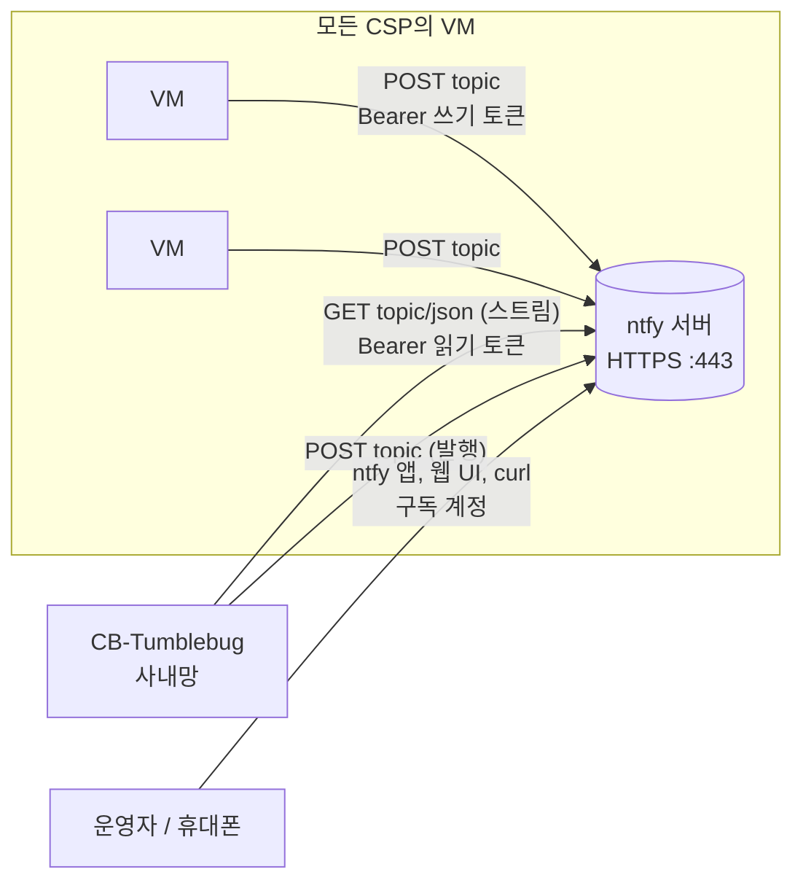

# 알림 채널 (Notifier, ntfy)

VM과 CB-Tumblebug이 자체 호스팅 또는 외부 [ntfy](https://ntfy.sh) 서버를 통해 메시지를 주고받는 알림 채널 가이드입니다.

## 📑 목차

1. [개요](#개요)
2. [아키텍처](#아키텍처)
3. [Notifier 구성](#notifier-구성)
4. [구독 계정](#구독-계정)
5. [메시지 발행과 수신](#메시지-발행과-수신)
6. [MapUI](#mapui)
7. [API 레퍼런스](#api-레퍼런스)
8. [보안 모델](#보안-모델)
9. [제약과 문제 해결](#제약과-문제-해결)

---

## 개요

### Notifier란 무엇인가?

**Notifier**는 CB-Tumblebug 배포당 하나 존재하는 알림 채널로, ntfy 토픽 하나를 기반으로 합니다.
CB-Tumblebug은 토픽을 구독하고, VM은 토픽에 발행하며, 운영자도 발행하거나 구독할 수 있습니다.

CB-Tumblebug은 **기존 ntfy 서버를 등록**하거나, `infra-ntfy` 템플릿으로 **직접 서버를 프로비저닝**할 수 있습니다.
후자는 소형 VM을 만들고 토큰 인증과 TLS가 설정된 ntfy를 설치한 뒤 자동으로 등록합니다.

### 왜 이 기능을 사용하는가?

**문제점:**
- CB-Tumblebug은 보통 사내망에 배포됩니다. 퍼블릭 클라우드의 VM은 CB-Tumblebug에 접속할 수 없어
  "부트스트랩이 끝났다", "작업이 실패했다"를 알릴 방법이 없습니다.
- 수천 대의 VM 상태를 SSH로 폴링하는 방식은 확장되지 않습니다.

**해결책:**
- VM과 CB-Tumblebug 양쪽이 ntfy 서버로 **아웃바운드**만 연결합니다. CB-Tumblebug 쪽에 인바운드 경로가 필요 없습니다.
- VM에는 쓰기 전용 토큰을, CB-Tumblebug은 읽기 전용 토큰을 사용합니다.
- 메시지는 `kind`, `nsId`, `infraId`, `nodeGroupId`, `nodeId`를 JSON으로 담아, CB-Tumblebug이 핸들러로 분배할 수 있습니다
  (예: 향후 초기화 스크립트 완료 보고).

### 핵심 특징

✅ **호출 한 번으로 구성**: `POST /tumblebug/notifier/ntfy`가 VM 생성, ntfy 설치, 인증서 발급, 등록을 처리합니다.
✅ **두 가지 TLS 모드**: 자체서명 인증서(IP 주소 URL) 또는 CB-Tumblebug이 관리하는 Route53 도메인 기반 Let's Encrypt.
✅ **범위가 제한된 토큰**: 발행자는 쓰기 전용, CB-Tumblebug은 읽기 전용, 그 외는 `deny-all`.
✅ **구독 계정**: 사람을 위한 읽기 전용 ntfy 사용자. ntfy 모바일 앱과 웹 UI에서 사용 가능.
✅ **깔끔한 제거**: 관리형 notifier 삭제 시 VM, DNS 레코드, 보안 그룹, SSH 키, vNet까지 제거.

---

## 아키텍처



| 구성 요소 | 역할 |
|-----------|------|
| `src/core/notifier` | 등록 저장(etcd `/system/notifier`), 재접속과 `since=` 이어받기를 갖춘 구독 goroutine, 발행, 왕복 테스트, 최근 메시지 버퍼, 소비자용 `RegisterHandler(kind, fn)` |
| `src/core/notifier/scripts/install-ntfy.sh` | `//go:embed`로 바이너리에 포함되는 설치 스크립트. GitHub 릴리스의 ntfy `.deb`를 설치하고 토큰과 TLS를 설정 |
| `init/templates/infra-ntfy.json`, `sg-ntfy.json` | VM 1대 템플릿(기본 AWS t3.micro)과 보안 그룹(443, 80, 22) |
| `POST /tumblebug/notifier/ntfy` | 템플릿으로 프로비저닝 → (선택) Route53 레코드 → SSH로 설치 스크립트 실행 → 등록 → 왕복 테스트 |

설치 스크립트는 VM에서 root로 실행되며 모든 값을 `TB_NTFY_*` 환경변수로 받으므로 수동 실행도 가능합니다
(`scripts/notifier/README.md` 참고).

---

## Notifier 구성

CB-Tumblebug 인스턴스당 notifier는 하나만 등록할 수 있습니다.

### 방법 A: 관리형 서버 프로비저닝 (자체서명)

```bash
curl -u default:default -X POST http://localhost:1323/tumblebug/notifier/ntfy
```

`system` 네임스페이스에 인프라 `ntfy`를 만들고(`nsId`, `name`, `templateId`로 변경 가능), 공인 IP를 SAN으로 하는
자체서명 인증서로 ntfy를 설치한 뒤 `https://<공인IP>`를 등록합니다. 약 1.5~3분 걸립니다. CA 인증서는 등록 정보의
`caCert`에 저장되며 클라이언트가 신뢰하도록 설정해야 합니다. 이 모드에서는 휴대폰 앱 구독이 되지 않습니다.

설치 단계가 실패하면 같은 요청을 다시 보내면 됩니다. 같은 이름의 인프라가 있으면 재사용해 설치부터 재시도합니다.

### 방법 B: 도메인과 Let's Encrypt 인증서로 프로비저닝

CB-Tumblebug이 볼 수 있는 Route53 호스티드 존이 필요합니다([글로벌 DNS 관리](global-dns-management.md) 참고).

```bash
curl -u default:default -X POST http://localhost:1323/tumblebug/notifier/ntfy \
  -H 'Content-Type: application/json' -d '{"domainName":"example.com"}'
```

CB-Tumblebug이 사용 중이지 않은 `ntfy-<랜덤 3자>.example.com` 레코드 이름을 고르고, A 레코드를 만들고, 조회가 될 때까지
기다린 뒤 certbot(HTTP-01, 80 포트)으로 Let's Encrypt 인증서를 발급해 `https://ntfy-xxx.example.com`을 등록합니다.
갱신은 certbot 타이머와 ntfy를 재시작하는 배포 훅이 처리합니다. iOS 앱 푸시를 위해 `upstream-base-url`이
`https://ntfy.sh`로 설정됩니다.

`recordName`을 주면 그 이름을 쓰되, 이미 존재하는 레코드는 덮어쓰지 않고 거부합니다. Let's Encrypt가 같은 호스트명에
주당 5개까지만 인증서를 발급하므로 기본값은 랜덤 이름입니다.

### 방법 C: 기존 ntfy 서버 등록

```bash
curl -u default:default -X PUT http://localhost:1323/tumblebug/notifier \
  -H 'Content-Type: application/json' \
  -d '{"url":"https://ntfy.example.com","topic":"tb-notify","writeToken":"tk_...","readToken":"tk_...","caCert":"-----BEGIN CERTIFICATE-----..."}'
```

`caCert`는 자체서명 서버일 때만 필요합니다. CB-Tumblebug이 `/v1/health`를 확인한 뒤 구독을 시작합니다.

### 방법 D: 환경변수

`TB_NOTIFIER_NTFY_URL`, `TB_NOTIFIER_NTFY_TOPIC`, `TB_NOTIFIER_NTFY_WRITE_TOKEN`, `TB_NOTIFIER_NTFY_READ_TOKEN`,
선택적으로 `TB_NOTIFIER_NTFY_CA_CERT_FILE`을 설정합니다(`conf/setup.env` 또는 Helm values의 `tumblebug.notifier.*`).
저장된 등록이 없을 때만 기동 시 적용되며, 이후에는 API가 우선합니다.

### 확인과 제거

```bash
curl -u default:default http://localhost:1323/tumblebug/notifier                 # 토큰 마스킹
curl -u default:default "http://localhost:1323/tumblebug/notifier?showSecrets=true"
curl -u default:default -X POST http://localhost:1323/tumblebug/notifier/test     # 발행 → 수신 왕복
curl -u default:default -X DELETE "http://localhost:1323/tumblebug/notifier?deleteInfra=true"
```

`deleteInfra=true`면 관리형 notifier의 인프라를 종료·삭제하고 DNS 레코드, 보안 그룹, SSH 키, vNet도 함께 제거합니다.
없으면 등록만 해제합니다.

---

## 구독 계정

사람은 공유 토큰 대신 각자의 읽기 전용 ntfy 사용자로 구독합니다. 계정은 관리형 서버에서만 만들 수 있습니다.

```bash
curl -u default:default -X POST http://localhost:1323/tumblebug/notifier/reader \
  -H 'Content-Type: application/json' -d '{"name":"alice"}'
```

응답에 비밀번호가 **한 번만** 포함되며(CB-Tumblebug은 저장하지 않음), 서버 URL과 토픽, 자체서명 서버라면 CA 인증서가 함께 옵니다.
이 계정은 토픽 읽기만 가능합니다.

ntfy 앱에서는 설정 → 사용자 관리에서 서버 URL과 이 계정을 추가한 뒤, 구독 → 다른 서버 사용에서 URL과 토픽을 입력합니다.
앱 구독에는 Let's Encrypt 모드가 필요하며, 자체서명 서버는 웹 UI나 curl로만 가능합니다.

```bash
curl -u alice:<비밀번호> https://ntfy-xxx.example.com/<topic>/json
```

목록은 `GET /tumblebug/notifier/reader`, 삭제는 `DELETE /tumblebug/notifier/reader/{name}`입니다.

---

## 메시지 발행과 수신

### VM에서

```bash
curl -H "Authorization: Bearer $TB_NOTIFY_TOKEN" \
  -d '{"kind":"initScript","nsId":"default","infraId":"infra-01","nodeGroupId":"g1","nodeId":"g1-1","status":"ok"}' \
  https://ntfy-xxx.example.com/<topic>
```

자체서명 서버면 `--cacert ca.pem`을 추가합니다. 본문은 어떤 문자열이든 되며, JSON이면 CB-Tumblebug이
`kind`, `nsId`, `infraId`, `nodeGroupId`, `nodeId`를 추출합니다.

### CB-Tumblebug에서

```bash
curl -u default:default -X POST http://localhost:1323/tumblebug/notifier/publish \
  -H 'Content-Type: application/json' -d '{"kind":"custom","data":{"text":"deployment finished"}}'
```

### CB-Tumblebug이 수신한 메시지 조회

```bash
curl -u default:default "http://localhost:1323/tumblebug/notifier/messages?limit=50"
```

CB-Tumblebug은 최근 200개 메시지를 메모리에 보관하고 마지막 메시지 ID를 저장하므로, 재시작 후에는 멈춘 지점부터
구독을 이어갑니다. 내부 소비자는 `notifier.RegisterHandler(kind, fn)`으로 등록합니다.

---

## MapUI

왼쪽 패널 → **📦 Resource Provisioning** → **🔔 Notifier (ntfy)**에서 전체 생명주기를 다룹니다: 관리형 서버 생성
(호스티드 존 목록 표시, Record를 비우면 `ntfy-xxx`), 기존 서버 등록, 왕복 테스트, 구독 계정(비밀번호는 한 번만 표시되며
보기/숨기기와 복사 지원), 최근 메시지와 발행, VM 삭제 옵션이 있는 등록 해제.

---

## API 레퍼런스

모든 엔드포인트는 네임스페이스와 무관한 전역 API이며 CB-Tumblebug API 자격증명이 필요합니다.

| 메서드 | 경로 | 설명 |
|--------|------|------|
| `GET` | `/tumblebug/notifier` | 등록된 notifier. `showSecrets=true`가 아니면 토큰 마스킹 |
| `PUT` | `/tumblebug/notifier` | 기존 ntfy 서버 등록 |
| `DELETE` | `/tumblebug/notifier` | 등록 해제. `deleteInfra=true`면 관리형 인프라와 리소스도 삭제 |
| `POST` | `/tumblebug/notifier/ntfy` | 템플릿으로 프로비저닝 후 등록. 본문: `nsId`, `templateId`, `name`, `domainName`, `recordName` (모두 선택) |
| `POST` | `/tumblebug/notifier/test` | 발행/구독 왕복 테스트 |
| `POST` | `/tumblebug/notifier/publish` | `{kind, data}` 발행 |
| `GET` | `/tumblebug/notifier/messages` | 최근 수신 메시지, `limit`(기본 50) |
| `POST` | `/tumblebug/notifier/reader` | 읽기 전용 계정 생성 `{name, password?}` |
| `GET` | `/tumblebug/notifier/reader` | 읽기 전용 계정 목록 |
| `DELETE` | `/tumblebug/notifier/reader/{name}` | 읽기 전용 계정 삭제 |

---

## 보안 모델

- ntfy 서버는 익명 접근을 거부합니다. 주체는 세 종류입니다: `tb-writer`(쓰기 전용 토큰, VM에 전달),
  `tb-reader`(읽기 전용 토큰, CB-Tumblebug 사용), 구독 계정(사람별 읽기 전용).
- 쓰기 토큰은 VM user data나 명령줄에 실리므로 낮은 가치의 비밀로 취급합니다. 토픽에 메시지를 올리는 것만 가능하며,
  메시지에 비밀 정보를 담지 않아야 합니다.
- CB-Tumblebug API 뒤의 모든 것은 CB-Tumblebug 신뢰 모델을 따릅니다. API에 인증된 사용자는 `showSecrets=true`를 포함해
  관리자 권한을 가집니다.
- 토큰, 비밀번호, PEM 블록은 CB-Tumblebug 로그에서 마스킹됩니다.

---

## 제약과 문제 해결

| 증상 | 원인 / 조치 |
|------|-------------|
| `ntfy install failed ... Could not resolve host` | VM에 아웃바운드 인터넷이 없음. 설치는 ntfy 패키지(GitHub)를, 도메인 모드는 certbot과 Let's Encrypt를 받아야 함 |
| `DNS for ... does not resolve` | Route53 전파가 3분을 넘겼거나, 호스티드 존이 해당 도메인의 권한 서버가 아님 |
| 휴대폰 앱이 로그인을 요구하거나 접속 실패 | 구독 계정을 만들 것. 앱에는 Let's Encrypt 모드가 필요하며 자체서명 서버는 웹 UI나 curl만 가능 |
| `a notifier is already registered` | 배포당 하나만 가능. 먼저 해제할 것 |
| 등록 후 왕복 테스트 실패 | CB-Tumblebug이 서버 URL에 닿지 못하거나(방화벽, 잘못된 CA) 읽기 토큰에 토픽 권한이 없음 |
| 대량 수신 후 메시지가 비어 있음 | 메모리 버퍼는 200개. 소비자는 목록 API 대신 핸들러를 사용할 것 |

`recordName`을 고정해 반복 생성하면 같은 호스트명에 대한 Let's Encrypt 주당 5개 제한에 걸릴 수 있습니다.
`recordName`을 비우면 매번 새 랜덤 이름을 받습니다.
