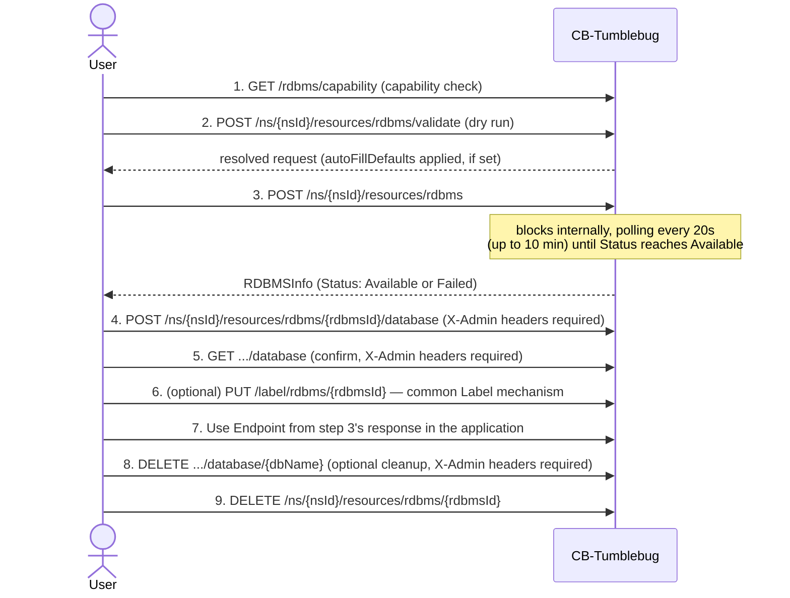
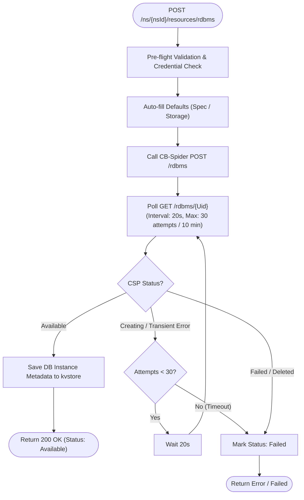
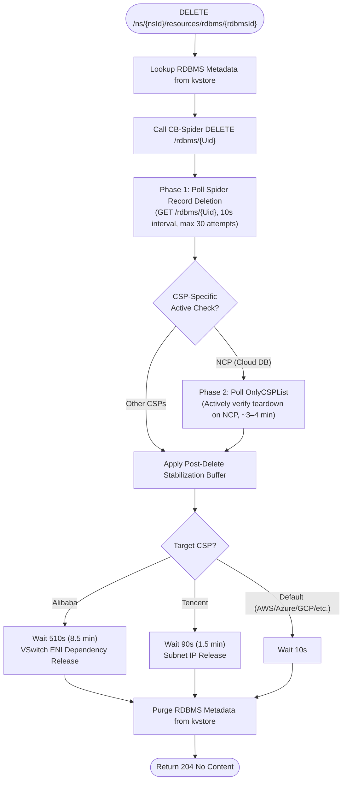

# RDBMS 관리 — 기능 및 API 레퍼런스

CB-Tumblebug의 RDBMS(관리형 관계형 데이터베이스) 기능인 지원 기능 탐색(Capability Discovery), 인스턴스 수명주기 관리, 논리적 데이터베이스 관리 및 CSP별 기본값 설정을 다룹니다. 내부적으로는 CB-Spider의 RDBMS API(v0.13.17+)를 기반으로 동작하며, 이는 구현 세부 사항이므로 본 문서의 초점은 아닙니다(참고 자료 참조).

## CSP별 엔진 지원 매트릭스

| CSP           | 프로바이더 이름 | MySQL | MariaDB | 테스트된 참조 버전 (MySQL / MariaDB) | 주요 플랫폼 / 서비스                     |
| :------------ | :-------------- | :---: | :-----: | :----------------------------------- | :--------------------------------------- |
| **AWS**       | `aws`           |  ✅   |   ✅    | `8.0` / `10.6`                       | Amazon RDS (Multi-AZ SubnetGroup)        |
| **Azure**     | `azure`         |  ✅   |   ❌    | `8.0.21` / —                         | Azure Database for MySQL Flexible Server |
| **GCP**       | `gcp`           |  ✅   |   ❌    | `8.0` / —                            | Google Cloud SQL for MySQL               |
| **Alibaba**   | `alibaba`       |  ✅   |   ✅    | `8.0` / `10.6`                       | Alibaba Cloud ApsaraDB RDS               |
| **Tencent**   | `tencent`       |  ✅   |   ❌    | `8.0` / —                            | TencentDB for MySQL                      |
| **IBM**       | `ibm`           |  ✅   |   ❌    | `8.4` / —                            | IBM Cloud Databases for MySQL            |
| **NCP**       | `ncp`           |  ✅   |   ❌    | `8.0.36` / —                         | NAVER Cloud Platform Cloud DB for MySQL  |
| **NHN**       | `nhn`           |  ✅   |   ✅    | `MYSQL_V8408` / `MARIADB_V101118`    | NHN Cloud RDS for MySQL / MariaDB        |
| **OpenStack** | `openstack`     |  ✅   |   ✅    | `5.7.29` / `10.4`                    | OpenStack Trove                          |
| **KT Cloud**  | `kt`            |  ❌   |   ❌    | —                                    | _미지원 (관리형 DB 서비스 없음)_         |

## 주요 기능

| 기능                                                                   | 상태        | 위치                                                                                                              |
| ---------------------------------------------------------------------- | ----------- | ----------------------------------------------------------------------------------------------------------------- |
| 정적 CSP 전체 지원 매트릭스 조회 (`GetRDBMSSupport`)                   | ✅          | [rdbms.go](../../../src/core/resource/rdbms.go), [rdbms.go](../../../src/interface/rest/server/resource/rdbms.go) |
| 실시간 Connection별 지원 기능 조회 (`GetRDBMSCapability`)              | ✅          | [rdbms.go](../../../src/core/resource/rdbms.go), [rdbms.go](../../../src/interface/rest/server/resource/rdbms.go) |
| DB 인스턴스 수명주기 관리 (Create/List/Get/Delete)                     | ✅          | [rdbms.go](../../../src/core/resource/rdbms.go), [rdbms.go](../../../src/interface/rest/server/resource/rdbms.go) |
| 생성 요청 사전 검증 (Dry run, 부작용 없음)                             | ✅          | [rdbms.go](../../../src/core/resource/rdbms.go)의 `ValidateRDBMSCreateRequest`                                    |
| CSP 관리자 사용자 이름/비밀번호 정책 검증                              | ✅          | [rdbms.go](../../../src/core/resource/rdbms.go)의 `validateAdminCredentials`                                      |
| Spec 기반 `autoFillDefaults` 자동 선택기 (vCPU/메모리 기준)            | ✅          | [rdbms.go](../../../src/core/resource/rdbms.go)의 `pickSmallestDBSpec`                                            |
| 내부 논리적 데이터베이스 CRUD (`charset` / `collation` 지원)           | ✅          | [rdbms.go](../../../src/core/resource/rdbms.go), [rdbms.go](../../../src/interface/rest/server/resource/rdbms.go) |
| 보안 전송(Secure Transport) 및 서버 CA 인증서 조회                     | ✅          | [rdbms.go](../../../src/core/resource/rdbms.go), [rdbms.go](../../../src/interface/rest/server/resource/rdbms.go) |
| 태그 관리                                                              | Label 활용  | [label.go](../../../src/core/common/label/label.go)                                                               |
| 기존 CSP RDBMS 등록/등록 해제 (Register/Unregister)                    | 계획 없음   | —                                                                                                                 |
| 상태 동기화 및 보정 (Reconciliation)                                   | ✅          | [rdbmsReconcile.go](../../../src/core/reconcile/rdbmsReconcile.go)                                                |

- **지원 기능 탐색 (Capability discovery)**: CSP가 어떤 엔진과 기능을 지원하는지 확인합니다.
  - 실시간 호출 없이 정적 CSP 전체 참조 정보를 조회합니다 (`GET /rdbms/support`).
  - 실시간 Connection별 조회: 버전, 스펙/스토리지 옵션, `storageSizeRangeGB`(10진수 GB), `Requires*`/`Supports*` 플래그를 조회합니다 (`GET /rdbms/capability`).
  - 일반적인 흐름: `/support`로 CSP/엔진을 선택한 후, 대상 Connection에 대해 `/capability`를 호출합니다.
- **무자격증명 저장 정책 (Zero-Credential Policy)**:
  - 생성 시 제공된 `adminUserName` 및 `adminUserPassword`는 인스턴스 마스터/관리자 자격 증명을 나타냅니다.
  - **CB-Spider와 CB-Tumblebug 모두 이러한 자격 증명을 영구 저장하거나 관리하지 않습니다.** 사용자가 직접 기록하고 관리해야 합니다.
  - 데이터베이스 접근이 필요한 작업(데이터베이스 CRUD, Secure Transport 조회)은 호출자가 HTTP 헤더(`X-Admin-User-Name` 및 `X-Admin-User-Password`)를 통해 자격 증명을 명시적으로 전달해야 합니다.
- **DB 인스턴스 수명주기**: 관리형 DB 인스턴스를 생성, 조회 및 삭제합니다.
  - 프로비저닝 없는 사전 검증(Dry run) (`POST .../rdbms/validate`).
  - 생성: 네트워크 이름을 확인하고, 실시간 지원 기능 데이터([CSP 지원 기능, 요구 사항 및 제약 사항](#csp-지원-기능-요구-사항-및-제약-사항) 참조) 및 CSP 관리자 자격 증명 정책([관리자 자격 증명 제약 사항](#관리자-자격-증명-제약-사항) 참조)에 대해 검증하며, 요청 시 사용 가능한 최소 `dbInstanceSpec`과 호환 스토리지 타입을 자동으로 채우고, DB 인스턴스가 `Available` 상태에 도달할 때까지 서버 측에서 대기합니다 (`POST .../rdbms`; 자세한 내용은 [RDBMS 관리 안정성 강화](#rdbms-관리-안정성-강화) 참조).
  - 삭제: kvstore 레코드를 지우기 전에 두 가지 독립적인 확인 절차를 거칩니다 (`DELETE .../rdbms/{rdbmsId}`; [RDBMS 관리 안정성 강화](#rdbms-관리-안정성-강화) 참조).
- **내부 논리적 데이터베이스**: `Available` 상태인 DB 인스턴스 내부의 논리적 데이터베이스를 생성, 목록 조회 및 삭제합니다.
  - Tumblebug이 추적하는 리소스가 아니므로 kvstore 항목이 없으며 실시간으로 조회됩니다 (`POST`/`GET`/`DELETE .../rdbms/{rdbmsId}/database[/{dbName}]`).
  - MySQL 및 MariaDB에서 선택적 `charset` 및 `collation` 사용자 지정을 지원합니다 (`POST .../rdbms/{rdbmsId}/database`; [논리적 데이터베이스 Charset 및 Collation 지원](#논리적-데이터베이스-charset-및-collation-지원) 참조).
  - 관리자 자격 증명은 해당 호출에만 그대로 전달되며 절대 저장되지 않습니다.
- **보안 전송(Secure Transport) 및 TLS**: 실시간 TLS 적용 상태, 활성 암호화 스위트(Cipher Suite)를 확인하고 서버 CA 인증서를 다운로드합니다 (`GET .../rdbms/{rdbmsId}/secure-transport`).
- **태그 관리**: 다른 모든 리소스 타입과 마찬가지로 전용 태그 API 대신 공통 [Label 메커니즘](../../../src/core/common/label/label.go)을 사용합니다.
- **기존 CSP DB 인스턴스 등록**(Registration)은 VNet/SecurityGroup의 register/deregister 패턴을 따르도록 계획되어 있으나 아직 구현되지 않았습니다.
- **상태 동기화 및 보정(Reconciliation)**: 공통 [resource-reconciliation.md](resource-reconciliation.md) 규약을 통해 상태 불일치(Drift)를 감지합니다. 현재 생성 중/삭제 중 복구 경로는 VNet/ObjectStorage와 동일하게 로깅만 수행하는 골격(Skeleton) 상태입니다. `DeletionFailed` 상태의 DB 인스턴스는 자동 관리형 리소스(`IsAutoManagedResource`)인 경우에만 `Available`로 자동 복구되며, 사용자 소유 DB 인스턴스의 삭제 실패 표시(Tombstone)는 유지(Sticky)됩니다. 이에 대한 복구 경로는 **추후 결정(TBD)** 예정입니다(`PUT .../restore`가 범용적으로 존재하지만 RDBMS에는 아직 연결되지 않았습니다. [resource-reconciliation.md](resource-reconciliation.md)의 미결 사항을 참조하세요).

## 사용 시퀀스 (Tumblebug 사용자 관점)

시나리오 A는 완전히 구현되어 있으며, 시나리오 B/C는 계획된 등록/감사 기능의 목표 흐름을 설명합니다([API 레퍼런스](#api-레퍼런스) 참조).



- **시나리오 B — 기존 CSP DB 인스턴스 등록 (계획됨)**: `POST /inspectResources`를 호출하여 CSP에만 존재하는 DB 인스턴스를 찾은 다음, `POST .../rdbms/register`(CSP 인스턴스 ID 지정; 생략 시 `vNetId` 자동 확인)를 호출합니다. `.../unregister`는 CSP DB 인스턴스를 건드리지 않고 Tumblebug의 소유권만 해제합니다.
- **시나리오 C — 고아(Orphan) 리소스 감사 및 정리 (계획됨)**: `POST /inspectResources`가 `onTumblebug`/`onCspOnly` 목록을 반환하며, `DELETE /rdbms/cspOnly/{cspId}`는 CSP에만 존재하는 고아 리소스를 직접 제거합니다(Tumblebug을 완전히 우회하므로 먼저 대상을 확인해야 합니다).

## API 레퍼런스

CSP/Tumblebug 매핑 목록 조회, 개수 집계 및 고아 리소스 감지 기능처럼 범용 메커니즘인 `inspectResources`([shared-resource-management.md](shared-resource-management.md) 참조)가 이미 요구 사항을 충족하는 경우, 계획된 기능들은 별도의 RDBMS 전용 API를 중복 추가하는 대신 기존 범용 API를 재사용합니다.

### 구현된 엔드포인트

| 메서드 | 경로                                                     | 핸들러                          |
| ------ | -------------------------------------------------------- | ------------------------------- |
| GET    | `/rdbms/support`                                         | `RestGetRDBMSSupport`           |
| GET    | `/rdbms/capability`                                      | `RestGetRDBMSCapability`        |
| POST   | `/ns/{nsId}/resources/rdbms/validate`                    | `RestValidateRDBMS`             |
| POST   | `/ns/{nsId}/resources/rdbms`                             | `RestPostRDBMS`                 |
| GET    | `/ns/{nsId}/resources/rdbms`                             | `RestGetAllResources` (범용)    |
| GET    | `/ns/{nsId}/resources/rdbms/{rdbmsId}`                   | `RestGetRDBMS`                  |
| DELETE | `/ns/{nsId}/resources/rdbms/{rdbmsId}`                   | `RestDeleteRDBMS`               |
| POST   | `/ns/{nsId}/resources/rdbms/{rdbmsId}/database`          | `RestPostRDBMSDatabase`         |
| GET    | `/ns/{nsId}/resources/rdbms/{rdbmsId}/database`          | `RestGetRDBMSDatabases`         |
| DELETE | `/ns/{nsId}/resources/rdbms/{rdbmsId}/database/{dbName}` | `RestDeleteRDBMSDatabase`       |
| GET    | `/ns/{nsId}/resources/rdbms/{rdbmsId}/secure-transport`  | `RestGetRDBMSSecureTransport`   |

### 계획된 엔드포인트

| 메서드 | 경로                                              | 핸들러                      |
| ------ | ------------------------------------------------- | --------------------------- |
| POST   | `/ns/{nsId}/resources/rdbms/register`             | `RestPostRegisterRDBMS`     |
| DELETE | `/ns/{nsId}/resources/rdbms/{rdbmsId}/unregister` | `RestDeleteUnregisterRDBMS` |
| DELETE | `/rdbms/cspOnly/{cspId}?connectionName=`          | `RestDeleteRDBMSCspOnly`    |

`RestDeleteRDBMSCspOnly`는 네임스페이스에 독립적이며 파괴적인 관리자 전용 API입니다(명시적 확인이 필요하며 호출자/Connection/CSP ID를 로깅함). 전용 태그 API는 구축되지 않았으며, RDBMS 인스턴스는 대신 공통 Label 메커니즘을 사용합니다.

## CSP 지원 기능, 요구 사항 및 제약 사항

참조 값 및 CSP별 규칙입니다. 오래된 참조 정보로 인해 잘못된 요청이 통과되어 수 분간의 CSP 프로비저닝 후에야 실패하는 것을 방지하기 위해, `CreateRDBMS`는 캐시된 사본을 신뢰하지 않고 요청 시점에 항상 실시간 지원 기능(Capability) 데이터를 다시 확인합니다.

### CSP 지원 기능 요약 (MySQL)

`DB 작업 방식 (DB Op. Method)` — `cspNativeApi`(CSP 네이티브 데이터베이스 API) 또는 `sqlFallback`(관리자 로그인을 통한 직접 SQL 연결; 네트워크 도달 가능성에 대한 자세한 내용은 [직접 SQL 연결 및 도달 가능성](#직접-sql-연결-및-도달-가능성-외부-vs-내부-vpc) 참조).

| CSP           | 엔진 버전     | DB Spec                                           | 스토리지           | 스토리지 타입 선택 |            서브넷 요구 사항             | 보안 그룹 요구 사항      | 태그 지원 | DB 작업 방식   |
| :------------ | :------------ | :------------------------------------------------ | :----------------- | :----------------: | :-------------------------------------: | :----------------------: | :-------: | :------------- |
| **AWS**       | `8.0`         | `db.t3.medium`                                    | 100GB / gp3        |     선택 가능      |            필수 (2개 AZ)                |           필수           |   지원    | `sqlFallback`  |
| **Azure**     | `8.0.21`      | `Standard_B1ms`                                   | 21GB / auto        |     자동 관리      | 필수 (Private) / 해당 없음 (Public)     |        해당 없음         |   지원    | `cspNativeApi` |
| **GCP**       | `8.0`         | `db-n1-standard-1`                                | 20GB / PD_SSD      |    시리즈 종속     |                해당 없음                |        해당 없음         |   지원    | `cspNativeApi` |
| **Alibaba**   | `8.0`         | `mysql.n4.large.1`                                | 20GB / cloud_essd  |     선택 가능      |                  필수                   |        해당 없음         |   지원    | `cspNativeApi` |
| **Tencent**   | `8.0`         | `8000` (MB)                                       | 50GB / local_ssd   |     선택 가능      |                  필수                   |           선택           |   지원    | `cspNativeApi` |
| **IBM**       | `8.4`         | `multitenant`                                     | 30GB / auto        |     자동 관리      |                해당 없음                |        해당 없음         |   지원    | `sqlFallback`  |
| **OpenStack** | `5.7.29`      | `m1.small`                                        | 20GB / auto        |     선택 가능      |                해당 없음                |        해당 없음         |  미지원   | `cspNativeApi` |
| **NCP**       | `8.0.36`      | `SVR.VDBAS.AMD.STAND.C002.M008.NET.SSD.B050.G003` | CSP 관리형         |     자동 관리      |                  필수                   |        해당 없음         |  미지원   | `cspNativeApi` |
| **NHN**       | `MYSQL_V8408` | `m2.c2m4`                                         | 20GB / General SSD |     선택 가능      |                  필수                   | 해당 없음 (전용 DB-SG)   |  미지원   | `cspNativeApi` |

전체 CSP별 참고 사항(비밀번호 특이 사항, 프리미엄 스토리지 최소 용량 등)은 CB-Spider 위키의 [RDBMS Management Guide](<https://github.com/cloud-barista/cb-spider/wiki/RDBMS%E2%80%90Management%E2%80%90Guide(KR)>) 섹션 9를 참조하세요.

### CSP 지원 기능 요약 (MariaDB)

9개 CSP 중 4개만 MariaDB를 지원합니다. Azure, GCP, Tencent, IBM, NCP는 `mariadb`를 지원 목록에 포함하지 않으므로 해당 프로바이더에서는 `mysql`을 사용하세요.

| CSP           | 엔진 버전          | DB Spec                | 스토리지           | 스토리지 타입 선택 | 서브넷 요구 사항 | 보안 그룹 요구 사항    | 태그 지원 | DB 작업 방식   |
| :------------ | :----------------- | :--------------------- | :----------------- | :----------------: | :--------------: | :--------------------: | :-------: | :------------- |
| **AWS**       | `10.6` (`10.6.27`) | `db.t3.medium`         | 100GB / gp2        |     선택 가능      |  필수 (2개 AZ)   |          필수          |   지원    | `sqlFallback`  |
| **Alibaba**   | `10.6`             | `mariadb.n2.medium.2c` | 20GB / cloud_essd  |     선택 가능      |       필수       |       해당 없음        |   지원    | `cspNativeApi` |
| **NHN**       | `MARIADB_V101118`  | `m2.c2m4`              | 20GB / General SSD |     선택 가능      |       필수       | 해당 없음 (전용 DB-SG) |  미지원   | `cspNativeApi` |
| **OpenStack** | `10.4`             | `m1.small`             | 20GB / auto        |     선택 가능      |    해당 없음     |       해당 없음        |  미지원   | `cspNativeApi` |

_(참고: OpenStack Trove 데이터스토어는 MariaDB 10.4를 등록하며, 핵심 수명주기 및 SQL 데이터 I/O가 검증되었습니다.)_

### CSP별 요구 사항 및 제약 사항

- **AWS**:
  - 서로 다른 가용 영역(AZ)에 있는 2개의 서브넷(SubnetGroup)과 사전 생성된 보안 그룹(Security Group)이 필요합니다.
  - `io1`/`io2` 스토리지 타입은 `Iops >= 1000` 및 `StorageSize >= 100GB`를 요구합니다.
  - 데이터베이스 CRUD는 `sqlFallback`(관리자 로그인을 통한 직접 SQL 연결)을 사용하므로 프라이빗 DB 인스턴스는 프라이빗 엔드포인트에 대한 네트워크 도달 가능성이 필요합니다.
- **Azure**:
  - `RequiresSubnet`: `PublicAccess: false`(VPC 프라이빗 모드)일 때 필수이며, `PublicAccess: true`(기본값)일 때는 사용되지 않습니다.
  - `SupportsStorageTypeSelection=false` — 스토리지 SKU는 컴퓨팅 티어에 따라 Azure에서 자동 관리됩니다.
  - TLS 암호화(`require_secure_transport=ON`)를 강제하므로 클라이언트는 TLS를 활성화하여 연결해야 합니다.
- **GCP**:
  - `StorageType`이 머신 시리즈에 종속됩니다(C4A/N4 시리즈는 `HYPERDISK_BALANCED`, 기타 시리즈는 `PD_SSD`/`PD_HDD`). 사전 검증(Pre-flight validation) 단계에서 프로비저닝 전에 불일치를 잡아냅니다.
- **Alibaba**:
  - 대상 스토리지 타입과 호환되는 DB 인스턴스 사양을 선택해야 합니다(예: `mysql.n4.*`는 `cloud_essd`를 지원하며, `local_ssd`는 `rds.mysql.*`가 필요함).
  - 네트워크 인터페이스 해제가 DB 인스턴스 삭제보다 지연되므로 삭제 과정에 안정화 재시도 버퍼(510초 / 8.5분)가 포함되어 있습니다.
- **Tencent**:
  - DBSpec 메모리 크기는 MB 단위로 지정합니다(예: 8GB의 경우 `8000`).
  - 보안 그룹은 선택 사항입니다(VM의 보안 그룹을 공유함).
  - 백그라운드 ENI 해제가 DB 인스턴스 삭제보다 지연되므로 삭제 과정에 안정화 재시도 버퍼(90초)가 포함되어 있습니다.
- **IBM**:
  - 자동 관리형 스토리지(`SupportsStorageTypeSelection=false`)를 사용하는 공유/멀티테넌트 플랫폼에 프로비저닝됩니다.
  - 데이터베이스 CRUD는 `sqlFallback`을 사용하며 TLS 연결이 필요합니다.
  - 현재 지원되는 활성 MySQL 버전은 `8.4`입니다. 지원 종료(EOL) 버전(`5.7`, `8.0`)은 신규 배포 시 IBM Cloud에서 거부되며 `assets/rdbmsinfo.yaml`의 `endOfLifeVersions`를 통해 필터링됩니다.
- **NCP**:
  - `StorageSize`는 자동 관리되며(10GB에서 시작하여 10GB 단위로 최대 6000GB까지 자동 확장됨), 사용자 지정 크기 입력은 무시됩니다. 스토리지 타입 기본값은 `SSD`입니다.
  - 자동화된 프로비저닝 시 공식적으로 VPC 프라이빗 모드(`PublicAccess: false`)만 지원합니다. 프라이빗 VPC 엔드포인트(`*.vpc-cdb.ntruss.com`)만 할당합니다. NCP는 공인 도메인 할당을 위한 Open API/SDK를 제공하지 않으므로 `PublicAccess: true` 설정은 Tumblebug 검증 단계에서 거부됩니다. (참고: 외부 접근이 필요한 경우 사용자가 NCP 콘솔(`Database > Cloud DB for MySQL > DB Server > DB 관리 > 공인 도메인 관리`)에서 수동으로 공인 도메인을 신청하고 인바운드 ACG 규칙을 구성할 수 있습니다.) 그렇지 않은 경우 직접 SQL 접근을 위해서는 내부 VPC VM이 필요합니다.
  - **인바운드 접근 제어 (ACG)**: NCP Cloud DB ACG는 엄격한 **기본 거부(Default Deny)** 규칙(기본 인바운드 규칙 0개)을 적용합니다. 동일한 VPC 및 서브넷 내부에서조차 인바운드 ACG 규칙이 구성되지 않으면 포트 3306 연결이 타임아웃됩니다. 개발/테스트 목적으로 `ncpDBACGToAllowAllInbound: true`(또는 Spider의 `NCPAutoOpenACG: true`)를 설정하면 CB-Spider가 Cloud DB ACG에 인바운드 규칙(`0.0.0.0/0 -> 3306`)을 추가하도록 요청합니다. 기본적으로 공인 도메인이 할당되지 않으므로 외부 공인 접근은 여전히 차단됩니다.
    > [!WARNING]
    > **테스트 전용**: `ncpDBACGToAllowAllInbound`는 ACG 수준에서 모든 IP 주소(`0.0.0.0/0`)에 대한 인바운드 접근을 개방합니다. 이는 오직 개발/테스트 편의를 위해서만 제공됩니다. **운영(Production) 환경에서는 절대 사용하지 마세요.** 운영 환경에서는 이 값을 `false`로 유지하고 NCP 콘솔(`Database > Cloud DB for MySQL > ACG`)에서 특정 클라이언트/서브넷 IP 주소로 제한하여 구성하세요.
  - 전체 DB 인스턴스 삭제는 동적 CSP 측 폴링을 통해 능동적으로 추적됩니다(약 3~4분 소요).
- **NHN**:
  - 전용 RDS 자격 증명(`User Access Key`, `Secret Access Key` 및 엔진 AppKey)이 필요합니다.
  - `PublicAccess: true`일 때 단일 공인 FQDN 엔드포인트를 반환합니다. 표준 VPC 보안 그룹(`securityGroupIds`)은 무시됩니다.
  - 접근 제어는 NHN Cloud의 전용 **DB 보안 그룹**(DB Security Group)에 의해 관리됩니다. `PublicAccess: true`와 함께 `nhnDBSGToAllowAllInbound: true`(또는 Spider의 `NHNAutoOpenDBSecurityGroup: true`)를 설정하면 테스트용으로 전체 개방(`0.0.0.0/0`)된 DB 보안 그룹을 자동 생성 및 연결하고 DB 삭제 시 자동으로 삭제합니다.
- **OpenStack**:
  - 생성 후 스토리지 타입이 보고되지 않으므로 `Available` 상태를 통해 프로비저닝 성공 여부를 확인하세요.
  - CB-Spider `v0.13.15`(`#1873`, `#1866` 수정)는 Trove가 `ACTIVE`를 보고한 후 초기 관리자 권한 `GRANT`를 지수 백오프(최대 5회 시도 / 2분)로 재시도하여 후속 SQL 작업에서 `Error 1044`가 발생하는 것을 방지합니다.
  - 참고: 현재 OpenStack Trove MariaDB 10.4 게스트 이미지는 유효하지 않은 게스트 TLS 인증서로 `require_secure_transport=ON`을 강제하므로(`#1869`), Trove API 컨트롤 플레인 작업은 성공하는 반면 직접 SQL 데이터 플레인 연결에는 영향을 미칩니다. 이는 향후 OpenStack MySQL/MariaDB 이미지 업그레이드를 통해 해결될 예정입니다.

### 관리자 자격 증명 제약 사항

생성 요청이 CB-Spider에 도달하기 전에 클라이언트 측에서 `validateAdminCredentials`에 의해 강제 적용됩니다. `—`는 기록된 제약 사항이 없음을 의미합니다.

| CSP       | 관리자 사용자 이름 제약 사항                                                                                                                                      | 관리자 비밀번호 제약 사항              |
| --------- | ----------------------------------------------------------------------------------------------------------------------------------------------------------------- | -------------------------------------- |
| AWS       | —                                                                                                                                                                 | —                                      |
| Azure     | 거부: `admin`                                                                                                                                                     | —                                      |
| GCP       | —                                                                                                                                                                 | —                                      |
| Alibaba   | 거부: `admin`                                                                                                                                                     | —                                      |
| Tencent   | 고정: `root`                                                                                                                                                      | —                                      |
| IBM       | 고정: `admin`                                                                                                                                                     | 15~72자, 특수문자 불가                 |
| OpenStack | —                                                                                                                                                                 | —                                      |
| NCP       | 거부: `admin`, `root` 등 (시스템 계정)                                                                                                                            | 최소 1개 이상의 특수문자 필수          |
| NHN       | 거부: `admin`, `root`, `rds_admin`, `rds_mha`, `rds_repl`, `sqlgw`, `etladm`, `alertman`, `prom`, `mysql.session`, `mysql.sys`, `mysql.infoschema` (1~32자) | —                                      |

### 논리적 데이터베이스 Charset 및 Collation 지원

`POST /ns/{nsId}/resources/rdbms/{rdbmsId}/database`는 **MySQL** 및 **MariaDB** 인스턴스에 대해 선택적 `charset` 및 `collation` 필드를 허용합니다(CB-Spider `v0.13.13+` `#1868` 기반):

```json
{
  "databaseName": "sampledb",
  "charset": "utf8mb4",
  "collation": "utf8mb4_unicode_ci"
}
```

- **사전 검증 (Pre-flight Validation)**:
  - `databaseName`은 `^[A-Za-z0-9_-]+$` 패턴과 일치해야 합니다.
  - `charset` 및 `collation`(비어 있지 않은 경우)은 `^[A-Za-z0-9_]+$` 패턴과 일치해야 하며, `dbEngine`이 `mysql` 또는 `mariadb`인 경우에만 지원됩니다.
  - **Alibaba MariaDB**에서는 비어 있지 않은 `collation`이 전달되면 `400 Bad Request`로 거부됩니다. Alibaba의 `CreateDatabase` API는 MariaDB에서 `CharacterSetName`(`charset`)만 지원하기 때문입니다.
- **CSP별 실행 메커니즘 및 전제 조건**:

| CSP           | 기본값 (`charset` 및 `collation` 생략)        | `charset`만 지정                                          | `charset` + `collation` (또는 `collation`만 지정)                 | 전제 조건 / 주의 사항                                                                                                                                                                        |
| :------------ | :-------------------------------------------- | :-------------------------------------------------------- | :---------------------------------------------------------------- | :------------------------------------------------------------------------------------------------------------------------------------------------------------------------------------------- |
| **GCP**       | 네이티브 Cloud SQL Admin API                  | 네이티브 Cloud SQL Admin API                              | 네이티브 Cloud SQL Admin API                                      | 직접 SQL 연결이 필요하지 않습니다.                                                                                                                                                           |
| **OpenStack** | 네이티브 Trove API                            | 네이티브 Trove API                                        | 네이티브 Trove API                                                | 직접 SQL 연결이 필요하지 않습니다.                                                                                                                                                           |
| **Alibaba**   | 네이티브 RDS OpenAPI                          | 네이티브 RDS OpenAPI                                      | MySQL: 네이티브 RDS OpenAPI<br/>MariaDB: **거부됨 (`400`)**       | Alibaba MariaDB는 `charset`만 지원합니다.                                                                                                                                                    |
| **Azure**     | 네이티브 ARM API                              | ARM API + SQL 쿼리 (`information_schema.CHARACTER_SETS`)  | 네이티브 ARM API                                                  | `charset`과 `collation`을 모두 제공하면 SQL 연결 없이 순수 ARM API를 사용하며, `charset`만 제공하면 SQL을 통해 인스턴스를 쿼리하여 기본 collation을 매칭합니다.                              |
| **Tencent**   | 네이티브 TencentDB API                        | 네이티브 TencentDB API                                    | 네이티브 API + 후속 SQL `ALTER DATABASE ... COLLATE`              | `collation` 지정 시 CB-Spider에서 DB 엔드포인트로의 네트워크 도달 가능성이 필요합니다(`ALTER` 실패 시 `DeleteDatabase`를 통해 자동 롤백됨).                                                  |
| **AWS**       | 직접 SQL (`CREATE DATABASE`)                  | 직접 SQL (`CREATE DATABASE ... CHARACTER SET`)            | 직접 SQL (`CREATE DATABASE ... CHARACTER SET ... COLLATE`)        | CB-Spider에서 RDS 엔드포인트로의 네트워크 도달 가능성이 필요합니다.                                                                                                                          |
| **IBM**       | 직접 SQL (`CREATE DATABASE`)                  | 직접 SQL (`CREATE DATABASE ... CHARACTER SET`)            | 직접 SQL (`CREATE DATABASE ... CHARACTER SET ... COLLATE`)        | CB-Spider에서 IBM Cloud Databases 엔드포인트로의 네트워크 도달 가능성이 필요합니다.                                                                                                          |
| **NCP**       | 네이티브 REST API (`AddCloudMysqlDatabaseList`) | 직접 SQL `CALL sys.ncp_create_db('db', 'charset', '')`    | 직접 SQL `CALL sys.ncp_create_db('db', 'charset', 'collation')`   | NCP는 프라이빗 VPC 엔드포인트(`*.vpc-cdb.ntruss.com:3306`)만 가집니다. `charset`/`collation` 설정은 CB-Spider가 NCP 프라이빗 VPC에 네트워크로 도달할 수 있을 때만 동작합니다.                |
| **NHN**       | 네이티브 REST API                             | 직접 SQL (`CREATE DATABASE ... CHARACTER SET`)            | 직접 SQL (`CREATE DATABASE ... CHARACTER SET ... COLLATE`)        | `charset`/`collation` 설정을 위해서는 사전에 NHN Cloud 콘솔에서 **"직접 제어(DB 스키마 & 사용자 직접 제어)"를** 활성화하고 DB 보안 그룹을 개방해야 합니다.                                  |

### 직접 SQL 연결 및 도달 가능성 (외부 vs 내부 VPC)

Tumblebug/Spider의 REST 기반 데이터베이스 관리(`DB Op. Method`)와는 별개로, 호출자의 자체 애플리케이션이나 테스트 클라이언트가 MySQL 와이어 프로토콜(포트 3306)을 통해 데이터베이스 엔드포인트에 직접 연결하는 경우에 대한 설명입니다.

| CSP       |          외부 공인 접근           |            내부 (VPC) 접근             | TLS 필수 여부 | 도달 가능성 제약 사항 및 근거                                                                                                                                                                                                                 |
| --------- | :-------------------------------: | :------------------------------------: | :-----------: | --------------------------------------------------------------------------------------------------------------------------------------------------------------------------------------------------------------------------------------------- |
| AWS       |                🟢                 |                   🟢                   |      No       | `publicAccess=true` 설정 시 외부에서 일반(Plain) 연결 성공.                                                                                                                                                                                   |
| Azure     |                🟢                 |                   🟢                   |      Yes      | 일반 연결 거부됨(`Error 3159 ... require_secure_transport=ON`). TLS 필수(`tls=preferred` 또는 `true`).                                                                                                                                        |
| GCP       |                🟢                 |                   🟢                   |      No       | `publicAccess=true` 설정 시 외부에서 일반(Plain) 연결 성공.                                                                                                                                                                                   |
| Alibaba   |                🟢                 |                   🟢                   |       —       | `publicAccess=true` 설정 시 CB-Spider가 자동으로 공인 연결(Public Connection)을 할당하고 IP 화이트리스트를 구성함.                                                                                                                            |
| Tencent   |                🟢                 |                   🟢                   |       —       | `publicAccess=true` 설정 시 CB-Spider가 자동으로 공인 WAN 접근을 개방함.                                                                                                                                                                      |
| IBM       |                🟢                 |                   🟢                   |      Yes      | 공인 엔드포인트 지원; TLS 필수(`*.databases.appdomain.cloud`).                                                                                                                                                                                |
| OpenStack |    🟢 (FIP/라우터 구성 시)        |                   🟢                   |       —       | 테넌트 네트워크의 외부 라우터 및 유동 IP(Floating IP) 할당 여부에 따라 달라짐.                                                                                                                                                                |
| NCP       |          🔴 (해당 없음)           | 🔴 (기본값) / 🟢 (ACG 규칙 추가 시)    |       —       | **VPC 프라이빗 모드 전용(`publicAccess: false`)**; 엔드포인트는 프라이빗 VPC 전용(`*.vpc-cdb.ntruss.com`)입니다. NCP 콘솔(`Database > Cloud DB for MySQL > ACG`)에서 ACG 인바운드 규칙을 추가하거나 `ncpDBACGToAllowAllInbound: true`(테스트 전용)를 설정하기 전까지는 VPC 내부에서도 포트 3306이 기본 차단됩니다. |
| NHN       | 🔴 (기본값) / 🟢 (DB SG 설정 시)  |         🟢 (DB SG 규칙 필요)           |       —       | **공인 FQDN/IP가 할당되지만, 기본적으로 포트 3306이 차단됨**(NHN Cloud 전용 DB 보안 그룹의 포지티브 보안 모델). 접근하려면 NHN 콘솔(`Database > RDS for MySQL > DB 보안 그룹`)에서 인바운드 허용 규칙을 구성하거나 `nhnDBSGToAllowAllInbound: true`(테스트용)를 설정해야 합니다. |

> [!NOTE]
> **이중 테스트 전략 (외부 vs 내부 VPC)**:
>
> - **외부 원격 테스트**: 공용 인터넷을 통한 클라이언트 측 연결성을 검증합니다(AWS, Azure, GCP, IBM에 적용 가능).
> - **내부 VPC VM 테스트 (원격 명령 API 활용)**: 동일한 VPC 네트워크 내부에서 SQL CRUD를 검증하여 CSP별 공인 IP/방화벽 제약을 극복합니다(NCP, NHN 및 프라이빗 운영 데이터베이스 배포 환경에 필수적).

양쪽 환경에 유연하게 적응하는 연결 모드(예: `go-sql-driver/mysql`의 `tls=preferred`)를 사용하면 TLS 협상 오류를 방지할 수 있습니다.

## RDBMS 관리 안정성 강화

관리형 관계형 데이터베이스는 비동기 프로비저닝 지연 시간, 일시적인 상태 전환, 백그라운드 리소스 해제 지연 측면에서 CSP마다 상당한 이질성을 보입니다. CB-Tumblebug은 DB 인스턴스 생성 및 삭제의 종단간(End-to-End) 신뢰성을 보장하기 위해 특화된 방어 메커니즘을 구현합니다.

### 생성 안정성 강화

DB 인스턴스 생성은 CSP에서 DB 인스턴스가 `Available` 상태에 도달할 때까지 서버 측에서 대기(Block)합니다.



- **생성 폴링 (`ConfirmRDBMSCreated`)**: `Available` 상태가 될 때까지 최대 10분(30회 시도) 동안 20초 간격으로 폴링합니다.
  - **AWS**: 즉시 `Creating`을 반환하며, RDS MySQL/MariaDB 생성에는 일반적으로 5~7분이 소요됩니다.
  - **IBM**: 즉시 `Creating`을 반환하며, 클라우드 데이터베이스 프로비저닝 시간이 가변적입니다.
  - **Alibaba**: 초기 클러스터 설정 중에 일시적으로 `Error`를 반환한 후 `Available` 상태로 안정화될 수 있습니다.

### 삭제 안정성 강화

DB 인스턴스 삭제 시 2단계 검증을 통해 삭제를 확인하고, 연쇄적인 네트워크 삭제 실패를 방지하기 위해 CSP별 삭제 후 안정화 버퍼를 적용합니다.



- **삭제 확인 (`PollResourceFullyDeleted`)**: 두 개의 독립적인 계층을 통해 삭제를 검증합니다:
  - **NCP**: Cloud DB 인스턴스 삭제에는 약 3~4분이 소요되며, 동적 CSP 측 폴링(`PollResourceDeletedOnCSP`, 최대 10분 동안 10초 간격으로 폴링)을 통해 능동적으로 추적됩니다.
  - **Alibaba**: VPC/vSwitch 연결이 비동기적으로 해제되므로, 인스턴스 삭제 직후 서브넷을 삭제하면 `DependencyViolation.Rds`가 발생합니다.
  - **Tencent**: VPC/서브넷 IP 해제가 인스턴스 삭제보다 지연됩니다(`ResourceInUse`).
- **삭제 후 안정화 버퍼 (Post-Delete Stabilization Buffers)**:
  - **Alibaba**: 후속 서브넷/VPC 삭제 전에 백그라운드 VSwitch ENI 분리가 완전히 이루어지도록 510초(8.5분) 대기.
  - **Tencent**: 네트워크 인터페이스 해제를 위해 90초(1.5분) 대기.
  - **NCP**: 기본 10초 버퍼(전체 삭제는 이미 동적 `OnlyCSPList` 폴링으로 확인됨).
  - **기본값 (AWS, Azure, GCP, IBM, OpenStack)**: 10초.

## 참고 자료

CB-Spider 측 통합에 관한 배경 문서입니다(구현 세부 사항이며 Tumblebug 자체 API 규약의 일부는 아님):

- [RDBMS‐Management‐Guide (KR)](<https://github.com/cloud-barista/cb-spider/wiki/RDBMS%E2%80%90Management%E2%80%90Guide(KR)>)
- [CB-Spider RDBMS API Test README](https://github.com/cloud-barista/cb-spider/blob/master/test/rdbms-mysql-test/README.md)
- [CB-Spider RDBMS StorageType Test README](https://github.com/cloud-barista/cb-spider/blob/master/test/rdbms-mysql-test/storage-type-test/README.md)
- [CB-Spider RDBMS Database Management Test README](https://github.com/cloud-barista/cb-spider/blob/master/test/rdbms-mysql-test/database-test/README.md)
- [CB-Spider RDBMS Charset Test README](https://github.com/cloud-barista/cb-spider/blob/master/test/rdbms-mysql-test/charset-test/README.md)
- [CB-Spider RDBMS Collation Test README](https://github.com/cloud-barista/cb-spider/blob/master/test/rdbms-mysql-test/collation-test/README.md)
- [CB-Spider RDBMS Tag Management Test README](https://github.com/cloud-barista/cb-spider/blob/master/test/rdbms-mysql-test/tag-test/README.md)

## 부록: Tumblebug API → CB-Spider API 매핑

구현된 엔드포인트의 10개 라우트를 다룹니다(계획된 엔드포인트는 Spider 호출 형태가 확정되지 않아 제외됨). `{Uid}`는 Tumblebug의 `rdbmsId`가 아니라 CB-Spider 자체의 DB 인스턴스 ID(`RDBMSInfo.Uid`)입니다. 🔁 표시는 CB-Spider가 네트워크 통신(Wire) 상에서 여전히 `MasterUserName`/`MasterUserPassword`로 부르는 필드를 나타내며, 호출 지점에서 Tumblebug의 `adminUserName`/`adminUserPassword`와 상호 변환되고 Tumblebug API 호출자에게는 절대 `Master*`로 노출되지 않습니다.

| Tumblebug API                                  | 호출되는 CB-Spider API                                                                                            | 비고                                                                                                            |
| ---------------------------------------------- | ----------------------------------------------------------------------------------------------------------------- | --------------------------------------------------------------------------------------------------------------- |
| `GET /rdbms/support`                           | — (없음)                                                                                                          | `assets/rdbmsinfo.yaml`에서 정적으로 제공.                                                                      |
| `GET /rdbms/capability`                        | `GET /rdbmsmetainfo` (필수); `GET /dbspec`, `GET /rdbmsengine` (최선형 호출)                                      | 최선형(Best-effort) 호출은 `dbInstanceSpecs`/`liveSupportedEngines`만 채움.                                     |
| `POST .../rdbms/validate`                      | `/capability`의 필수 호출과 동일하며, `dbInstanceSpec` 자동 채우기 시 `GET /dbspec` 추가 호출                     | 사전 검증(Dry run) — 실제 생성/삭제에 도달하지 않음.                                                            |
| `POST .../rdbms`                               | Validate와 동일하며, 추가로 `POST /rdbms`; `GET /rdbms/{Uid}` (Creating 또는 Error 상태 동안 최대 10분간 20초마다 폴링) | 생성 요청 본문에 🔁 포함.                                                                                       |
| `GET .../rdbms` (목록)                         | — (없음)                                                                                                          | kvstore에서 제공.                                                                                               |
| `GET .../rdbms/{rdbmsId}`                      | `GET /rdbms/{Uid}`                                                                                                | 응답에 🔁 포함 (비밀번호는 절대 반환되지 않음).                                                                 |
| `DELETE .../rdbms/{rdbmsId}`                   | `DELETE /rdbms/{Uid}`; `GET /rdbms/{Uid}` + `GET /allrdbms` (이중 검증)                                           | [RDBMS 관리 안정성 강화](#rdbms-관리-안정성-강화) 참조.                                                         |
| `POST .../rdbms/{rdbmsId}/database`            | `GET /rdbms/{Uid}` (상태 확인); `POST /rdbms/{Uid}/databases`                                                     | 선택적 `Charset`/`Collation` 전달; `X-Master-User-Name`/`X-Master-User-Password` 헤더 및 본문을 통해 🔁 전달.    |
| `GET .../rdbms/{rdbmsId}/database`             | `GET /rdbms/{Uid}/databases?ConnectionName=...`                                                                   | `X-Master-User-Name` 및 `X-Master-User-Password` 헤더를 통해 🔁 전달.                                           |
| `DELETE .../rdbms/{rdbmsId}/database/{dbName}` | `DELETE /rdbms/{Uid}/databases/{dbName}?ConnectionName=...`                                                       | 본문 및 `X-Master-User-Name`/`X-Master-User-Password` 헤더를 통해 🔁 전달.                                      |
| `GET .../rdbms/{rdbmsId}/secure-transport`     | `GET /rdbms/{Uid}/secure-transport?ConnectionName=...`                                                            | `X-Master-User-Name` 및 `X-Master-User-Password` 헤더를 통해 🔁 전달.                                           |
