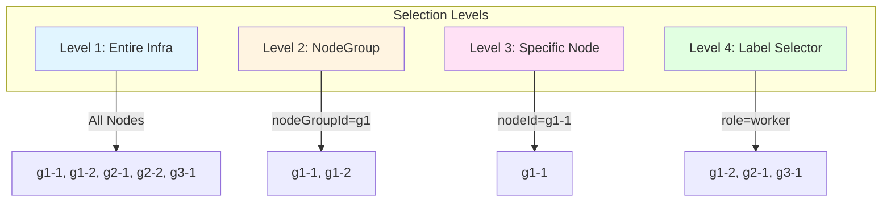
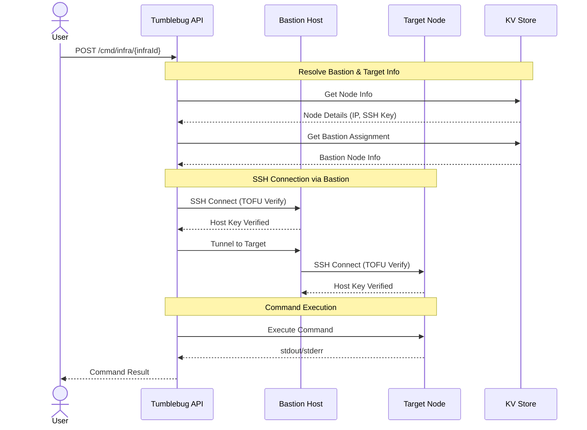
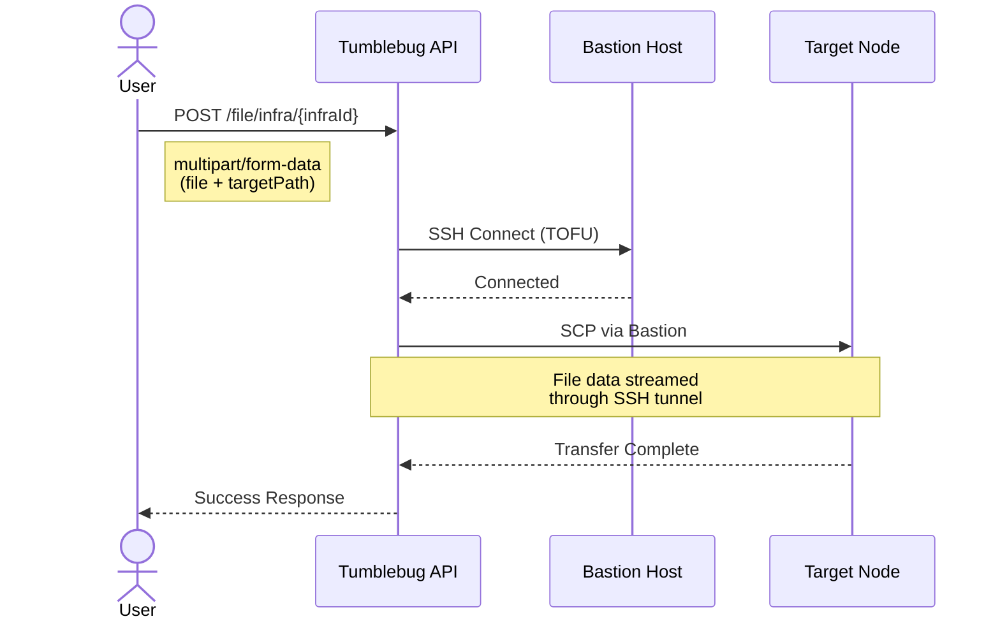
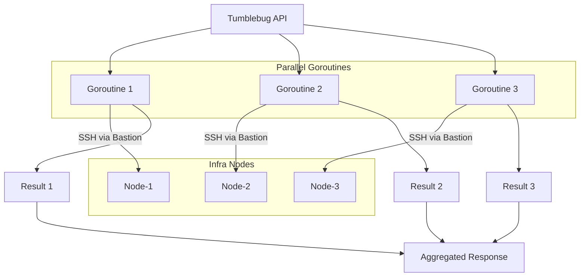
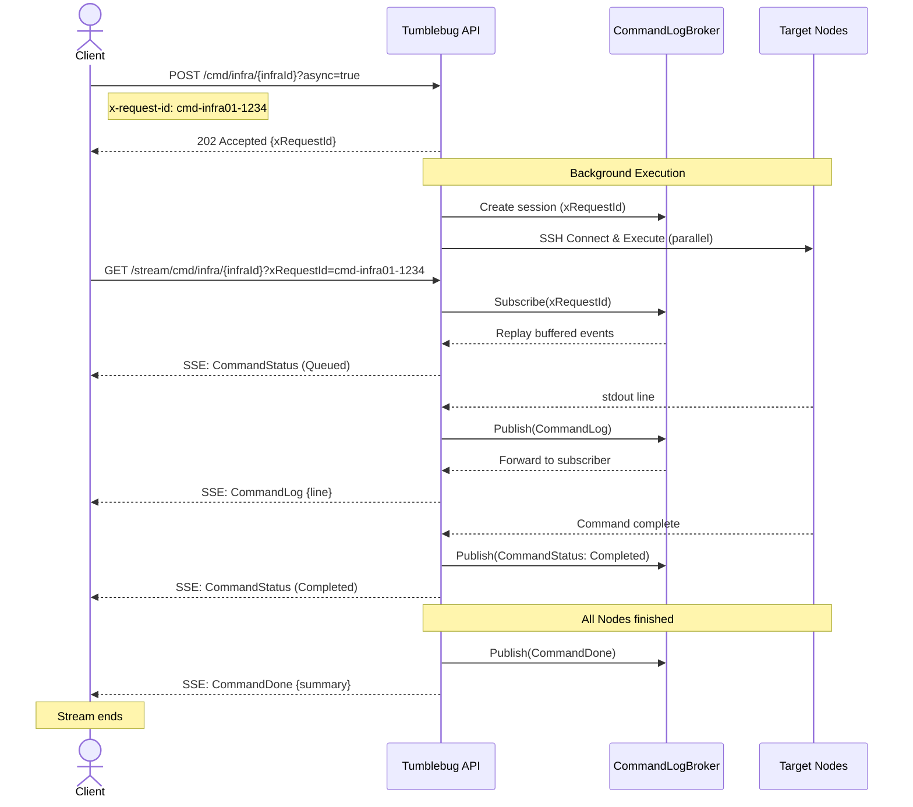
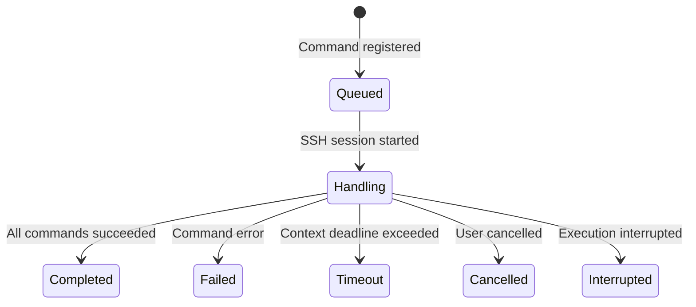
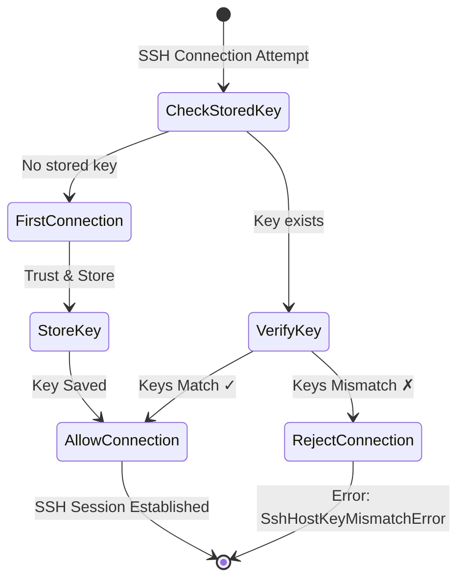
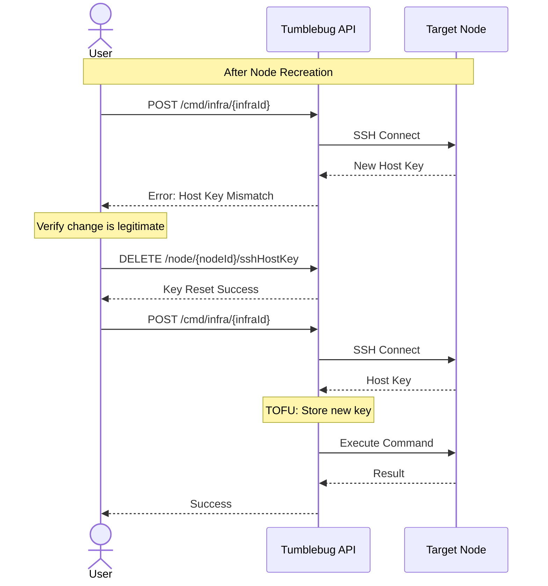

# 원격 명령 실행 및 파일 전송 (Remote Command Execution and File Transfer)

TOFU(Trust On First Use) 검증이 적용된 안전한 SSH를 통해 Infra 노드에 원격 명령을 실행하고 파일을 전송하는 방법에 대한 종합 가이드입니다.

> 💡 동일한 실행 엔진이 Infra 생성 시 노드를 부트스트랩하는 **배포 후 명령**(Post-deployment commands)에도 사용됩니다(대상 지정, 스트리밍, 명령 상태 이력 모두 동일하게 동작). 자세한 내용은 [인프라 프로비저닝 → 배포 후 명령](infra-provisioning.md)을 참조하세요.

## 📑 목차

1. [개요](#개요)
2. [핵심 개념](#핵심-개념)
3. [아키텍처](#아키텍처)
4. [실시간 스트리밍 (SSE)](#실시간-스트리밍-sse)
5. [SSH 호스트 키 검증 (TOFU)](#ssh-호스트-키-검증-tofu)
6. [API 레퍼런스](#api-레퍼런스)
7. [사용 예제](#사용-예제)

---

## 개요

### 원격 명령 실행이란?

**원격 명령 실행**(Remote Command Execution)은 사용자가 Infra(멀티 클라우드 인프라) 내의 노드(Node)에서 셸 명령을 실행할 수 있도록 지원하는 CB-Tumblebug의 핵심 기능입니다. 보안을 위해 명령은 **배스천 호스트**(Bastion Host)를 경유하는 SSH를 통해 전송되며, 여러 노드에 걸친 병렬 실행을 지원합니다.

### 파일 전송이란?

**파일 전송**(File Transfer)은 SCP(Secure Copy Protocol)를 통해 Tumblebug 서버에서 대상 노드로 파일을 업로드하는 기능입니다. 원격 명령과 마찬가지로 파일 전송 또한 배스천 호스트 아키텍처를 사용합니다.

### 왜 이 기능들을 사용해야 하는가?

**문제점:**
- 여러 클라우드에 분산된 각 노드에 수동으로 SSH 접속하는 작업은 번거롭고 오류가 발생하기 쉽습니다.
- 프라이빗 서브넷에 위치한 노드는 점프 호스트(Jump Host) 없이는 직접 SSH 접속이 불가능합니다.
- 수십 개의 노드에 대해 SSH 호스트 키를 수동으로 신뢰 처리하는 것은 비현실적입니다.

**해결책:**
- **통합 API**: 단일 API 호출로 여러 노드에서 명령을 실행합니다.
- **배스천 아키텍처**: 지정된 점프 호스트를 통해 프라이빗 노드에 안전하게 접근합니다.
- **TOFU 보안**: 중간자 공격(MITM)을 방지하기 위해 SSH 호스트 키를 자동으로 검증합니다.
- **병렬 실행**: 모든 대상 노드에서 명령이 동시에 실행됩니다.

---

## 핵심 개념

### 단계별 대상 선택 (Gradual Target Selection)

Tumblebug은 정밀한 명령 실행을 위해 **다단계 대상 선택**을 지원합니다:



| 수준(Level) | 파라미터 | 예시 | 대상 노드 |
|-------|-----------|---------|------------|
| **Infra** | (없음) | `/cmd/infra/infra01` | Infra 내의 모든 노드 |
| **NodeGroup** | `nodeGroupId` | `?nodeGroupId=g1` | NodeGroup g1 내의 모든 노드 |
| **Node** | `nodeId` | `?nodeId=g1-1` | 노드 g1-1만 해당 |
| **Label** | `labelSelector` | `?labelSelector=role=worker` | 일치하는 레이블을 가진 노드 |

**레이블 셀렉터(Label Selector) 예시:**
- `role=worker` - `role=worker` 레이블을 가진 노드
- `env=prod,tier=backend` - 두 레이블이 모두 일치하는 노드
- `sys.id=g1-1` - 시스템 레이블 일치 (노드 ID)

### 배스천 호스트 (점프 호스트)

**배스천 호스트**(Bastion Host)는 공인 IP(Public IP)를 보유하고 Infra 내 다른 노드들로의 SSH 연결을 위한 게이트웨이 역할을 수행하는 노드입니다. 모든 원격 명령과 파일 전송은 배스천을 통해 라우팅됩니다.

```
┌─────────────────────────────────────────────────────────────────┐
│                           Infra                                   │
│  ┌─────────────────┐                                            │
│  │  Bastion Host   │◄─────── Public IP (SSH Entry Point)        │
│  │  (Jump Host)    │                                            │
│  └────────┬────────┘                                            │
│           │ SSH Tunnel (via Private Network)                    │
│           ▼                                                     │
│  ┌─────────────────┐  ┌─────────────────┐  ┌─────────────────┐  │
│  │   Target Node 1   │  │   Target Node 2   │  │   Target Node 3   │  │
│  │  (Private IP)   │  │  (Private IP)   │  │  (Private IP)   │  │
│  └─────────────────┘  └─────────────────┘  └─────────────────┘  │
└─────────────────────────────────────────────────────────────────┘
```

**핵심 포인트:**
- Infra 내의 각 노드에는 배스천 호스트가 자동으로 할당됩니다.
- 배스천은 공인 IP를 가진 Infra 내의 어느 노드든 될 수 있습니다.
- SSH 연결 경로: `사용자 → 배스천 (공인 IP) → 대상 노드 (사설 IP)`
- 여러 Infra가 함께 쓰는 서브넷에서는 Infra마다 자기 배스천을 등록하고, 그 Infra의 노드는 자기 배스천을 먼저 씁니다.
- 자동 지정된 배스천에 연결할 수 없으면 5분간 제외하고 다른 배스천으로 요청을 보냅니다(남은 것이 없으면 같은 Infra의 공인 IP 노드를 새로 등록). 직접 지정한 배스천은 우회하지 않습니다.

### 명령 실행 흐름

1. 사용자가 Tumblebug API로 명령 요청을 전송합니다.
2. Tumblebug이 대상 노드의 배스천 호스트를 확인합니다.
3. SSH 연결이 수립됩니다: Tumblebug → 배스천 → 대상 노드
4. 대상 노드에서 명령이 실행됩니다.
5. 출력 결과(stdout/stderr)가 사용자에게 반환됩니다.

---

## 아키텍처

### 원격 명령 실행 흐름



### 파일 전송 흐름



### 병렬 실행 아키텍처

여러 노드를 대상으로 지정할 경우 명령은 병렬로 실행됩니다:



---

## 실시간 스트리밍 (SSE)

### 개요

기본적으로 원격 명령 API는 **동기(Synchronous) 모드**로 동작합니다. 즉, 모든 노드가 실행을 마친 후에야 HTTP 응답이 반환됩니다. 많은 노드에서 장시간 실행되는 명령의 경우, 클라이언트는 진행 상황을 확인할 수 없는 상태로 대기해야 합니다.

**SSE(Server-Sent Events)를 활용한 비동기(Async) 모드**는 다음과 같은 방식으로 이 문제를 해결합니다:
1. `xRequestId`와 함께 즉시 `HTTP 202 Accepted`를 반환합니다.
2. 백그라운드에서 명령을 실행합니다.
3. SSE 엔드포인트를 통해 실시간 이벤트(상태 변경, stdout/stderr 라인 출력, 완료 요약)를 스트리밍합니다.

### 동기 모드 vs 비동기 모드

| 기능 | 동기 모드 (기본값) | 비동기 모드 (`?async=true`) |
|---------|--------------------|--------------------------|
| 응답 | 모든 노드가 완료될 때까지 대기 | 즉시 `202 Accepted` 반환 |
| 출력 | 응답 본문에 전체 결과 포함 | SSE 스트림을 통한 실시간 이벤트 전달 |
| 진행 상태 가시성 | 완료 시점까지 확인 불가 | 노드별 실시간 상태 업데이트 제공 |
| 활용 사례 | 짧은 명령, 스크립트 기반 워크플로 | 장시간 실행 명령, 대화형 UI |

### 아키텍처



### SSE 이벤트 유형

SSE 스트림은 세 가지 유형의 이벤트를 각각 `data:` 프레임 내의 JSON 객체로 전달합니다:

#### 1. `CommandStatus`

노드의 명령 실행 상태가 변경될 때 전송됩니다(예: Queued → Handling → Completed).

```json
{
  "type": "CommandStatus",
  "nodeId": "g1-1",
  "commandIndex": 1,
  "timestamp": "2024-01-15T10:30:01Z",
  "status": {
    "infraId": "infra01",
    "nodeId": "g1-1",
    "status": "Handling",
    "command": "echo hello && hostname"
  }
}
```

**상태 전이(Status Transitions):**


#### 2. `CommandLog`

SSH 세션에서 발생하는 stdout/stderr 출력의 각 라인마다 실시간으로 전송됩니다.

```json
{
  "type": "CommandLog",
  "nodeId": "g1-1",
  "commandIndex": 1,
  "timestamp": "2024-01-15T10:30:02Z",
  "log": {
    "stream": "stdout",
    "line": "Hello World",
    "lineNumber": 1
  }
}
```

| 필드 | 설명 |
|-------|-------------|
| `log.stream` | `"stdout"` 또는 `"stderr"` |
| `log.line` | 출력 라인 내용 |
| `log.lineNumber` | 노드별, 스트림별 순차 라인 번호 |

#### 3. `CommandDone`

**종료 이벤트(Terminal Event)** — 모든 노드의 실행이 끝났을 때 한 번 전송됩니다. 이 이벤트 이후에 SSE 스트림이 닫힙니다.

```json
{
  "type": "CommandDone",
  "timestamp": "2024-01-15T10:30:45Z",
  "summary": {
    "totalNodes": 5,
    "completedNodes": 4,
    "failedNodes": 1,
    "elapsedSeconds": 44
  }
}
```

명령이 노드에 도달하기 전에 실패한 경우(예: 전처리 오류), `error` 필드가 포함됩니다:

```json
{
  "type": "CommandDone",
  "timestamp": "2024-01-15T10:30:01Z",
  "summary": {
    "totalNodes": 0,
    "completedNodes": 0,
    "failedNodes": 0,
    "elapsedSeconds": 0,
    "error": "built-in function GetPublicIP error: no Node found (ID: /ns/default/infra/infra01/node/g1-1)"
  }
}
```

### CommandLogBroker (내부 구조)

브로커는 인메모리 요청별 세션을 사용하여 SSE 이벤트 배포를 관리합니다:

- **링 버퍼(Ring Buffer)**: 요청당 최대 10,000개의 이벤트를 저장하여 늦게 접속한 클라이언트도 이전 이력을 재생(Replay)할 수 있도록 지원합니다.
- **논블로킹 발행(Non-blocking Publish)**: 느린 구독자가 있더라도 명령 실행 파이프라인이 블로킹되지 않습니다.
- **자동 정리(Auto-cleanup)**: 세션은 `CommandDone` 발생 30초 후에 제거됩니다.
- **지연 합류(Late Join)**: 실행이 시작된 후 연결하는 클라이언트는 버퍼링된 모든 이벤트를 먼저 수신한 뒤 실시간 업데이트를 받습니다.

---

## SSH 호스트 키 검증 (TOFU)

### TOFU란?

**TOFU**(Trust On First Use)는 다음과 같이 동작하는 보안 모델입니다:
1. **최초 연결**: SSH 호스트 키를 저장하고 신뢰합니다.
2. **이후 연결**: 저장된 키와 제시된 키를 비교합니다.
3. **불일치 감지**: 키가 일치하지 않으면 연결을 거부합니다(중간자 공격 가능성).

이는 `ssh` 명령줄 도구(`~/.ssh/known_hosts`)에서 사용하는 것과 동일한 모델입니다.

### Tumblebug에서의 TOFU 동작 방식



### 호스트 키 저장 구조

호스트 키는 `VmInfo` 구조체 내에 저장됩니다:

```go
type VmInfo struct {
    // ... other fields ...
    
    // SshHostKeyInfo contains SSH host key for TOFU verification
    SshHostKeyInfo *SshHostKeyInfo `json:"sshHostKeyInfo,omitempty"`
}

type SshHostKeyInfo struct {
    HostKey     string  // Base64-encoded public key
    KeyType     string  // ssh-rsa, ssh-ed25519, ecdsa-sha2-nistp256
    Fingerprint string  // SHA256 fingerprint
    FirstUsedAt string  // Timestamp of first trust (RFC3339)
}
```

### 호스트 키 변경 처리

노드가 재생성(종료 후 다시 생성)되면 SSH 호스트 키가 변경됩니다. 이는 정상적인 상황이지만 TOFU 검증 실패를 유발합니다.

**해결 단계:**
1. 키 변경이 예상된 것인지 확인합니다(침해된 것이 아니라 노드가 재생성되었는지 확인).
2. API를 통해 저장된 호스트 키를 초기화(Reset)합니다.
3. 다음 연결 시 새로운 키가 저장됩니다(TOFU).



### 독립적인 키 관리: 배스천 vs 대상 노드

배스천과 대상 노드 모두 고유한 SSH 호스트 키를 가지며 독립적으로 관리됩니다:

| 노드 역할 | 키 저장 위치 | 검증 시점 |
|---------|---------------------|--------------|
| 배스천(Bastion) | `bastion.SshHostKeyInfo` | 첫 점프 연결 시 TOFU 수행 |
| 대상(Target) | `target.SshHostKeyInfo` | 최종 연결 시 TOFU 수행 |

이를 통해 다음이 보장됩니다:
- 배스천의 키가 변경되면 배스천 침해 여부를 감지할 수 있습니다.
- 대상 노드의 키가 변경되면 대상 노드 침해 여부를 감지할 수 있습니다.
- 각 노드의 보안이 독립적으로 검증됩니다.

---

## API 레퍼런스

### Infra에서 명령 실행

Infra 내의 노드들에서 명령을 실행합니다.

```
POST /tumblebug/ns/{nsId}/cmd/infra/{infraId}
```

**쿼리 파라미터:**
| 파라미터 | 타입 | 설명 |
|-----------|------|-------------|
| `nodeGroupId` | string | 특정 노드그룹만 대상으로 지정 |
| `nodeId` | string | 특정 노드만 대상으로 지정 |
| `labelSelector` | string | 레이블로 노드 필터링 (예: `role=worker`) |
| `async` | bool | SSE 스트리밍을 사용하는 비동기 모드의 경우 `true`로 설정 |

**요청 본문(Request Body):**
```json
{
  "userName": "cb-user",
  "command": ["echo 'Hello World'", "hostname", "uname -a"]
}
```

**응답(Response):**
```json
{
  "results": [
    {
      "infraId": "infra01",
      "nodeId": "g1-1",
      "nodeIp": "10.0.1.5",
      "command": {
        "0": "echo 'Hello World'",
        "1": "hostname",
        "2": "uname -a"
      },
      "stdout": {
        "0": "Hello World",
        "1": "g1-1",
        "2": "Linux g1-1 5.15.0-generic x86_64 GNU/Linux"
      },
      "stderr": {},
      "error": ""
    }
  ]
}
```

**비동기 응답 (`?async=true` 설정 시):**

즉시 `HTTP 202 Accepted`를 반환합니다:
```json
{
  "xRequestId": "cmd-infra01-1234567890",
  "message": "Command execution started. Use GET /tumblebug/ns/{nsId}/stream/cmd/infra/{infraId}?xRequestId={xRequestId} for real-time streaming."
}
```

### 명령 실행 로그 스트리밍 (SSE)

Server-Sent Events를 통해 실시간 명령 실행 이벤트를 구독합니다.

```
GET /tumblebug/ns/{nsId}/stream/cmd/infra/{infraId}?xRequestId={xRequestId}
```

**쿼리 파라미터:**
| 파라미터 | 타입 | 설명 |
|-----------|------|-------------|
| `xRequestId` | string | **필수.** `POST /cmd/infra/{infraId}?async=true`에서 반환된 요청 ID |

**응답:** `Content-Type: text/event-stream`

응답은 SSE 스트림입니다. 각 이벤트는 다음과 같은 형식으로 전달됩니다:
```
data: {"type":"CommandStatus","nodeId":"g1-1", ...}

data: {"type":"CommandLog","nodeId":"g1-1","log":{"stream":"stdout","line":"Hello","lineNumber":1}, ...}

data: {"type":"CommandDone","summary":{"totalNodes":3,"completedNodes":3,"failedNodes":0,"elapsedSeconds":12}}
```

스트림은 `CommandDone` 이벤트가 전송된 후 종료됩니다. 프록시/로드밸런서 타임아웃을 방지하기 위해 15초마다 keepalive 주석(`: keepalive`)이 전송됩니다.

**참고 사항:**
- SSE 엔드포인트는 **BasicAuth**가 필요합니다(다른 Tumblebug API와 동일한 자격 증명).
- 표준 `EventSource` API는 커스텀 헤더를 지원하지 않으므로, 브라우저 클라이언트에서는 `fetch()`와 `ReadableStream`을 함께 사용하세요.
- 실행이 시작된 후에 클라이언트가 연결하면 버퍼링된 이벤트가 먼저 재생됩니다.

### Infra로 파일 전송

Infra 내의 노드들로 파일을 업로드합니다.

```
POST /tumblebug/ns/{nsId}/file/infra/{infraId}
Content-Type: multipart/form-data
```

**폼 필드(Form Fields):**
| 필드 | 타입 | 설명 |
|-------|------|-------------|
| `file` | file | 업로드할 파일 |
| `targetPath` | string | 노드의 대상 디렉터리 경로 |
| `nodeGroupId` | string | 특정 노드그룹을 대상으로 지정 (선택 사항) |
| `nodeId` | string | 특정 노드를 대상으로 지정 (선택 사항) |

**응답:**
```json
{
  "results": [
    {
      "infraId": "infra01",
      "nodeId": "g1-1",
      "nodeIp": "10.0.1.5",
      "stdout": {
        "0": "File transfer successful: /home/cb-user/config.yaml"
      },
      "stderr": {},
      "error": ""
    }
  ]
}
```

### SSH 호스트 키 정보 조회

노드에 대해 저장된 SSH 호스트 키 정보를 조회합니다.

```
GET /tumblebug/ns/{nsId}/infra/{infraId}/node/{nodeId}/sshHostKey
```

**응답 (키가 존재하는 경우):**
```json
{
  "hostKey": "AAAAC3NzaC1lZDI1NTE5AAAAI...",
  "keyType": "ssh-ed25519",
  "fingerprint": "SHA256:abcdef123456...",
  "firstUsedAt": "2024-01-15T10:30:00Z"
}
```

**응답 (아직 저장된 키가 없는 경우):**
```json
{}
```

### SSH 호스트 키 초기화

노드에 대해 저장된 SSH 호스트 키를 초기화합니다. 노드가 정상적으로 재생성된 경우에 사용합니다.

```
DELETE /tumblebug/ns/{nsId}/infra/{infraId}/node/{nodeId}/sshHostKey
```

**응답:**
```json
{
  "message": "SSH host key for Node 'g1-1' has been reset. The next SSH connection will store the new host key (TOFU)."
}
```

---

## 사용 예제

### 예제 1: 모든 노드에서 명령 실행

```bash
curl -X POST "http://localhost:1323/tumblebug/ns/default/cmd/infra/infra01" \
  -H "Content-Type: application/json" \
  -d '{
    "userName": "cb-user",
    "command": ["df -h", "free -m"]
  }'
```

### 예제 2: 특정 노드에서 명령 실행

```bash
curl -X POST "http://localhost:1323/tumblebug/ns/default/cmd/infra/infra01?nodeId=g1-1" \
  -H "Content-Type: application/json" \
  -d '{
    "userName": "cb-user",
    "command": ["systemctl status nginx"]
  }'
```

### 예제 3: 특정 레이블을 가진 노드에서 명령 실행

```bash
curl -X POST "http://localhost:1323/tumblebug/ns/default/cmd/infra/infra01?labelSelector=role=worker" \
  -H "Content-Type: application/json" \
  -d '{
    "userName": "cb-user",
    "command": ["docker ps"]
  }'
```

### 예제 4: 모든 노드로 파일 전송

```bash
curl -X POST "http://localhost:1323/tumblebug/ns/default/file/infra/infra01" \
  -F "file=@./config.yaml" \
  -F "targetPath=/home/cb-user/"
```

### 예제 5: 호스트 키 불일치 처리

다음과 같은 오류가 발생한 경우:
```
SSH host key mismatch for Node 'g1-1'. Stored key (ssh-ed25519, SHA256:abc...) 
does not match received key (ssh-ed25519, SHA256:xyz...). 
This could indicate a MITM attack or the Node was recreated.
```

**1단계:** 변경 사항이 정상적인지 확인합니다(노드가 최근에 재생성되었는지 확인).

**2단계:** 호스트 키를 초기화합니다.
```bash
curl -X DELETE "http://localhost:1323/tumblebug/ns/default/infra/infra01/node/g1-1/sshHostKey"
```

**3단계:** 명령을 다시 시도합니다(TOFU를 통해 새 키가 저장됨).
```bash
curl -X POST "http://localhost:1323/tumblebug/ns/default/cmd/infra/infra01?nodeId=g1-1" \
  -H "Content-Type: application/json" \
  -d '{
    "userName": "cb-user",
    "command": ["hostname"]
  }'
```

### 예제 6: 저장된 호스트 키 확인

```bash
curl -X GET "http://localhost:1323/tumblebug/ns/default/infra/infra01/node/g1-1/sshHostKey"
```

### 예제 7: SSE 스트리밍을 활용한 비동기 명령 실행

**1단계:** 비동기 모드로 명령 실행 시작

```bash
curl -X POST "http://localhost:1323/tumblebug/ns/default/cmd/infra/infra01?async=true" \
  -H "Content-Type: application/json" \
  -H "x-request-id: my-cmd-001" \
  -u default:default \
  -d '{
    "command": ["apt update", "apt install -y nginx"],
    "timeoutMinutes": 10
  }'
```

응답:
```json
{
  "xRequestId": "my-cmd-001",
  "message": "Command execution started. Use GET /tumblebug/ns/{nsId}/stream/cmd/infra/{infraId}?xRequestId={xRequestId} for real-time streaming."
}
```

**2단계:** 실시간 로그 수신을 위해 SSE 스트림에 연결

```bash
curl -N "http://localhost:1323/tumblebug/ns/default/stream/cmd/infra/infra01?xRequestId=my-cmd-001" \
  -H "Accept: text/event-stream" \
  -u default:default
```

출력 (SSE 스트림):
```
: connected to stream for xRequestId=my-cmd-001

data: {"type":"CommandStatus","nodeId":"g1-1","commandIndex":1,"timestamp":"...","status":{"status":"Queued"}}

data: {"type":"CommandStatus","nodeId":"g1-1","commandIndex":1,"timestamp":"...","status":{"status":"Handling"}}

data: {"type":"CommandLog","nodeId":"g1-1","commandIndex":1,"timestamp":"...","log":{"stream":"stdout","line":"Hit:1 http://archive.ubuntu.com/ubuntu jammy InRelease","lineNumber":1}}

data: {"type":"CommandLog","nodeId":"g1-1","commandIndex":1,"timestamp":"...","log":{"stream":"stdout","line":"Reading package lists...","lineNumber":2}}

data: {"type":"CommandStatus","nodeId":"g1-1","commandIndex":1,"timestamp":"...","status":{"status":"Completed"}}

data: {"type":"CommandDone","timestamp":"...","summary":{"totalNodes":3,"completedNodes":3,"failedNodes":0,"elapsedSeconds":45}}
```

### 예제 8: SSE를 활용한 비동기 명령 실행 (JavaScript/브라우저)

```javascript
// Step 1: Start async command
const response = await fetch('http://localhost:1323/tumblebug/ns/default/cmd/infra/infra01?async=true', {
  method: 'POST',
  headers: {
    'Content-Type': 'application/json',
    'Authorization': 'Basic ' + btoa('default:default'),
    'x-request-id': 'my-cmd-001'
  },
  body: JSON.stringify({
    command: ['echo hello', 'hostname'],
    timeoutMinutes: 5
  })
});

const { xRequestId } = await response.json();

// Step 2: Connect to SSE stream (using fetch + ReadableStream for BasicAuth support)
const sseResponse = await fetch(
  `http://localhost:1323/tumblebug/ns/default/stream/cmd/infra/infra01?xRequestId=${xRequestId}`,
  {
    headers: {
      'Accept': 'text/event-stream',
      'Authorization': 'Basic ' + btoa('default:default')
    }
  }
);

const reader = sseResponse.body.getReader();
const decoder = new TextDecoder();
let buffer = '';

while (true) {
  const { done, value } = await reader.read();
  if (done) break;

  buffer += decoder.decode(value, { stream: true });

  let boundary;
  while ((boundary = buffer.indexOf('\n\n')) !== -1) {
    const message = buffer.substring(0, boundary);
    buffer = buffer.substring(boundary + 2);

    for (const line of message.split('\n')) {
      if (line.startsWith('data: ')) {
        const event = JSON.parse(line.substring(6));
        console.log(`[${event.type}]`, event.nodeId || '', event);

        if (event.type === 'CommandDone') {
          console.log('All Nodes finished:', event.summary);
        }
      }
    }
  }
}
```

---

## 보안 고려사항 (Security Considerations)

### 왜 InsecureIgnoreHostKey를 사용하지 않는가?

`InsecureIgnoreHostKey`(모든 호스트 키를 무조건 수락)를 사용하면 SSH가 **중간자 공격**(Man-in-the-Middle, MITM)에 취약해집니다:

```
[Attacker Scenario without TOFU]
User → Attacker's Fake Node → Real Node
      ↑                    
      Attacker intercepts all traffic
      and can modify commands/data
```

TOFU를 적용하면:
- 최초 연결 시 신뢰 관계를 수립합니다.
- 이후 연결 시 신뢰된 키를 검증합니다.
- 키가 변경되면 즉시 경고를 발생시킵니다.

### 모범 사례 (Best Practices)

1. **키 변경 확인**: 호스트 키를 초기화하기 전에 노드가 정상적으로 재생성되었는지 반드시 확인하세요.
2. **경고 모니터링**: 예상치 못한 호스트 키 불일치는 보안 문제를 의미할 수 있습니다.
3. **레이블 셀렉터 활용**: 노출 범위를 최소화하기 위해 명령 대상을 정밀하게 지정하세요.
4. **명령 출력 검토**: 보안 관련 경고가 있는지 stderr를 확인하세요.
