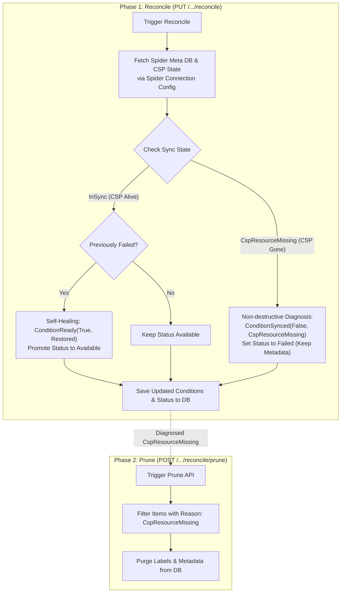

# 리소스 상태 동기화 및 보정 (Resource Reconciliation)

## 🧭 Reconcile이 수행하는 작업

**Reconcile은 리소스의 Tumblebug 메타데이터가 CB-Spider 및 CSP의 실제 상태와 여전히 일치하는지 진단하고, 가능한 경우 Condition/Status를 복구합니다. 이때 메타데이터나 CSP 리소스를 절대 삭제하지 않습니다.**

## 🔍 필요한 시점과 기대 효과

**Tumblebug 메타데이터, Spider 메타데이터, 실제 CSP 리소스가 서로 일치하지 않게 될 수 있는 모든 상황에서 Reconcile이 필요하며, 이를 실행하면 실제 관찰된 상태를 정확히 반영하도록 각 리소스의 Condition/Status가 업데이트됩니다.**

Tumblebug 메타데이터, Spider 메타데이터, CSP 리소스는 세 개의 독립적인 시스템이므로 서로 일치하지 않는 상태가 발생할 수 있습니다:

- 누군가 CSP 콘솔에서 직접 리소스를 삭제한 경우 — Tumblebug과 Spider는 여전히 리소스가 존재한다고 판단합니다.
- 삭제 시 Spider가 CSP에서 not-found를 만나고 현재 동작 방식에 따라 자체 메타데이터까지 지우는 경우(아래 "Spider 삭제 동작" 참조) — Spider의 레코드만 사라집니다.
- 다른 리소스가 의존하고 있어 Tumblebug에서의 삭제가 실패한 경우 — CSP 리소스 자체는 정상이지만 리소스가 `Failed` 상태에 머물게 됩니다.

Reconcile 실행 시 동작:

- CSP 리소스가 살아 있는 것으로 확인되면 `Failed` 상태에 빠진 리소스를 다시 `Available`로 복구하고, 원래의 실패 원인은 Condition 메시지에 유지합니다. (단, 자동 관리형 리소스가 아닌 `DeletionFailed` 리소스는 예외로, 상태가 그대로 유지(Sticky)됩니다. 아래 공통 규약을 참조하세요.)
- 대응하는 CSP 리소스가 사라진 리소스는 삭제하지 않고 표시만 합니다: `Failed` 상태 + 진단 사유가 기록되며 메타데이터는 보존됩니다.
- 그 외의 불일치(예: CSP 리소스는 살아 있는데 Spider만 자체 IID를 잃어버린 경우)도 다른 상태로 억지로 끼워 맞추지 않고 있는 그대로 정직하게 기록합니다.

### 진단 상태 매트릭스

Tumblebug은 Kubernetes API 관례를 따르는 표준화된 `Condition` 객체를 사용합니다:

- **`ConditionReady`**: 전반적인 운영 준비 상태 (`True`/`False`).
- **`ConditionSynced`**: TB 메타데이터가 CSP와 일치하는지 여부 (`True`/`False`).
- **`ConditionChildrenReady`**: 하위 서브 리소스(예: VNet 하위의 Subnet)의 준비 상태.

| 상태                     | TB 메타 | Spider 메타 | CSP 리소스 | 동기화 Condition 사유        | Reconcile 수행 동작                                                                                                             |
| :----------------------- | :-----: | :---------: | :--------: | :--------------------------- | :------------------------------------------------------------------------------------------------------------------------------ |
| **`InSync`**             |    O    |      O      |     O      | `ReasonAvailable` / `InSync` | **권한이 있는 경우**(아래 공통 규약의 소유권 게이트 참조) Status를 `Available`로 유지/복구하고, 그렇지 않으면 변경하지 않음. |
| **`CspResourceMissing`** |    O    |      O      |     X      | `ReasonCspResourceMissing`   | **비파괴적 진단**: Status를 `Failed`로 설정하고 메타데이터는 보존함.                                                            |
| **`SpMetaMissing`**      |    O    |      X      |     O      | `ReasonSpMetaMissing`        | Spider IID 재등록 대상 후보.                                                                                                    |
| **`TbMetaOnly`**         |    O    |      X      |     X      | `ReasonTbMetaOnly`           | 메타데이터만 남은 고아(Orphan) 항목.                                                                                            |

CSP 존재 여부는 항상 Spider 메타 존재 여부와 독립적으로 확인되므로(`GetResourceSyncState`가 CSP 측 목록과 직접 비교함), `SpMetaMissing`(CSP 살아 있음)이 `TbMetaOnly`/`CspResourceMissing`(CSP 사라짐)과 혼동되는 일은 절대 없습니다. 또한 이 Reason은 모든 곳에 있는 그대로 기록되며, 단지 리소스가 `Available` 상태이거나 복구 중이라는 이유로 `InSync`로 뭉뚱그려지지 않습니다.

## ✅ 진단 결과에 따른 후속 조치

**`CspResourceMissing`으로 진단된 항목만 `Prune`의 처리 대상입니다. Reconcile이 보고하는 그 외의 모든 상태(예: `SpMetaMissing`)는 Prune이 건드리지 않으므로 직접 판단하여 조치해야 합니다.**

| 리소스 타입                | 엔드포인트                                            | HTTP 메서드 | 목적                                              |
| :------------------------- | :---------------------------------------------------- | :---------: | :------------------------------------------------ |
| **VNet (단일)**            | `/ns/{nsId}/resources/vNet/{vNetId}/reconcile`        |    `PUT`    | 단일 VNet 및 하위 Subnet 상태 동기화(Reconcile)   |
| **VNet (일괄)**            | `/ns/{nsId}/resources/vNet/reconcile`                 |    `PUT`    | 네임스페이스 내 모든 VNet 상태 동기화(Reconcile)  |
| **VNet (Prune)**           | `/ns/{nsId}/resources/vNet/reconcile/prune`           |   `POST`    | 고아 상태인 VNet 및 Subnet 메타데이터 정리(Purge) |
| **ObjectStorage (단일)**   | `/ns/{nsId}/resources/objectStorage/{osId}/reconcile` |    `PUT`    | 단일 Object Storage 상태 동기화(Reconcile)        |
| **ObjectStorage (일괄)**   | `/ns/{nsId}/resources/objectStorage/reconcile`        |    `PUT`    | 네임스페이스 내 모든 Object Storage 상태 동기화   |
| **ObjectStorage (Prune)**  | `/ns/{nsId}/resources/objectStorage/reconcile/prune`  |   `POST`    | 고아 상태인 Object Storage 메타데이터 정리(Purge) |
| **RDBMS (단일)**           | `/ns/{nsId}/resources/rdbms/{rdbmsId}/reconcile`      |    `PUT`    | 단일 RDBMS 인스턴스 상태 동기화(Reconcile)        |
| **RDBMS (일괄)**           | `/ns/{nsId}/resources/rdbms/reconcile`                |    `PUT`    | 네임스페이스 내 모든 RDBMS 인스턴스 상태 동기화   |
| **RDBMS (Prune)**          | `/ns/{nsId}/resources/rdbms/reconcile/prune`          |   `POST`    | 고아 상태인 RDBMS 메타데이터 정리(Purge)          |

Prune은 항상 `.../reconcile/prune` 경로 아래에 위치합니다. 이 경로 구조 자체가 Prune은 Reconcile이 이미 진단한 결과에 대해서만 동작한다는 것을 보여줍니다(초기의 평면적인 `.../prune` 경로를 대체한 이유는 미결 사항을 참조하세요). 아직 이 프레임워크로 마이그레이션되지 않은 리소스 타입은 SecurityGroup, SSHKey, DataDisk, K8sCluster, GlobalDNS, VPN이며, 이들은 새로운 설계 작업 없이 아래의 동일한 공통 규약을 채택할 수 있습니다.

### ⚠️ 제거된 레거시 엔드포인트

> [!WARNING]
> `?action=reconcile`(VNet, Subnet) 및 `?option=reconcile`(ObjectStorage)을 사용한 `DELETE` 요청은 단순히 사용 중단(Deprecated)된 것이 아니라 **완전히 제거**되었습니다. ObjectStorage의 경우 이 옵션이 진단 중에 Spider 삭제를 호출하여 아래 "Spider 삭제 동작"에 설명된 문제를 유발했습니다.
>
> 단일 리소스 상태 동기화에는 대신 `PUT /ns/{nsId}/resources/{resourceType}/{resourceId}/reconcile`을 사용하세요(ObjectStorage의 경우 Reconcile이 진단한 항목을 정리하려면 후속으로 `POST .../reconcile/prune`을 호출하세요).
>
> VPN은 아직 이 프레임워크로 마이그레이션되지 않았으므로 `DELETE .../{vpnId}?option=reconcile`이 여전히 유일한 reconcile 경로로 남아 있습니다.

### 실행 흐름



`SpMetaMissing`과 `TbMetaOnly`는 위의 `CspResourceMissing`과 동일한 비파괴적 진단 패턴을 따르며(상태 매트릭스 참조), 가독성을 위해 다이어그램에서는 생략되었습니다. "Previously Failed? Yes" 분기 또한 단순화되어 표현되었습니다. 자동 관리형 리소스가 아닌 `DeletionFailed` 리소스의 경우 자가 치유(Self-healing)를 건너뛰고 `Status`를 변경하지 않은 채 진단 결과만 기록합니다(아래 공통 규약의 소유권 게이트 참조).

---

아래 섹션들은 Reconcile이 _왜_ 이렇게 설계되었는지 설명하며, 새로운 리소스 타입으로 확장하거나 내부 동작을 디버깅할 때 가장 유용합니다.

## 💡 설계 철학 및 용어 선정 배경

Reconciler 및 Reconcile 후 정리(Post-Reconcile Cleanup) API의 아키텍처 설계 과정에서 명확성과 안전성을 보장하기 위해 주요 운영 용어와 HTTP 메서드를 검토했습니다:

### 운영 용어 매트릭스

| 용어         | 운영 범위 및 의미                                                                                                                                      | 결정 배경                                                                                                                                                                      |
| :----------- | :----------------------------------------------------------------------------------------------------------------------------------------------------- | :----------------------------------------------------------------------------------------------------------------------------------------------------------------------------- |
| **`Prune`**  | **고아 메타데이터의 일괄 가비지 컬렉션**<br/>CSP에서 누락된 것으로 진단된 항목(`CspResourceMissing`)의 Tumblebug 메타데이터를 안전하게 제거합니다.     | **Reconcile 후 정리 용어로 채택됨.** `git prune`이나 `docker system prune`처럼 활성 리소스에 영향을 주지 않고 죽거나 고아가 된 항목만 선별적으로 정리합니다.                    |
| **`Purge`**  | **영구 파괴**<br/>상태에 관계없이 메타데이터와 로그를 무조건 완전히 삭제합니다.                                                                         | 자동화된 정리 루틴에 사용하기에는 너무 파괴적입니다.                                                                                                                           |
| **`Force`**  | **CSP 잠금/제약 조건 무시**<br/>잠긴 리소스를 삭제하기 위해 CSP 리소스 잠금을 우회합니다(Spider에 `force=true` 전달).                                   | 일상적인 정리가 아닌 긴급 삭제 쿼리 파라미터(`?action=force`)로 사용됩니다.                                                                                                    |
| **`Refine`** | **표준화 및 정제**<br/>원시 CSP 리소스 스펙이나 레이블을 Tumblebug 통합 모델로 정규화합니다.                                                            | 수명주기 정리가 아닌 리소스 등록 시 자산 정규화에 사용됩니다.                                                                                                                  |

### 2단계 선언적 패턴: `Reconcile` vs `Prune`

일시적인 CSP API 타임아웃이나 네트워크 결함으로 인한 우발적인 데이터 손실을 방지하기 위해, Tumblebug은 상태 동기화를 두 개의 명시적 단계로 분리합니다:

- **1단계: Reconcile (`PUT /.../reconcile`) — 비파괴적 진단**
  - 기대 상태(Expected state)와 관찰된 상태(Observed state)를 비교합니다.
  - CSP 리소스가 누락된 경우에도 Tumblebug은 **절대 DB 메타데이터를 자동으로 삭제하지 않습니다**. 대신 리소스에 `ConditionSynced: False`(`Reason: CspResourceMissing`)를 표시하고 Status를 `Failed`로 설정합니다.
  - 운영자가 조치를 취하기 전에 리소스 불일치 상태를 완전히 파악할 수 있도록 가시성을 제공합니다.

- **2단계: Prune (`POST /.../reconcile/prune`) — 운영자 트리거 기반 일괄 정리**
  - 누락된 CSP 리소스가 Tumblebug 외부에서 의도적으로 삭제되었음을 운영자가 확인했을 때 실행합니다.
  - 특정 리소스 ID를 삭제하는 것이 아니라 네임스페이스 전체에서 조건(Condition)으로 필터링하여 작동하므로 `DELETE` 대신 `POST`(일괄 작업)를 사용합니다.
  - URL 자체에서 Prune이 Reconcile이 진단한 결과에 대해서만 작동함을 보여주기 위해 형제 경로가 아닌 `.../reconcile/` 하위에 중첩되어 있습니다(이러한 선택의 배경이 된 사례 조사는 부록을 참조하세요).

## ⚠️ Spider 삭제 동작

Spider 메타데이터에는 존재하지만 CSP에는 존재하지 않는 리소스에 대해 CB-Spider 메인테이너들과 확인된 동작은 다음과 같습니다:

- **List/Get**: CSP 세부 정보 없이 이름만 포함된 리소스를 반환합니다. 에러가 발생하지 않습니다.
- **Delete**: CSP 호출이 not-found를 반환하면 Spider는 **`force` 여부와 관계없이** 자체 메타데이터 레코드를 즉시 삭제합니다.

이에 따른 두 가지 결과:

1. 첫 번째 `DELETE` 시도는 CSP에서 발생한 not-found 메시지(예: "NoSuchBucket")를 받으며, 그 동일한 호출 내에서 CB-Spider는 자체 레코드도 함께 지웁니다. 이는 부수적인 현상이 아니라 현재 CB-Spider의 고유 동작 방식입니다. 재시도 시에는 레코드가 이미 사라졌기 때문에 Spider 자체의 "IID does not exist" 에러라는 _다른_ 메시지를 받게 됩니다. `apierr.IsNotFound`는 이미 두 형태를 모두 분류합니다(Spider IID 패턴 → CSP 메시지 패턴 → HTTP 404 폴백). 모든 `Delete*` 함수는 리소스별 문자열 매칭을 사용하는 대신 이 단일 공통 분류기를 사용해야 합니다.
2. Reconcile/자가 치유(Self-heal) 과정에서는 (`force` 유무와 상관없이) **절대 Spider `DELETE`를 호출해서는 안 됩니다**. 진단 중에 이를 호출하면 관찰하려는 상태(`SpMetaMissing` vs `CspResourceMissing`) 자체를 파괴하게 됩니다. 진단은 오직 아래의 비파괴적 일괄 목록 조회(Bulk-list) 엔드포인트만 사용합니다.

다른 인프라 도구들도 Tumblebug의 `Reconcile`/`Prune` 분리와 동일한 방식으로 "진단"과 "삭제"를 분리합니다(사례 조사는 이 가이드 끝부분의 부록 참조). 따라서 Reconcile은 **별도의 자가 치유 옵션 파라미터를 받지 않으며**, 항상 진단과 가능한 범위 내의 복구만 수행합니다. 더 파괴적인 작업은 이미 `Prune`/`Force`(위 용어 매트릭스 참조)가 담당합니다.

## 🧩 리소스 타입 간 공통 규약 (Common Contract)

> [!IMPORTANT]
> **어떠한 reconciler나 리소스 함수에서도 `Status`를 직접 할당하지 마세요.** `SetCondition`을 통해 `Ready`/`Synced`를 업데이트한 다음, 예외 없이 모든 분기에서 항상 `Status = Derive<Type>Status(Conditions)`로 재계산해야 합니다. `Ready`와 무관하게 `Status`를 독립적으로 설정하는 reconciler는 실제로는 복구하기에 안전하지 않은 리소스를 조용히 복구시켜 버릴 수 있습니다. 수정되기 전 VNet/ObjectStorage/RDBMS/Subnet 전반에서 실제로 발생했던 이 실수(`ApplySyncState`가 `Ready`와 상관없이 `Status`를 `Available`로 설정함)로 인해, 복구되어서는 안 되는 고정(Sticky) 삭제 표시(Tombstone)들이 조용히 `Available`로 되살아나는 문제가 있었습니다.

| 항목          | 표준 규약                                                                                                                                                                                                                                                                                                                                                      |
| :------------ | :------------------------------------------------------------------------------------------------------------------------------------------------------------------------------------------------------------------------------------------------------------------------------------------------------------------------------------------------------------- |
| 진단          | `GetCspResourceStatus` → `GetResourceSyncState` → `SetCondition` (각 reconciler에서 Ready/Synced 직접 설정) → `Derive<Type>Status` (`src/core/model/condition.go`) — Status는 항상 Conditions로부터 재계산되며 절대 독립적으로 할당되지 않음                                                                                                                   |
| Reconciler    | `reconcile/<type>Reconcile.go`, `RegisterReconciler(model.Str<Type>, ...)`를 통해 등록; 옵션 파라미터 없음                                                                                                                                                                                                                                                     |
| 복구          | CSP가 살아 있고 `ShouldRestoreToAvailable`인 경우 `ConditionReady`를 `Available`로 복구함 — **단**, 사용자 소유(비자동 관리형) 리소스의 `DeletionFailed`는 예외로 고정(Sticky) 상태를 유지함(`IsAutoManagedResource`; VNet/ObjectStorage/RDBMS에만 해당하며 Subnet에는 소유권 게이트 없음). `ConditionSynced`는 Ready가 복구되더라도 억지로 `InSync`로 강제하지 않고 실제 동기화 상태(`InSync` 또는 `SpMetaMissing`)를 그대로 기록함 |
| 삭제          | 오직 `Prune<Type>s(nsId)`(필터: `ConditionSynced.Reason == ReasonCspResourceMissing`) 또는 사용자의 명시적인 `Delete<Type>` 호출만 가능. 또한 `Prune<Type>s`는 정리되는 각 항목에 대해 Spider 자체의 IID도 최선형(Best-effort)으로 강제 삭제(not-found 허용)하므로, Spider의 고아 메타데이터가 유일한 접근 경로였던 TB 레코드보다 오래 남지 않도록 보장함 |
| Not-found 확인 | `apierr.IsNotFound(err)`만 사용하며, 리소스별 문자열 매칭 금지                                                                                                                                                                                                                                                                                                 |
| REST 형태     | `PUT .../{type}/{id}/reconcile`, `PUT .../{type}/reconcile`, `POST .../{type}/reconcile/prune`; `DELETE`에 숨겨진 파괴적 옵션 없음. Prune은 절대 쿼리 파라미터가 아닌 `reconcile` 하위의 경로 세그먼트로 구성됨 — 이유는 부록 참조.                                                                                                                           |

## 🔍 Spider Connection Config 기반 일괄 관찰 (Bulk Observation)

CB-Tumblebug Reconciler의 핵심 최적화는 **Spider Connection Config 기반 일괄 검사**(Bulk Inspection)입니다:

각 리소스 ID에 대해 개별 API 호출을 반복하는 대신, Reconcile은 대상 리소스의 **Spider Connection Config**(`/alls3`, `/allvpc`, `/allrdbms` 등)를 사용하여 CB-Spider에 쿼리합니다:

```text
┌────────────────────────┐
│  Tumblebug Reconciler   │
└────────────┬────────────┘
             │ GET /all* ?ConnectionName=...
             ▼
┌──────────────────────────────────┐
│  CB-Spider (Connection Config)    │
│  compares its own metadata with   │
│  the CSP's actual resource list   │
└───────┬───────────────────┬───────┘
        │ reads              │ calls
        ▼                    ▼
┌───────────────┐   ┌────────────────────┐
│   Spider DB    │   │    CSP Provider     │
│ (Spider's own  │   │  (the real cloud —  │
│   metadata)    │   │  AWS/GCP/Azure/...) │
└───────────────┘   └────────────────────┘
```

Tumblebug은 절대 CSP 프로바이더와 직접 통신하지 않으며 오직 CB-Spider만 호출합니다. CB-Spider가 자체 DB와 CSP를 비교하여 그 차이(`MappedList`/`OnlySpiderList`/`OnlyCSPList`)를 반환하는 주체입니다.

### 주요 장점:

1. **이중 상태 조회**: 단일 Connection 호출로 Reconcile은 **Spider 메타 DB 존재 여부**(`SP Meta`)와 **실제 CSP 프로바이더 리소스 존재 여부**(`CSP Resource`)를 모두 가져옵니다.
2. **고성능 확장성**: 동일한 Connection Config 하위의 모든 리소스를 일괄 조회하므로 대규모 상태 동기화 시 네트워크 오버헤드를 줄이고 CSP API 속도 제한(Rate-limiting)을 방지합니다.

---

## 📝 미결 사항 (Open Items)

세션 간에 누락되지 않도록 기록해 둔 알려진 공백 및 보류된 결정 사항입니다:

1. **`force` 쿼리 파라미터 불일치.** "CSP 잠금을 우회하고 Spider에 `force=true`를 전달한다"는 동일한 개념이 세 가지 다른 방식으로 노출되어 있습니다: `?option=force`(ObjectStorage, RDBMS, K8sCluster), `?action=force`(VNet, Subnet), 그리고 단순 `?force=true`(DataDisk 및 `interface/rest/server/resource/common.go`의 공유 헬퍼). 하나의 형태로 표준화하는 작업은 보류되었으며 ObjectStorage/RDBMS reconcile 작업 범위에는 포함되지 않습니다.
2. **`HasDependency` Reason 분류.** 다른 리소스가 의존하고 있어 실패하는 삭제(예: VM이 연결된 VNet)는 현재 다른 일반 삭제 실패와 동일한 범용 `ReasonDeletionFailed`를 받습니다. `ReasonHasDependency`는 이미 정의되어 있으나(`src/core/model/condition.go`) 사용되지 않고 있습니다. 이를 구분하려면 `apierr.IsNotFound`/`IsConflict`와 같은 계층의 새로운 CSP 메시지 분류기(예: `apierr.IsDependencyViolation`)가 필요하며, 이를 신뢰할 수 있으려면 먼저 CSP별 실제 에러 텍스트 샘플 검증이 필요합니다.
3. **실제 `reconcileCreating`/`reconcileDeleting` 구현.** 세 Reconciler(VNet, ObjectStorage, RDBMS) 모두 현재 이 기능들을 로깅만 수행하는 골격(Skeleton) 형태로 제공하고 있어, 생성 중이거나 삭제 중간에 멈춘 리소스를 아직 복구하지 못합니다. 이는 상태 동기화가 가장 절실히 필요한 장애 모드이지만, 제대로 구현하려면 CSP별 검증과 재시도 정책이 필요하므로 별도의 더 큰 설계 작업으로 다뤄야 합니다.
4. **기존 작업 스케줄러를 통한 주기적 자동 Reconcile.** `src/core/infra/scheduler.go`는 이미 반복 작업(현재 `registerCspResources`/`registerCspResourcesAll` `JobType`)을 실행하고 있으므로, `reconcileAll` `JobType`을 추가하면 명시적인 API 호출뿐만 아니라 스케줄에 따라서도 Reconcile을 실행할 수 있습니다. Argo CD의 선례(`syncPolicy.automated.prune`은 `automated` 자체 외에 추가적인 명시적 활성화(Opt-in)를 요구함 — 부록 참조)에 따라, 향후 자동 Prune을 도입할 때는 자동 Reconcile 활성화와는 별도로 자체적인 명시적 Opt-in을 요구해야 합니다. 그 외 범위(네임스페이스, 주기)는 아직 열려 있습니다.
5. **`kvstore` 패키지의 Compare-And-Swap 프리미티브 부재.** 모든 `Prune<Type>s`는 리소스를 삭제하기 직전에 리소스의 Condition을 다시 읽고 재확인합니다(이번에 추가된 항목별 Spider 호출로 인해 넓어진 스냅샷 대 삭제 경쟁 조건(Race condition)을 완화하지만 완전히 제거하지는 못함). 근본적인 해결책은 `kvstore` 패키지 수준(`src/kvstore/kvstore`, etcd 기반)에서 etcd의 네이티브 `Txn`/`Compare(ModRevision(key), ...)`를 사용한 `CompareAndDelete` 스타일의 호출을 노출하여, 확인 후 삭제(Check-then-delete)가 두 번의 별도 왕복이 아닌 스토리지 계층의 원자적(Atomic) 작업이 되도록 하는 것입니다. `kvstore.NewLock`/`NewSession`(etcd 분산 뮤텍스)이 이미 존재하지만 `examples/kvstore/main.go` 외부에서는 사용되지 않으며, 일괄 Prune 루프의 항목별 잠금으로 쓰기에는 너무 무거울 가능성이 높고 실제 코드에서 아직 검증되지 않았습니다. 이는 Prune뿐만 아니라 코드베이스의 모든 읽기-수정-쓰기(Read-modify-write) 경로에 이점을 주므로 지엽적으로 패치하기보다 패키지 수준에서 설계되어야 합니다.
6. **아직 이 프레임워크로 마이그레이션되지 않은 VPN.** `DELETE /ns/{nsId}/infra/{infraId}/vpn/{vpnId}?option=reconcile`(`src/interface/rest/server/resource/vpn.go`)은 VPN의 유일한 reconcile 경로입니다. 전용 `PUT .../reconcile` 엔드포인트가 없으므로 VNet/ObjectStorage/RDBMS와 달리 이 옵션을 단순히 제거할 수 없습니다. VPN을 마이그레이션하려면 실제 `VPNReconciler`와 `PUT .../reconcile`/`POST .../reconcile/prune` 엔드포인트를 추가한 후, 다른 세 타입에서 제거한 것과 동일한 방식으로 `?option=reconcile` 삭제 옵션을 폐기해야 합니다.
7. **Restore API 적용 범위 및 문서화 — 추후 결정(TBD).** `PUT .../{type}/{id}/restore`(`RestRestoreResource`, `src/interface/rest/server/resource/common.go`)는 핸들러와 `resource.RestoreResource`가 완전히 범용적이어서 추가 백엔드 변경 없이 어떤 타입에서도 작동할 수 있음에도 불구하고, `server.go`에서 VNet, DataDisk, SSHKey, SecurityGroup에 대해서만 등록되어 있고 ObjectStorage나 RDBMS에는 등록되어 있지 않습니다. 이와 별개로 해당 엔드포인트는 **어디에도 Swagger 어노테이션이 없어서**(`@Router`도 없고 `RestDelResource`가 가진 것과 같은 타입별 더미 스텁도 없음), 실제로 작동하는 라우트가 있는 타입들조차 `swagger.json`/`swagger.yaml`에 나타나지 않습니다. 라우트를 ObjectStorage/RDBMS로 확장할지 여부와 모든 타입에 대해 Swagger 문서를 추가할지 여부는 아직 결정되지 않았습니다.

---

## 📎 부록

### 진단(Diagnose) 대 삭제(Delete) 분리에 관한 업계 선례

| 도구               | 진단 (Diagnose)                                                   | 삭제 (Delete)                                                           |
| :----------------- | :---------------------------------------------------------------- | :---------------------------------------------------------------------- |
| Terraform          | `plan -refresh-only`는 드리프트(Drift)만 보고함                   | 별도의 `apply` / `state rm`                                             |
| AWS CloudFormation | `DetectStackDrift`는 읽기 전용임                                  | 자동 복구(Auto-remediation) 없음                                        |
| Argo CD            | `OutOfSync`/`Missing`; `selfHeal`은 드리프트를 되돌리지만 삭제는 안 함 | 별도의 `prune: true`                                                    |
| K8s Operators      | reconcile 루프는 상태를 복구하거나 `.status`를 업데이트함         | reconcile 루프가 아닌 `deletionTimestamp`+finalizers를 통한 객체 삭제   |

네 도구 모두 Tumblebug의 `Reconcile`/`Prune` 분리와 동일하게 "복구"와 "삭제"를 독립적으로 트리거되는 작업으로 분리합니다.

출처: [Terraform refresh-only](https://developer.hashicorp.com/terraform/tutorials/state/refresh), [CloudFormation DetectStackDrift](https://docs.aws.amazon.com/AWSCloudFormation/latest/APIReference/API_DetectStackDrift.html), [Argo CD Auto-Sync](https://argo-cd.readthedocs.io/en/stable/user-guide/auto_sync/), [Kubebuilder: Watching Resources](https://book.kubebuilder.io/reference/watching-resources)

### 작업 배치 방식에 관한 업계 선례 (경로 세그먼트 vs. 쿼리 파라미터)

작업이 **경로 세그먼트**(독립된 서브 리소스/작업, 고유 URL)에 속하는지 아니면 **쿼리 파라미터**(기존 호출에 대한 수정자)에 속하는지는, 해당 작업이 _어떤 종류_의 작업이 일어나는지를 바꾸는지 아니면 동일한 종류의 작업이 _어떻게_ 동작하는지만 바꾸는지에 따라 결정됩니다:

| 도구/API                                                                    | 메커니즘         | 배치 방식                                                                                                                                                              |
| :-------------------------------------------------------------------------- | :--------------- | :--------------------------------------------------------------------------------------------------------------------------------------------------------------------- |
| `kubectl apply --prune`                                                     | Prune            | 별도 명령어 없이 `apply` 자체의 플래그로 제공                                                                                                                          |
| Argo CD Sync API (`POST /applications/{name}/sync`)                         | Prune            | 동일한 sync 호출의 본문 필드(`prune: true`); 자동 동기화는 `automated`가 켜져 있어도 기본값이 꺼져 있는 _추가_ 중첩 opt-in(`syncPolicy.automated.prune`)을 요구함       |
| Terraform `state rm`                                                        | 메타데이터만 제거 | `plan`/`apply`/`destroy`와 완전히 분리된 자체 명령어 그룹(`terraform state <subcommand>`)                                                                              |
| Kubernetes `DeleteOptions.propagationPolicy` (Foreground/Background/Orphan) | 연쇄 삭제 동작   | `DELETE` 호출 자체의 필드 — 동일한 작업, 다른 실행 세부 방식                                                                                                           |

이 사례들을 종합해 보면, 쿼리 파라미터나 필드 수정자는 작업이 _동일한 범주_ 내에 머무를 때만 사용됩니다(`propagationPolicy`는 여전히 삭제만 수행하며, `force`도 여전히 잠긴 리소스를 삭제할 뿐입니다 — Tumblebug 자체의 `?option=force`도 이와 일치합니다). 수정자가 _비파괴적_ 호출을 _파괴적_ 호출로 뒤바꾸는 경우(Argo CD의 `sync` 내 `prune` 필드), 도구가 이를 단일 엔드포인트에 유지하려면 기본값 `false` 플래그와 자동화를 위한 추가 중첩 opt-in에 의존해야만 합니다. Tumblebug은 이미 이와 유사한 방식(`DELETE .../{osId}?option=reconcile`, 현재 제거됨 — 제거된 레거시 엔드포인트 참조)을 시도해 보았으나 안전하지 않음을 확인했습니다. 진단과 파괴를 혼합하는 쿼리 파라미터는 실수로 전달하기가 너무 쉽고 로그나 게이트웨이 규칙만으로는 추론하기가 너무 어렵기 때문입니다. `Prune`을 고유한 경로 세그먼트(`.../reconcile/prune`)로 배치하면 파괴적인 호출이 진단 호출에서 파라미터 하나만 바뀐 형태가 아니라 항상 물리적으로 구별되는 URL이라는 더 엄격한 보장을 유지할 수 있습니다.
