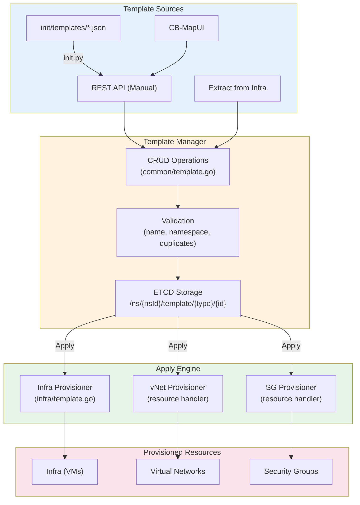
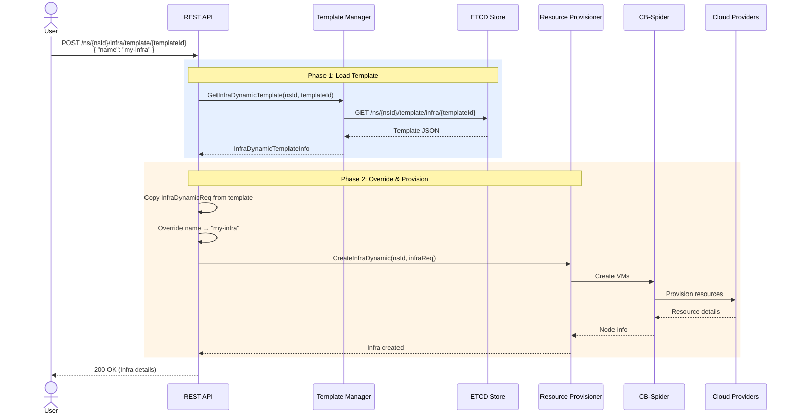
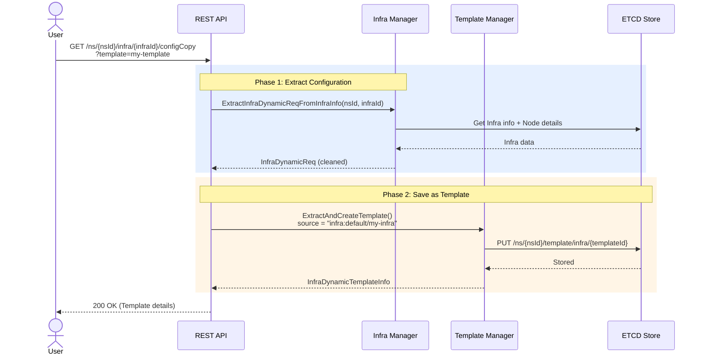
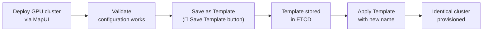
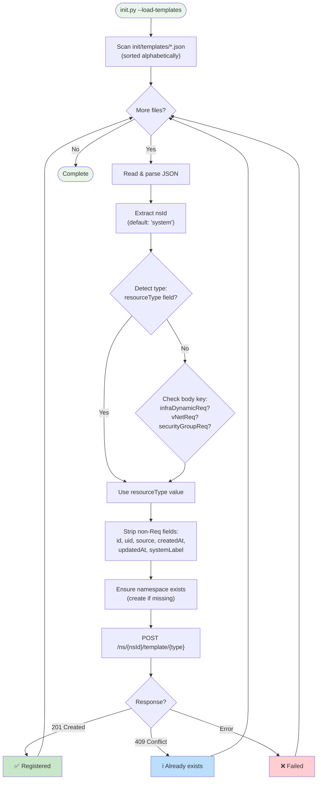

# 리소스 템플릿 관리 (Resource Template Management)

CB-Tumblebug에서 재사용 가능한 리소스 템플릿을 관리하고 템플릿 기반으로 프로비저닝하는 방법에 대한 종합 가이드입니다.

## 📑 목차

1. [개요](#개요)
2. [주요 기능](#주요-기능)
3. [아키텍처](#아키텍처)
4. [템플릿 유형](#템플릿-유형)
5. [API 레퍼런스](#api-레퍼런스)
6. [활용 시나리오](#활용-시나리오)
7. [템플릿 파일 형식](#템플릿-파일-형식)
8. [템플릿 로딩 (init.py)](#템플릿-로딩-initpy)
9. [모범 사례](#모범-사례)

---

## 개요

### 리소스 템플릿 관리란?

리소스 템플릿 관리(Resource Template Management)는 사용자가 인프라 구성을 템플릿으로 **정의, 저장, 공유 및 재사용**할 수 있도록 지원하는 CB-Tumblebug의 시스템입니다. 템플릿은 클라우드 리소스(Infra(멀티 클라우드 인프라), vNet(가상 네트워크), SecurityGroup)의 전체 명세를 캡처하여 단일 API 호출만으로 동일하거나 유사한 환경을 재현할 수 있게 해줍니다.

### 왜 템플릿을 사용해야 하는가?

**문제점:**
- 멀티 클라우드 인프라를 프로비저닝하려면 수많은 파라미터(스펙, 이미지, 리전, 방화벽 규칙, CIDR 블록 등)를 지정해야 합니다.
- 이전에 배포했던 환경을 수동으로 다시 생성하는 작업은 번거롭고 오류가 발생하기 쉽습니다.
- 검증된 구성을 팀이나 네임스페이스 간에 공유할 표준 메커니즘이 없었습니다.
- GPU 집약적이거나 특수한 워크로드의 경우 세심하게 검증된 구성을 안전하게 보관해야 합니다.

**해결책:**
- **한 번 정의하고 여러 번 배포(Define Once, Deploy Many)**: 정상 동작하는 구성을 템플릿으로 저장하고 여러 네임스페이스에서 재사용합니다.
- **실행 중인 인프라에서 추출**: 운영 중인 Infra의 정확한 구성을 캡처하여 템플릿으로 만듭니다.
- **사전 구축된 템플릿(Pre-built Templates)**: 일반적인 구성(웹 서버, GPU 클러스터, VPC 레이아웃)을 JSON 파일로 기본 제공합니다.
- **원클릭 프로비저닝**: 이름만 지정하여 템플릿을 적용하면 실제 리소스가 즉시 생성됩니다.

### 핵심 요약

✅ **세 가지 리소스 유형**: Infra, vNet, SecurityGroup을 위한 템플릿 지원  
✅ **완전한 CRUD**: 모든 템플릿 유형에 대한 생성, 조회, 수정, 삭제 작업 지원  
✅ **적용(Apply) 워크플로**: 템플릿에서 직접 실제 리소스를 프로비저닝  
✅ **Infra에서 추출**: 실행 중인 Infra의 구성을 재사용 가능한 템플릿으로 캡처  
✅ **파일 기반 로딩**: 초기화 시 `init/templates/*.json`에서 사전 구축된 템플릿 로드  
✅ **네임스페이스 범위 지정**: 논리적 격리를 위해 네임스페이스 단위로 템플릿을 구성  
✅ **레이블 보존**: 사용자 정의 레이블(예: `accelerator: gpu`)이 템플릿에 그대로 보존됨  
✅ **적용 시 이름 재정의(Override)**: 템플릿 본문은 그대로 유지되며, 적용 시점에 리소스 이름과 설명만 커스터마이징됨  

---

## 주요 기능

### 1. 템플릿 수명 주기 (Template Lifecycle)

```
Define → Store → Share → Apply → Provision
```

템플릿은 단순한 수명 주기를 따릅니다:

1. **정의(Define)**: 리소스 구성을 지정합니다(수동 작성, JSON 파일 로드, 또는 실행 중인 Infra에서 추출).
2. **저장(Store)**: 네임스페이스 범위 내의 ETCD에 저장합니다.
3. **공유(Share)**: `system` 네임스페이스의 템플릿은 공유 카탈로그 역할을 합니다(적용하기 전에 대상 네임스페이스로 복사하여 사용).
4. **적용(Apply)**: 단일 API 호출로 템플릿에서 실제 클라우드 리소스를 생성합니다.
5. **반복 개선(Iterate)**: 요구사항이 변화함에 따라 템플릿 설명이나 구성을 업데이트합니다.

### 2. 실행 중인 인프라에서 추출

임시(Ad-hoc) 프로비저닝과 반복 가능한 배포 사이의 간극을 메우는 고유 기능입니다:

```
Running Infra → Extract Configuration → Save as Template → Redeploy Anywhere
```

- 스펙 ID, 이미지 ID, 디스크 구성, 연결 이름(Connection Name), 사용자 레이블을 캡처합니다.
- 런타임 고유 데이터(UID, IP, CSP 리소스 ID, 시스템 레이블)는 제거합니다.
- 추적성을 위해 출처(Source)를 `"infra:{nsId}/{infraId}"`로 기록합니다.

### 3. 재정의(Override)를 통한 적용

템플릿을 적용할 때 **이름**(name)과 선택적으로 **설명**(description)만 재정의됩니다. 그 외의 모든 구성은 템플릿에서 변경 없이 그대로 가져옵니다:

```jsonc
// Apply request — minimal input
{
  "name": "my-new-infra",
  "description": "Production deployment from template"
}
```

이를 통해 일관성이 보장됩니다. 즉, 동일한 템플릿은 항상 동일한 인프라 토폴로지를 생성합니다.

### 4. 사전 구축된 템플릿 파일

CB-Tumblebug은 `init/templates/` 디렉터리에 즉시 사용 가능한 템플릿 파일들을 기본 포함하고 있습니다:

| 파일 | 유형 | 설명 |
|------|------|-------------|
| `aws-small-web.json` | Infra | AWS 서울 리전의 단일 t3.small 웹 서버 |
| `llm-bench-gpu.json` | Infra | 멀티 클라우드 GPU 클러스터 (NVIDIA L4, L40S, AMD V710) |
| `aws-standard-vpc.json` | vNet | 표준 3-서브넷 VPC 레이아웃 |
| `aws-web-sg.json` | SecurityGroup | 웹 서버 방화벽 규칙 (SSH, HTTP, HTTPS) |

이 파일들은 `make init` 또는 `./init/init.sh --load-templates-only` 실행 시 자동으로 로드됩니다.

---

## 아키텍처

### 시스템 구성 요소



### ETCD 키 패턴

템플릿은 다음과 같은 키 구조로 ETCD에 저장됩니다:

```
/ns/{nsId}/template/{templateType}/{templateId}
```

**예시:**
```
/ns/system/template/infra/aws-small-web
/ns/default/template/vNet/aws-standard-vpc
/ns/default/template/securityGroup/aws-web-sg
```

`templateId`가 생략되면 해당 프리픽스를 사용하여 특정 유형의 모든 템플릿 목록을 조회합니다.

### 적용(Apply) 워크플로



### 추출(Extract) 워크플로



---

## 템플릿 유형

### 1. Infra 템플릿 (멀티 클라우드 인프라)

전체 멀티 클라우드 노드 배포 명세를 캡처합니다:

```json
{
  "resourceType": "infra",
  "id": "llm-bench-gpu",
  "name": "llm-bench-gpu",
  "description": "LLM benchmarking Infra with GPU VMs",
  "source": "user",
  "createdAt": "2026-03-10T09:00:00Z",
  "updatedAt": "2026-03-10T09:00:00Z",
  "infraDynamicReq": {
    "nodeGroups": [
      {
        "name": "nvidial4",
        "nodeGroupSize": 1,
        "label": { "accelerator": "gpu" },
        "description": "NVIDIA L4 GPU node",
        "specId": "aws+us-east-2+g6.2xlarge",
        "imageId": "ami-0503ed50b531cc445",
        "rootDiskType": "gp2",
        "rootDiskSize": 200,
        "connectionName": "aws-us-east-2"
      }
    ]
  }
}
```

**`infraDynamicReq.nodeGroups[]`의 주요 필드:**

| 필드 | 필수 여부 | 설명 |
|-------|----------|-------------|
| `name` | 예 | NodeGroup 이름 (노드 이름 프리픽스) |
| `nodeGroupSize` | 아니요 | 이 그룹 내의 VM 수 (기본값: 1) |
| `specId` | 예 | 컴퓨트 스펙 ID (예: `aws+us-east-2+g6.2xlarge`) |
| `imageId` | 예 | OS 이미지 ID (예: AWS의 경우 AMI) |
| `label` | 아니요 | 사용자 정의 레이블 (예: `{"accelerator": "gpu"}`) |
| `rootDiskType` | 아니요 | 디스크 유형 (예: `gp2`, `gp3`, `PremiumSSD`) |
| `rootDiskSize` | 아니요 | 디스크 크기 (GB 단위) |
| `connectionName` | 아니요 | 사용할 CSP 연결(Connection) 이름 |
| `zone` | 아니요 | 배치를 위한 가용 영역(Availability Zone) |

### 2. vNet 템플릿 (가상 네트워크)

서브넷을 포함한 VPC/VNet 구성을 캡처합니다:

```json
{
  "resourceType": "vNet",
  "id": "aws-standard-vpc",
  "name": "aws-standard-vpc",
  "description": "Standard AWS VPC with 3 subnets",
  "source": "user",
  "vNetReq": {
    "connectionName": "aws-ap-northeast-2",
    "cidrBlock": "10.0.0.0/16",
    "subnetInfoList": [
      { "name": "public-subnet", "ipv4_CIDR": "10.0.1.0/24" },
      { "name": "private-subnet", "ipv4_CIDR": "10.0.2.0/24" },
      { "name": "database-subnet", "ipv4_CIDR": "10.0.3.0/24" }
    ]
  }
}
```

### 3. SecurityGroup 템플릿

방화벽 규칙을 캡처합니다:

```json
{
  "resourceType": "securityGroup",
  "id": "aws-web-sg",
  "name": "aws-web-sg",
  "description": "Web server security group (SSH, HTTP, HTTPS)",
  "source": "user",
  "securityGroupReq": {
    "connectionName": "aws-ap-northeast-2",
    "vNetId": "default-shared-aws-ap-northeast-2",
    "firewallRules": [
      { "ports": "22", "protocol": "TCP", "direction": "inbound", "cidr": "0.0.0.0/0" },
      { "ports": "80", "protocol": "TCP", "direction": "inbound", "cidr": "0.0.0.0/0" },
      { "ports": "443", "protocol": "TCP", "direction": "inbound", "cidr": "0.0.0.0/0" }
    ]
  }
}
```

---

## API 레퍼런스

### Infra 템플릿 CRUD

| 메서드 | 엔드포인트 | 설명 |
|--------|----------|-------------|
| `POST` | `/ns/{nsId}/template/infra` | Infra 템플릿 생성 |
| `GET` | `/ns/{nsId}/template/infra` | 모든 Infra 템플릿 목록 조회 (`?filterKeyword=` 선택 사항) |
| `GET` | `/ns/{nsId}/template/infra/{templateId}` | 특정 Infra 템플릿 조회 |
| `PUT` | `/ns/{nsId}/template/infra/{templateId}` | Infra 템플릿 수정 |
| `DELETE` | `/ns/{nsId}/template/infra/{templateId}` | 특정 Infra 템플릿 삭제 |
| `DELETE` | `/ns/{nsId}/template/infra` | 모든 Infra 템플릿 삭제 |

### Infra 템플릿 적용 및 추출

| 메서드 | 엔드포인트 | 설명 |
|--------|----------|-------------|
| `POST` | `/ns/{nsId}/infra/template/{templateId}` | 템플릿 적용 → Infra 생성 (`?option=hold` 선택 사항) |
| `GET` | `/ns/{nsId}/infra/{infraId}/configCopy` | Infra 구성 추출 (템플릿으로 저장하려면 `?template={name}` 지정) |

### vNet 템플릿 CRUD

| 메서드 | 엔드포인트 | 설명 |
|--------|----------|-------------|
| `POST` | `/ns/{nsId}/template/vNet` | vNet 템플릿 생성 |
| `GET` | `/ns/{nsId}/template/vNet` | vNet 템플릿 목록 조회 (`?filterKeyword=` 선택 사항) |
| `GET` | `/ns/{nsId}/template/vNet/{templateId}` | 특정 vNet 템플릿 조회 |
| `PUT` | `/ns/{nsId}/template/vNet/{templateId}` | vNet 템플릿 수정 |
| `DELETE` | `/ns/{nsId}/template/vNet/{templateId}` | 특정 vNet 템플릿 삭제 |
| `DELETE` | `/ns/{nsId}/template/vNet` | 모든 vNet 템플릿 삭제 |

### vNet 템플릿 적용

| 메서드 | 엔드포인트 | 설명 |
|--------|----------|-------------|
| `POST` | `/ns/{nsId}/resources/vNet/template/{templateId}` | 템플릿 적용 → vNet 생성 |

### SecurityGroup 템플릿 CRUD

| 메서드 | 엔드포인트 | 설명 |
|--------|----------|-------------|
| `POST` | `/ns/{nsId}/template/securityGroup` | SecurityGroup 템플릿 생성 |
| `GET` | `/ns/{nsId}/template/securityGroup` | SecurityGroup 템플릿 목록 조회 (`?filterKeyword=` 선택 사항) |
| `GET` | `/ns/{nsId}/template/securityGroup/{templateId}` | 특정 SecurityGroup 템플릿 조회 |
| `PUT` | `/ns/{nsId}/template/securityGroup/{templateId}` | SecurityGroup 템플릿 수정 |
| `DELETE` | `/ns/{nsId}/template/securityGroup/{templateId}` | 특정 SecurityGroup 템플릿 삭제 |
| `DELETE` | `/ns/{nsId}/template/securityGroup` | 모든 SecurityGroup 템플릿 삭제 |

### SecurityGroup 템플릿 적용

| 메서드 | 엔드포인트 | 설명 |
|--------|----------|-------------|
| `POST` | `/ns/{nsId}/resources/securityGroup/template/{templateId}` | 템플릿 적용 → SecurityGroup 생성 |

**총 21개의 템플릿 관련 REST 엔드포인트 제공**

### 예제: Infra 템플릿 생성 및 적용

**1단계: 템플릿 생성**
```bash
curl -X POST "http://localhost:1323/tumblebug/ns/default/template/infra" \
  -u default:default \
  -H "Content-Type: application/json" \
  -d '{
    "name": "my-web-server",
    "description": "Simple web server template",
    "infraDynamicReq": {
      "nodeGroups": [{
        "name": "web",
        "nodeGroupSize": 1,
        "specId": "aws+ap-northeast-2+t3.small",
        "imageId": "ami-01f71f215b23ba262",
        "rootDiskType": "gp3",
        "rootDiskSize": 30
      }]
    }
  }'
```

**2단계: 템플릿 적용 (Infra 프로비저닝)**
```bash
curl -X POST "http://localhost:1323/tumblebug/ns/default/infra/template/my-web-server" \
  -u default:default \
  -H "Content-Type: application/json" \
  -d '{
    "name": "production-web",
    "description": "Production web server deployed from template"
  }'
```

### 예제: 실행 중인 Infra에서 템플릿 추출

```bash
curl -X GET "http://localhost:1323/tumblebug/ns/default/infra/llm-bench/configCopy?template=llm-bench-saved" \
  -u default:default
```

생성된 템플릿에는 출처를 추적할 수 있도록 `source: "infra:default/llm-bench"`가 기록됩니다.

---

## 활용 시나리오

### 시나리오 1: 반복 가능한 GPU 클러스터 배포

연구자가 LLM 벤치마킹을 위한 GPU 클러스터 구성을 검증한 후, 나중에 이를 그대로 다시 생성하고자 합니다.



### 시나리오 2: 표준화된 네트워크 아키텍처

운영 팀이 표준 VPC 레이아웃(퍼블릭/프라이빗/데이터베이스 서브넷)을 정의하고 여러 리전에 일관되게 배포합니다.

1. 표준 CIDR 레이아웃으로 vNet 템플릿을 생성합니다.
2. `connectionName`을 변경하여 각 리전에 템플릿을 적용합니다(향후 개선 사항 — 현재는 템플릿에 지정된 연결이 그대로 사용됨).
3. 모든 리전이 동일한 네트워크 토폴로지를 갖게 됩니다.

### 시나리오 3: 빠른 시작을 위한 사전 구축 템플릿 활용

신규 사용자는 `init/templates/`에 포함된 사전 구축 템플릿으로 빠르게 시작할 수 있습니다:

```bash
# Load all pre-built templates
./init/init.sh --load-templates-only

# List available Infra templates in the system namespace
curl -X GET "http://localhost:1323/tumblebug/ns/system/template/infra" -u default:default

# Deploy directly from the system namespace
curl -X POST "http://localhost:1323/tumblebug/ns/system/infra/template/aws-small-web" \
  -u default:default \
  -d '{"name": "quick-start-web"}'
```

### 시나리오 4: CB-MapUI 연동

CB-MapUI는 템플릿 관리를 위한 시각적 인터페이스를 제공합니다:

- **📄 Save Template**: 현재 Infra 구성을 추출하여 템플릿으로 저장합니다.
- **Template Management Panel**: Infra, vNet, SecurityGroup 템플릿을 탐색, 생성, 적용 및 삭제합니다.
- **Apply with Preview**: 프로비저닝 전에 템플릿 내용을 미리 검토합니다.

---

## 템플릿 파일 형식

`init/templates/` 내의 템플릿 JSON 파일은 다음과 같은 단순한 규칙을 따릅니다:

```json
{
  "nsId": "system",
  "resourceType": "infra",
  "name": "template-name",
  "description": "Human-readable description",
  "<bodyKey>": { ... }
}
```

| 필드 | 필수 여부 | 설명 |
|-------|----------|-------------|
| `resourceType` | 예 | `"infra"`, `"vNet"`, `"securityGroup"` 중 하나 |
| `name` | 예 | 템플릿 식별자 (템플릿 ID가 됨) |
| `description` | 아니요 | 사람이 읽을 수 있는 설명 |
| `nsId` | 아니요 | 대상 네임스페이스 (기본값: `"system"`) |
| `infraDynamicReq` | * | Infra 본문 (`resourceType`이 `"infra"`인 경우 필수) |
| `vNetReq` | * | vNet 본문 (`resourceType`이 `"vNet"`인 경우 필수) |
| `securityGroupReq` | * | SecurityGroup 본문 (`resourceType`이 `"securityGroup"`인 경우 필수) |

**유형 감지 폴백(Fallback)**: `resourceType`이 없는 경우, 로더는 `infraDynamicReq`, `vNetReq`, 또는 `securityGroupReq` 키의 존재 여부를 통해 유형을 자동으로 감지합니다.

### 새 템플릿 파일 추가하기

1. 위의 형식에 맞춰 `init/templates/`에 JSON 파일을 생성합니다.
2. `./init/init.sh --load-templates-only`를 실행하여 등록합니다.
3. API 및 CB-MapUI에서 해당 템플릿을 사용할 수 있게 됩니다.

---

## 템플릿 로딩 (init.py)

### 명령줄 옵션

```bash
# Load templates only
./init/init.sh --load-templates-only

# Load templates as part of full initialization
./init/init.sh

# Direct Python invocation
python3 init/init.py --load-templates
```

### 로딩 프로세스



---

## 모범 사례

### 1. 공유 템플릿에는 `system` 네임스페이스 사용

`system` 네임스페이스의 템플릿은 조직 전체의 청사진(Blueprint) 역할을 합니다:

```json
{
  "nsId": "system",
  "resourceType": "infra",
  "name": "standard-web-server",
  ...
}
```

`system` 네임스페이스는 공유 카탈로그 역할을 수행합니다. 다른 네임스페이스에서 템플릿을 사용하려면 다음 단계를 따르세요:
1. GET API를 통해 `system`에서 템플릿 정의를 읽어옵니다.
2. POST(생성) API를 사용하여 대상 네임스페이스에 동일한 템플릿을 생성합니다.
3. 대상 네임스페이스에서 템플릿을 적용합니다(적용 엔드포인트는 동일한 네임스페이스 내의 템플릿만 조회합니다).

### 2. 설명적인 레이블 포함

레이블은 템플릿 추출 과정에서도 그대로 유지되며 유용한 메타데이터를 제공합니다:

```json
{
  "name": "gpu-worker",
  "label": {
    "accelerator": "gpu",
    "role": "inference",
    "team": "ml-platform"
  },
  "specId": "aws+us-east-2+g6.2xlarge",
  ...
}
```

### 3. 의미 있는 이름과 설명 사용

템플릿 이름은 ID가 되며 생성 후에는 변경할 수 없습니다:

- ✅ `llm-bench-gpu`, `aws-standard-vpc`, `web-server-3tier`
- ❌ `test1`, `temp`, `my-template`

### 4. 삭제 전 추출

세심하게 구성한 복잡한 Infra를 삭제하기 전에 다음을 수행하세요:

1. CB-MapUI에서 **📄 Save Template**을 클릭합니다(또는 추출 API 호출).
2. 템플릿이 정상적으로 저장되었는지 확인합니다.
3. 그 후 Infra를 안전하게 삭제합니다(구성은 보존됨).

### 5. 명명 규칙을 통한 버전 관리

템플릿 이름은 변경할 수 없으므로(Immutable), 버전 관리를 위해 명명 규칙을 활용하세요:

```
gpu-cluster-v1
gpu-cluster-v2-a100
gpu-cluster-v3-h100
```

### 6. 스펙/이미지 가용성 검증

템플릿의 스펙과 이미지는 특정 시점의 참조값입니다. 오래된 템플릿을 적용하기 전에 다음을 확인하세요:

- 대상 리전에서 스펙 ID가 여전히 사용 가능한지 확인합니다.
- 이미지 ID가 CSP에 의해 지원 중단(Deprecated)되지 않았는지 확인합니다.
- 전체 프로비저닝 전에 Infra 검토 API(`?option=hold`)를 사용하여 유효성을 검증하는 것을 고려하세요.

---

## 주요 파일 참조 (Key Files Reference)

| 파일 | 용도 |
|------|---------|
| `src/core/model/template.go` | 템플릿 데이터 구조체 (Info, Req, ApplyReq, ListResponse) |
| `src/core/common/template.go` | CRUD 비즈니스 로직 (3가지 유형에 대한 18개 함수) |
| `src/core/infra/template.go` | Infra 적용(Apply) 및 추출(Extract) 로직 |
| `src/interface/rest/server/infra/template.go` | Infra 템플릿 REST 핸들러 |
| `src/interface/rest/server/resource/template.go` | vNet 및 SecurityGroup 템플릿 REST 핸들러 |
| `src/interface/rest/server/server.go` | 라우트 등록 |
| `init/templates/*.json` | 사전 구축된 템플릿 파일들 |
| `init/init.py` | 템플릿 파일 로딩 로직 |
