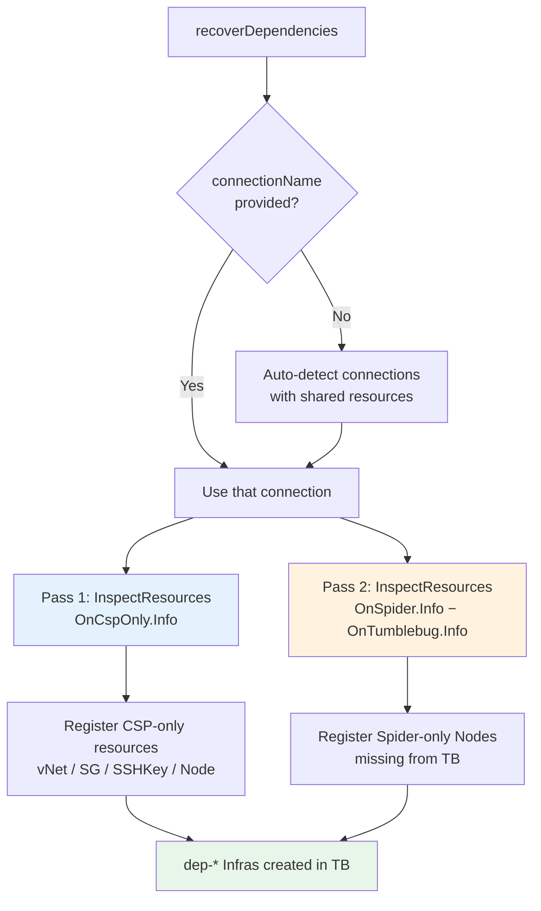
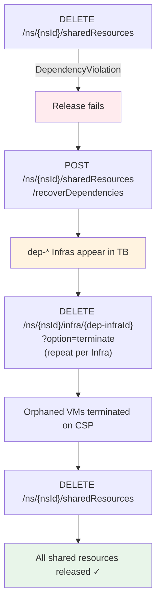

# 공유 리소스 관리 (Shared Resource Management)

이 문서는 CB-Tumblebug의 **공유 리소스(Shared Resources)** 개념 — 공유 리소스가 무엇인지, 어떻게 해제(Release)하는지, 그리고 고아(Orphaned) CSP 리소스로 인해 발생하는 의존성 위반(Dependency Violation) 문제를 어떻게 복구하는지 설명합니다.

## 🔑 공유 리소스란 무엇인가?

Infra가 프로비저닝될 때, CB-Tumblebug는 클라우드 연결(Connection)별로 일련의 **네트워크 사전 요구 사항**을 자동으로 생성합니다. 동일한 네임스페이스 내의 여러 Infra가 중복 생성 없이 이를 재사용할 수 있기 때문에 이를 **공유 리소스**(Shared Resources)라고 부릅니다.

세 가지 리소스 유형은 다음과 같습니다:

| 유형 | 역할 |
|---|---|
| **VNet** (+ Subnet) | 해당 연결 내 모든 Node에 대한 네트워크 경계 |
| **SecurityGroup** | 각 Node에 적용되는 기본 인바운드/아웃바운드 규칙 |
| **SSHKey** | Node 접속에 사용되는 키 페어 |

**명명 규칙 (Naming convention):** `{nsId}-shared-{connectionName}[-{zone}]`

예시: `default-shared-aws-ap-northeast-2`

공유 리소스는 지연 생성(Lazy creation) 방식을 따릅니다 — 특정 연결에 대해 첫 번째 Infra가 생성될 때 만들어지며, 명시적으로 해제될 때까지 유지됩니다.

## 🔄 수명 주기 (Lifecycle)

```mermaid
flowchart LR
    A[POST /infra] -->|first use| B[Create Shared Resources]
    B --> C[Provision Nodes]
    C --> D[Running Infra]
    D -->|DELETE /infra| E[Terminate Nodes]
    E -->|shared resources remain| F[Idle Shared Resources]
    F -->|DELETE /sharedResources| G[Released]

    style B fill:#fff3e0
    style G fill:#e8f5e9
```



공유 리소스는 Infra가 종료(Terminate)될 때 **삭제되지 않습니다**. 동일한 연결에서 다음 Infra가 사용할 수 있도록 남아 있어 반복적인 프로비저닝 오버헤드를 방지합니다.

## 🗑️ 공유 리소스 해제하기 (Releasing Shared Resources)

네임스페이스가 더 이상 필요하지 않거나 특정 연결의 공유 리소스를 정리해야 할 때 다음 API를 호출합니다:

```
DELETE /tumblebug/ns/{nsId}/sharedResources
```

CB-Tumblebug는 의존성 순서에 따라 리소스를 삭제합니다:

```
SecurityGroup  →  SSHKey  →  VNet
```

응답은 리소스별 결과를 보고합니다:

```json
{
  "total": 6,
  "successCount": 6,
  "failedCount": 0,
  "results": [
    { "resourceType": "securityGroup", "resourceId": "default-shared-aws-ap-south-1", "success": true },
    ...
  ]
}
```

## ⚠️ DependencyViolation: 해제가 실패하는 경우

CSP 측에서 여전히 공유 VNet, SG 또는 SSHKey에 연결된 리소스를 가지고 있는 경우, 삭제 작업은 `DependencyViolation` 에러와 함께 실패할 수 있습니다:

```json
{
  "resourceType": "securityGroup",
  "resourceId": "default-shared-aws-ap-south-1",
  "success": false,
  "message": "DependencyViolation: resource sg-07507b9b17864d82d has a dependent object"
}
```

### 근본 원인 (Root Cause)

이 문제는 부분 실패(Partial failure)나 강제 정리(Forced cleanup) 등으로 인해 Node(VM)가 **CSP에서 실제로 종료되지 않은 채** CB-TB의 레지스트리에서만 제거되었을 때 발생합니다. 해당 VM은 공유 SG, SSHKey 및 VNet에 대한 참조를 계속 유지하므로 이들의 삭제를 가로막게 됩니다.

> 💡 **가장 흔한 원인은 `DELETE /infra/{infraId}?option=force`입니다.** 이 옵션은 "노드가 반드시 Terminated 상태여야 한다"는 사전 조건을 건너뛰고 CB-TB 메타데이터를 즉시 삭제하므로, CSP에 아직 살아 있는 모든 노드는 고아(Orphan) 상태가 됩니다 — 즉, 계속 과금이 발생하고 공유 리소스를 붙잡아 두게 됩니다. 따라서 `option=terminate`를 사용하고, 종료가 아직 진행 중이라면 잠시 후 다시 시도하세요. 어쩔 수 없이 `force`를 사용한 경우, 이제 응답에 위험에 처한 노드 목록을 알려주는 경고 메시지가 포함됩니다:
>
> ```
> [WARNING] 1 node(s) may remain on the CSP: n-1(i-0a2a9a21c2b0050a8,Running)
>           — verify with POST /tumblebug/inspectResources (resourceType: node) and terminate leftovers
> ```
>
> 함께 보기: [인프라 프로비저닝 → 정리하기](infra-provisioning.md).

이러한 VM들을 **고아 리소스**(Orphaned resources)라고 부릅니다. 이들은 CB-TB에서는 보이지 않는 다음 두 가지 상태 중 하나로 존재합니다:

| 상태 | 설명 |
|---|---|
| **CSP-only** | CSP에는 존재하지만 CB-Spider에 등록된 적이 없음 |
| **Spider-only** | CB-Spider에는 등록되어 있지만 CB-TB의 레지스트리에서 제거됨 |

두 유형 모두 일반적인 `GET /infra` 목록 조회로는 감지되지 않으며, CB-TB에 해당 기록이 없기 때문에 표준 삭제 흐름을 통해 정리할 수도 없습니다.

## 🔧 의존성 복구 (Dependency Recovery)

`recoverDependencies` API는 두 가지 유형의 고아 리소스를 모두 찾아내어 `dep-` 접두사가 붙은 Infra 아래에 CB-TB로 등록함으로써, 일반적인 수명 주기 관리를 통해 조회하고 삭제할 수 있게 만듭니다.

```
POST /tumblebug/ns/{nsId}/sharedResources/recoverDependencies
```

### 작동 원리 (How It Works)



**Pass 1**은 CSP에는 존재하지만 CB-Spider는 알지 못하는 리소스를 처리합니다.  
**Pass 2**는 CB-Spider는 이미 알고 있지만 CB-TB가 추적을 잃어버린 VM을 처리합니다 — 이는 실제 환경에서 발생하는 `DependencyViolation` 에러의 가장 흔한 원인입니다.

### 요청 (Request)

**경로 파라미터 (Path parameter):** `nsId` — 스캔할 네임스페이스

**본문 (Body, 모든 필드 선택 사항):**

| 필드 | 기본값 | 설명 |
|---|---|---|
| `connectionName` | _(비어 있음)_ | 스캔 대상을 단일 연결로 제한합니다. 비어 있으면 해당 네임스페이스에 공유 리소스가 있는 모든 연결을 자동으로 스캔합니다. |
| `infraNamePrefix` | `dep` | 의존성 복구 목적임을 나타내기 위해 등록되는 Infra 이름에 적용할 접두사입니다. |

**쿼리 파라미터 (Query parameter):**

| 파라미터 | 기본값 | 설명 |
|---|---|---|
| `option` | `vNet,securityGroup,sshKey,node` | 스캔할 CSP 리소스 유형 (CSV 형식). |

**예제 — 모든 연결 자동 스캔:**
```bash
curl -X POST "http://localhost:1323/tumblebug/ns/default/sharedResources/recoverDependencies" \
  -H "Content-Type: application/json" \
  -d '{}'
```

**예제 — 특정 단일 연결 스캔:**
```bash
curl -X POST "http://localhost:1323/tumblebug/ns/default/sharedResources/recoverDependencies" \
  -H "Content-Type: application/json" \
  -d '{"connectionName": "aws-ap-south-1"}'
```

### 응답 (Response)

```json
{
  "elapsedTime": 9,
  "registeredConnection": 3,
  "availableConnection": 3,
  "registerationOverview": {
    "vNet": 0, "securityGroup": 0, "sshKey": 1, "node": 3, "failed": 0
  },
  "registerationResult": [
    {
      "connectionName": "aws-ap-south-1",
      "elapsedTime": 4,
      "registerationOverview": { "node": 1 },
      "registerationOutputs": {
        "output": ["node: aws-ap-south-1-i-0a844072b4f88d073"]
      }
    }
  ]
}
```

`registerationOverview.node` 카운트가 0보다 크면 고아 VM이 발견되어 등록되었음을 확인할 수 있습니다.

## 🚀 전체 복구 흐름 (Full Recovery Flow)



### 단계별 가이드 (Step-by-step)

**1. 해제 시도 (어떤 연결이 실패하는지 확인)**
```bash
curl -X DELETE "http://localhost:1323/tumblebug/ns/default/sharedResources"
```

**2. 고아 상태의 의존성 리소스 등록**
```bash
curl -X POST "http://localhost:1323/tumblebug/ns/default/sharedResources/recoverDependencies" \
  -H "Content-Type: application/json" -d '{}'
```

**3. 등록된 dep-* Infra 목록 조회**
```bash
curl "http://localhost:1323/tumblebug/ns/default/infra"
```

**4. CB-TB를 통해 각 고아 VM 종료**
```bash
curl -X DELETE \
  "http://localhost:1323/tumblebug/ns/default/infra/dep-i-0a844072b4f88d073?option=terminate"
```

**5. 공유 리소스 해제 재시도**
```bash
curl -X DELETE "http://localhost:1323/tumblebug/ns/default/sharedResources"
```

## 📋 API 요약

| 메서드 | 경로 | 설명 |
|---|---|---|
| `POST` | `/ns/{nsId}/sharedResource` | 특정 연결에 대한 공유 리소스 생성 |
| `DELETE` | `/ns/{nsId}/sharedResources` | 네임스페이스 내 모든 공유 리소스 해제 |
| `POST` | `/ns/{nsId}/sharedResources/recoverDependencies` | 삭제를 가로막고 있는 고아 CSP 리소스 등록 |
