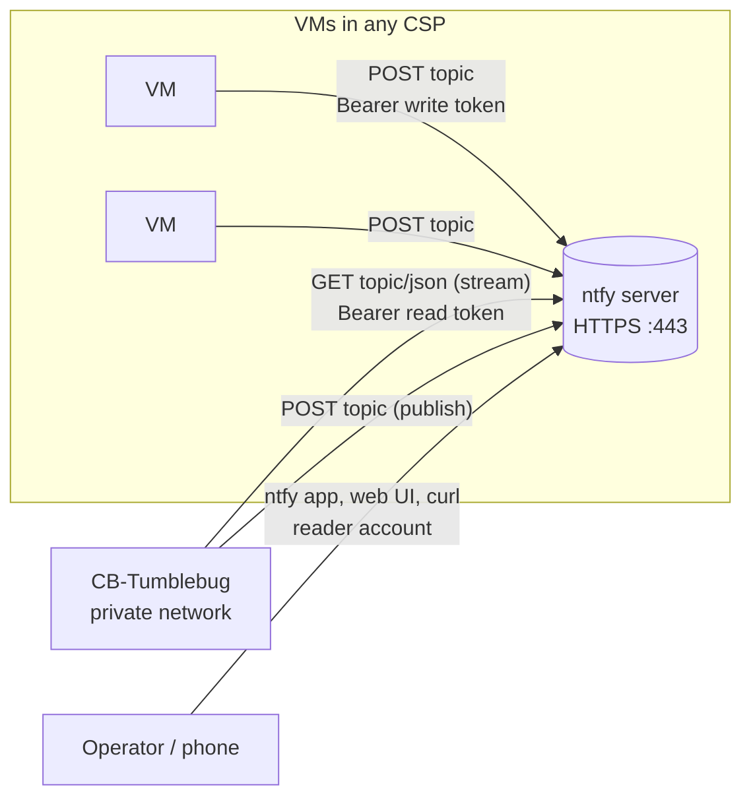

# Notifier (ntfy)

Guide to the notification channel that lets VMs and CB-Tumblebug exchange messages through a self-hosted or external [ntfy](https://ntfy.sh) server.

## 📑 Table of Contents

1. [Overview](#overview)
2. [Architecture](#architecture)
3. [Setting Up a Notifier](#setting-up-a-notifier)
4. [Subscriber Accounts](#subscriber-accounts)
5. [Publishing and Receiving Messages](#publishing-and-receiving-messages)
6. [MapUI](#mapui)
7. [API Reference](#api-reference)
8. [Security Model](#security-model)
9. [Limitations and Troubleshooting](#limitations-and-troubleshooting)

---

## Overview

### What is the Notifier?

The **Notifier** is a single notification channel per CB-Tumblebug deployment, backed by an ntfy topic.
CB-Tumblebug subscribes to the topic, VMs publish to it, and operators can publish or subscribe as well.

CB-Tumblebug can either **register an existing ntfy server** or **provision one itself** from the
`infra-ntfy` template: a small VM is created, ntfy is installed with token authentication and TLS,
and the result is registered automatically.

### Why Use It?

**Problem:**
- CB-Tumblebug is usually deployed inside a private network. VMs in public clouds cannot reach it,
  so a VM has no way to report "my bootstrap finished" or "my job failed".
- Polling thousands of VMs over SSH to learn their state does not scale.

**Solution:**
- Both sides connect **outbound** to the ntfy server: VMs publish, CB-Tumblebug subscribes.
  No inbound path to CB-Tumblebug is required.
- A write-only token is handed to VMs; CB-Tumblebug keeps a read-only token.
- Messages carry `kind`, `nsId`, `infraId`, `nodeGroupId`, `nodeId` as JSON so CB-Tumblebug can
  route them to handlers (for example, future init-script completion reports).

### Key Highlights

✅ **One-call provisioning**: `POST /tumblebug/notifier/ntfy` creates the VM, installs ntfy, issues a certificate and registers the channel.
✅ **Two TLS modes**: self-signed certificate (IP address URL) or Let's Encrypt via a Route53 domain managed by CB-Tumblebug.
✅ **Scoped tokens**: write-only for publishers, read-only for CB-Tumblebug, `deny-all` for everyone else.
✅ **Subscriber accounts**: read-only ntfy users for people, usable from the ntfy mobile app or web UI.
✅ **Clean removal**: deleting a managed notifier removes the VM, DNS record, security group, SSH key and vNet.

---

## Architecture



| Component | Role |
|-----------|------|
| `src/core/notifier` | Registration store (etcd `/system/notifier`), subscriber goroutine with reconnect and `since=` resume, publish, round-trip test, recent-message buffer, `RegisterHandler(kind, fn)` for consumers |
| `src/core/embedded/scripts/install-ntfy.sh` | Install script embedded with `//go:embed`; installs the ntfy `.deb` from GitHub releases, configures tokens and TLS |
| `init/templates/infra-ntfy.json`, `sg-ntfy.json` | One-VM template (AWS t3.micro by default) and security group (443, 80, 22) |
| `POST /tumblebug/notifier/ntfy` | Orchestrates: provision from template → optional Route53 record → run install script over SSH → register → round-trip test |

The install script runs as root on the VM. All parameters are passed as `TB_NTFY_*` environment
variables, so the same script can be run by hand (see `scripts/notifier/README.md`).

---

## Setting Up a Notifier

Only one notifier can be registered per CB-Tumblebug instance.

### Option A: Provision a managed server (self-signed)

```bash
curl -u default:default -X POST http://localhost:1323/tumblebug/notifier/ntfy
```

Creates Infra `ntfy` in the `system` namespace (override with `nsId`, `name`, `templateId`),
installs ntfy with a self-signed certificate whose SAN is the public IP, and registers
`https://<public-ip>`. Takes about 1.5 to 3 minutes. The CA certificate is stored in the registration
(`caCert`) and must be trusted by clients; phone apps cannot subscribe to this mode.

If the install step fails, send the same request again: an existing Infra of the same name is reused
and the installation is retried.

### Option B: Provision with a domain and Let's Encrypt certificate

Requires a Route53 hosted zone visible to CB-Tumblebug (see [Global DNS Management](global-dns-management.md)).

```bash
curl -u default:default -X POST http://localhost:1323/tumblebug/notifier/ntfy \
  -H 'Content-Type: application/json' -d '{"domainName":"example.com"}'
```

CB-Tumblebug picks a free record name `ntfy-<3 random chars>.example.com`, creates the A record,
waits for it to resolve, obtains a Let's Encrypt certificate with certbot (HTTP-01 on port 80) and
registers `https://ntfy-xxx.example.com`. Renewal is handled by the certbot timer with a deploy hook that
restarts ntfy. `upstream-base-url` is set to `https://ntfy.sh` so the iOS app receives push notifications.

Pass `recordName` to choose the name yourself; a name that already exists is rejected rather than overwritten.
Random names are the default because Let's Encrypt limits certificates per exact hostname (5 per week).

### Option C: Register an existing ntfy server

```bash
curl -u default:default -X PUT http://localhost:1323/tumblebug/notifier \
  -H 'Content-Type: application/json' \
  -d '{"url":"https://ntfy.example.com","topic":"tb-notify","writeToken":"tk_...","readToken":"tk_...","caCert":"-----BEGIN CERTIFICATE-----..."}'
```

`caCert` is only needed for a self-signed server. CB-Tumblebug checks `/v1/health` and starts subscribing.

### Option D: Environment variables

Set `TB_NOTIFIER_NTFY_URL`, `TB_NOTIFIER_NTFY_TOPIC`, `TB_NOTIFIER_NTFY_WRITE_TOKEN`,
`TB_NOTIFIER_NTFY_READ_TOKEN` and optionally `TB_NOTIFIER_NTFY_CA_CERT_FILE` (see `conf/setup.env`,
or `tumblebug.notifier.*` in the Helm values). They seed the registration at startup only when none is
stored; the API takes precedence afterwards.

### Checking and removing

```bash
curl -u default:default http://localhost:1323/tumblebug/notifier                 # tokens masked
curl -u default:default "http://localhost:1323/tumblebug/notifier?showSecrets=true"
curl -u default:default -X POST http://localhost:1323/tumblebug/notifier/test     # publish → receive round trip
curl -u default:default -X DELETE "http://localhost:1323/tumblebug/notifier?deleteInfra=true"
```

With `deleteInfra=true` a managed notifier's Infra is terminated and deleted together with its DNS record,
security group, SSH key and vNet. Without it only the registration is removed.

---

## Subscriber Accounts

People subscribe with their own read-only ntfy user instead of the shared token. Accounts are created on
a managed server only.

```bash
curl -u default:default -X POST http://localhost:1323/tumblebug/notifier/reader \
  -H 'Content-Type: application/json' -d '{"name":"alice"}'
```

The response contains the password **once** (CB-Tumblebug does not store it), the server URL, the topic
and, for a self-signed server, the CA certificate. The account can read the topic and nothing else.

In the ntfy app: Settings → Manage users → add the server URL with this account, then Subscribe to
topic → use another server → enter the URL and topic. This requires the Let's Encrypt mode; with a
self-signed certificate use the web UI or curl:

```bash
curl -u alice:<password> https://ntfy-xxx.example.com/<topic>/json
```

List with `GET /tumblebug/notifier/reader`, remove with `DELETE /tumblebug/notifier/reader/{name}`.

---

## Publishing and Receiving Messages

### From a VM

```bash
curl -H "Authorization: Bearer $TB_NOTIFY_TOKEN" \
  -d '{"kind":"initScript","nsId":"default","infraId":"infra-01","nodeGroupId":"g1","nodeId":"g1-1","status":"ok"}' \
  https://ntfy-xxx.example.com/<topic>
```

Add `--cacert ca.pem` for a self-signed server. Any body is accepted; when it is JSON, CB-Tumblebug
extracts `kind`, `nsId`, `infraId`, `nodeGroupId` and `nodeId`.

### From CB-Tumblebug

```bash
curl -u default:default -X POST http://localhost:1323/tumblebug/notifier/publish \
  -H 'Content-Type: application/json' -d '{"kind":"custom","data":{"text":"deployment finished"}}'
```

### Reading what CB-Tumblebug received

```bash
curl -u default:default "http://localhost:1323/tumblebug/notifier/messages?limit=50"
```

CB-Tumblebug keeps the latest 200 messages in memory and persists the last message id, so after a
restart the subscription resumes where it stopped. Internal consumers register with
`notifier.RegisterHandler(kind, fn)`.

---

## MapUI

Left panel → **📦 Resource Provisioning** → **🔔 Notifier (ntfy)** opens a dialog that covers the whole
lifecycle: create a managed server (hosted zones are listed; leave Record empty for `ntfy-xxx`), register
an existing server, round-trip test, subscriber accounts (password shown once with show/hide and copy),
recent messages and publishing, and unregistration with an option to delete the VM.

---

## API Reference

All endpoints are global (not namespaced) and require the CB-Tumblebug API credentials.

| Method | Path | Description |
|--------|------|-------------|
| `GET` | `/tumblebug/notifier` | Registered notifier (204 when none). Tokens masked unless `showSecrets=true` |
| `PUT` | `/tumblebug/notifier` | Register an existing ntfy server. `url` must be `http(s)://host[:port][/path]` (no credentials, query or fragment; link-local and metadata addresses rejected) and `topic` 1-64 of `A-Za-z0-9_-` |
| `DELETE` | `/tumblebug/notifier` | Unregister. `deleteInfra=true` also deletes the managed Infra and its resources |
| `POST` | `/tumblebug/notifier/ntfy` | Provision from template and register. Body: `nsId`, `templateId`, `name`, `domainName`, `recordName` (all optional) |
| `POST` | `/tumblebug/notifier/test` | Publish/subscribe round-trip test |
| `POST` | `/tumblebug/notifier/publish` | Publish `{kind, data}` |
| `GET` | `/tumblebug/notifier/messages` | Recent received messages, `limit` (default 50) |
| `POST` | `/tumblebug/notifier/reader` | Create a read-only account `{name, password?}` |
| `GET` | `/tumblebug/notifier/reader` | List read-only accounts |
| `DELETE` | `/tumblebug/notifier/reader/{name}` | Remove a read-only account |

---

## Security Model

- The ntfy server denies anonymous access. Three principals exist: `tb-writer` (write-only token,
  given to VMs), `tb-reader` (read-only token, used by CB-Tumblebug) and reader accounts (read-only, per person).
- The write token travels in VM user data or command lines, so treat it as low-value: it only allows
  posting messages to the topic. Never put secrets in messages.
- Everything behind the CB-Tumblebug API follows the CB-Tumblebug trust model: anyone authenticated to the
  API is an administrator, including `showSecrets=true`.
- Tokens, passwords and PEM blocks are masked in CB-Tumblebug logs.

---

## Limitations and Troubleshooting

| Symptom | Cause / Action |
|---------|----------------|
| `ntfy install failed ... Could not resolve host` | The VM has no outbound internet. Installation downloads the ntfy package (GitHub) and, with a domain, certbot and Let's Encrypt |
| `DNS for ... does not resolve` | Route53 propagation took longer than 3 minutes, or the hosted zone is not authoritative for the domain |
| Phone app asks for login / fails to connect | Create a subscriber account; the Let's Encrypt mode is required for apps. Self-signed servers work only with the web UI or curl |
| `a notifier is already registered` | Only one notifier per deployment. Unregister first |
| Round-trip test fails after registration | CB-Tumblebug cannot reach the server URL (firewall, wrong CA) or the read token lacks access to the topic |
| Messages missing after a burst | The in-memory buffer holds 200 messages; consumers should use handlers rather than the list endpoint |

Repeated creations with an explicit `recordName` may hit the Let's Encrypt limit of 5 certificates per
week for the same hostname; leave `recordName` empty to get a fresh random name.
